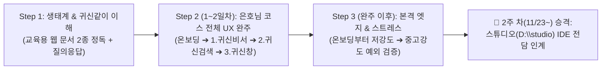

# 🎯 Ghosti QA 2-Track 테스팅 체계 및 역할별 미션 발급 운영 명세서

> **문서 버전:** v2.0 (2026-11-13 신규 투입 요원 한소희 님 『귀신같이』 100% 올인 코스 · 1~2일차 은호님 코스 전체 UX 완주 · 2주 차 스튜디오 IDE 로드맵 및 노션 `담당(UX/로직)` 태그 확정 반영)  
> **적용 대상:** Ghosti 전담 AI 에이전트(`1귀신`/`2귀신`/`3귀신`), 노션 QA 칸반 보드 (`400f9ffd2c1d807fa3e7c705d2b0ceab`), 현장 QA 테스터 2인 (`UX` 조은호 님 / `로직` 한소희 님)  
> **핵심 원칙:**
> 1. **전사 『귀신같이(Ghosti)』 100% 올인 (타 프로젝트 및 알바 코딩 배제)**: 『귀신같이』는 무조건 성공해야 하는 최우선 프로젝트이므로 `00귀신같이` 등 외도 작업은 일절 진행하지 않으며, 신규 알바(한소희 님, 11/16 월요일 출근)에게도 코딩 업무는 부여하지 않고 오직 『귀신같이』 QA 완주 및 검증에 집중합니다.
> 2. **단일 보드 공유 하에 `[UX]`(사용자 경험/동선)와 `[로직]`(전체 UX 완주 후 시스템 엣지/예외 처리) 투트랙 분리** 및 **[Step 1: 생태계·앱 이해 & 질의응답 ➔ Step 2: 1~2일차 은호님 코스(`온보딩 ➔ 1. 귀신비서 ➔ 2. 귀신검색 ➔ 3. 귀신창`) 전체 UX 완주 점검 ➔ Step 3: 완주 후 온보딩부터 본격 엣지 케이스 & 고강도 스트레스 테스팅 ➔ 2주 차: 검증 합격 시 `스튜디오(D:\studio)` IDE 전담 승격]** 단계별 진화형 운영.

---

## 1. 신규 투입 요원(한소희 님, 11/16 월요일 출근) 온보딩 및 단계별 테스팅 파이프라인

새로운 테스터가 합류했을 때 앱의 전체 맥락을 모르는 상태에서 바로 난이도 높은 엣지 케이스로 직행하면 시야가 좁아지고 길을 잃게 됩니다.  
따라서 코딩이나 타 프로젝트(`00귀신같이` 등)를 배제하고, 반드시 아래의 **1주 차 3단계 집중 코스(Step 1 ➔ Step 2 ➔ Step 3) 및 2주 차 스튜디오 IDE 전환 로드맵**을 밟도록 미션을 발급합니다.

### 1.1 [Step 1] 전체 멀린 생태계 & 『귀신같이』 이해 + 질의응답 (사전 정보 습득)
- **필독 교육용 웹 문서 2종 및 비서 마스터 소개서:**
  1. **전체 멀린 생태계 가이드:** `https://sundreamer.app/family-apps.html`
  2. **『귀신같이 자세히 보기』 QA 마스터 가이드:** `https://sundreamer.app/ghosti-guide.html`
  3. **비서 전사 마스터 소개서 하위 상세 페이지:** [`D:\Secretary\docs\파트_1\Ghosti_귀신같이\GHOSTI_APP_INTRO_AND_VISION_GUIDE.md`](file:///d:/Secretary/docs/파트_1/Ghosti_귀신같이/GHOSTI_APP_INTRO_AND_VISION_GUIDE.md)
- **핵심 목표:**
  - 앱 설명을 정독·숙지하고 궁금한 점을 질문·응답하며 멀린 생태계 전체와 『귀신같이』가 왜 태어났는지(클라우드 0원, 0.1초 입말 타격감, 로컬 퍼스트 AI 비서) 완벽히 이해하기.
  - 온보딩 쇼룸과 본 웹 4대 핵심 메뉴(`1. 👻 귀신비서`, `2. 👻 귀신검색`, `3. ⚡ 귀신창`, `4. 📸 사진 공유`) 및 유료 확장 메뉴(`내 기기 통합`)의 전체 구조를 머릿속에 그리기.

### 1.2 [Step 2] 입사 후 1~2일차 — 조은호(해나라) 님이 걸어온 길 그대로 전체 UX 완주 점검
- **미션 성격:** 출근하자마자 엣지 케이스로 바로 들어가지 않고, **첫 하루이틀 동안은 조은호(해나라) 님이 그동안 걸어온 길을 그대로 되짚어보며 `온보딩 ➔ 1. 👻 귀신비서 ➔ 2. 👻 귀신검색 ➔ 3. ⚡ 귀신창 (및 4. 📸 사진 공유)` 전체 UX를 처음부터 끝까지 점검**합니다.
- **수행 항목 (전 구간 1회독 완주 & 일반 버그·UX 불편사항 포착):**
  1. 처음 이 앱을 접하는 일반 사용자의 시선으로 위에서 아래로(좌에서 우로) 화면을 둘러보며, 불필요한 설명(TMI)이 많아 피로하거나 어색한 문구가 없는가?
  2. 버튼이나 아이콘을 봤을 때 설명서 없이도 뭘 눌러야 할지 한눈에 직관적으로 들어오는가?
  3. 기본 동선과 체험 기능을 직접 눌러보며 작동 불량(일반 버그)이나 버벅이는 UI가 있는가?
- **초반 둘러보기 카드 체크박스 예외 규칙 (`<= 5개`):**
  - 기본 노션 QA 철칙은 **1카드당 체크박스 `3개 이하(`<= 3`)`**이나, **오직 `로직` 담당자의 초반 쉬운 길(전체 UX 둘러보기/완주 점검) 카드에 한해서만 1카드당 최대 `5개 이하(`<= 5`)`**로 묶어 흐름이 끊기지 않게 발급합니다.
- **산출물:** 발견한 일반 버그뿐만 아니라 **`[일반 유저 입장의 소감 및 UI/UX 개선의견]`을 카드 내 빨간 글씨 코멘트로 적극 제안**하도록 유도합니다.

### 1.3 [Step 3] 전체 UX 완주 이후 — 온보딩부터 본격 엣지 케이스 & 고강도 스트레스 테스팅 시작
- **미션 성격:** Step 2의 전체 UX 1회독 완주를 통해 앱 전반의 현재 상황을 몸으로 완전히 파악한 이후에, 비로소 **온보딩부터 순서대로 예외 상황(Edge Case) 및 고강도 스트레스 테스팅(카드당 체크박스 `3개 이하` 엄수)**에 돌입합니다.
- **3-A. 저강도 엣지 케이스 (기본 예외 상황 점검):**
  - 일반적인 사용자도 실수로 저지를 수 있는 기초적인 예외 상황 점검.
  - 검색창에 아무것도 안 치고 엔터 연타, 긴 공백 입력.
  - 창을 열자마자 바로 닫기, 마우스 포커스를 바깥으로 뺏기.
  - 사진 공유 창 열고 QR 코드 찍기 전에 새로고침.
- **3-B. 중·고강도 엣지 케이스 (시스템 극한 스트레스 테스팅):**
  - 전공자/네이티브 개발 경험을 십분 발휘하여 **"일부러 시스템을 뻗게 만드는 결함 유도"**.
  - **한글 자모 분리 (`ㄱㅣㅁㅊㅣ` vs `김치`) 및 초성 검색 동시 입력 예외.**
  - **대용량 파일(20MB 이상 원본 사진 50장) 동시 전송 중 모바일 Wi-Fi 강제 단절 후 재연결.**
  - **단축키(`Ctrl+0`) 1초 10회 연타 및 게임 전체화면 오버레이 좌표 점검.**
  - 이 단계에서 발견된 버그는 에이전트가 즉각 단품 완결(Single-Piece Flow)로 로직을 패치합니다.

### 1.4 [2주 차(11/23~) 전환 로드맵] 검증 통과 시 『스튜디오(`D:\studio`)』 IDE 전담 인계
- **전환 기준 및 역할:**
  - 1주 차 동안 위 『귀신같이』 QA 업무(Step 1~3)에 집중시켜 **앱 이해도와 버그 리포트의 논리성·꼼꼼함이 검증(합격)되면, 2주 차(11/23~)부터 스튜디오(`D:\studio`) IDE를 맡겨** 『귀신같이』 웹 온보딩 및 쇼츠·마케팅 파이프라인을 전담하게 합니다.

---

## 2. 노션 칸반 보드 구조 및 태그 운영 표준

### 2.1 단일 보드 3-View 체계
- **보드 ID:** `400f9ffd2c1d807fa3e7c705d2b0ceab`
- **필수 Select 속성:** `담당` (`type: "select"`)
  - 🟢 **`UX`** (`color: "green"`): 조은호(해나라) 테스터 전담 퀘스트 및 버그
  - 🟣 **`로직`** (`color: "purple"`): 한소희 테스터 전담 퀘스트(초반 UX 완주 둘러보기 ➔ 엣지·스트레스) 및 버그
- **보드 상단 3대 탭(View) 및 필터 구성:**
  1. 📌 **`전체 보드`**: 멀린님 총괄 감독 및 2개 트랙 전체 흐름 파악용
  2. 🟢 **`UX 트랙`**: `담당 == UX` 필터링 (조은호 테스터 전용 뷰)
  3. 🟣 **`로직 트랙`**: `담당 == 로직` 필터링 (한소희 테스터 전용 뷰)

### 2.2 카드 제목 네이밍 및 이모지 규칙 (`1귀신` / `2귀신` / `3귀신` 역할 연동)
카드 자체의 텍스트 색상 변경 한계를 극복하고 3창 감시병(`--role 1`, `--role 2`, `--role 3`)과 자동 연동하기 위해, 제목 앞머리에 역할 태그와 트랙 말머리를 부여합니다.
- `UX` 카드: `🎯 [1귀신] ...` 또는 `🟢 [1귀신] [UX] 테스트 미션 또는 버그 요약` (`담당: UX` 자동 부여)
- `로직` 초반 둘러보기 카드: `🟣 [1귀신] [로직] [온보딩 둘러보기 1/3] ...` (`담당: 로직` 자동 부여, 체크박스 최대 5개 이하 허용)
- `로직` 엣지·스트레스 카드: `🟣 [1귀신] [로직] [난이도:저강도/고강도] 엣지 케이스 미션 또는 버그 요약` (`담당: 로직` 자동 부여, 체크박스 최대 3개 이하 엄수)

---

## 3. 기능 구현 단계별 2-Track 미션 난이도 비교 매트릭스

| 대상 기능 | 🟢 [UX] 미션 및 [로직] Step 2 초반 완주 (일반 사용자 동선 / 체감) | 🟣 [로직] Step 3 심화 미션 (경우의 수 / 극한 엣지 / 결함 유도) |
| :--- | :--- | :--- |
| **0. 🏠 온보딩 쇼룸 (첫인상 · 체험관)** | • 첫 화면 진입 시 타이틀·캐릭터·글자 가독성이 한눈에 들어오는가? • 좌측 `👻 귀신비서` 4대 무기 칩 클릭 시 우측 체험 스테이지가 즉시 전환되는가? • 하단 15초 쇼츠 예고편 재생 및 이메일 10초 사전등록 동선이 자연스러운가? | • **이메일 사전등록 입력창에 잘못된 이메일 형식·특수문자·공백 연속 입력 및 인증번호 6자리 오입력/만료 타이머 경계값 검증** • 우측 체험 스테이지 탭(`영상 점프`·`문서 투시`·`사진 정리`·`귀신창`) 초고속 교차 연타 시 오디오/애니메이션 겹침 여부 점검 |
| **1. 👻 귀신비서 (PC 연결 · 속도케어 · 사진정리)** | • 초기 『내 컴퓨터 연결』 유도 문구(실측 속도 손해율·제 성능 회복·임의 조작 0% 안심 고지)가 겁먹지 않고 와닿는가? • 원클릭 케어 및 사진 정리 4대 탭(`중복·연사`, `주차·영수증`, `스크린샷`, `흔들린 사진`) 전환·접기가 직관적인가? • 1초 타임머신 복원 기록 화면이 이해하기 쉬운가? | • **프로세스 정리 도중 윈도우 필수 시스템 프로세스(`csrss`, `svchost`) 및 사내 DRM 보호 화이트리스트 무결성 검증** • 사진 정리 실행 중 대상 파일이 다른 프로그램에 의해 잠겨(Lock) 있을 때의 예외 스킵 처리 • Windows Defender 순정 API 호출 실패/타임아웃 시 대체 폴백 에러 바운더리 검증 |
| **2. 👻 귀신검색 (동영상 1초 점프 · 문서 투시)** | • 검색창 입력 시 버벅임이나 딜레이가 없는가? • 동영상 대사/장면 클릭 시 해당 시간대로 바로 점프하고 `📝 글자 뽑기`가 즉시 작동하는가? • 검색어가 없을 때 안내 텍스트가 자연스러운가? | • **한글 자모 분리 (`ㄱㅣㅁㅊㅣ` vs `김치`) 및 초성 검색 (`ㄱㅊ`) 동시 입력 예외** • 특수문자(`\`, `/`, `*`, `?`, `"`, `<`, `>`, `|`), 공백 20개 연속 입력 시 SQLite 쿼리 인젝션 및 충돌 검증 • 파일 10만 개 검색 도중 강제 ESC 연타 및 백스페이스 고속 연타 시 레이스 컨디션 점검 |
| **3. ⚡ 귀신창 (단축키 소환 · 무버튼 한영성형)** | • `Ctrl+0` 또는 `우클릭 0.35초 꾹` 입력 시 부드럽게 뜨는가? • 영타 입력 후 스페이스바만 누르면 무버튼으로 한글 자동 전환이 깔끔하게 되는가? • `[1] 서식·줄바꿈` ~ `[5] 번호·일정` 미니 툴바가 직관적인가? | • **게임 전체화면 모드, 원격 데스크톱(RDP), 다중 모니터(FHD+4K 혼합) 환경에서의 해상도 DPI 스케일링 오버레이 좌표 왜곡 검증** • 단축키 1초에 10회 연속 연타 시 데몬 프로세스 좀비화 및 중복 윈도우 핸들 생성 방지 검증 • 윈도우 키보드 보안 프로그램(은행/관공서 nProtect 등) 활성 상태에서의 전역 훅(Hook) 우회 및 충돌 복구 |
| **4. 📸 사진 공유 & 5. 📱 내 기기 통합** | • QR 코드 스캔 후 모바일 웹 화면이 1초 안에 뜨고 사진 선택·전송이 직관적인가? • 가족·동호회·동창회 공유방 탭과 `내 기기 통합` 점진적 공개 토글이 부드럽게 작동하는가? | • **사진 50장 동시 다중 전송 중 모바일 Wi-Fi 끄기(비행기 모드 전환) 후 재연결 시 청크 유실/재전송 검증** • 4K/8K 고해상도(20MB 이상) 원본 이미지 전송 시 메모리 스파이크 및 캔버스 리사이징 데드락 점검 • PC 데몬 강제 종료 후 재부팅 시 가상 마운트 드라이브(S:) 언마운트 누수 및 로컬 SQLite 인덱스 복구 검증 |

---

## 4. 자동화 파이프라인 아키텍처 (`notion_qa.py`)

### 4.1 핵심 기능 1: `create_mission()` (`담당` 태그 자동 부착 & 체크박스 수 코드 가드)
- **`담당 == "UX"` (조은호 님 트랙):**
  - 일상적인 한국어 구어체, 구체적인 마우스/터치 행동 중심.
  - 1개 카드당 체크박스(`to_do`) **최대 3개 이하(`MAX_QA_TODOS_PER_CARD = 3`)** 철칙 적용.
- **`담당 == "로직"` (한소희 님 트랙 - 단계별 분기):**
  - **Step 2 초반 둘러보기/완주 (`둘러보기`, `완주`, `UX 점검` 포함 & `엣지`/`스트레스` 미포함):** 전체 화면 흐름에 맞춰 체크할 수 있도록 1개 카드당 체크박스 **최대 5개 이하(`MAX_QA_TODOS_LOGIC_WALKTHROUGH = 5`)** 조건부 예외 허용.
  - **Step 3 저강도/고강도 엣지 및 스트레스 테스팅:** 다시 1개 카드당 체크박스 **최대 3개 이하(`<= 3`)**로 엄격히 제한.
- **`move_card_to_column_bottom()` 복제 이동 시 `담당` 태그 영구 보존:**
  - 카드를 `재테스트 대기` 또는 `테스트 미션` 컬럼 맨 아래로 복제 이동할 때 기존 카드의 `"담당"`(`UX` / `로직`), `"앱"`, `"우선순위"` 속성을 100% 그대로 보존합니다.

### 4.2 핵심 기능 2: 퀘스트 보충 투트랙 가동
1. **무인 퀘스트 보드 모드 (Auto-Replenish):**
   - 감시병이 25초 주기로 보드를 감시하다가, `UX` 또는 `로직`의 `[테스트 미션]` 카드가 1개 이하로 떨어지면 단계별 퀘스트 마스터 풀에서 다음 미션을 추가 등록합니다.
2. **멀린님 수동 즉시 주문 모드:**
   - 멀린님이 채팅창 또는 우체국으로 지시하시면 즉시 노션 API를 호출하여 해당 트랙(`UX` / `로직`) 미션 카드를 발급합니다.

### 4.3 핵심 기능 3: 단품 완결 버그 수정 루프 (`Single-Piece Flow`)
- 두 테스터 중 누구든 `[발견된 버그]`에 카드를 올리면:
  1. **Single-Piece Flow 철칙 (`1카드 = 1턴 = 즉시 보고`):** 반드시 **가장 먼저 올라온 카드 단 1건만** `[버그 수정중]`으로 이동 후 착수 (나머지 대기 카드는 절대 건드리지 않음).
  2. **코드 분석·패치·빌드·배포:** 로컬 코드 수정, `npm run build` 검증 및 `origin/main` 푸시 완료.
  3. **맞춤형 인라인 피드백 블록(`📌 [테스트 기준 규칙]` + 클릭형 `to_do` 3개 이하) 작성 후 `[재테스트 대기]` 맨 아래 이동.**

---

## 5. 멀린님 PC 리소스 보호 및 노션 QA 6대 안전 수칙

1. **멀린님 리소스 보호:**
   - 감시병은 파이썬 백그라운드 데몬(`IsDaemon: true`, 창당 단 1개)으로 CPU 점유율 0.1% 미만, AI 토큰 소모 0으로 상시 대기합니다.
2. **노션 QA 테스터 작성 중 가로채기 영구 엄금:**
   - 테스터가 `[테스트 미션]`, `[테스트 중]`, `[재테스트 대기]`에서 타이핑을 하거나 캡처를 붙이는 중에는 절대 카드를 건드리지 않으며, **오직 테스터가 완전히 작성을 마치고 카드를 `[발견된 버그]` 칸으로 넘겼을 때만** 안전하게 감지하여 착수합니다.
3. **미수정 카드 일괄 이동 절대 금지:**
   - 실제로 코드를 고치고 배포까지 끝낸 바로 그 1건만 `[재테스트 대기]`로 넘깁니다.

