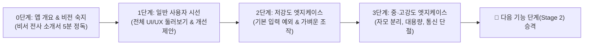

# 🎯 Ghosti QA 2-Track 테스팅 체계 및 역할별 미션 발급 운영 명세서

> **문서 버전:** v1.1 (2026-11-08 온보딩 4단계 파이프라인 및 단계별 엣지케이스 격상 체계 반영)  
> **적용 대상:** Ghosti 전담 AI 에이전트, 노션 QA 칸반 보드 (`400f9ffd2c1d808bae34e9170fb56519`), 현장 QA 테스터 2인  
> **핵심 원칙:** 단일 보드 공유 하에 `[UX]`(사용자 경험/동선)와 `[로직]`(시스템 엣지/예외 처리) 투트랙 완벽 분리 및 **[온보딩 ➔ 1단계 사용자 UI/UX ➔ 저강도 엣지 ➔ 중·고강도 엣지] 4단계 진화형 테스트** 운영

---

## 1. 신규 투입 요원(소희님) 온보딩 및 단계별 테스팅 파이프라인

새로운 테스터가 왔을 때 앱을 전혀 모르는 상태에서 바로 난이도 높은 엣지 케이스로 직행하면 시야가 좁아지고 길을 잃게 됩니다.  
따라서 반드시 아래의 **4단계 점진적 온보딩 & 테스팅 시퀀스**를 밟도록 미션을 발급합니다.

### 1.1 [0단계] 사전 정보 습득 (앱 개요 · 취지 · 비전)
- **필독 문서:** 비서 전사 마스터 소개서 하위 상세 페이지  
  👉 [`D:\Secretary\docs\파트_1\Ghosti_귀신같이\GHOSTI_APP_INTRO_AND_VISION_GUIDE.md`](file:///d:/Secretary/docs/파트_1/Ghosti_귀신같이/GHOSTI_APP_INTRO_AND_VISION_GUIDE.md)
- **핵심 목표:**
  - Ghosti가 왜 태어났는지(클라우드 0원, 0.1초 입말 타격감, 로컬 퍼스트 AI 비서).
  - 무료 4대 핵심(`🔍 찾기`, `📸 사진 공유`, `✋ 손보기`, `⚡ 귀신창`)과 유료 확장 메뉴의 전체적인 구조를 머릿속에 그리기.

### 1.2 [1단계] 일반 유저 입장 UI/UX 플로우 점검 및 소감/개선사항 수렴
- **미션 성격:** CS 전공 지식을 잠시 내려놓고, "처음 이 앱을 깔아서 쓰는 일반인"의 눈으로 전체 화면을 둘러봅니다.
- **수행 항목:**
  1. 화면에 불필요한 설명(TMI)이 너무 많아 피로하지 않은가?
  2. 버튼이나 아이콘을 봤을 때 뭘 눌러야 할지 한눈에 직관적으로 들어오는가?
  3. 기본 동작 중 어색하거나 버벅이는 UI가 있는가?
- **산출물:** 버그 카드가 없더라도 **`[소감 및 UI/UX 개선사항]`을 노션 카드에 적극 제안 등록**하도록 유도 (이 피드백은 즉시 멀린님께 보고되고 화면 정화에 반영됨).

### 1.3 [2단계] 저강도 엣지 케이스 (기본 예외 상황 점검)
- **미션 성격:** 일반적인 사용자도 실수로 저지를 수 있는 기초적인 예외 상황 점검.
- **수행 항목:**
  - 검색창에 아무것도 안 치고 엔터 연타, 긴 공백 입력.
  - 창을 열자마자 바로 닫기, 마우스 포커스를 바깥으로 뺏기.
  - 사진 공유 창 열고 QR 코드 찍기 전에 새로고침.

### 1.4 [3단계] 중·고강도 엣지 케이스 (시스템 극한 스트레스 테스팅)
- **미션 성격:** 전공자/네이티브 개발 경험을 십분 발휘하여 **"일부러 시스템을 뻗게 만드는 결함 유도"**.
- **수행 항목:**
  - **한글 자모 분리 (`ㄱㅣㅁㅊㅣ` vs `김치`) 및 초성 검색 동시 입력 예외.**
  - **대용량 파일(20MB 이상 원본 사진 50장) 동시 전송 중 모바일 Wi-Fi 강제 단절 후 재연결.**
  - **단축키(`Ctrl+0`) 1초 10회 연타 및 게임 전체화면 오버레이 좌표 점검.**
  - 이 단계에서 발견된 버그는 제가 즉각 단품 완결(Single-Piece Flow)로 로직을 패치합니다.

---

## 2. 노션 칸반 보드 구조 및 태그 운영 표준

### 2.1 단일 보드 3-View 체계
- **보드 ID:** `400f9ffd2c1d808bae34e9170fb56519`
- **필수 Select 속성:** `담당` (또는 `구분`)
  - 🟢 **`UX`** (Green): 조은호 테스터 전담 퀘스트 및 버그
  - 🟣 **`로직`** (Purple): 한소희 테스터 전담 심층 퀘스트 및 예외 버그
- **보드 상단 3대 탭(View) 구성:**
  1. 📌 **`전체 보드`**: 멀린님 총괄 감독 및 2개 트랙 전체 흐름 파악용
  2. 🟢 **`UX 트랙`**: `담당 == UX` 필터링 (조은호 테스터 전용 뷰)
  3. 🟣 **`로직 트랙`**: `담당 == 로직` 필터링 (한소희 테스터 전용 뷰)

### 2.2 카드 제목 네이밍 및 이모지 규칙
카드 자체의 텍스트 색상 변경 한계를 극복하기 위해, 제목 앞머리에 직관적인 말머리를 강제 부여합니다.
- `UX` 카드: `🟢 [UX] [기능파트] 테스트 미션 또는 버그 요약`
- `로직` 카드: `🟣 [로직] [기능파트] [난이도:입문/저강도/고강도] 엣지 케이스 미션 또는 버그 요약`

---

## 3. 기능 구현 단계별 2-Track 미션 난이도 비교 매트릭스

| 대상 기능 | 🟢 [UX] 미션 (일반 사용자 동선 / 체감) | 🟣 [로직] 심화 미션 (경우의 수 / 극한 엣지 / 결함 유도) |
| :--- | :--- | :--- |
| **1. 🔍 찾기 (초고속 검색)** | • 검색창 입력 시 버벅임이나 딜레이가 없는가? • 결과 클릭 시 해당 파일/폴더가 바로 열리는가? • 검색어가 없을 때 안내 텍스트가 자연스러운가? | • **한글 자모 분리 (`ㄱㅣㅁㅊㅣ` vs `김치`) 및 초성 검색 (`ㄱㅊ`) 동시 입력 예외** • 특수문자(`\`, `/`, `*`, `?`, `"`, `<`, `>`, `|`), 공백 20개 연속 입력 시 SQLite 쿼리 인젝션 및 충돌 검증 • 파일 10만 개 검색 도중 강제 ESC 연타 및 백스페이스 고속 연타 시 레이스 컨디션 점검 |
| **2. 📸 사진 공유 (모바일-PC)** | • QR 코드 스캔 후 모바일 웹 화면이 1초 안에 뜨는가? • 사진 선택 후 전송 버튼을 누르면 직관적인가? • 60초 타이머가 끝났을 때 알림이 명확한가? | • **사진 50장 동시 다중 전송 중 모바일 Wi-Fi 끄기(비행기 모드 전환) 후 재연결 시 청크 유실/재전송 검증** • 4K/8K 고해상도(20MB 이상) 원본 이미지 전송 시 메모리 스파이크 및 캔버스 리사이징 데드락 점검 • 방 만료 1초 전 업로드 시작 시 트랜잭션 롤백 및 임시 캐시 자동 파기 여부 |
| **3. ✋ 손보기 (PC/모바일 케어)** | • 1줄 롤링 텍스트가 읽기 편하게 돌아가는가? • 원클릭 케어 버튼을 눌렀을 때 진행률 애니메이션이 시원한가? • 복원 기록 타임머신 화면이 이해하기 쉬운가? | • **프로세스 킬 도중 윈도우 필수 시스템 프로세스(csrss, svchost) 보호 화이트리스트 무결성 검증** • 디스크 정리 실행 중 대상 파일이 다른 프로그램에 의해 잠겨(Lock) 있을 때의 예외 스킵 처리 • Windows Defender 순정 API 호출 실패/타임아웃 시 대체 폴백 에러 바운더리 검증 |
| **4. ⚡ 귀신창 (단축키 소환술)** | • `Alt+Space` 또는 지정 단축키 입력 시 부드럽게 뜨는가? • 마우스 포커스가 자동으로 검색창에 맞춰지는가? • 바깥 화면을 클릭하면 자연스럽게 닫히는가? | • **게임 전체화면 모드, 원격 데스크톱(RDP), 다중 모니터(FHD+4K 혼합) 환경에서의 해상도 DPI 스케일링 오버레이 좌표 왜곡 검증** • 단축키 1초에 10회 연속 연타 시 데몬 프로세스 좀비화 및 중복 윈도우 핸들 생성 방지 검증 • 윈도우 키보드 보안 프로그램(은행/관공서 nProtect 등) 활성 상태에서의 전역 훅(Hook) 우회 및 충돌 복구 |
| **5. 📱 내 기기 통합 & S: 드라이브** | • 점진적 공개(접힘/펼침) 토글이 부드럽게 작동하는가? • 체험 뱃지(`✨ 체험중`)가 거슬리지 않고 적절한가? | • **PC 데몬 강제 종료 후 재부팅 시 가상 마운트 드라이브(S:) 언마운트 누수 방지** • 로컬 SQLite 인덱스 손상(Corrupted) 시뮬레이션 시 자동 복구(Re-index) 시퀀스 점검 • 오프라인 캐시 상태에서 쓰기 작업 후 온라인 복구 시 충돌 해결(Conflict Resolution) |

---

## 4. 자동화 파이프라인 아키텍처 (`notion_qa.py`)

### 4.1 핵심 기능 1: `generate_mission(role, feature_part, mission_tier)`
- **`role="UX"` (은호님 트랙):**
  - 일상적인 한국어 구어체, 구체적인 마우스/터치 행동 중심.
  - "이 버튼을 눌러보고 3초 안에 원하는 결과를 찾을 수 있는지 확인해 주세요."
- **`role="로직"` (소희님 트랙 - 단계별 분기):**
  - `tier="ONBOARDING"`: 비서 앱소개서 정독 및 전체 UI 둘러보기, 개선사항 제안 요청.
  - `tier="LOW_EDGE"`: 기본 입력창 특수문자, ESC 연타 등 일상적 실수 예외 점검.
  - `tier="HIGH_EDGE"`: 자모 분리, 대용량 통신 단절, 멀티모니터 좌표 왜곡 등 고난도 시스템 스트레스 점검.

### 4.2 핵심 기능 2: 퀘스트 보충 투트랙 가동
1. **무인 퀘스트 보드 모드 (Auto-Replenish):**
   - 감시병이 25초 주기로 보드를 감시하다가, `UX` 또는 `로직`의 `[미션/대기]` 카드가 1개 이하로 떨어지면 미리 준비된 '단계별 퀘스트 마스터 풀'에서 다음 난이도의 미션을 자동으로 1개씩 추가 등록합니다.
2. **멀린님 수동 즉시 주문 모드:**
   - 멀린님이 채팅창에 지시하시면 즉시 노션 API를 호출하여 우선순위 긴급 카드를 발급합니다.

### 4.3 핵심 기능 3: 단품 완결 버그 수정 루프 (`process_bug_queue`)
- 두 테스터 중 누구든 `[발견된 버그]`에 카드를 올리면:
  1. **Single-Piece Flow 철칙:** 반드시 **가장 먼저 올라온 카드 단 1건만** `[버그 수정중]`으로 이동 후 착수 (나머지는 건드리지 않음).
  2. **코드 분석 및 패치:** 로컬 코드 수정 및 `tsc`, 테스트 검증 완료.
  3. **맞춤형 피드백 블록 작성 후 `[재테스트 대기]` 이동.**

---

## 5. 멀린님 PC 1대 집중 운영 및 안전 수칙

1. **멀린님 리소스 보호:**
   - 감시병은 파이썬 백그라운드 데몬(`IsDaemon: true`)으로 CPU 점유율 0.1% 미만, AI 토큰 소모 0으로 상시 대기합니다.
   - 멀린님께서는 다른 3개 IDE 작업과 기획 총괄에만 온전히 몰입하실 수 있도록, 알바생들의 버그 수습과 퀘스트 발급을 제가 무인으로 뒷단에서 100% 처리합니다.
2. **노션 QA 테스터 작성 중 가로채기 영구 엄금:**
   - 테스터가 `[미션/대기]`나 `[테스트 중]`에서 타이핑을 하거나 캡처를 붙이는 중에는 절대 카드를 건드리지 않으며, **오직 테스터가 완전히 작성을 마치고 카드를 `[발견된 버그]` 칸으로 넘겼을 때만** 안전하게 감지하여 착수합니다.
3. **미수정 카드 일괄 이동 절대 금지:**
   - 실제로 코드를 고치고 배포까지 끝낸 바로 그 1건만 `[재테스트 대기]`로 넘깁니다.
