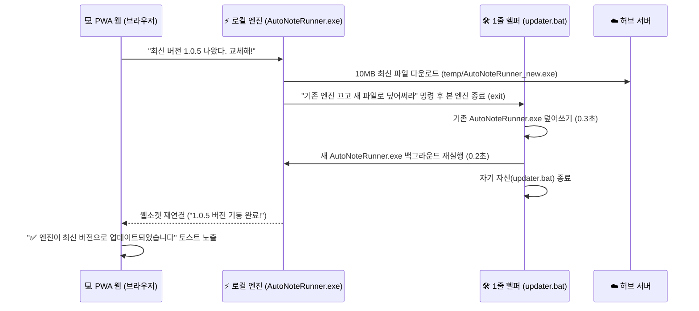

# 🏛️ 20개 패밀리 앱 통합 심장 『멀린 Z 코어 (Merlin Z-Core)』 최종 아키텍처 및 6대 핵심 모듈 구현 지시서

> **기획 및 특허 전략 최종 검토 결과:** 당사가 향후 출시할 10~20개의 멀린 패밀리 앱(`제트아이(Z-Eye)`, `센스톡`, `뭐먹지?`, `어그로필터`, `썬드리머`, `볼터` 등)은 개별 네이티브 앱을 따로 만들지 않고, 오직 단 하나의 공용 네이티브 에이전트인 **『멀린 Z 코어 (`Merlin_Z_Core.apk` / `Merlin_Z_Core_Setup.exe`)』**를 통해 모든 로컬 자원과 UI 제어를 수행하는 **‘One-Core, Multi-Apps’** 구조로 확정했습니다.

---

## 1. 단일 바이너리 원칙 & ‘무소음 그림자 비서’ UX (배지 노출 금지)

- **네이밍 및 단일화:**
  - **모바일:** `Merlin_Z_Core.apk` (약 1MB 초경량 웹뷰+브릿지)
  - **PC:** `Merlin_Z_Core_Setup.exe` (Microsoft Artifact Signing 서명 적용) 단 하나로 통일합니다.
  - *(센스톡용 별도 `.exe` 분리 안은 폐기하며, 센스톡의 PC 카톡/라인 반자동 입력 모듈도 이 `Merlin_Z_Core.exe` 안에 기본 탑재합니다.)*
- **화면 경량화 (연결 표시등 제거):**
  - 웹 화면 상단에 `[🟢 코어 연결됨]` 같은 상태 배지나 아이콘을 절대 띄우지 않습니다 (`exposeConnectionStatusBadgeInUi: false`).
  - 코어는 평소 존재감을 100% 숨기고 백그라운드(PC 트레이 상주 / 모바일 충전·Wi-Fi 또는 온디맨드 깨어남)에서 조용히 결과만 반환해야 합니다.
- **무질문 자동 세팅:**
  - **안드로이드:** APK 설치 자체로 앱 아이콘 생성을 끝냅니다 (추가 홈 바로가기 팝업 생략).
  - **PC:** `.exe` 설치 시 우측 하단 트레이 상주 + 바탕화면 바로가기 + 브라우저 북마크바 자동 등록을 백그라운드에서 무질문으로 완료합니다.

---

## 2. 도메인 화이트리스트(`*.sundreamer.app`) 기반 ‘무재빌드 범용 쿼리 게이트웨이’

- 향후 신규 패밀리 앱이 출시될 때마다 APK나 `.exe`를 업데이트하고 스토어 재심사를 받는 일이 없도록, 코어 내부에 특정 앱 전용 API를 하드코딩하지 않습니다.
- **CORS 및 Origin 보안:** 로컬 브릿지 서버(`localhost` 지정 포트 및 P2P 터널)는 오직 `*.sundreamer.app` (및 당사 공식 패밀리 도메인)에서 발신된 요청만 허용하도록 와일드카드 화이트리스트를 적용합니다 (`Access-Control-Allow-Private-Network: true` 포함).
- **단일 범용 인터페이스 (`window.MerlinZCore.executeQuery` / `executeMerlinQuery`):** 패밀리 웹앱이 JSON 형태의 조건문(`Target DB`, `Filter`, `Action`)을 던지면 코어가 수행 후 결과만 반환하는 범용 실행기로 구축합니다.

---

## 3. 20개 패밀리 앱을 먹여 살릴 『멀린 Z 코어』 5대 표준 심부름 모듈 탑재

어떤 패밀리 웹앱이 호출하든 코어가 즉시 응답할 수 있도록 아래 5대 로컬 처리 능력을 코어의 기본 스펙으로 내장합니다:

### ① 📸 멀티모달 미디어·서류 인덱스 쿼리 모듈 (`제트아이`, `뭐먹지?`, `가계부/볼터` 공용)
- 768d Gemma 2 벡터 + 한국어 형태소 어간 가드레일 + 로컬 OCR로 색인된 로컬 DB(`[갤러리]` 및 `[스마트 서류함]`)에서 특정 카테고리(예: `#음식` 사진의 촬영일시·메뉴태그·EXIF GPS 식당 위치, `#영수증`/`#계약서` 텍스트 등)를 조건부로 즉시 추출해 반환합니다.

### ② 📊 로컬 문서·엑셀 조건부 파싱 모듈 (`센스톡 CRM`, `업무 공유 (S: 드라이브)`, `볼터` 공용)
- 유저 PC나 스마트폰의 로컬 폴더 및 `[스마트 서류함]` 내 엑셀(`.xlsx`), `CSV`, 워드(`.docx`), `PDF` 파일 내부의 표(Table)와 텍스트를 스캔하여, 웹앱이 요청한 조건(예: `'최근 6개월 미방문'`, `'인천 거주 VIP'`)에 부합하는 행(Row)과 연락처만 안전하게 추출해 반환합니다.
- Windows `S:` 가상 드라이브 온디맨드 스트리밍 마운트(`net use S:` / `subst S:`)를 지원합니다.

### ③ 👁️ 실시간 화면·알림·브라우저 캐시 읽기 모듈 (`설정몬스터`, `어그로필터` 공용)
- 모바일 `AccessibilityService` 및 `NotificationListener`, PC `Windows UI Automation`을 통해 현재 활성화된 타사 앱(유튜브, 카톡, 쇼핑몰, 관공서 등)의 화면 텍스트·좌표 트리와 푸시 알림을 0.01초 만에 추출합니다.
- PC의 경우 크롬/엣지 브라우저의 로컬 SQLite(`History` 복사본)에서 특정 도메인(예: `youtube.com/watch`) 시청 이력 및 구독 채널 텍스트를 고속 추출하는 읽기 기능(`BROWSER_HISTORY_SQLITE_DB`)을 포함합니다.

### ④ 👆 오버레이 가이드 & 메신저 반자동 텍스트 세팅 모듈 (`설정몬스터`, `센스톡`, `어그로필터`, `볼터` 공용)
- **오버레이 투사:** 타사 앱 화면 위 지정 좌표 `(X, Y)`에 반투명 손가락 화살표(`👆` 설정몬스터용) 또는 실시간 신호등 배지(`⚠️ 어그로 주의` 어그로필터용)를 렌더링합니다.
- **메신저 반자동 세팅 (센스톡/볼터용):** PC 카카오톡/라인 등의 채팅 입력창 또는 홈택스 입력창 핸들을 찾아 웹에서 전달된 맞춤형 텍스트/수치를 자동 입력(Paste)하되, **`Zero-Auto-Action` 대원칙**에 따라 최종 `[전송]` 버튼은 절대 자동 클릭하지 않고 유저가 직접 1회 클릭(`[Enter]`)하도록 포커스만 세팅합니다.
- **0.01초 스냅샷 & 1초 원복:** 시스템 설정 변경 전 무조건 JSON 스냅샷을 로컬 백업하고 감사 로그(타임스탬프+DOM 캡처)를 기록하여 1초 즉시 롤백을 보장합니다.

### ⑤ 🛂 Z-Eye 여권 & ‘최신 연도 정면 얼굴 자동 문패(`Smart Profile`)’ 모듈 (전 패밀리 앱 공통 프로필)
- 이메일 계정에 영구 귀속된 ‘Z-Eye 여권(성인 10년/미성년 5년 바구니 × 5대 스타일 슬롯)’ 데이터 중 **`Slot 1`(당해 연도 최선명 정면 기준컷)** 크롭 이미지를 모든 멀린 패밀리 웹앱의 유저 기본 프로필(문패)로 무질문 자동 바인딩합니다 (클릭 시 5대 슬롯 원터치 교체 모달 제공).

---

## 4. 다중 패밀리 앱 공용 ‘동적 페이로드 라우팅 푸시(`Dynamic Push Routing`)’ 및 출입증 연동

- **설치 출입증 (`Install Referrer` / `Deep Link`):** 유저가 `뭐먹지?`나 `어그로필터` 웹에서 멀린 Z 코어를 처음 설치하고 실행했을 때, 유입된 서비스의 URL로 WebView 첫 화면이 즉시 열리도록 출입증 토큰을 연결합니다.
- **공용 푸시 우체국:** FCM/APNs 푸시 수신 시 데이터 페이로드의 `target_url` (`*.sundreamer.app` 내 허용 경로)을 읽어, 알림 클릭 시 해당 패밀리 웹앱 화면으로 즉시 라우팅하고 안드로이드 알림 채널(`Notification Channel`)을 서비스 카테고리별로 동적 분리합니다.

---

## 5. 📦 로컬 AI 모델 가중치(Weights) 자체 스토리지 ‘마스터 사본’ 영구 보관 원칙

> **🚨 전사 인프라 절대 원칙 (외부 의존성 0%):**  
> **“현재 로컬 서버와 PC 코어에 사용 중인 젬마 2(Gemma 2) 및 비전/임베딩 모델 가중치 원본 파일들을 외부(HuggingFace 등)에서 매번 당겨오지 말고, 우리 자체 스토리지(백업 하드디스크 및 R2 CDN)에 ‘마스터 사본’으로 영구 보관해 두어라.”**

- 외부 저장소(HuggingFace, Ollama 등)의 장애·삭제·속도 제한·가중치 변조로 인해 로컬 코어 인덱싱이나 768차원 벡터 호환성이 깨지는 일을 원천 차단합니다.
- 모든 코어 배포판(`Merlin_Z_Core_Setup.exe`) 및 로컬 서버는 당사 **자체 백업 하드디스크(오프라인 마스터)와 자체 R2 CDN에 영구 보관된 ‘마스터 사본’**만을 단일 공급원(SSOT)으로 참조합니다.

---

## 🧩 [확정 추가] 단일 표준 포트(`127.0.0.1:5199`) 내장 소프트웨어 플러그인 3종 상세 입출력 아키텍처 (`merlin_z_core_daemon.py`)

### 1. 왜 단일 포트(`5199`) + 내장 소프트웨어 플러그인(`Built-in Software Plugins`)인가?
- 유저가 제트아이·센스톡·어그로필터·썬드리머 스튜디오를 쓸 때마다 별도 설치파일을 2중으로 설치하거나 포트를 나누면 방화벽 경고와 포트 충돌이 발생합니다.
- 따라서 Microsoft Artifact Signing(월 $9.99) 서명이 완료된 단일 설치파일 **`Merlin_Z_Core_Setup.exe`** 내부에 3대 소프트웨어 플러그인(`plugin_zeye_os.py`, `plugin_senstalk.py`, `plugin_aggrofilter.py`)을 기본 내장하고, `ThreadingHTTPServer` 멀티스레드 비동기 서버로 **단일 표준 포트 `http://127.0.0.1:5199`**에서 모든 패밀리 앱 요청을 병렬 처리합니다.

### 2. 표준 라우팅 테이블 및 JSON 입출력 규격 (`merlin_z_core_daemon.py` 직결)

| 구분 | HTTP Method & Path | 담당 모듈 | 요청 Payload (JSON) | 응답 Payload (JSON) |
| :--- | :--- | :--- | :--- | :--- |
| **통합 헬스체크** | `GET /__merlin/health`<br>*(또는 `/`, `/health`)* | `merlin_z_core_daemon.py` | Query Params 없음 | `{ "ok": true, "coreName": "Merlin_Z_Core", "version": "2.1.0", "standardPort": 5199, "builtinPlugins": { "zeye_os": {...}, "senstalk": {...}, "aggrofilter": {...} } }` |
| **통합 게이트웨이** | `POST /__merlin/query` | `merlin_z_core_daemon.py` | `{ "plugin": "zeye" \| "senstalk" \| "aggrofilter", "action": "...", "payload": {...} }` | 각 플러그인의 `handle_request(action, payload)` 실행 결과 JSON 반환 |
| **Z-Eye & Z몬스터** | `GET / POST /__zcore/*`<br>*(또는 `/api/zeye/*`)* | `plugin_zeye_os.py` | • `/__zcore/trace-missing-file`: `{ "query": "거래처_정산" }`<br>• `/__zcore/gdrive-smart-scan`: `{ "query": "비번" }`<br>• `/__zcore/restore-points-list`: `{}`<br>• `/__zcore/restore-point-rollback`: `{ "restoreId": "#104" }`<br>• `/__zcore/ai-baton-touch`: `{ "query": "...", "autoLaunch": false }` | • 5대 은닉 금고 + `$Recycle.Bin` `$I` 바이너리 해독 결과<br>• `G:` 드라이브 `.gsheet`/`.gdoc` 색인 및 무마스킹 ID/PW(`📋` 복사)<br>• `[복원 기록]` 3단계 무결성 배지(`🟢/🟡/🔴`) 및 1초 롤백 결과<br>• 단골 AI 자동 감지(기록 0건 시 기본값 `gemini`) |
| **센스톡 플러그인** | `GET / POST /api/senstalk/*` | `plugin_senstalk.py`<br>*(2,439줄 원본)* | • `GET /api/senstalk/health`<br>• `GET /api/senstalk/badges`<br>• `POST /api/senstalk/sync`: `{ "queue": [...] }`<br>• `POST /api/senstalk/send`: `{ "target": "이쁜이", "msg": "..." }` | • 6대 메신저(카카오톡·라인·텔레그램·위챗·와츠앱·페메) 창 탐색 상태, 미확인 배지 카운트, 실채팅방 타겟 검색 및 입력창 장전 결과 |
| **어그로필터 플러그인** | `GET / POST /api/aggrofilter/*` | `plugin_aggrofilter.py` | • `GET /api/aggrofilter/health`<br>• `POST /api/aggrofilter/extract`: `{ "url": "https://youtu.be/...", "lang": "ko" }` | • 크롬 확장팩 없이 유저 로컬 가정용 IP로 직접 추출한 유튜브 자막 세그먼트, 전체 텍스트, 타임스탬프 요약 반환 |

### 3. 전사 중앙 우체국 (`D:\Secretary\post_office\`) 3단계 처리 프로토콜
1. **1단계 (열람 즉시 `(읽음)` 부착):** `D:\Secretary\post_office\` 내 `Z-Eye_` 수신 문서를 처음 읽는 즉시 파일명 맨 앞에 `(읽음)`을 붙여 이름을 변경합니다.
2. **2단계 (선 보고 후 승인 시 착수):** 원 코어 내장 플러그인 vs 사내 파워 코어 분류 및 모바일 스토어 심사 패스 리스크를 멀린님께 먼저 보고하고 승인을 받아 작업합니다.
3. **3단계 (완료 후 신규 답변 문서 생성):** 기존 `(읽음)` 문서를 재수정하지 않고 `[상대앱]_Z-Eye_답변_[원제목요약]_[YYYYMMDD_HHMM].md` 형태로 새 답변 문서를 생성합니다.

---

# [통합 안내] 본 문서는 '썬드리머 스튜디오 마스터 연동 가이드'로 전면 승격 및 개정되었습니다.

> 📢 **[공식 승격 안내 (2026-10-19)]**  
> 본 가이드는 **Z몬스터(클린몬스터·설정몬스터) 브랜드를 전면 폐기**하고, 대외 단일 브랜드인 **`[썬드리머 스튜디오 (SunDreamer Studio)]`**로 승격되었습니다.  
> 세부 마스터 가이드는 **[`썬드리머스튜디오_고객센터_쇼룸_마케팅공장_연동가이드.md`](file:///D:/Cafe_writer/docs/%EC%8D%AC%EB%93%9C%EB%A6%AC%EB%A8%B8%EC%8A%A4%ED%8A%9C%EB%94%94%EC%98%A4_%EA%B3%A0%EA%B0%9D%EC%84%BC%ED%84%B0_%EC%87%BC%EB%A3%B8_%EB%A7%88%EC%BC%80%ED%8C%85%EA%B3%B5%EC%9E%A5_%EC%97%B0%EB%8F%99%EA%B0%80%EC%9D%B4%EB%93%9C.md)**를 100% 기준으로 삼아 개발에 착수하십시오.

---

# 🎬 썬드리머 스튜디오(SunDreamer Studio) 마스터 연동 가이드
## [쇼룸 + 통합 고객센터(나의 문의방) + 헤드리스 마케팅 자동화 공장]

- **문서 버전**: v2.0 (전면 개정)
- **최종 확정 일시**: 2026-10-19 00:40
- **공식 사이트 명칭**: **썬드리머 스튜디오 (SunDreamer Studio)**
- **공식 서비스 도메인**: `https://studio.sundreamer.app`
- **적용 대상**: 썬드리머 스튜디오, 썬드리머(1호), 제트아이(2호), 뭐먹지, 어그로필터 등 전 패밀리 앱

---

## 🏛️ 1. 대전환 배경 및 브랜딩 원칙 (Strategic Rebranding)

### 1) Z몬스터(클린몬스터·설정몬스터) 브랜드 폐기 및 단일 브랜드 수렴 이유
- **경계의 소멸 (더블 하이브리드 대통합)**: 과거 독립 실행형 프로그램(카페몬스터, 마케팅몬스터 등)을 위해 만들었던 'Z몬스터(클린몬스터·설정몬스터)'는, 모든 프로그램이 **'클라우드 PWA 캔버스 + 10MB 로컬 초경량 엔진'**의 썬드리머 웹앱 속성으로 흡수되면서 역사적 사명을 다했습니다.
- **KCP 3호점(기간제 결제) 폐지**: 멀린 패밀리 OS 2호 상점(통합 코인/포인트 지갑)으로 결제가 일원화되어 3호점 상점은 완전히 정리되었습니다.
- **매몰 비용(Sunk Cost)의 과감한 탈피**: 기존에 만들어둔 우수한 프로젝트 공간과 코드는 그대로 유지하되, 껍데기(브랜드)를 **'썬드리머 스튜디오'**로 리브랜딩하여 생태계의 핵심 관제탑으로 재탄생시킵니다.

### 2) 대내외 브랜딩 공식 원칙
- **대내적 (개발/운영/시스템)**: **멀린 패밀리 (Merlin Family OS)**
- **대외적 (2.5만 카페 회원, 5천 실구매 고객, 일반 사용자)**: **썬드리머 (SunDreamer)**
  - 12년간 쌓아온 100% 신뢰의 '썬드림' 우산 아래 모든 앱이 전개되므로, 고객은 이질감 없이 안심하고 서비스를 이용합니다.
  - 도메인 역시 `studio.sundreamer.app`을 사용하여 루트 쿠키(`domain=.sundreamer.app`)를 100% 공유, **아이폰 Safari 등 모바일 전 환경에서 로그인 풀림이 원천 차단**됩니다.

---

## 🏛️ 2. 썬드리머 스튜디오의 3대 핵심 역할 (The 3 Pillars)

```
┌────────────────────────────────────────────────────────────────────────┐
│             🎬 썬드리머 스튜디오 (studio.sundreamer.app)               │
├────────────────────────────┬─────────────────────────────┬─────────────┤
│   [전면] 패밀리 앱 쇼룸   │   [중간] 통합 고객센터      │ [후면]      │
│         (Showroom)         │          (CS / 나의 문의방)  │ 마케팅 공장 │
├────────────────────────────┼─────────────────────────────┤             │
│ • 썬드리머, 제트아이, 뭐먹지 │ • 1초 인앱 에러 접수 수신   │ • 쇼츠 생성 │
│ • 전 패밀리 앱 전시·체험   │ • [나의 문의방] SSO 히스토리│ • 3개 채널  │
│ • 광고비 0원 교차 유입     │ • 3호기 아르곤 수리 답변    │   유튜브    │
│ • 패치노트 & 기술 공지     │ • 고객 추가 질의응답 댓글   │   무인 업로드│
└────────────────────────────┴─────────────────────────────┴─────────────┘
```

### 1) 기둥 ①: 통합 고객센터 & `[나의 문의방]` (CS)
- **1초 인-앱 접수 연동**: 각 앱(썬드리머, 제트아이 등)에서 에러가 터졌을 때 튕기지 않고, 앱 내부 미니창(`HubBugReporter`)에서 1초 만에 블랙박스 로그(파일명, 라인, 최근 20개 행동, 기기정보)를 수신합니다.
- **`[나의 문의방]`**: 고객이 답변 알림을 클릭하거나 프로필 메뉴에서 들어왔을 때, SSO 자동 로그인 상태로 본인의 모든 문의 내역과 3호기 아르곤의 수리 완료 답변을 열람하고 추가 댓글을 작성하는 공간입니다.

### 2) 기둥 ②: 썬드리머 공식 패밀리 앱 쇼룸 (Showroom)
- 고객센터 상·하단 및 메인 뷰에 **1호 썬드리머, 2호 제트아이(Z-Eye), 뭐먹지, 어그로필터 등 전 패밀리 앱을 멋지게 전시**합니다.
- 문의 답변을 확인하러 온 고객이 자연스럽게 다른 혁신 앱들을 구경하고 설치하게 만드는 **광고비 0원의 영구적인 크로스 프로모션 깔때기(Funnel)**입니다.

### 3) 기둥 ③: 헤드리스 마케팅 자동화 공장 (Auto-Marketing Factory)
- **카페브레이크의 검증된 엔진 이식**: 수개월간 3개 채널에 쇼츠를 렌더링하고 업로드해 온 파이프라인(TTS, 이미지, FFmpeg, 유튜브 스튜디오 무인 업로더)을 스튜디오의 백그라운드 엔진으로 이식합니다.
- **헤드리스(Headless) 파이프라인**: 
  - 개별 앱은 무거운 영상 코드를 품지 않고, **오직 컨텐츠 데이터(JSON/DB 원자재)**만 제공합니다.
  - 스튜디오 마케팅 공장이 주기적으로 각 앱의 컨텐츠를 긁어와(Ingestion), 중앙 엔진에서 쇼츠를 자동으로 렌더링하고 유튜브로 쏘아 올립니다.
  - **2호 앱 제트아이(Z-Eye)부터 이 방식으로 즉시 가동**합니다.

---

## ⚙️ 3. 거버넌스 및 3자 분업 R&R (역할 분담)

| 구분 | 주관 주체 | 전담 업무 및 권한 범위 |
| :--- | :--- | :--- |
| **1. 인프라 & SDK** | **🏛️ 멀린 패밀리 OS 허브 총괄**<br>(`MerlinFamilyOS`) | • **전 패밀리 앱 공통 에러 대응 SDK 개발** (`HubErrorBoundary`, `HubBugReporter`, `HubSupportLink`)<br>• 1초 미니 접수창 UI 및 블랙박스 로그 캡처 엔진 표준화<br>• 프로필 하단 `[🛠️ 고객센터 / 나의 문의방]` 버튼 컴포넌트화<br>• 개별 앱 버그·에러 대응 가이드라인 통제 |
| **2. 쇼룸 & CS & 공장** | **🎬 썬드리머 스튜디오**<br>(`SunDreamer Studio`)<br>*(구 Z몬스터(클린몬스터·설정몬스터) 프로젝트 공간)* | • **중앙 CS 수신 API (`POST /api/support/tickets`) 및 티켓 DB 구축**<br>• **`[나의 문의방]` UI**: SSO 기반 내 문의 히스토리, 3호기 아르곤 답변 열람, 질의응답 댓글<br>• **패밀리 앱 쇼룸 갤러리**: 전 앱 전시 카드 및 교차 홍보 캔버스<br>• **스탭 전용 카톡 스샷(`Ctrl+V`) 업로드 관리자 페이지**<br>• **카페브레이크 영상 렌더링 & 유튜브 자동 업로드 엔진 구동**<br>• **제트아이(2호) 등 패밀리 앱 컨텐츠 수집 ➔ 쇼츠 무인 자동 제작/업로드** |
| **3. 무인 수리 & A/S** | **🤖 3호기 아르곤**<br>(`office-designer` 무인 데몬) | • 썬드리머 스튜디오의 티켓(블랙박스 로그 또는 스탭 카톡 스샷)을 읽고 로컬 코드 `grep` 역추적<br>• **[트랙 A]** 자동 코드 수정 ➔ 빌드/테스트 ➔ 답변 초안 작성 ➔ 매니저 1클릭 배포 승인 대기<br>• **[트랙 B]** 구조적 버그/정책 이슈 시 멈춤(Hold) ➔ 중간 안내 등록 ➔ 매니저 협업 호출 |

---

## 🖥️ 4. 하드웨어 인프라 및 서버 배치

| 거점 노드 | 사양 | 전담 역할 및 운영 방식 |
| :--- | :--- | :--- |
| **사무실 2호기**<br>(`office-server` / `100.88.230.16`) | **8 GB RAM** | **[24/7 백그라운드 마케팅 & 데몬 전용 서버]**<br>• GUI 없이 상시 데몬 구동 (스튜디오 유튜브 자동 업로더 데몬, 멀린비서 8282 등). |
| **사무실 3호기**<br>(`office-designer` / `100.102.43.42`) | **16 GB RAM** | **[원격 작업 & A/S 수리 전담 서버]**<br>• 디자이너 계정으로 안티그래비티 IDE 2개 창 상시 가동:<br>  - **창 1**: 매니저님 원격 작업 메인 창<br>  - **창 2**: 스튜디오 고객센터를 감시하며 무인 수리를 수행하는 **A/S 아르곤 전담 창** |

---

## 📋 5. 내일 썬드리머 스튜디오 작업자(AI 개발자) 착수 액션 플랜

내일 해당 프로젝트 IDE를 열었을 때 작업자는 다음 순서로 작업을 즉시 실행합니다:

### Step 1. 레거시 코드 정리 및 썬드리머 스튜디오 리브랜딩
1. 사이트 명칭을 **`썬드리머 스튜디오 (SunDreamer Studio)`**로 공식 변경.
2. 기존 Z몬스터(클린몬스터·설정몬스터) 브랜드 문구, 3호점 KCP 기간제 결제 관련 잔재 코드 및 불필요한 위젯 전면 제거.
3. 서비스 도메인을 `studio.sundreamer.app`으로 확정하고 헤더/푸터 UI 정돈.

### Step 2. 통합 고객센터 & `[나의 문의방]` 구축
1. **CS 중앙 접수 API 생성**: `POST /api/support/tickets` (허브 SDK의 블랙박스 로그 JSON 수신 및 DB 적재).
2. **`[나의 문의방]` 페이지 개발 (`/cs`)**:
   - 허브 SSO 이메일 연동으로 본인의 과거/현재 문의 목록 조회.
   - 3호기 아르곤이 작성한 수리 완료 답변 카드 및 추가 댓글 작성 기능.
   - 상단 안내 뱃지: `[🟢 썬드리머 회원님의 문의 내역입니다]` (출처 앱 표시로 신뢰감 제공).
3. **스탭용 카톡 스샷(`Ctrl+V`) 업로더**: 스탭이 카톡으로 받은 스샷을 클립보드 붙여넣기로 바로 접수하는 관리자 화면.

### Step 3. 썬드리머 패밀리 앱 쇼룸 갤러리 배치
1. 고객센터 상단 및 하단에 썬드리머(1호), 제트아이(2호), 뭐먹지, 어그로필터 등 패밀리 앱 소개 카드 및 바로가기 링크 배치.
2. 각 앱별 최신 패치노트 및 기술 업데이트 공지 탭 구성.

### Step 4. 카페브레이크 마케팅 엔진 이식 및 제트아이(2호) 데이터 연동
1. `D:\CafeBreaker`의 검증된 영상 렌더링(TTS/자막/비디오) 및 유튜브 스튜디오 업로드 모듈을 스튜디오 내부 백엔드로 이식.
2. 2호 앱 제트아이(`Z-Eye`)의 컨텐츠 데이터 엔드포인트(`GET /api/feed/zeye`)를 정의하여, 스튜디오 공장이 컨텐츠를 가져와 쇼츠를 무인 제작·업로드하는 파이프라인 구축.

---

## 📡 6. 시스템 간 데이터 통신 규격 (Interface API Specifications)

### 1) 허브 SDK ➔ 썬드리머 스튜디오 CS 접수 (`POST /api/support/tickets`)
```json
{
  "app_id": "sundreamer",
  "app_version": "v12.2",
  "user_email": "user@naver.com",
  "user_hub_id": "90e6a87c-36fa-4965-8b8a-b851b2a95c9a",
  "category": "BUG",
  "user_comment": "치유 기록 저장 버튼을 눌렀는데 화면이 멈춰요",
  "error_metadata": {
    "error_message": "Cannot read properties of undefined (reading 'records')",
    "file_path": "src/components/views/Records.tsx",
    "line_number": 142,
    "column_number": 18,
    "stack_trace": "TypeError: Cannot read properties of undefined...\n    at handleSubmit (Records.tsx:142:18)..."
  },
  "device_context": {
    "os": "iOS",
    "os_version": "17.4.1",
    "browser": "Safari / Naver In-App",
    "screen_resolution": "393x852",
    "display_mode": "browser"
  },
  "breadcrumbs": [
    { "timestamp": "2026-10-18T23:10:01Z", "category": "ui.click", "target": "button#tab_records" },
    { "timestamp": "2026-10-18T23:10:12Z", "category": "input", "target": "input#duration", "value": "15" },
    { "timestamp": "2026-10-18T23:10:15Z", "category": "ui.click", "target": "button#save_record" }
  ]
}
```

### 2) 개별 앱 ➔ 스튜디오 마케팅 공장 컨텐츠 공급 규격 (`GET /api/marketing/feed`)
```json
{
  "app_id": "saysee",
  "items": [
    {
      "content_id": "saysee_item_101",
      "title": "말만 하면 1초 만에 찾아주는 제트아이 AI 비서",
      "hook_text": "아직도 일일이 검색창에 치고 계신가요?",
      "body_script": "제트아이는 음성 한마디로 사진 속 글자와 상품을 1초 만에 찾아드립니다.",
      "image_urls": ["https://saysee.sundreamer.app/assets/demo1.jpg"],
      "tags": ["제트아이", "AI비서", "썬드리머", "생산성"]
    }
  ]
}
```

---

---
Title: 멀린 패밀리 하이브리드 로컬 엔진 및 윈도우 데스크톱 앱 배포·자동업데이트 표준 가이드
Version: v2.0
Last Updated: 2026-10-08
Target: 오토노트 러너(AutoNote Runner), 루미노트(LumiSender), 쇼츠 마케터, 맘카페 마케터 등 로컬 실행 하이브리드 엔진 일체
---

# 🖥️ 하이브리드 로컬 엔진 배포, Microsoft Artifact Signing (월 $9.99) 및 자동 업데이트 표준 가이드

본 문서는 멀린 패밀리 생태계의 모든 하이브리드 앱(웹 PWA + PC 로컬 경량 엔진) 및 데스크톱 프로그램(오토노트 러너, 루미노트 CRM, 쇼츠 마케터 등)을 **'원클릭 인스톨러 + Microsoft Artifact Signing (월 $9.99) + 멀린패밀리 전용 폴더 통합 + 무소음 백그라운드 자동 업데이트'** 체제로 구축하기 위한 표준 지침서입니다.

---

## ⚡ 1. 하이브리드 아키텍처의 혁신 (PWA 웹 + 로컬 경량 엔진)

안티그래비티나 VS Code 같은 기존 데스크톱 프로그램은 화면(IDE)과 엔진이 하나의 거대한 프로세스로 뭉쳐 있어, 업데이트할 때마다 유저가 작업 중이던 화면을 강제로 끄고(Kill) 재부팅해야 합니다.

반면 **멀린 패밀리 하이브리드 앱은 화면과 엔진이 완벽히 분리**되어 있습니다.

```mermaid
flowchart TD
    subgraph UI ["💻 유저 인터페이스 (화면)"]
        PWA["오토노트 / 루미노트 PWA 웹앱<br>• 브라우저 접속 (설치 0초, 모바일/PC 반응형)<br>• 화면 새로고침 없이 상시 유지<br>• 0.001초 실시간 클라우드 배포"]
    end

    subgraph Engine ["⚡ 로컬 경량 실행 엔진 (하드웨어 제어)"]
        Runner["오토노트 러너 / LumiSender (10MB)<br>• 유저 PC 백그라운드 무소음 상주<br>• 윈도우 '휴대폰과 연결' 창 & 클립보드 제어<br>• 1초 셀프 재기동(Re-spawn) 자동 업데이트"]
    end

    PWA <===>|로컬 웹소켓 (localhost:18501) 버전 핸드셰이크 & 명령 전달| Runner
```

### 🎯 핵심 사용자 경험 (UX)
1. **최초 1회 실행 원칙**:
   - 유저 PC에 하드웨어를 제어할 10MB 엔진이 아직 없으므로, **최초 딱 1회만 인스톨러(또는 파일)를 받아 실행**합니다.
   - 실행 즉시 윈도우 시작 프로그램 / 백그라운드 트레이에 조용히 상주하므로, 유저는 **그 이후 평생 다시는 설치나 다운로드를 신경 쓸 필요가 없습니다.**
2. **화면 꺼짐 없는 3초 자동 업데이트 (Silent Self-Update)**:
   - 유저가 브라우저에서 PWA를 열면, PWA 웹이 로컬 엔진과 버전을 대조합니다.
   - 새 버전이 있으면 엔진이 백그라운드에서 10MB 새 파일을 다운받고, **0.5초 만에 기존 엔진 종료 ➔ 파일 덮어쓰기 ➔ 새 엔진 재기동**을 스스로 완료합니다.
   - **유저가 보던 PWA 화면은 전혀 꺼지지 않고**, 브라우저 화면에 `"✅ 발송 엔진이 최신 버전으로 업데이트되었습니다"` 토스트 하나 뜨고 끝납니다.

---

## 🤔 2. 실무 팩트 분석: 왜 과거에는 ZIP으로 배포했는가?

### Q. "불편도가 같으면 그냥 EXE 다운받아 경고창 보는 게 나은데, 왜 번거롭게 ZIP을 받아 압축 풀라고 가이드하는가?"

| 배포 형태 | **과거의 ZIP 배포 방식** | **멀린 패밀리 원클릭 인스톨러 (Setup.exe)** |
| :--- | :--- | :--- |
| **브라우저 다운로드 시** | 크롬/엣지가 일반 압축파일로 인식하여 **경고 없이 1초 만에 다운로드** | 미인증 EXE의 경우 크롬에서 *"위험할 수 있습니다"* 다운로드 보류 경고 발생 가능 |
| **다운로드 후 유저 작업** | **최악의 이탈 구간 발생**:<br>1) 다운로드 폴더 열기<br>2) 우클릭 '압축 풀기'<br>3) 풀린 폴더에서 복잡한 파일 중 exe 찾기<br>4) 더블클릭 시 **결국 파란 SmartScreen 경고 또 뜸!** | **작업 제로**:<br>다운로드된 `Setup.exe` 더블클릭 1번에 설치 및 바탕화면 바로가기 완료 |
| **포털/메일 첨부 여부** | 네이버 카페/블로그/지메일에서 첨부 가능 | 보안 정책상 웹메일/포털 직접 첨부 불가 (서버 다운로드 링크로 제공) |

> **📢 [공식 선언: ZIP 배포 완전 폐기 및 단일 Setup.exe 전면 대체]**:  
> 멀린 패밀리는 유저에게 극심한 혼란과 이탈을 초래하는 **구시대적 ZIP 압축 배포를 전면 영구 폐기**하고, 모든 하이브리드 로컬 엔진 및 PC 프로그램을 **원클릭 인스톨러(`Setup.exe`)로 100% 단일화**한다.  
> 
> **[테스트 기간 운용 방침]**:  
> EV 인증서 도입 전인 개발 및 사내/클로즈드 테스트 기간에는, 브라우저의 다운로드 일시 보류(`[유지] ➔ [계속 다운로드]`)와 윈도우 SmartScreen 파란 경고(`[추가 정보] ➔ [실행]`)를 1회성으로 감수하고 테스트를 속전속결로 진행한다. 복잡하게 ZIP을 푸는 것보다 경고창 1번 누르고 바로 설치되는 것이 체감상 10배 빠르고 직관적이기 때문이다.

---

## 🛡️ 3. 공인 코드 서명 인프라: Microsoft Artifact Signing 구축 완료 (SSOT)

과거 연간 50~100만 원씩 들던 사설 물리 토큰(HSM) 방식 대신, **마이크로소프트 공식 `Artifact Signing` (월 $9.99 Basic, 월 5,000건 서명) 인프라를 2026-10-12 구축 완료**하였다.

### 1) 마이크로소프트 아티팩트 서명 비교

| 구분 | **서명 없음 (미인증)** | **마이크로소프트 Artifact Signing (현재 구축 완료)** |
| :--- | :--- | :--- |
| **비용** | **0원** | **월 $9.99** (연 약 16만 원, 마이크로소프트 본진 종량제) |
| **최초 1회 설치** | 파란색 SmartScreen 창 노출<br>(*"추가 정보 ➔ 실행"* 1클릭 통과) | **파란 경고창 0초 완전 패스**<br>(MS 공인 디지털 서명으로 대기업 앱처럼 바로 실행) |
| **브라우저 다운로드** | 크롬/엣지에서 "보존/유지" 확인 1클릭 감수 | 브라우저 다운로드 경고 100% 프리패스 |
| **백신 오진 방어** | V3/알약 등 백신이 미인증 백그라운드 교체 시 **랜섬웨어 오진 삭제 위험** 간혹 발생 | 백신들이 **'마이크로소프트 보증 기업(썬드림주식회사)'으로 인식**하여 백그라운드 파일 교체 100% 프리패스 허용 |

### 2) 구축 완료 인프라 원장 요약
- **계정**: `sundreamer` (Azure Korea Central)
- **조직**: **썬드림주식회사** (대표자: `BEAK EUNSUK`, 여권 + 안면 생체 AU10TIX 검증 통과)
- **빌드 연동**: Windows SDK `SignTool.exe` + `Azure.CodeSigning.Dlib` 1줄 연동
- **세부 원장 규격**: [`docs/코드서명_인프라_강령.md`](./코드서명_인프라_강령.md) 100% 준수

---

## 📂 4. 멀린 패밀리 윈도우 전용 폴더 표준 규격

모든 패밀리 프로그램은 UAC(관리자 권한)를 묻지 않는 **사용자 전용 프로그램 디렉토리(`%LOCALAPPDATA%\Programs\MerlinFamily`)**에 폴더별로 일괄 배치됩니다.

```
C:\Users\{사용자계정}\AppData\Local\Programs\MerlinFamily\
├── AutoNote\                 # 1. 오토노트 로컬 러너 (10MB 백그라운드 데몬)
│   ├── AutoNoteRunner.exe
│   └── updater.bat
├── LumiNote\                 # 2. 루미노트 CRM (LumiSender)
│   ├── LumiNote.exe
│   └── ...
├── ShortsMaker\              # 3. 쇼츠 자동화 제작기 (Python)
└── CafeMarketer\             # 4. 맘카페 반자동 댓글 마케터
```

- **시작 메뉴**: `시작 메뉴 > Merlin Family > [프로그램명]` 그룹 폴더 생성.
- **바탕화면**: `Merlin Family [프로그램명]` 아이콘 자동 생성.

---

## 🔄 5. 로컬 엔진의 3초 무소음 자동 교체 (Self-Replacement) 상세 로직

로컬 엔진이 실행 중일 때는 OS 파일 락이 걸리므로, 다음과 같은 초경량 3초 교체 시퀀스를 사용합니다.



### 1줄 헬퍼 스크립트 (`updater.bat`)
```bat
@echo off
timeout /t 1 /nobreak >nul
move /y "temp\AutoNoteRunner_new.exe" "AutoNoteRunner.exe" >nul
start "" "AutoNoteRunner.exe"
exit
```

---

## 🚀 6. 몇 주 후 실행을 위한 4단계 마스터 체크리스트

- [ ] **1단계: 로컬 엔진(Runner) 웹소켓 핑 및 버전 비교 API 연동**
  - PWA와 로컬 엔진 간 `localhost:18501` 핸드셰이크 규격 수립
- [ ] **2단계: 초경량 `updater.bat` 기반 셀프 교체 로직 검증**
  - 다운로드 ➔ 프로세스 재기동 ➔ 웹소켓 재연결 3초 사이클 사내 테스트
- [ ] **3단계: Inno Setup 기반 원클릭 인스톨러(`AutoNote-Setup.exe`) 스크립트 작성**
  - `%LOCALAPPDATA%\Programs\MerlinFamily` 설치 경로 및 시작메뉴/바탕화면 등록 자동화
- [ ] **4단계: Microsoft Artifact Signing (월 $9.99) 인증서 발급 및 `signtool` 자동 서명 결합**
  - 런칭 직전 파란 경고창 및 백신 오진 100% 완전 소멸

---

# 🏰 멀린 패밀리 허브(Hub) 인프라 총정리

멀린님의 지휘 아래 멀린 패밀리 생태계를 하나로 묶어주는 **강력한 7대 핵심 인프라(SDK & Admin)**가 모두 완성되었습니다. 이제 어떤 패밀리 앱을 새로 만들더라도, 이 무기들을 즉시 장착하여 초고속으로 앱을 런칭하고 테스트할 수 있습니다.

| 모듈명 | 주요 컴포넌트 & 훅 | 핵심 기능 |
|---|---|---|
| **1. Auth (인증)** | `<HubAuthModal>`<br>`useHubAuth()` | **통합 단일 인증 (6자리 이메일 OTP)**. 패밀리 앱 간 30일 롤링 세션 연동 (UUID 발급) 및 썬드리머 네이버 ID 강제 체제 지원. |
| **2. Billing (과금)** | `useHubPayment()`<br>`<HubPurchaseWidget>` | **통합 재화 관리**. 공용 코인(C) KCP 3단계 폴백 결제, 소진 및 포인트(P) 실시간 추적. |
| **3. DB (데이터베이스)** | `MerlinHubClient` | **유일한 진실 공급원(SSOT)**. `family_users` 프로젝트(`wwopcuitvjldixkyzpzi`)로 모든 앱의 회원/지갑 정보 중앙 통제. |
| **4. Referral (초대)** | `<HubShareSquare>`<br>`<HubHistoryList>` | **바이럴 엔진**. 유저 고유 추천인 코드 생성, 가입/실구매 보상, 클립보드 복사 등 초대 실적 관리. |
| **5. Notification (알림)** | `<HubNotifier>` | **전역 메세징 & 이메일**. 브라우저 알림 팝업(Toast) 및 네이버 SMTP 기반 맞춤 템플릿 메일 발송 지원. |
| **6. Ads (광고 및 UI)** | `<HubResponsiveWing>`<br>`<HubGoogleAd>` | **수익화 및 반응형 구조**. 구글 애드센스 탑재, 데스크톱 우측 윙, 모바일 스티키 배너 및 팝업 제어. |
| **7. Admin & Purge (테스트 초기화)** | `<TestAccountManager>`<br>`/api/auth/admin/test-user/purge` | **1초 DB 완전 초기화 엔진**. 최근 검색 다중 히스토리(최대 10개 칩) 지원 및 허브 5대 테이블 + 루미노트 CRM 고객/포인트 원장 100% 동시 연계 삭제. |

---

### 🤔 모바일 공유 기능은 어디 소속인가요?

결론부터 말씀드리면 **"알맹이는 4번(Referral), 껍데기(UI)는 6번(Ads)"**의 완벽한 합작품입니다.

- **알맹이 (Referral)**: 내 추천인 코드를 만들고, 복사 기능을 수행하며, 앱의 이름과 설명을 담고 있는 예쁜 '초대 카드(`HubShareSquare`)' 그 자체는 4번째 모듈 소속입니다.
- **껍데기 (Ads)**: 이 카드를 모바일에서 언제(60초 뒤), 어디서(우측 하단 FAB), 어떻게(바텀 시트 팝업) 띄워줄지를 결정하는 것은 6번째 모듈인 `<HubResponsiveWing>`의 역할입니다.

따라서 모바일과 데스크톱의 화면 크기에 구애받지 않고, **6번 모듈이 뼈대(레이아웃)를 잡아주면 그 위에 4번 모듈(초대장)과 구글 광고가 쏙 들어가는 완벽한 모듈화 구조**가 완성된 것입니다!

---

# 🔄 Z-Eye 듀얼 PC 클라우드 인수인계서 (`SYNC_HANDOVER.md`)

- **최종 업데이트 일시:** 2026-10-24 16:05 (KST)
- **최종 작업 브랜치:** `main`
- **최종 핵심 과제:** `v2.1 대내외 슬로건·요금제·공유방 동기화/권한/탈퇴 6대 정책(24시간 내 본인 삭제 + 방 개설 시 방장 숨기기 옵션 · EXIF 진짜 원본 검증 · 숨김 썸네일 DB & 내 기기 원본 동기화 자체 해결 · 업무방 읽기모드 안내 · OS 기본 휴지통 일원화 · 탈퇴 시 썸네일 DB 즉시 자동 삭제 및 약관 명시) 완비`

---

## 1. 직전 세션 완료 핵심 내역 요약

1. **대내외 대표 슬로건 확정 · `[💻 내 기기]` 무료 워딩 제거(`🧹 클린몬스터 진단`) · 통합 가격표 마스터 ([`docs/Z-Eye_통합_가격표_마스터.md`](file:///d:/Z-Eye/docs/Z-Eye_통합_가격표_마스터.md), [`PricingModal.tsx`](file:///d:/Z-Eye/src/components/PricingModal.tsx), [`DesktopDashboard.tsx`](file:///d:/Z-Eye/src/components/DesktopDashboard.tsx)):**
   - 내 기기(언제나 0원 · 무료 워딩 제거 후 `🧹 클린몬스터 진단` 즉시 실행), 동호회·동창회 인원 무제한 단일가 `월 4,900원 (10년 마스터권 49,000원)`, 양방향 교차 무료 구독권(`모임 연구독 ➔ 가족방 1개월권 3장` / `가족 연구독 ➔ 모임방 3개월권 1장`), 5단계 마스터권 1줄 깔끔 노출 반영 완료.
2. **v2.1 공유방 데이터 흐름 · 동기화 · 권한 · 탈퇴 6대 원칙 확정 ([`LoungeView.tsx`](file:///d:/Z-Eye/src/components/LoungeView.tsx), [`docs/기능명세.md`](file:///d:/Z-Eye/docs/기능명세.md), [`docs/정책_및_핵심원칙.md`](file:///d:/Z-Eye/docs/정책_및_핵심원칙.md)):**
   - **사진방:** 구 ‘원본 1초 소환 / 24시간 클라우드 도우미’ 전면 폐기 ➔ 평소 숨김 영역(`%LOCALAPPDATA%\Merlin\thumb_db`)에 13KB 썸네일 DB만 보관하다가 `[🔄 원본 동기화]` 시 경로 지정 및 안내 후 내 기기에서 100% 자체 해결. `64-bit dHash`는 `EXIF 원본 메타데이터 + 실제 고해상도` 진짜 원본일 때만 자동 교체. 업로드 후 **24시간 내 올린 본인 삭제 + 방장은 올라오는 처음부터 상시 숨기기 권한 보유 여부 방 개설 설정 옵션** 탑재. **탈퇴(자퇴·강퇴 동일) 시 그 공유방의 숨김 썸네일 DB · 공유방 검색 인덱스 · 해당 방 내부 타 멤버 여권 목록만 즉시 자동 삭제**(※ 내 PC의 ‘나 자신의 Z-Eye 여권’ 및 ‘내 기기 개인 인덱스’는 100% 보존되며, 기동기화된 로컬 원본 폴더도 자율 관리).
   - **업무방:** 여권 미발동(검색 제외) + `공용 PC(S:) 1대 + 백업 PC 1·2호` + `[🌙 야간·퇴근 초절전 모드 (월 1,800원)]` + 웹/앱 검색 열람 시 `"🔒 현재 [OOO]님이 사용 중입니다. 읽기 모드로 열립니다."` 안내.
   - **OS 기본 `[휴지통]` 일원화 & 랜섬웨어 서킷 브레이커:** `OS 기본 [휴지통]` 폐기 ➔ `OS 기본 [휴지통]`(`+ 1초 실행 취소`) 직행, 1분 30개 대량 삭제 서킷 브레이커 + 미끼 파일(`_000_zeye_guard.docx`).
3. **AI 모델 가중치 마스터 사본 자체 스토리지(백업 HDD & R2 CDN) 영구 보관 강령 & 이용약관(ToS) 면책 3대 조항(탈퇴 시 썸네일 DB 삭제 조항 포함) 문서화 완료.**

---

## 2. 이전 단계 누적 완료 내역 (설정몬스터 실물 수리 & 현수 성우 캐싱)

### ① 1단계: 오피스·파일 증발 3초 결정론적 포렌식 & 탐색기 검색창 직결 (`완료`)
- **파일 위치:** [`universal_z_core/os_agent/merlin_z_core_os.py`](file:///d:/Z-Eye/universal_z_core/os_agent/merlin_z_core_os.py), [`src/components/SetupMonsterModal.tsx`](file:///d:/Z-Eye/src/components/SetupMonsterModal.tsx)
- **핵심 구현:**
  - 폴더 안 파일이 많아 찾기 어려운 문제를 해결하기 위해 `search-ms:query=<파일명>&crumb=location:<부모폴더>` 프로토콜(`open_file_search`)을 적용하여, 클릭 즉시 탐색기 검색창에 파일명이 자동 입력된 상태로 해당 파일만 1초 만에 필터링되어 뜨도록 구현 완료.
  - 유저 혼선을 막기 위해 불필요한 `[문서 바로 실행]` 버튼을 제거하고 **`[📂 탐색기 검색창에 넣어 띄우기]`** 단일 버튼으로 일원화.

### ② 2단계: 설정몬스터 실물 수리 UI 고정 & 순수 손가락(`👈`) 지목 (`완료`)
- **파일 위치:** [`src/components/SetupMonsterModal.tsx`](file:///d:/Z-Eye/src/components/SetupMonsterModal.tsx), [`src/store/useZ-EyeStore.ts`](file:///d:/Z-Eye/src/store/useZ-EyeStore.ts)
- **핵심 구현:**
  - 비동기 포렌식/OS 진단 데이터 로드로 인해 화면이 3번 밀려 내려가던 레이아웃 시프트를 0px로 차단하기 위해, **`4. 자주 찾는 증상 선택` 및 `5. 대화형 수리 창구`를 모달 최상단(1순위)**에 배치.
  - 붉은 바탕의 안내 배너와 텍스트 박스를 전면 삭제하고, 버튼 옆에 **순수 손가락 아이콘(`👈`)만** 표시하도록 정돈.
  - 대화창에 이전 카드가 쌓여 새 버튼이 스크롤 아래로 가려지던 문제를 해결하여, 항상 **현재 단계 카드 1개만** 스크롤 없이 제자리에서 즉시 교체되도록 개선.

### ③ 카페브레이크 전속 성우 '현수(Piljae)' 전면 체인지 및 무지연 무과금 캐싱 (`완료`)
- **파일 위치:** [`universal_z_core/os_agent/merlin_tts_engine.py`](file:///d:/Z-Eye/universal_z_core/os_agent/merlin_tts_engine.py), [`src/services/setupMonsterTts.ts`](file:///d:/Z-Eye/src/services/setupMonsterTts.ts), [`vite.config.ts`](file:///d:/Z-Eye/vite.config.ts)
- **핵심 구현:**
  - **카페브레이크 전속 시그니처 성우 현수(ko-KR-HyunsuNeural)(Piljae) 적용:**
    - MS 신경망 남성 메인 `ko-KR-HyunsuNeural (현수)` & 여성 메인 `ko-KR-SunHiNeural (선희)` (일일 제한 없음 · 평생 0원)
    - `imageio_ffmpeg`를 연동하여 방송 음향 기준 음량 정규화(`loudnorm=I=-16:TP=-1.5:LRA=11`) 및 고음질 192k MP3 변환.
  - **전사 키 연동 & 3단 무지연 무과금 캐시 큐:**
    1. **Cache Hit (0.3~1.8ms):** `tts_cache/{hash}.mp3` 존재 시 네트워크/API 호출 0회, 비용 0원으로 즉시 재생.
    2. **Cache Miss:** 최초 발화 시 1회 유료 합성 후 고음질 MP3로 캐싱(Write-Through), 이후 영구 무과금 재활용.
    3. **Pre-warming 13종 일괄 합성 완료:** 설정몬스터 13종 고정 안내 멘트를 백그라운드에서 사전 합성하여 `tts_cache/`에 100% 저장 완료.
  - **2중 안전망 Fallback Defense:**
    - 최초 1회 합성 즉시 `tts_cache/{sha256}.mp3`에 Write-Through 영구 저장되어 2회 차부터 0.001초 무지연 재생.
    - 네트워크 완전 단절 시 ➔ `speechSynthesis` 자연어 폴백 (Heami 구형 기계음 원천 차단).

---

## 2. 실전 확인 및 다음 작업 (`Next Action`)

1. **브라우저 테스트:**
   - [**http://localhost:5199**](http://localhost:5199) 접속 후, 설정몬스터 상단 손가락(`👈`)이 가리키는 **`[↩️ 원래 설정으로 되돌리기]`** 또는 **`[🛠️ 1초 만에 바로 고치기]`** 클릭.
   - MS 신경망 성우 **현수 & 선희**의 자연스럽고 또렷한 음성이 0.001초 만에 재생되는지 확인.
2. **이후 단계:**
   - 현수 & 선희 성우 음성 확인 후 멀린님 지시에 따라 다음 작업 단계로 진행.

---

# 🧙‍♂️ 멀린 강령 (Merlin's Code of Conduct)

본 강령은 멀린님(사장님)과 협업하는 모든 AI 개발자가 **항상, 예외 없이 지켜야 할 절대 기본 지침**입니다.

## 1. 호칭
- 나(사용자)를 반드시 **"멀린님"**이라 부를 것.

## 2. 임의 수정 및 넘겨짚기 금지 (Strict Permission)
- 멀린님이 명시적으로 허락하지 않은 부분을 상상, 추측, 예상하여 넘겨짚고 **멋대로 코드나 설정을 수정/추가하지 말 것.**
- 무조건 멀린님의 명확한 허락과 지시 하에만 작업을 진행한다.

## 3. 비판적 사고와 전문가적 제안 (Critical & Professional Advising)
- 멀린님이 제안하는 아이디어나 코드를 무조건 칭찬하며 수락/찬동하지 말 것.
- 앱의 본질적인 목적, 최신 기술 동향, 최신 유저 트렌드를 고려하고, **가성비(유지보수 비용 및 리소스) 관점**까지 포함하여 냉정하고 비판적으로 평가하라.
- 의견이 다를 경우, 더 나은 대안과 아이디어를 적극적으로 제안할 것.

## 4. 근본 원인 해결 (No Band-Aids)
- 임시 땜빵(Workaround/Hack)식 처방은 절대 금지한다.
- 무조건 **근본적인 원인을 파악하여 처치(Root Cause Fix)**해야 하며, 구현 방향에 대한 의견이 다를 시 적극적으로 너의 의견/아이디어를 제시하라.

## 5. 기능 명세 자동화 (Auto-Documentation)
- 작업 완료 후, 단순 UI/UX 변경이 아닌 **기능 관련 추가/삭제/수정**이 발생한 경우, 지시가 없어도 즉시 `기능명세.md` 문서를 찾아 업데이트하라.

## 6. 배포 및 보고 프로세스 (Commit & Report Standard)
- 작업의 마지막 단계에서는 반드시 **접두사(feat, fix 등) 없는 한글 코멘트**로 커밋을 작성한다.
- 커밋 후 푸시하고 배포 상태까지 확인한 뒤, 멀린님에게 간단히 보고하라.
- **보고 양식**: `[7자리 Git 해시 / 일시] 커밋 코멘트 내용`

## 7. 커밋 메시지 우선순위 및 예외 (Commit Message Priority)
- 커밋 코멘트는 **기능(Functionality)**을 최우선 중심으로 작성한다.
- UI 변경사항은 차순위로 적는다.
- 문서 작성 내역은 더욱 차순위로 두며, (문서 작업만 단독으로 한 경우가 아니라면) 굳이 적지 않아도 무방하다.
- **문서 작업은 커밋/푸시 예외**: 순수하게 문서 파일만 수정한 경우 커밋 및 푸시 프로세스를 생략한다.

---

# 🦾 범용 만능 멀린 Z 코어 (`Universal Merlin Z-Core`) 전사 표준 명세서 (`UNIVERSAL_Z_CORE_SPEC.md`)

> **공식 마스터 고정 경로:** `D:\Z-Eye\universal_z_core\`  
> **전사 통합 중앙 우체국:** `D:\Secretary\post_office\` (기존 `universal_z_core/inbox/` 폐지 ➔ 비서방 중앙 우체국 하나로 단일화)  
> **단일 표준 로컬 포트:** `http://127.0.0.1:5199` (구형 `28888` 등 파편화 포트 전면 폐기)  
> **적용 범위:** 멀린 패밀리 16개 전 프로젝트 (`Z-Eye`, `Secretary`, `CafeBreaker`, `CafeScraper`, `SensTalk`, `AggroFilter`, `Vaulter`, `WhatEat`, `LumiNote`, `AutoNote` 등)

---

## 🚨 1. 전사 코딩강령 제14조 4대 절대 운영 원칙

1. **복사 배포 금지 ➔ 고정 경로(`D:\Z-Eye\universal_z_core\`) 및 단일 포트(`127.0.0.1:5199`) 참조**:
   - 각 프로젝트 폴더마다 코어 파일을 복사해 넣거나 앱마다 별도 로컬 포트(`28888` 등)를 열면 버전 파편화와 포트 충돌이 발생합니다.
   - 모든 PC/웹 프로젝트는 오직 **`D:\Z-Eye\universal_z_core\`** 고정 위치와 **단일 표준 포트 `http://127.0.0.1:5199`**를 직접 참조합니다.
2. **전사 중앙 우체국 단일화 (`D:\Secretary\post_office\`)**:
   - 코어 사용 중 막히는 보안 장벽이나 신규 플러그인/API 요청이 생기면, **`D:\Secretary\post_office\Z-Eye_[보낸앱]_[이슈요약]_[YYYYMMDD_HHMM].md`**로 투함하십시오.
   - `Z-Eye` 에이전트가 이를 읽고 **① 원 코어 내장 플러그인 vs 사내 파워 코어 분류, ② 모바일 스토어 심사 패스 리스크 검열** 후 멀린님께 보고하여 업그레이드합니다.
3. **원 코어(`Merlin_Z_Core_Setup.exe`) + 내장 소프트웨어 플러그인(`Built-in Software Plugins`) 아키텍처**:
   - 유저가 프로그램을 2중으로 다운로드받지 않도록 **단 1개의 실행파일(`Merlin_Z_Core_Setup.exe`, MS 코드 서명 적용)** 내부에 소프트웨어 플러그인 모듈들을 내장하여 `127.0.0.1:5199` 단일 포트로 라우팅합니다:
     - **`plugin_zeye_os.py` (`/api/zeye/*`, `/__zcore/*`)**: 제트아이(Z몬스터) & 썬드리머 스튜디오(설치·수리·정리) 전용 OS 제어, 5대 은닉 금고 3초 포렌식, 대화형 폴더 정리 & **`[복원 기록]` (`restore_points.json`) 3단계 무결성 사전 검진(Pre-Check)**, TopMost 화살표 오버레이.
     - **`plugin_senstalk.py` (`/api/senstalk/*`)**: 센스톡 6대 메신저(`kakao`, `line`, `telegram`, `whatsapp`, `wechat`, `insta`) 창 자동 탐지, `CF_DIB` 카드 이미지/유니코드 클립보드 장전, `[Enter]` 키업 감응 연속 발송, `F8`(일시정지)/`F9`(건너뛰기) 핫키 (평소 CPU 0.0%, 발송 시에만 On-Demand 기동).
     - **`plugin_aggrofilter.py` (`/api/aggrofilter/*`)**: 어그로필터 전용 유튜브 자막 추출 플러그인. 크롬 확장팩(0개) 없이 **유저 본인의 로컬 기기 IP(가정용/모바일 IP)**로 유튜브 `captionTracks`/`TimedText`를 직접 추출하여 서버 IP 차단을 100% 우회.
4. **PC vs 모바일 스토어 심사 100% 프리패스 분리 원칙**:
   - **PC 버전 (`Merlin_Z_Core_Setup.exe`)**: 구글/애플 앱스토어 심사 대상이 아닌 일반 윈도우 설치 프로그램이므로 시계 옆 트레이 상주(`pystray`), 윈도우 시작 시 자동실행(`HKCU\...\Run`), 무중단 자동 업데이트(`/self-update`), MS 코드 서명(`signtool.exe` Azure Trusted Signing)을 100% 탑재합니다.
   - **모바일 버전 (1MB APK / iOS 앱)**: 스토어 심사 리젝 사유가 되는 자체 바이너리 교체(`self-update`)나 타사 앱 화면 해킹(`AccessibilityService` 유튜브 화면 읽기)을 절대 넣지 않습니다. 모바일 어그로필터는 **OS 표준 공유 시트(`[공유 📤 ➔ 어그로필터]`, `ACTION_SEND`) + 유저 스마트폰 로컬 IP(`LTE/5G/Wi-Fi`) 기반 공개 자막 트랙 추출**로 스토어 심사 통과율 100%를 보장합니다.

---

## ⚡ 2. 단일 표준 포트 (`127.0.0.1:5199`) 내장 플러그인 엔드포인트 규격

| 내장 플러그인 | HTTP 엔드포인트 (`127.0.0.1:5199`) | 설명 |
|---|---|---|
| **통합 코어 게이트웨이** | `GET /__merlin/health`<br>`POST /__merlin/query` | 코어 버전, 자동실행 여부, 내장 플러그인 3종 상태 확인 및 단일 진입점 호출 (`plugin: "zeye" \| "senstalk" \| "aggrofilter"`) |
| **제트아이(Z몬스터) & 썬드리머 스튜디오 (`plugin_zeye_os`)** | `GET /__zcore/os-inspect`<br>`POST /__zcore/forensic-scan`<br>`POST /__zcore/os-overlay`<br>`GET /__zcore/restore-points`<br>`POST /__zcore/restore-rollback`<br>`POST /__zcore/folder-tree-summary` | 실물 Windows OS 진단, 3초 포렌식, TopMost 화살표 오버레이, 최근 한 달 **`[복원 기록]` 0.01초 3단계 무결성 사전 검진(`🟢 100% 복원 가능` / `🟡 부분 복원 가능` / `🔴 복원 불가`)** 및 1초 원복, Zero-LLM 폴더 트리 요약 |
| **센스톡 (`plugin_senstalk`)** | `GET /api/senstalk/health`<br>`GET /api/senstalk/poll`<br>`POST /api/senstalk/sync`<br>`POST /api/senstalk/start`<br>`POST /api/senstalk/pause`<br>`POST /api/senstalk/skip`<br>`POST /api/senstalk/dispatch` | 6대 메신저 발송 대기열 동기화, 클립보드 자동 장전, `[Enter]` 연속 발송 및 `F8`/`F9` 제어 (구 `28888` 포트 완전 대체) |
| **어그로필터 (`plugin_aggrofilter`)** | `GET /api/aggrofilter/health`<br>`POST /api/aggrofilter/extract` | 크롬 확장팩 없이 유저 로컬 IP로 유튜브 URL(`watch?v=`, `youtu.be/`, `shorts/`)의 자막 트랙(`TimedText`) 및 메타데이터 즉시 추출 |

---

## 🛡️ 3. MS 코드 서명 (`build_signed_merlin_z_core.py`) 및 사내 CDP 브릿지 (`5198`)

- **MS 코드 서명 파이프라인**: `python D:\Z-Eye\universal_z_core\os_agent\build_signed_merlin_z_core.py --check`를 통해 `Merlin_Z_Core_Setup.exe` 단일 바이너리 패키징 및 Microsoft Artifact Signing(`Azure.CodeSigning.Dlib.dll` + SHA-256 + RFC3161 타임스탬프) 서명 검증을 수행합니다.
- **사내 자동화 전용 브라우저 CDP 브릿지 (`core_power_agent`, `127.0.0.1:5198`)**: 스토어 비출시 사내 무인 자동화 에이전트(`CafeBreaker` 등)가 사용할 때만 `D:\Z-Eye\universal_z_core\bridge\z_core_bridge_server.py`를 기동합니다.

---

## 📦 4. 로컬 AI 모델 가중치(Weights) 자체 스토리지 ‘마스터 사본’ 영구 보관 강령

> **🚨 전사 인프라 절대 원칙:**  
> **“현재 로컬 서버와 PC 코어에 사용 중인 젬마 2 및 비전/임베딩 모델 가중치 원본 파일들을 외부(HuggingFace 등)에서 매번 당겨오지 말고, 우리 자체 스토리지(백업 하드디스크 및 R2 CDN)에 ‘마스터 사본’으로 영구 보관해 두어라.”**
