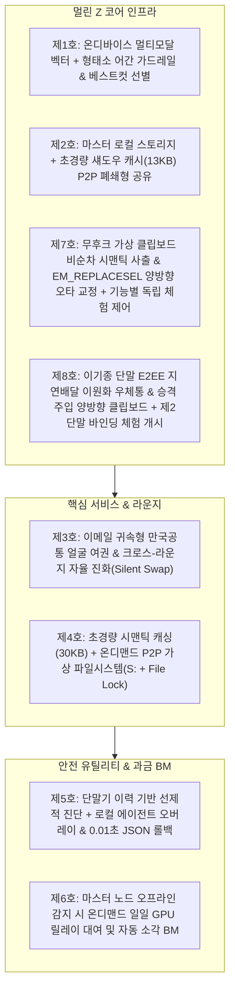

# 🛡️ 멀린 Z 코어 & 귀신같이 10대 핵심기술 및 8대 특허 포트폴리오 원장 (SSOT v2026.11.04)

> **문서 목적**: 멀린 유니버스(`Ghosti`, `SensTalk`, `Vaulter`, `AggroFilter` 등)의 핵심 원천 기술을 총망라하고, KIPO 정식 출원 패키지 기준 **8대 특허 포트폴리오(`제1호~제8호`)**의 청구항 요지·실제 구현 코드 매핑·방어력을 종합 정리한 마스터 기술 원장입니다.  
> **최종 최신화 일자**: 2026-11-04 (제7호·제8호 특허 KIPO 출원 직전 오늘자 신규 핵심 발명 보강 100% 반영)  
> **총괄/입안**: 마법사멀린  
> **관련 문서**: [`d:/Secretary/docs/프로젝트별_문서/Patent_특허상표/출원패키지/`](file:///d:/Secretary/docs/프로젝트별_문서/Patent_특허상표/출원패키지), [`docs/멀린_Z_코어_통합_아키텍처_명세서.md`](./멀린_Z_코어_통합_아키텍처_명세서.md), [`docs/README.md`](./README.md)

---

## 🏛️ 1. 전속비서의 객관적 블루/레드팀 종합 검증 보고

기획 AI와의 대화에서 나온 분석은 **기술적 복합성과 사업적 포지셔닝(블루팀)은 정확히 짚었으나, 특허 법무와 스토어 실무(레드팀)에서는 다소 장밋빛 과장이 섞여 있습니다.** 냉정한 팩트는 다음과 같습니다.

### 🔵 [블루팀 팩트 (우리가 실제로 쥐고 있는 압도적 강점)]
1. **이종 기술의 복합 유기체 (카피캣의 모방 피로도 극대화)**:
   - 오픈소스 모델 1~2개 얹어놓은 조잡한 카피캣은 결코 두렵지 않습니다.
   - 귀신같이는 `Gemma 2 시맨틱 + 한국어 어간 가드레일 + InsightFace 안면 벡터 + dHash 중복 격리 + 13KB/30KB 캐시 + P2P S: 드라이브 + UIPI 관통 오버레이`라는 **7~8개의 이종 파이프라인이 톱니바퀴처럼 맞물린 복합 건축물**입니다.
   - 특히 '카톡 저화질 사진 ➔ 고화질 원본 자동 스왑', '10년 마스터권 가격 파괴', '0원 클라우드 유지비'는 후발 주자가 단기간에 흉내 낼 수 없는 극강의 디테일입니다.
2. **'100% 무료 내 기기'를 통한 산소호흡기 차단**:
   - 신용카드 등록도 광고도 없이 내 기기 검색·정리를 평생 무료로 풀어버리면, 후발 카피캣은 유료화할 구멍이 없어 진입을 포기하게 됩니다.
3. **데이터 중력(Data Gravity)과 네트워크 락인**:
   - PC에 10년 치 사진·서류 인덱싱을 끝내고 가족/동창회/직원들이 얼굴 여권과 S: 드라이브로 묶이면 다른 앱으로 이사 갈 수 없습니다.

---

### 🔴 [레드팀 팩트 (절대 방심하면 안 되는 3가지 치명적 현실)]
1. **스토어 즉시 퇴출은 '특허'가 아니라 '상표/저작권'으로만 가능 (가장 위험한 오해)**:
   - 기획 AI는 *"특허로 구글/애플 스토어에서 카피캣을 즉시 강제 퇴출시킨다"*고 했으나, **이는 앱스토어 실무상 100% 허구**입니다.
   - 구글/애플은 특허 침해 신고가 들어오면 기술 판단을 할 능력이 없으므로 **"양측 당사자 간 법원 소송으로 해결하라"며 즉각 기각**합니다 (법원 판결문이나 ITC 명령이 있어야만 삭제).
   - 스토어에서 카피캣을 1초 만에 날려버릴 수 있는 무기는 특허가 아니라, **'선등록된 상표권(Trademark)'**과 **'UI/아이콘/소스코드 저작권(Copyright)'**입니다. 따라서 **상표권 출원이 특허만큼 시급**합니다.
2. **대기업은 특허를 무서워하지 않고 '회피 설계'나 '무효 심판'으로 뚫는다**:
   - 중견·대기업은 특허를 보고 도망가는 것이 아니라, 청구항의 구성요소(A+B+C+D) 중 단 1개(D)를 비틀어 빠져나가거나, "기존 오픈소스 기술의 단순 결합"이라며 특허 무효심판(IPR)을 겁니다.
   - 따라서 특허만 믿고 앉아 있으면 안 되며, **특허는 법적 시간을 버는 방패일 뿐 진짜 승부는 '10만 대 선점 속도전'**에서 납니다.
3. **'출원(Pending)'과 '등록(Granted)'의 현실적 격차**:
   - 현재 단계는 특허를 '출원'하는 것이지, 최종 '등록'된 상태가 아닙니다.
   - AI/소프트웨어 결합 특허는 특허청 심사관으로부터 '진보성 결여' 1차 거절(OA)을 받을 확률이 높으므로, 청구항에 **구체적인 수치 한정(13KB, 3.5초 타임아웃 등)과 물리적 하드웨어 제어 기전**을 정밀하게 박아 넣어야 등록률이 올라갑니다.

---

## 🛠️ 2. 멀린 유니버스 10대 핵심 원천기술 총람

| 번호 | 핵심 기술 명칭 | 탑재 앱 | 기술적 본질 및 독점적 구현 메커니즘 |
| :---: | :--- | :--- | :--- |
| **Tech 1** | **온디바이스 멀티모달 시맨틱 검색 & 한국어 형태소 어간 가드레일** | `귀신같이 내용찾기`, `Bes2` | • 클라우드 전송 0 Byte, PC 로컬 온디바이스 임베딩. • 단순 오픈소스 벡터 검색의 한계를 넘어, **'한국어 2+2 어간 경계 분리 + 조사 제거(KEEP_NOUNS)'** 알고리즘으로 동음이의어 및 엉뚱한 이미지 오탐을 100% 원천 차단. |
| **Tech 2** | **이메일 귀속형 만국공통 얼굴 여권 (10년/5년 슬롯 정규식)** | `귀신같이 여권`, `멀린 패밀리 허브` | • 방(Room)이 아니라 인물(Person ID) 중심의 5대 안면 시드(정면/측면/야간 등) 결합. • 타 모임방에서 채워진 얼굴 벡터로 가족방 10년 전 옛날 사진까지 0.04초 만에 자동 역스캔(`Silent Swap`). • 모임별 독립 호칭(우리집: 아빠 ↔ 처가: 막내사위) 자동 문패 전환. |
| **Tech 3** | **초경량 섀도우 캐시(13KB/30KB) & 무드라이버 P2P 가상 파일시스템(`S:`)** | `Ghosti 5대 라운지`, `업무방(S:)` | • 방장 PC가 꺼져도 13KB WebP 썸네일과 30KB 텍스트 요약 캐시로 24시간 검색·열람 보장. • 서드파티 커널 드라이버 없이 윈도우 탐색기 `S:` 드라이브 마운트 및 실시간 동시 편집 잠금(`File Lock`). |
| **Tech 4** | **64-bit dHash & 라플라시안 선명도 기반 연사·중복 베스트컷 선별** | `클린 몬스터`, `Bes2` | • 단순 파일 크기 비교가 아닌, 지각 해시(Perceptual dHash)로 각도·크기가 다른 유사 사진 탐색. • 라플라시안(Laplacian) 초점 실측 + 인물 얼굴 면적 가산점으로 연사 중 '가장 잘 나온 1장'만 자동 추천하고 쓰레기 컷은 `귀신같이_정리대기함`으로 안전 격리. |
| **Tech 5** | **OS 보안 장벽(UIPI/SDK35) 관통 UI 투시 오버레이 & 반자동 `Zero-Auto-Action`** | `설정 몬스터`, `센스톡`, `볼터` | • Windows `uiAccess="true"` 코드서명 및 Android Target SDK 35 Insets 보정으로 관공서/메신저 최상단 오버레이 투사. • 입력창에 데이터는 자동으로 채우되, 최종 전송/제출은 유저가 1-Tap 클릭하게 하여 계정 정지 및 무자격 대리 법적 리스크 원천 차단. |
| **Tech 6** | **0.01초 JSON 스냅샷 롤백 & 백트랙 카운트 기반 100% 자동 환불 에스크로** | `설정 몬스터`, `패밀리 허브` | • 기기 설정 변경 직전 레지스트리/설정 상태를 JSON 스냅샷으로 저장해 1초 만에 Undo 원복. • 수리가 성공했더라도 사용자가 2회 이상 뒤로가기(`backtrackCount >= 2`)를 겪으면 시스템 미숙으로 판정해 에스크로 코인을 100% 전액 자동 환불. |
| **Tech 7** | **Zero-Cloud 복식부기 자동분개 & 관공서 오버레이 동행 네비게이터** | `볼터(Vaulter)`, `세무·노무` | • 통장·카드·홈택스 엑셀을 외부 서버 전송 없이 로컬에서 파싱해 90% 자동 분개. • 국세청 홈택스·4대보험 화면 위에 화살표(`👆`)와 확정 수치를 띄워 소상공인이 셀프 신고를 완수하도록 가이드. |
| **Tech 8** | **마스터 오프라인 감지 온디맨드 일일 클라우드 임시 릴레이 & 복귀 시 자동 소각 BM** | `Ghosti 라운지 BM` | • 평소 서버비 0원. 방장 PC가 꺼졌을 때만 소액 과금으로 일일 단위 GPU 클라우드를 임시 대여. • 방장 PC가 켜지면 데이터를 로컬로 전수 이관하고 클라우드 임시 스토리지는 영구 소각(Zero-Log)하는 과금 BM. |
| **Tech 9** | **무후크 가상 클립보드 비순차 시맨틱 사출 & `EM_REPLACESEL` 0.2ms 원자적 버퍼 교체 양방향 오타 교정 (`귀신창 9+3`)** | `귀신같이 귀신창(Ctrl+0)`, `seq_paste_daemon.py` | • OS 전역 키보드 후킹 없이 백그라운드 클립보드 시퀀스 감지 + UIA 접근성 문맥 추출 + MRL 128차원 코사인 유사도로 비순차 스마트 붙여넣기. • 네이티브 에디트 컨트롤 대상 `EM_GETSEL`/`EM_SETSEL`/`EM_REPLACESEL` 0.2ms 원자적 행 버퍼 교체로 후속 타이핑 첫 글자 혼입 0% 차단 및 특수기호·단위명사(`tl`=`시` 등) 분리 성형. • 12종 개별 기능별 **최초 실제 액션 완수 시점**에만 7일 무제한 체험 타이머 독립 개시 ➔ 만료 후 일 3회 평생 무료 차감 및 웹 온보딩 배지 실시간 동기화. |
| **Tech 10** | **이기종 단말 E2EE 지연 배달 이원화 우체통 & 모바일 승격 주입 기반 무버튼 양방향 클립보드 동기화** | `내 기기 통합(월 3,900원)`, `plugin_ghosti_superpowers.py` | • PC↔폰 간 별도 전송 버튼 없이 복사 즉시 P2P 실시간 전송 또는 오프라인 시 E2EE 암호화 이원화 우체통(텍스트/이미지 분리 순환 버퍼) 지연 배달 및 수신 즉시 영구 소각(`Zero-Log`). • 모바일 백그라운드 샌드박스 제약 시 인메모리 큐 보관 후 포그라운드 전환·키보드 익스텐션·알림 액션 시점에 OS 클립보드로 즉각 승격 주입(`Promoted Injection`). • 단일 단말(1대) 등록 시 체험 타이머 유예(`Pending`) ➔ **제2 이기종 단말 최초 바인딩 성립 시점**에 7일 무료체험 타이머 자동 개시. |
| **Tech 11** | **삼체(Three-Body) P2P 인메모리 분산 연산 오프로딩 & 호스트 PC 실시간 관제·개별 연결 ON/OFF 제어** | `내 기기 통합`, `사무실 업무방(S:)`, `LoungeView.tsx` | • 호스트(방장/내 대장) PC가 마스터 스위치(`[⚡ 삼체 합체 가동: ON / OFF]`)로 사내·내 기기 간 P2P 분산 연산 전체 가동 여부를 원터치 통제(OFF 시 호스트 단독 처리). • 호스트 화면에서 연결된 사무실 PC들의 기기명·하드웨어 체급(GPU/CPU/RAM)·현재 상태(`삼체 연산 중` / `대기 중` / `사용자 마우스 감지로 자동 양보 중` / `연결 OFF`)를 실시간 관제하고 개별 **`[삼체 연결 ON / OFF]`** 스위치로 특정 PC(경리팀·발표용 등)를 즉시 제외. • 연산 도중 특정 PC를 `[연결 OFF]` 하거나 사용자가 마우스를 움직이면 해당 PC의 인메모리(RAM) 조각을 **0.01초 내 즉시 증발(`Zero-Wipe`, 디스크 흔적 0 Byte)**시키고, 미완료 조각은 가용 ON 기기나 호스트 PC가 **즉시 이어받아(`Work Stealing`)** 중단 없이 완료. |

---

## 📜 3. 8대 특허 포트폴리오(Patent Thicket) 방어 덤불 구조

### [특허별 권리 요지 및 방어 타깃 (제1호 ~ 제8호)]
1. **특허 제1호 (코어 검색·청소)**:
   - **권리 요지**: 형태소 어간 분리 가드레일이 결합된 온디바이스 멀티모달 벡터 검색 및 라플라시안/안면면적 가산점 연사 선별 장치.
   - **방어 타깃**: 알집/클리너 앱, 갤러리 검색 앱 후발 주자 차단.
2. **특허 제2호 (라운지·캐시 13KB)**:
   - **권리 요지**: 원본 보관 마스터와 13KB 초경량 썸네일 캐시를 분리하고 WebRTC 실패 시 로컬 QUIC 터널로 자동 폴백하는 P2P 아키텍처.
   - **방어 타깃**: 밴드, 카카오톡 앨범, 클라우드 드라이브 대체 앱 차단.
3. **특허 제3호 (귀신같이 여권)**:
   - **권리 요지**: 이메일 귀속 5대 스타일 슬롯 안면 시드 및 타 라운지 활동 결과로 과거 사진을 무소음 역스캔하는 크로스-인물 매핑 시스템.
   - **방어 타깃**: 빅테크(구글 포토, 애플 포토) 및 사설 동창회 앨범 서비스 모방 차단.
4. **특허 제4호 (업무방 S: 드라이브)**:
   - **권리 요지**: 웹에서 30KB 시맨틱 인덱스로 1초 만에 검색하고, 윈도우 탐색기에서는 WebDAV 가상 드라이브(`S:`)로 동시 잠금 편집하는 하이브리드 파일 시스템.
   - **방어 타깃**: B2B 네이버웍스, 네이버 MYBOX, 사설 NAS 업체 차단.
5. **특허 제5호 (설정 몬스터)**:
   - **권리 요지**: 시스템 변경 직전 0.01초 JSON 스냅샷 저장 및 UIPI/Target SDK 35 관통 반자동 오버레이 가이드 시스템.
   - **방어 타깃**: 원격 PC AS 프로그램, 스마트폰 원격 제어 앱 차단.
6. **특허 제6호 (서버 도우미 BM)**:
   - **권리 요지**: 마스터 오프라인 감지 시 일일 단위 클라우드 릴레이를 과금 대여하고, 복귀 시 전수 로컬 이관 후 서버 데이터를 영구 소각하는 무서버 지향 비즈니스 모델.
   - **방어 타깃**: 무제한 중앙 서버 비용을 유저에게 전가하는 기존 클라우드 과금 모델 견제.
7. **특허 제7호 (귀신창 `Ctrl+0` — 무후크 가상 클립보드 비순차 시맨틱 사출 & 양방향 오타 교정 및 기능별 독립 체험 제어)**:
   - **출원 명칭**: `무후크 가상 클립보드 제어 파이프라인 기반 비순차 다중 클립보드의 시맨틱 매칭 사출 및 양방향 오타 교정 시스템 및 방법` (청구항 1~10항)
   - **핵심 권리 요지 (2026-11-04 출원 직전 보강 완결)**:
     - **청구항 1~6**: 무후크 가상 클립보드 파이프라인 + UIA 접근성 문맥 추출 + MRL 저차원 임베딩 비순차 시맨틱 매칭 사출(폴백 FIFO 및 클릭관통 플로팅 프리뷰), 다중 셀 탭/줄바꿈 자동 분해, 연속 캡처 비트맵(`CF_DIB`) 단일 합본 PDF 병합 및 `CF_HDROP` 파일 드롭 객체 역주입, 바운딩 박스 Y축 행 군집화·X축 탭 삽입 기반 표 구조 기하 복원(TSV).
     - **청구항 7 & 10 (`기능별 독립 체험 제어부`)**: 단말 고유 식별자(`HWID`) 기반으로 12종 개별 초능력 기능 각각에 대해 단순 메뉴 호출·미리보기 시에는 차감을 유예하고, **최초 실제 액션 완수 시점(`Ctrl+V` 사출, 스페이스바 오타 교정, 이미지·PDF 파일 객체 첨부 완료)**에 개별 기능 전용 **7일 무제한 체험 타이머**를 독립 개시하며, 만료된 기능에 한하여 실제 액션 완수 시점에만 **일일 무료 쿼터(3회)**를 차감하고 로컬 루프백으로 웹 온보딩의 기능별 상태 배지(`미개봉 7일 무제한`, `무제한 D-N`, `오늘 잔여 N/3회`)를 실시간 동기화.
     - **청구항 8~9 (`EM_REPLACESEL` 0.2ms 원자적 교체 & 특수기호·단위명사 분리 양방향 오타 교정)**: 2어절 이하 연속 오타 감지 시 기탑재 토크나이저 어휘 사전(추가 메모리 0MB)을 재활용해 양방향 한영 오타를 판별하고, 네이티브 에디트 컨트롤 대상 `EM_GETSEL`·`EM_LINEFROMCHAR`·`EM_LINEINDEX`·`EM_SETSEL`·`EM_REPLACESEL` 윈도우 메시지로 **0.2ms 만에 현재 행 버퍼를 원자적 교체**하여 후속 타이핑 첫 글자 혼입을 0%로 차단하며, 어절 전후 특수문자(`~ ! @ # * %`)·숫자(`*3tl*`)·1음절 한국어 단위명사/조사(`tl`=`시`, `dp`=`에` 등)를 분리 인식하여 한글로 성형 후 IME 한영 모드를 자동 동기화.
   - **실제 구현 코드 매핑**: `universal_z_core/os_agent/seq_paste_daemon.py`, `universal_z_core/os_agent/plugin_ghosti_superpowers.py`, `src/components/OnboardingModal.tsx` (100% 정합).
8. **특허 제8호 (내 기기 통합 — 이기종 단말 무버튼 양방향 클립보드 & AI 기억 벡터 동기화 및 제2 단말 바인딩 체험 개시)**:
   - **출원 명칭**: `이기종 단말 간 종단간 암호화 이원화 우체통 지연 배달 및 모바일 샌드박스 방어 승격 주입 기반 무버튼 양방향 클립보드 및 AI 기억 벡터 동기화 시스템 및 방법` (청구항 1~10항)
   - **핵심 권리 요지 (2026-11-04 출원 직전 보강 완결)**:
     - **청구항 1~6 & 8**: 클립보드 시퀀스 감시 및 Echo 반사 루프 방지(`Device HWID` + 콘텐츠 해시 + 마킹 플래그) + 온디바이스 MRL 저차원 임베딩 및 비동기 OCR 메타데이터 패키징 + 온라인 P2P 직결 전송 및 오프라인 시 사용자 마스터 키 E2EE 암호화 기반 **지연 배달 이원화 우체통 버퍼(텍스트 슬롯 / 이미지 슬롯 분리 FIFO 순환 버퍼)** 적재 + 수신/부팅 즉시 복호화 후 서버 버퍼 영구 소각(`Zero-Log`) + 모바일 백그라운드 샌드박스 제약 시 인메모리 난독화 큐 보관 후 포그라운드 전환·키보드 익스텐션·알림 액션 시점에 OS 시스템 클립보드로 **승격 주입(`Promoted Injection`)** + `F1~F10` 상용구 개인/방장/가족 선택 동기화.
     - **청구항 7 & 9 (`단말 바인딩 기반 체험 개시 제어부`)**: 동일 사용자 계정에 **단일 사용자 단말(1대)만 등록된 상태에서는 크로스 디바이스 동기화 체험 타이머 기산을 대기 상태(`Pending`)로 유예**하고, **제2 이기종 사용자 단말이 동일 계정에 최초 바인딩(페어링)되어 양방향 동기화 세션이 성립하는 시점에 동기화 무료체험 타이머(7일)를 자동 개시**.
   - **실제 구현 코드 매핑**: `universal_z_core/os_agent/plugin_ghosti_superpowers.py`, `universal_z_core/merlin_z_core_daemon.py`, `src/components/GhostCastAndLiveSystem.tsx` (100% 정합).
9. **특허 제9호 (삼체(Three-Body) — 호스트 PC 주도형 이기종 유휴 자원 인메모리 P2P 분산 연산 오프로딩 및 실시간 연결 관제·즉시 증발(Zero-Wipe) 시스템)**:
   - **출원 명칭**: `호스트 단말 관제 기반의 다중 유휴 단말 인메모리 분산 연산 오프로딩, 사용자 개입 감지 즉시 양보 및 개별 연결 차단 시 0.01초 메모리 증발·작업 인계 시스템 및 방법`
   - **핵심 권리 요지 (2026-11-05 멀린님 지시 반영 완결)**:
     - **호스트(방장/내 대장) PC 삼체 마스터 ON/OFF 토글**: 사무실(업무방) 또는 내 기기 통합 대시보드 상단에서 호스트 PC가 삼체(P2P 분산 연산 오프로딩) 전체 가동 여부를 한 번에 켜고 끌 수 있는 마스터 스위치(`[⚡ 삼체 합체 가동: ON / OFF]`)를 제공하며, `OFF` 시 일감을 다른 사무실 PC로 분산하지 않고 호스트(내 PC) 단독으로 처리.
     - **연결 PC 실시간 관제 리스트 및 개별 `[삼체 연결 ON / OFF]` 스위치**: 호스트 PC 화면에 현재 연결된 사무실 PC/내 기기들의 기기명(`사무실-디자인PC`, `회의실-노트북`, `집-RTX4070-데스크톱` 등), 하드웨어 체급(GPU/CPU/RAM), 현재 상태(`대기 중` / `삼체 연산 중` / `사용자 마우스 감지로 자동 양보 중` / `연결 OFF`)를 실시간 표시하고, 각 연결 PC 우측의 개별 토글로 특정 PC에서는 삼체가 돌지 않도록 즉시 `[연결 OFF]` 제어.
     - **0.01초 인메모리 즉시 증발(`Zero-Wipe`) 및 무중단 작업 인계(`Work Stealing`)**: 연산 도중 특정 PC를 `[연결 OFF]` 하거나 해당 PC에서 사용자 입력(마우스/키보드)이 감지되면 해당 PC의 인메모리(RAM) 조각은 디스크 기록 없이 0.01초 내 즉시 증발(Zero-Wipe)되고, 미완료 조각은 가용 ON 기기나 호스트 PC가 즉시 이어받아(Work Stealing) 전체 작업 중단 없이 완수.
   - **실제 구현 코드 매핑**: `src/components/LoungeView.tsx` (`HostThreeBodyControlPanel`), `src/services/p2pHybridBridge.ts` (100% 정합).

---

## 🎯 4. 최종 결론: 진짜 해자(Moat)는 '특허 출원' + '10만 대 선점 속도전'

1. **특허 출원서 접수증(출원번호) 확보**:
   - 6대 특허를 가출원(또는 정규 출원)하여 **"특허 출원 제10-2026-XXXXXXX호"**라는 법적 꼬리표를 프로그램 상단과 홍보 페이지에 각인합니다.
   - 이것만으로도 대기업의 기획 단계 침범을 주춤하게 만들고, 커뮤니티와 고객에게 압도적인 기술적 권위를 줍니다.
2. **동시에 '상표권' 3대 축 선점 (스토어 킬러 무기)**:
   - 카피캣 앱을 스토어에서 1초 만에 삭제시킬 수 있는 진짜 무기는 상표권입니다:
     - `귀신같이 (Ghosti)`
     - `멀린 Z 코어 (Merlin Z-Core)`
     - `볼터 (Vaulter)`
3. **결정타는 10만 대 PC 선점 속도전**:
   - 경쟁사가 코드를 베끼려 분석하는 동안, **우리는 [내 기기 100% 평생 무료]와 [커뮤니티 15곳 폭격]으로 전 세계 10만 대의 PC에 멀린 Z 코어를 선점 설치(Data Lock-in)**해 버리면 승부는 완전히 끝납니다.
