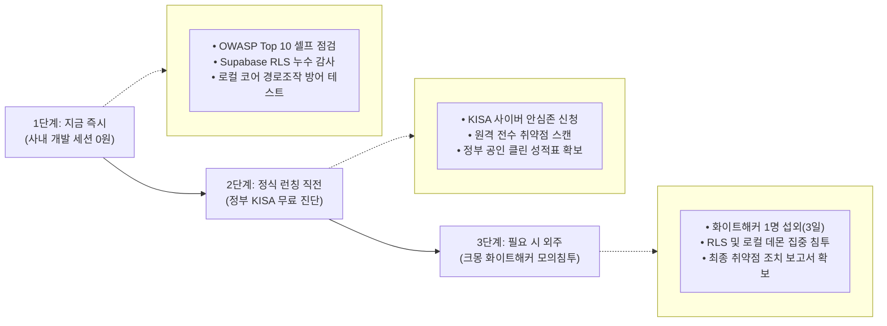

# 🛡️ 귀신같이(Ghosti) 시스템 보안 점검 및 모의해킹 대응 마스터 가이드

> **문서 상태:** 정규 보안 관리 지침서 (SSOT)  
> **작성 일자:** 2026-10-28  
> **적용 범위:** 『귀신같이』 프론트엔드 Web/PWA, 백엔드 Supabase RLS, 로컬 네이티브 코어(`Merlin Z-Core`, 포트 `5199`), P2P 통신 및 가상 `S:` 드라이브  
> **문서 목적:** 정부(KISA) 무료 진단 활용, 사내 0원 셀프 모의 침투, 전문 화이트해커 의뢰 기준, 그리고 우리 시스템 3대 보안 급소에 대한 선제적 철통 방어 체계 수립

---

## 🏛️ 1. 당장 무료로 지원받을 수 있는 공공 보안 점검 (정부 KISA 지원)

정부(KISA, 한국인터넷진흥원)에서 스타트업과 중소기업의 해킹 피해를 방지하기 위해 100% 무료로 보안 취약점 진단 및 모의해킹을 상시 지원하고 있습니다.

### 1.1 KISA ‘내PC 돌보미 / 중소기업 사이버 안심존 (보안 취약점 점검)’
- **지원 내용:** 한국인터넷진흥원에서 운영하며, 신청 시 보안 전문가가 당사 웹 서버(Supabase 연동부, API) 및 배포용 소프트웨어의 기본 포트, 취약점을 원격으로 전수 스캔·진단.
- **소요 비용:** **전액 무료 (정부 100% 지원)**
- **기대 효과:** 진단 완료 후 **공식 진단 결과 보고서**가 발급되므로 초기 대외 공신력 및 엔터프라이즈 신뢰도 확보에 매우 유용.

### 1.2 KISA ‘소프트웨어 보안약점(시큐어 코딩) 진단 서비스’
- **지원 내용:** 중소기업이 개발한 소스코드(프론트엔드/백엔드)를 정적 분석 도구와 보안 전문가가 심층 검토하여 SQL 인젝션, 경로 조작(Path Traversal), 암호화 결함, 세션 하이재킹 취약점 등을 사전에 탐지·조치 가이드 제공.
- **소요 비용:** **전액 무료**

---

## 💻 2. 개발팀(안티그래비티) 즉각 실행 0원 자체 보안 테스트 도구

외부 진단에 앞서 개발 세션에서 선제적으로 시스템을 타격하여 방어벽을 검증하는 3대 도구입니다.

### 2.1 OWASP ZAP (Zed Attack Proxy) — 웹 & API 모의 침투
- **운영 방식:** 전 세계 웹 보안 표준 기구(OWASP)의 무료 오픈소스 보안 스캐너.
- **실행 대상:** 로컬호스트(`http://localhost:5173`) 및 실서버 배포 주소(`https://ghosti.sundreamer.app`).
- **검증 항목:** 가상의 공격자가 되어 수천 가지 웹 취약점 공격(XSS, CSRF, 세션 하이재킹, 인증 우회, 헤더 인젝션 등)을 자동 수행하고 취약점 조치 리포트 도출.

### 2.2 Nmap & Wireshark — 로컬 PC 포트 노출 및 패킷 검사
- **운영 방식:** 로컬 데몬(`Merlin_Z_Core.exe`, 127.0.0.1:5199) 상주 시 외부 공격자가 침투할 수 있는 위험 포트가 열려 있는지 스캔.
- **검증 항목:** 공유기 외부 공용망(External WAN) 및 로컬 서브넷에서 단말 IP를 Nmap으로 타격하여 루프백 이외의 불필요한 포트가 철저히 닫혀(Filtered/Closed) 있는지 확인.

### 2.3 P2P 세션 탈취 및 경로 조작 (Directory Traversal) 테스트
- **운영 방식:** P2P 데이터 교환 및 로컬 브릿지 파일 조회 API 호출 시 상대방이 `../../Windows/System32` 또는 `../../Users/AppData` 같은 상대 경로 조작 쿼리를 인젝션했을 때의 방어력 테스트.
- **검증 항목:** 화이트리스트로 승인된 허용 디렉토리(사진첩, 다운로드, 바탕화면 등) 바깥의 시스템 영역 파일이 절대 노출·유출되지 않는지 엄격한 샌드박스 잠금 검증.

---

## 🏢 3. 전문 보안업체 모의해킹 (크몽 / 보안 전문 법인)

투자 유치(IR)나 B2B 엔터프라이즈(기업용 `S:` 드라이브) 정식 납품을 위해 외부 '공인 모의해킹 결과 보고서'가 필요한 경우의 단계별 외주 가이드입니다.

| 구분 | 대상 채널 | 예상 비용 | 수행 내용 및 활용 |
| :---: | :--- | :---: | :--- |
| **초기 실속형** | **크몽 / 숨고** (인증 화이트해커) | **약 50만 원 ~ 150만 원** | • 인증된 정보보안기사/화이트해커가 블랙박스(외부 침투 시도) 및 그레이박스(일반 계정 상태에서 권한 상승 시도) 방식으로 웹/API 집중 타격 • 실무적인 취약점 패치 리포트 확보 |
| **엔터프라이즈형** | **전문 정보보안 컨설팅 기업** (SK쉴더스, 안랩 등) | **수천만 원 단위** | • 시리즈 A 투자 유치 이후 및 대기업/관공서 입찰 납품 시점에 추진 (초기 단계에서는 과도한 예산이므로 보류) |

---

## 🔍 4. 우리 서비스(Ghosti) 모의해커 집중 타격 3대 핵심 구역

외부 모의해킹을 의뢰하거나 자체 침투 테스트 코드를 작성할 때, 반드시 아래 3개 구역을 **최우선 표적(Primary Target)**으로 지정해야 합니다:

### ① Supabase RLS (Row Level Security) 권한 우회
- **공격 시나리오:** 게스트 유저나 악의적인 타 모임방 멤버가 웹 브라우저 콘솔에서 JWT 토큰 또는 REST 쿼리를 변조하여, 본인이 속하지 않은 **남의 가족방·업무방의 사진 메타데이터, 얼굴 여권 시드, 썸네일, 채팅 기록을 탈취**할 수 있는지 여부.
- **방어 대책:**
  - Supabase 테이블 전체에 `ENABLE ROW LEVEL SECURITY` 100% 강제.
  - `auth.uid()`가 해당 `lounge_id`의 `lounge_members`에 정식 승인(`APPROVED`) 상태로 등록되어 있는지 확인하는 엄격한 RLS 정책 수립.

### ② 로컬 에이전트 파일 접근 권한 탈취 (Directory Traversal)
- **공격 시나리오:** 웹 프론트엔드 또는 P2P 명령을 통해 유저가 허용한 3대 구역(사진/다운로드/바탕화면) 외의 C드라이브 비밀 폴더, 인증서(`NPKI`), 시스템 파일(`C:\Windows\System32\drivers\etc\hosts` 등)을 임의로 읽거나 덮어쓸 수 있는지 여부.
- **방어 대책:**
  - 코어 엔진(`plugin_ghosti_os.py`) 파일 처리 함수에 `os.path.abspath` 및 `os.path.commonpath` 검증 로직 강제.
  - 허용된 루트 디렉토리 경계를 벗어나는 모든 경로는 0.001초 만에 `Access Denied (403)` 차단 및 침투 시도 감사 로그 기록.

### ③ 가상 S: 드라이브 마운트 시 파일 락(Lock) 무력화 & DoS
- **공격 시나리오:** 다중 사용자가 동시에 문서를 수정하는 B2B 업무 공유 환경에서, 악의적인 클라이언트가 가상 파일시스템 드라이버를 통해 마스터 PC에 비정상적인 버퍼 오버플로우를 유발하거나 파일 락(Lock)을 강제 해제하여 원본을 훼손할 수 있는지 여부.
- **방어 대책:**
  - 로컬 데몬 레벨에서 파일 핸들(Handle) 독점권 검증.
  - 비정상 대량 I/O 요청 시 서킷 브레이커(Circuit Breaker)를 발동하여 세션 강제 차단.

---

## 📋 5. 공식 추천 실행 3단계 로드맵

1. **1단계 (지금 즉시 / 개발팀 자체 점검 · 0원):**
   - Supabase 테이블 RLS 전수 점검.
   - 로컬 Z-코어 브릿지(`plugin_ghosti_os.py`)의 Directory Traversal 경로 차단 검증.
   - 외부 포트 노출 방어(오직 `127.0.0.1` 루프백만 허용).
2. **2단계 (정식 런칭 직전 / KISA 공공 무료 진단 · 0원):**
   - KISA(한국인터넷진흥원) 사이버 안심존 및 소프트웨어 시큐어 코딩 무료 진단을 신청하여 공공 기관 차원의 1차 클린 성적표 확보.
3. **3단계 (투자 유치 및 B2B 확장 시점 / 필요 시 외주 검토):**
   - 크몽 등에서 검증된 화이트해커(50~100만 원 선)를 섭외해 3일간 집중 모의 침투를 거쳐 대외 제출용 취약점 조치 결과 보고서 확보.
