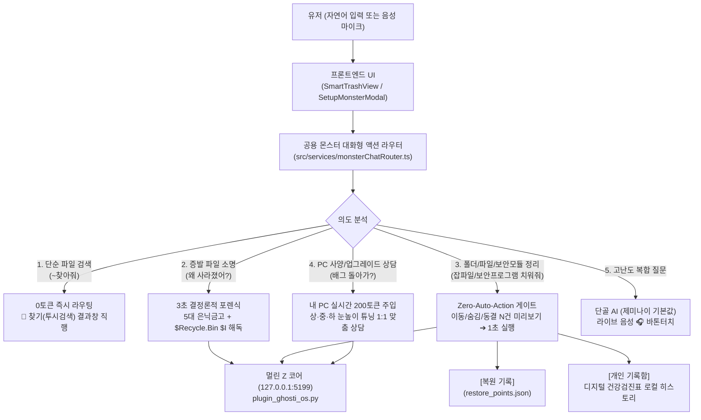

# ✋ 손보기 (폴더·파일 정돈 + PC·폰 진단·수리·복원 통합) — 최종 통합 기획 및 엔지니어링 명세서

> **문서 상태:** 멀린님 최종 승인 확정본 (SSOT v2026.11.06 In-Place 최신화 — 구명칭 및 폐기된 원격 폰 정리/앱 동결 잔재 전면 제거 완료)  
> **최종 확정일:** 2026-11-06  
> **적용 앱:** 『귀신같이』 (Ghosti) — **`[✋ 손보기]` 단일 통합 탭** (기존 `[🧹 치우기]` + `[⚙️ 고치기]` 전면 통합, 슬로건: *"혼자 쓸 땐 귀신같이 찾고 손보고! | 가족·팀과 함께 쓸 땐 귀신같이 공유하고!"*)  
> **통합 엔진:** 『멀린 Z 코어 (Merlin Z-Core)』 (단일 표준 포트 `127.0.0.1:5199`)  
> **기본 철학:** **"혼자 쓸 땐 언제나 0원(100% 무료 무제한), 노션(Notion) 스타일의 심플한 단일 대화창에서 글자 또는 `🎙️ 음성`으로 비서와 대화해 정리·수리·원복·문서검색·카톡전송을 끝내고(`[🎯 찾기] ↔ [✋ 손보기]` 양방향 0토큰 자동 라우팅), 모든 승인과 원복은 유저가 직접 입력한 자연어 문장으로 블랙박스에 영구 기록한다!"**

---

## 0. 🔥 [2026-11-01 멀린님 확정: `🪄 손보기` 단일 탭 4대 역할 통합 & 자연어 타이핑 블랙박스 9대 핵심 규격]

1. **`[🧹 치우기]` + `[⚙️ 고치기]` ➔ **`[🪄 손보기]`** 단일 탭 통합 (`DesktopDashboard.tsx`, `MobileAppView.tsx`, `SmartTrashView.tsx`):**
   - **도입 배경(Why):** 일반 사용자는 PC가 느려지거나 문제가 생겼을 때 그것이 파일을 '치워야' 할 문제인지 설정을 '고쳐야' 할 문제인지 구분하지 못하며, 어차피 하나의 통합 채팅창에서 대화로 해결되므로 탭을 둘로 나누는 것은 UI/UX 동선과 마케팅 메시지를 분산시킵니다. 한국어에서 *"폴더를 손보다(정리하다)"*와 *"기계를 손보다(수리하다)"* 두 가지 뜻을 동시에 품고 `[🎯 찾기]`와 순우리말 동사형 대칭을 이루는 **`[🪄 손보기]`** 단일 탭으로 통합합니다.
   - **상단 메뉴 구조:** **`[🎯 찾기]`** (제목 몰라도 귀신같이 찾고) · **`[🪄 손보기]`** (정리·수리·복원 귀신같이 손보고) · **`[👨‍👩‍👧‍👦 공유]`** (가족·팀과 함께 쓸 땐 귀신같이 공유하고).
2. **노션(Notion) 스타일 미니멀 대화창 & 온보딩 전제 2줄 핵심 가이드 (`MonsterStandardChatColumn.tsx`):**
   - 온보딩에서 기본 기능을 인지하고 진입했다는 전제하에, 채팅창 주변의 산만한 패널과 중복 추천 버튼·개발자용 배지(`JSON 코어 위임` 등)·수동 눈높이 스위치(`[🌱쉬운말 | 🌿일반 | 🌳전문가]`)를 전면 제거합니다.
   - 첫 안내 메시지는 오직 **① 💬 질문 가이드**와 **② ↩️ 승인·원복 가이드** 딱 2줄만 심플하게 표시하며, 하단에는 4개 대표 스타터 칩(`💻 느려짐·사양 점검`, `🧹 바탕화면·설치파일 정리`, `🕵️ 사라진 파일 찾기`, `🕰️ 복원 기록·원복`)만 배치합니다.
3. **저가 LLM(`gemini-2.5-flash`) 4대 비서 화법 철칙 & 질문 어휘 기반 자동 눈높이 (`monsterChatRouter.ts`):**
   - **① 일상 잡담 0토큰 정중 거절:** 평생 무료 구간의 LLM 토큰 낭비를 막기 위해, PC·파일·수리와 무관한 순수 일상 잡담은 0토큰 사전 필터 및 프롬프트 규칙으로 *"죄송합니다만 저는 PC 정리와 수리를 전담하는 비서라 일상 대화는 답변드리기 어렵습니다"*라고 정중히 거절합니다.
   - **② 과한 인사치레·호들갑 금지 (1~2단어 공감):** *"어휴~ 정말 좋은 생각이에요! 제가 클린몬스터인데 걱정 마세요!"* 같은 수다스러운 인사치레를 금지하고, **1~2단어(`"충분히 가능하십니다."`, `"새로 안 사셔도 됩니다."`)로만 짧게 공감**한 뒤 즉시 핵심 결론으로 들어갑니다.
   - **③ 비서 존댓말 고정 & 질문 말투 자동 눈높이:** 유저가 반말로 질문해도 항상 신뢰감 있는 **비서 존댓말(`~입니다`, `~해 드리겠습니다`)**로 답하며, 수동 모드 전환 버튼 없이도 유저 질문에 전문용어(RAM, 점유율, Hz 등)가 있으면 엔지니어링 수치로, 일상어/초보 말투면 쉬운 비유(`작업 공간(메모리)`, `저장 공간`)로 **같은 1회 응답(추가 토큰 0원) 안에서 자동 맞춤 설명**합니다.
   - **④ 기능 JSON 완전 분리 (`thinkingBudget: 0`):** 대화 텍스트(`replyKo`)와 실행 명세(`intent`, `zCoreCommand`)를 순수 JSON으로 분리하여 Z-코어(`127.0.0.1:5199`)에 위임합니다.
4. **사양 질문 시에만 작동하는 '월간 업데이트형 사양 기준표 (`MONTHLY_PC_SPEC_BENCHMARK`)' 조건부 주입:**
   - **토큰 낭비 0% 설계:** 폴더 정리나 파일 찾기 질문에는 사양 기준표를 아예 넣지 않고(0토큰), 오직 유저가 **사양·게임·영상편집·느려짐·업그레이드**를 물어볼 때만(`isSpecOrPerformanceQuery`) **~45토큰 분량의 초압축 기준표**를 조건부 주입합니다.
   - **월간 정기 업데이트(`version: 'YYYY-MM'`):** 경량 모델이 과거 기준으로 조언하지 않도록 매월 1일 정기 점검 시 `MONTHLY_PC_SPEC_BENCHMARK` 상수의 월간 기준치(CPU/GPU/RAM 세대 및 편집·게임 권장 사양)를 최신 상태로 업데이트합니다.
5. **클릭형 승인 버튼 폐지 ➔ '자연어 타이핑 승인' & 블랙박스(`ghosti_blackbox_audit.jsonl`) 영구 기록:**
   - 미리보기 카드에서 클릭형 `[⭕ 확인 완료]` 버튼을 제거합니다 (버튼 클릭만으로는 유저의 명시적 인지·동의 의사가 블랙박스에 남지 않기 때문).
   - 특정 단어를 강제하지 않고 유저가 채팅창에 **`"응 진행해"`**, **`"네 정리해 주세요"`**, **`"좋아 실행해"`**, **`"그래 치워줘"`** 등 승인에 준하는 자연어를 직접 타이핑하면 즉시 실행되며, `%LOCALAPPDATA%\Merlin
estore_points.json` 및 `%LOCALAPPDATA%\Merlin\ghosti_blackbox_audit.jsonl`에 **`userApprovalTypedText`(유저 타이핑 원문)**와 **`approvalMethod: "USER_TYPED_NATURAL_LANGUAGE_CONSENT"`**가 영구 기록됩니다.
6. **복원 지점 수십 개 대응 UI(최근 3건 기본 + 더보기/검색) ➔ '번호(`"1번 복원해줘"`) 타이핑 선택 원복' & 블랙박스 기록:**
   - 유저가 `"복원해줘"`, `"원래대로 되돌려줘"`, `"복원 기록 보여줘"`라고 입력하면 먼저 복원 히스토리 카드를 제시하고 몇 번을 되돌릴지 묻습니다.
   - **복원 지점이 수십 개 쌓였을 때의 스크롤 폭주 방지:** 카드에는 **가장 최근 3건(`#1~#3`)만 기본 표시**하고, 하단 **`[▾ 이전 복원 기록 더 보기 (외 N건)]`** 토글과 **`🔍 번호·날짜·작업명 빠른 검색창`**으로 수십 개의 복원 지점도 깔끔하게 탐색합니다.
   - 유저가 **`"1번 복원해줘"`**, **`"2번"`**, **`"#12 되돌려줘"`**처럼 번호를 타이핑하면 즉시 해당 지점을 원복하고 블랙박스에 **`userRollbackTypedText`**와 **`rollbackMethod: "USER_TYPED_NATURAL_LANGUAGE_ROLLBACK"`**을 영구 기록합니다.
7. **`[🪄 손보기]` 대화창 = 『귀신같이 인포메이션 데스크 (`GHOSTI_INFO_DESK`)』 (0토큰 결정론적 즉답):**
   - **도입 배경(Why):** 유저가 앱 사용법, `Ctrl+0` 귀신창 `[복사검색]` 및 `F1~F10` 상용구 단축키, 요금제(`👑 내 기기 통합 3,900원` 등), 이메일 자동 연결 방법, 신규 업데이트 내역을 물어볼 때 매번 설명서 페이지를 찾아 헤매지 않도록 `[🪄 손보기]` 비서가 공식 인포메이션 데스크 역할을 겸합니다.
   - **작동 방식 (`handleGhostiInfoDeskIfMatched`):** 0토큰 사전 매칭으로 질문 주제에 맞는 핵심 답변과 최신 업데이트 하이라이트를 즉시 안내하고, 관련 액션 버튼(`📖 3탭 온보딩 열기`, `👑 내 기기 통합 요금표 보기` 등)을 카드에 함께 띄웁니다.
8. **`[🪄 손보기]` 대화창 = 『말 한마디로 모든 앱 설정·상용구·클립보드 보관기간·문패 제어 센터 (`APP_SETTINGS_CONTROL`)』:**
   - **도입 배경(Why):** 환경설정 모달 깊숙이 들어가지 않아도 채팅창에서 비서에게 말 한마디만 하면 모든 개인화 설정이 즉시 바뀌어야 진정한 AI 비서 경험이 완성됩니다.
   - **작동 방식 (`handleAppSettingsControlIfMatched`):**
     - *"F1 상용구를 우리은행 1002-...로 바꿔줘"* ➔ 로컬 Z-코어(`POST /api/superpower/snippets`) 및 `seq_paste_daemon.py`의 `F1~F10` 슬롯 즉시 업데이트.
     - *"클립보드 보관 기간 30일로 늘려줘"* / *"오늘만 보관해줘"* ➔ `POST /api/superpower/settings` (`retention_days: 1 | 3 | 7 | 30`, 기본 `7일 300개`, 최대 `30일 1,000개`) 즉시 반영.
     - *"복사기록 싹 비워줘"* ➔ `POST /api/superpower/clear-history` 즉시 초기화.
     - *"애기귀신 소리 꺼줘/켜줘"*, *"귀신창 떠있는 시간 5초로 늘려줘"*, *"모임 문패를 성동고 89회로 바꿔줘"* 등 자연어 명령 즉시 실행 및 인라인 컨트롤 카드 제공.
9. **`[🪄 손보기]` 대화창 = 『클레임 · A/S · 아이디어 스튜디오 대리 접수 창구 (`STUDIO_SUPPORT_PROXY`)』 & `[나의 문의방]` 직통 점프 링크:**
   - **도입 배경(Why):** 고객이 불편사항(클레임), 버그/오류(A/S), 기능 제안(아이디어)을 말할 때 별도 고객센터 사이트로 이동해 다시 로그인하게 만들지 않고, 지금 열려 있는 `[🪄 손보기]` 채팅창에서 말 한마디로 회원 계정(`merlinAuth.email`) 그대로 썬드리머 스튜디오 통합 고객센터에 대리 접수합니다.
   - **작동 방식 (`handleStudioSupportProxyIfMatched` + `submitStudioSupportTicket`):**
     - 유저 발화를 **`🚨 클레임 접수 (CLAIM)`**, **`🛠️ A/S·오류 접수 (AS_BUG)`**, **`💡 아이디어 제안 (IDEA)`** 3대 카테고리로 자동 분류합니다.
     - 로그인된 회원 이메일과 OS/앱 블랙박스 컨텍스트를 담아 스튜디오 통합 CS 테이블(`support_tickets`, `appId: 'Ghosti'`)에 즉시 접수하거나 대화창 내 인라인 접수 카드에서 원클릭으로 전송합니다.
     - 접수 완료 즉시 스튜디오의 무인 자동화 IDE가 티켓을 분석·처리하여 결과를 브리핑하는 **`[🔗 스튜디오 '나의 문의방'에서 AI 처리 결과 바로 보기]`** 직통 SSO 링크(`buildStudioSupportJumpUrl({ appId: 'Ghosti', ticketId, email })`)를 채팅창에 반환합니다.

---

## 1. 🎯 전략적 배경 및 헌법 5대 원칙

1. **내 기기 전면 무료 원칙 (언제나 0원 · 무제한 혜택):**
   - `[내 기기]`의 치우기·고치기는 진단, 스캔, 대화형 상담, 실제 정리 및 수리까지 **평생 0원**입니다.
   - 구버전 문서 및 코드에 남아있던 코인 차감(100/300/500 코인), 잔액 부족 시 충전 유도 모달, 에스크로 환불 로직을 전면 제거합니다.
2. **이원화 실행 및 1초 무위험(Zero-Risk) 원칙:**
   - **파일 삭제:** 복잡한 임의 격리 폴더(`.zeye_quarantine`)를 폐기하고, **`OS 기본 [휴지통]` 직행 + `[↩️ 1초 실행 취소]`**로 직결합니다.
   - **대화형 폴더 이동/숨김:** 로컬 트랜잭션 원장(`[복원 기록]`, `restore_points.json`)에 기록되며, **`[↩️ 1초 원상복구]`**로 되돌립니다.
3. **실물 증거 확인 게이트 (`Zero-Auto-Action`):**
   - AI가 스스로 판단하여 임의로 파일을 지우거나 옮기지 않습니다.
   - 반드시 **`[이동 N건 / 숨김 N건]` 미리보기 카드** 또는 **`실물 증거 텍스트 5줄`**을 유저에게 먼저 제시하고, 유저가 `[⭕ 그대로 실행해 줘]`를 클릭한 순간에만 실행합니다.
4. **통합 AI 두뇌 (공용 대화형 엔진):**
   - 좌측 메뉴는 **`[🧹 치우기]`**와 **`[⚙️ 고치기]`**로 나뉘어 접근성을 높이되, 내부적으로는 **동일한 단일 대화형 엔진**을 공유합니다.
   - `🧹 치우기`에서 OS 고장을 말하든, `⚙️ 고치기`에서 파일 정리를 말하든 유저를 쫓아내지 않고 그 자리에서 즉시 처리합니다.
5. **일상성 기반의 자연스러운 효도 UX:**
   - '노인/효도 전용 모드'를 인위적으로 분리하지 않습니다.
   - 크고 시원한 폰트, 직관적인 시각 피드백, 친절한 일상 비유, `현수` 성우 음성 브리핑이 기본 탑재되어 있어 **누가 써도 자연스럽고 편안한 '효도 그 자체'의 경험**을 제공합니다.

---

## 2. 🏗️ 시스템 아키텍처 및 데이터 흐름

---

## 3. 💬 공용 대화형 엔진 7대 핵심 기능 사양

### ① 자연어 대화형 폴더 & 잡파일 & 보안모듈 정리 (`Zero-Auto-Action`)
- **수행 범위:**
  - 바탕화면/다운로드 폴더 내 업무 무관 잡파일을 `'기타'` 폴더로 이동하거나 오래된 폴더 숨김 처리.
  - 다운로드 폴더 내 **출처 불명 사설 설치파일(`.apk`, `.exe`, `.msi`) 및 방치된 대용량 임시 설치파일** 탐지 및 청소.
  - PC 부팅 및 메모리를 잠식하는 **미사용 웹 보안 서비스(관공서·은행 전자서명/키보드보안/통합설치 상주 모듈 등) 및 불필요한 시작프로그램** 탐지 및 안전 절전.
    - **온디맨드 권한 위임 헬퍼 (`On-Demand Privilege Elevation Helper` — `plugin_ghosti_care_suite.py` v2.1.0):** 일반 권한(`asInvoker`)으로 동작하는 Z-코어 평시 기동 원칙을 지키면서도 실제 `sc stop` / `sc config start= demand` 제어가 100% 작동하도록, 사용자가 **`[⚡ 미사용 웹 보안 서비스 절전 모드 켜기]`** 버튼을 처음 클릭할 때 딱 1회 Windows 표준 UAC 동의(`ShellExecuteW("runas")`)를 거쳐 작업 스케줄러에 **`GhostiSecurityCareHelper`(`HIGHEST` 최고 권한)** 태스크를 등록합니다. 이후 모든 절전(`sleep_security_services`) 및 은행·관공서 창 감지 시 0.15초 선행 기상(`wake_security_services`)은 `schtasks /run /tn "GhostiSecurityCareHelper"`를 통해 **추가 UAC 팝업 0회**로 즉시 실행됩니다. (사내 DRM은 100% 불가침 제외, 커널 자가보호 모듈은 강제 종료 없이 안전 가이드로 분기)
  - **정리 후보 선정 규칙 (Zero-LLM 실측, 2026-10-29 구현):** 바탕화면·다운로드 폴더 **바로 아래 파일만** 대상(하위 폴더·바로가기 `.lnk/.url`·시스템 파일 제외, 파일 본문은 읽지 않음).
    - 다운로드 설치파일 정리: 3일 이상 지난 `.exe/.msi/.apk/.msix/.appx` + 1일 이상 지난 받다 만 파일(`.crdownload/.part/.tmp/.download`).
    - 바탕화면·다운로드 잡파일 정리: 3일 이상 지난 `.tmp/.bak/.log/.crdownload/.part/.zip/.7z/.rar/.exe/.msi/.apk`.
    - 실행 시 삭제하지 않고 **같은 폴더 안의 `기타_정리함`으로 이동**하며, 같은 이름이 있으면 덮어쓰지 않고 `(2)` 등 새 이름을 붙입니다. 이동한 실제 경로(from → to)를 `[복원 기록]`에 남깁니다.
  - 유저가 채팅창에서 요구하는 **"자주 가는 단골 사이트(카페, 유튜브 등) 바탕화면 바로가기 만들어줘"** 등의 OS 편의 요청 유연 처리.
- **실행 게이트:**
  - 대화창에 즉시 **`[정리 미리보기: 이동 N건 / 숨김 N건 / 동결 N건]` 카드** 제시.
  - 유저의 최종 `[⭕ 확인 완료 · 그대로 실행해 줘]` 클릭 전에는 단 1건의 물리 변경도 발생하지 않음.

### ② `[복원 기록]` 3단계 사전 무결성 검진 (`Pre-Check`) & 1초 타임머신 원복
- **공식 명칭:** **`[복원 기록]`** (코더 용어인 커밋/스냅샷 노출 금지).
- **대화형 호출:** *"최근 한 달 복원기록 보여줘"*, *"아까 옮긴 거 다시 돌려놔 줘"*, *"어제 숨긴 폴더 다시 보이게 해줘"*.
- **3단계 무결성 배지:**
  - 🟢 **`[100% 완벽 복원 가능]`**: 대상 파일이 이동 위치에 온전히 보존됨.
  - 🟡 **`[부분 복원 가능 (M건 중 N건)]`**: 일부 파일이 유저에 의해 수정/이동됨.
  - 🔴 **`[복원 불가 (파일 없음)]`**: 대상 파일이 이미 영구 삭제됨.
- **원복 실행:** 유저 확인 즉시 1초 만에 원래 위치로 롤백.

### ③ 3초 결정론적 포렌식 & 윈도우 휴지통 `$I` 바이너리 해독 ‘1초 초월적 소명’
- **대화형 호출:** *"내 파일 왜 사라졌어?"*, *"아까 쓰던 문서가 없어졌어, 네가 지웠어?"*.
- **동작 방식:**
  - AI가 추측하거나 되묻지 않고 0.01초 만에 `[복원 기록]` + 5대 은닉 금고 + 윈도우 `$Recycle.Bin`의 `$I` 바이너리를 동시 스캔.
  - 3초 내에 **"고객님의 문서는 지워진 것이 아니라 휴지통에 보관되어 있습니다(실제 파일명, 크기, 삭제 일시)"**와 함께 **실물 증거 텍스트 5줄 미리보기 + `[📂 1초 원래 위치로 복구]`** 버튼 제공.
  - 10초 내 흔적이 없으면 3대 불가 영역(영구 파쇄, 물리 파손, 타인 암호)을 정직하게 안내(`DOCTOR_3_RED_LINES_NOTICE`).
  - **현재 구현 상태 (2026-10-29):**
    - 오피스 자동복구 금고 스캔은 **3초 제한을 실제로 집행**하며, 시간이 넘으면 확인하지 못한 금고 이름을 결과에 그대로 밝힙니다(`timedOut`, `skippedVaults`). 휴지통 해독 스캔은 10초 제한.
    - 휴지통 조회는 **현재 로그인한 사용자의 휴지통(SID)만**, 모든 로컬 고정 디스크를 대상으로 합니다(다른 계정의 삭제 이력 열람 금지).
    - 복구 방식: ① `[복원 기록]` 항목 → 기록된 경로로 되돌림 ② 휴지통 항목 → `$R` 실물을 원래 경로로 이동(같은 이름이 있으면 `(복원본)` 새 이름) ③ 오피스 자동복구 파일 → 원본은 그대로 두고 바탕화면에 `(복구본)` 사본 생성.
    - 찾지 못하면 "찾지 못했습니다"라고만 답하며, 확인하지 않은 사실(예: "휴지통 비우기로 소멸됨")을 단정하지 않습니다.
    - `DOCTOR_3_RED_LINES_NOTICE`의 현재 문구는 '영구 삭제 불가 / OS 시스템 폴더 개조 불가 / 금융·메신저 대리 전송 불가'이며, 위 기획의 3대 불가 영역(영구 파쇄·물리 파손·타인 암호) 문구로 교체는 아직 반영되지 않았습니다.

### ④ `[🎯 찾기] ↔ [✋ 손보기]` 양방향 0토큰 통합 음성·텍스트 자동 라우팅 (`Zero-LLM Bidirectional Voice Toss`) & `🎙️ 음성` 마이크 입력 (`voiceSearchAndAiBatonEngine.ts`, `monsterChatRouter.ts`, `MonsterStandardChatColumn.tsx`, `useSaySeeStore.ts`)
- **도입 배경(Why):** 일반 유저는 자신이 지금 `[🎯 찾기]` 화면에 있는지 `[✋ 손보기]` 화면에 있는지 의식하지 않고 마이크(`🎙️ 음성`)나 입력창에 원하는 말을 그대로 합니다. 어느 화면에서 말하든 유료 클라우드 LLM 호출 없이 **0토큰(0원) 로컬 의도 파서**가 0.001초 만에 의도를 판별해 알맞은 화면으로 자동 토스하고 즉시 실행해야 합니다.
- **방향 1 (`[🎯 찾기]` ➔ `[✋ 손보기]` 0토큰 자동 토스 — `isMonsterCareIntentFromSearch`):**
  - 유저가 `[🎯 찾기]` 검색창이나 음성 마이크(`🎙️`)에 *"바탕화면 설치파일 치워줘"*, *"중복 사진 정리해줘"*, *"컴퓨터가 왜 이렇게 느려?"*, *"글씨 크기 키워줘"*, *"아까 지운 거 원래대로 되돌려줘"*, *"사라진 계약서 복구해줘"* 등 **치우기·고치기·사양점검·복원·환경설정** 발화를 입력하면:
  - LLM 비용 0원으로 즉시 감지하여 화면을 **`[✋ 손보기]` 탭(`desktopTab: 'trash'`, `mobileTab: 'trash'`)으로 자동 전환**하고, `ghosti_toss_to_monster_chat` 이벤트를 통해 **`[✋ 손보기 대화창]`**에서 해당 진단·수리·복원 액션을 즉시 실행합니다.
- **방향 2 (`[✋ 손보기]` ➔ `[🎯 찾기]` 0토큰 자동 토스 & 서류함 팩트 즉답·카톡 직행 — `parseZeroLlmVoiceSearchIntent` + `resolveTargetDocAndBuildFactAnswer`):**
  - 유저가 `[✋ 손보기 대화창]`(글자 또는 하단 `🎙️ 음성` 버튼)이나 `[🎯 찾기]`에서 아래 5대 찾기·서류함 발화를 입력하면 0토큰으로 즉시 실행하고 **`[🎯 찾기]` (`searchSpace: 'vault'`) 화면으로 자동 전환**합니다:
    1. **단순 사진·영상·문서 검색 (`SIMPLE_SEARCH`):** *"작년 세무 계약서 찾아줘"*, *"제주도 바다 사진"* ➔ 0토큰 투시검색 실행 및 `[🎯 찾기]` 결과 화면 자동 이동.
    2. **문서 내 핵심 팩트 수치 즉답 (`DOC_FACT_QA_READ`):** *"계약서 보증금 얼마야?"*, *"월세 얼마야?"*, *"관리비 얼마야?"*, *"만기일 언제야?"* ➔ 로컬 문서 인덱스(`docs_semantic_index.json`)에서 해당 조항·수치를 0토큰으로 발췌해 화면 하이라이트 + **`현수` 성우 음성 즉답** (*"찾으신 주택임대차 표준계약서 확인 결과, 보증금은 5,000만 원, 월세는 월 150만 원입니다."*).
    3. **특정 키워드 포함 문장 전수 발췌·하이라이트·낭독 (`DOC_KEYWORD_SENTENCE_READ`):** *"계약서에서 '위약금'이나 '해지' 나오는 문장 다 읽어줘"* ➔ 노란 형광펜 하이라이트 + `현수` 건수 브리핑 후 **`선희` 아나운서 성우 연속 낭독**.
    4. **문서 사전 요약본 낭독 (`DOC_SUMMARY_READ`):** *"이 문서 요약해서 읽어줘"* ➔ 로컬 사전 요약본 **`선희` 성우 즉시 낭독**.
    5. **실제 카카오톡 대화방 직행 장전 (`KAKAO_REAL_CHATROOM_SEND`):** *"사무실 계약서 찾아서 이쁜이에게 카톡 전달해줘"* 또는 *"카톡 이쁜이한테 사무실 계약서 보내줘"* (어순 무관 양방향 정규식 지원) ➔ 실제 카카오톡 `'이쁜이'` 대화방을 최상단에 띄워 파일을 장전하고 유저가 `[Enter]` 1회로 전송 후 귀신같이로 자동 복귀.
- **`[✋ 손보기 대화창]` 음성 UI 이원화 (`MonsterStandardChatColumn.tsx`):**
  - **상단 헤더 우측 (`🔊 음성 켜짐` / `🔇 음성 꺼짐`):** 비서 답변을 소리 내어 읽어주는 **TTS 음성 안내 켜기/끄기** 토글 (툴팁: `"음성 안내(TTS 읽어주기) 켜기/끄기"`).
  - **하단 입력창 좌측 (`🎙️ 음성` / `⏹️ 듣는 중...`):** 유저가 말로 명령을 입력하는 **Web Speech API 한국어(`ko-KR`) STT 음성 인식 버튼**이며, 인식 완료 즉시 엔터 없이도 대화창에 자동 전송됩니다. 첫 환영 인사말(`createWelcomeMessage`)에서도 *"아래 입력창에 글자로 입력하시거나 🎙️ 음성으로 편하게 말씀해 주세요."*로 명확히 안내합니다.

### ⑤ 내 PC 실시간 사양(200토큰) 주입 & IT 이해도(상·중·하) 적응형 1:1 상담
- **스펙 주입:** 로컬 Z-코어에서 CPU, RAM, GPU, 디스크 잔여량 정보를 200토큰 분량의 메타데이터로 시스템 프롬프트에 자동 주입.
  - **현재 구현 상태 (2026-10-29):** Z-코어 `pc-spec` 액션이 CPU(레지스트리 ProcessorNameString), RAM(GlobalMemoryStatusEx), GPU(디스플레이 어댑터 DriverDesc), 시스템 드라이브 여유 공간, 모니터 주사율(EnumDisplaySettings), OS 버전을 실측합니다. 읽지 못한 값은 "확인 불가"로 표시하며 예시값으로 채우지 않습니다. 특정 게임·프로그램의 권장 사양 비교는 아직 지원하지 않는다고 명시합니다.
- **적응형 말투 (Adaptive Literacy Triage):**
  - **`🌱 초급 (어르신/컴맹)`**: 전문 용어 0%, 일상 비유 (*"책상 위에 서류가 꽉 차서 펜 놓을 자리가 없어요"*, *"몰래 전기 쓰는 경비원 2명을 안전하게 퇴근시켰어요"*).
  - **`🌿 중급 (일반인/학생)`**: 직관적 원인 설명 + 가성비 업그레이드 가이드 (*"RAM 8GB 증설 추천"*).
  - **`🌳 고급 (전문가/엔지니어)`**: 프로세스명, PID, 레지스트리 경로, 리소스 점유율(%) 팩트 브리핑.

### ⑥ 무료 무제한 신경망 성우 (`[남(현수)]` / `[여(선희)]` 원터치 선택) & 단골 AI `제미나이` 라이브 음성 바톤터치
- **성우 원터치 선택 (`VoiceActorControlPill.tsx`):** **`ko-KR-HyunsuNeural (현수, 남성 중저음)`** 및 **`ko-KR-SunHiNeural (선희, 여성 아나운서)`**를 상단 알약(Pill) 토글로 유저가 직접 선택하여 일일 제한 없이 100% 무료 무제한 낭독.
- **음성 마이크 입력:** 원클릭 STT 음성 명령 지원.
- **단골 AI 바톤터치 (`[찾기: 문서 본문]` & `[손보기: 실시간 기기 진단 스펙]` 양방향 탑재):**
  - 시스템 수리/정리 범위를 넘어서는 고난도 전문 질의(예: 메인보드/전원 하드웨어 심층 진단, 게임/편집 병목 상담, 계약서 독소조항 법률 해석 등) 발생 시, 유저가 최근 사용한 AI(1순위: 활성 창 스캔 ➔ 2순위: 브라우저 SQLite 방문 기록 ➔ 3순위 초기 유저 기본값: **`제미나이 Google Gemini`**)를 0.01초 만에 자동 감지.
  - **`[✋ 손보기]` 영역**: 내 PC·폰 실시간 측정 하드웨어 스펙(`CPU 모델·코어`, `RAM 용량·점유율`, `GPU`, `디스크 여유 공간`, `주사율`, `OS 버전`)과 증상 질문을 클립보드(Win32 Unicode + Web Clipboard)에 자동 세팅하고 단골 AI 상담 창을 즉시 오픈 (`PC_SPEC_CONSULTATION` 및 `BATON_TOUCH_CUTOFF` 카드 내 원클릭 버튼 제공).
  - **`[🎯 찾기]` 영역**: 찾은 계약서/문서 본문(최대 6,000자)과 질문을 자동 세팅하여 단골 AI로 연결 (단, 민감 계정/비밀번호 시트는 보안 가드로 외부 전송 원천 차단).
  - **빨간 손가락(`👆`) 2단계 화면 안내 & 복귀 알약:** OS 최상단(`TopMost`) 빨간 손가락 오버레이(`zos.spawn_overlay_detached`)와 카드 내 **`👆 ① 입력창 붙여넣기(Ctrl+V) 및 [전송(↑)] 클릭` ➔ `👆 ② 바로 옆 [라이브 음성 🎧] 클릭`** 가이드 및 **`[⬅️ 대화 종료 후 귀신같이 복귀]`** 알약을 동시 표시.

### ⑦ 영구 보관 `[디지털 건강검진표]` 발급 & 개인 히스토리 로컬 저장
- **발급 시점:** `🧹 치우기` 또는 `⚙️ 고치기` 작업 완료 시 자동 발급.
- **보관 및 용도:**
  - 외부 공유나 유료 쿠폰 지급을 강제하지 않고, **오직 내 기기 로컬의 `[개인 건강검진 기록함]`에 히스토리 형태로 차곡차곡 영구 보관**.
  - 확보된 용량(GB), 소탕된 보안 모듈 수, 정리된 중복 파일, 속도 개선율 추이를 언제든 이전 기록과 비교 열람 가능.

---

## 4. 🖼️ 메뉴별 UI/UX 인터랙션 설계

### 4.1 `[🧹 치우기]` 탭 ([`SmartTrashView.tsx`](file:///d:/Ghosti/src/components/SmartTrashView.tsx))
- **상단 그리드:**
  - ① 중복·연사 선택 (최고화질 1장 보존)
  - ② 주차장·영수증·사물 메모
  - ③ 스크린샷·캡처
  - ④ 흔들림·오촬영
  - ⑤ 휴지통 보관함 및 서류함 분리 확인
- **우측/하단 대화창:**
  - 기존 3줄 하드코딩 응답을 제거하고, **공용 몬스터 대화창** 탑재.
  - 마이크 음성 입력, 성우 `현수` 음성 켜기/끄기 토글, 추천 질의 칩 배치.
  - 정리 미리보기 승인 카드 (`이동 N건 / 숨김 N건`) ➔ `[⭕ 확인 완료 · 그대로 실행해 줘]` ➔ 실행 후 `[개인 건강검진표]` 카드 발급.

### 4.2 `[⚙️ 고치기]` 탭 ([`SetupMonsterModal.tsx`](file:///d:/Ghosti/src/components/SetupMonsterModal.tsx))
- **상단 고정:**
  - 자주 찾는 증상 선택 칩 (소리 안 남, 프린터 안 됨, 네트워크 끊김, PC 느림 등).
- **메인 영역:**
  - 코인 결제/충전/에스크로 잔재 전면 삭제 (상시 0원 무료 배지 표출).
  - 3초 포렌식 증발 문서 소명 카드 (5줄 미리보기 + 원클릭 복원).
  - PC 스펙 기반 1:1 상담 및 단골 AI 바톤터치 카드.

---

## 5. 🛠️ 엔지니어링 실행 체크리스트

> **2026-10-29 전수조사·수정 반영 상태** (근거 커밋: `fc3b190` · `4d8fa61` · `1a55aeb` · `499ab42` · `13996c6` · `9920d39` · `7ef857c`)

- [x] **1. 공용 라우터 구현 (`src/services/monsterChatRouter.ts`):** 7대 의도 판별 및 Z-코어 브릿지 직결 파이프라인.
  - 모든 Z-코어 호출은 `getZCoreUrl()`을 거쳐 웹 배포본에서도 `127.0.0.1:5199`로 연결됩니다.
  - Z-코어 미연결·실패·미발견 시 가짜 성공이나 예시 데이터로 대체하지 않고 그대로 알립니다(정직 원칙).
- [~] **2. 스토어 상태 정돈 (`src/store/useSaySeeStore.ts`):**
  - [x] 사진 정리 이동/복원: Z-코어 실제 결과(`moved`/`restored`)만 화면에 반영, 실패 시 화면 미변경. Z-코어 미연결 시 `🧪 체험 모드(실제 파일은 그대로)`로 명시.
  - [x] 화면에 보이던 코인 환불·에스크로·본사 전송·전 세계 배포 허위 문구 제거.
  - [ ] 내부 코인·에스크로 상태값/함수(`setupEscrowHoldingCoins`, `topupMerlinCoinAndStartEscrowRepair` 등) 코드 자체 제거는 미완료 (화면 문구만 정리됨, 별도 리팩토링 필요).
  - [x] 로컬 `[개인 건강검진 기록함]`: 실제로 실행된 작업만 기록 (예시 시드 기록·근거 없는 건강점수 제거).
- [x] **3. `SmartTrashView.tsx` 대화창:** 미리보기 게이트(실측 후보 전체 목록) 및 `[복원 기록]` 원복 연동, 실패 사유 표시.
- [x] **4. `SetupMonsterModal.tsx`:** 자동 실행하지 않은 설정 플랜은 "수리 완료" 대신 "설정을 바꾸지 않았다"고 표시. 현재 자동 실행 지원 항목은 S: 업무 드라이브 연결 1종.
- [x] **5. Z-코어 데몬 실동작 (`universal_z_core/os_agent/ghosti_safe_ops.py`):**
  - 사진 정리 = **윈도우 OS 휴지통 실제 이동**(`SHFileOperationW` + `FOF_ALLOWUNDO`) 및 휴지통에서 원위치 복원. 휴지통이 없는 드라이브(USB·네트워크)는 영구삭제 위험 때문에 거부.
  - 파일을 옮기거나 만드는 요청은 멀린 패밀리 공식 도메인(`*.sundreamer.app`)·로컬 개발 화면에서만 허용(그 외 출처 403).
  - 알 수 없는 액션은 OS 실행으로 넘기지 않고 거절.
- [x] **6. 검증:** `npm run build` 통과, 파이썬 단위·통합 테스트 16건(`universal_z_core/tests/`), 데몬 실구동 HTTP E2E 20건, 사진 휴지통 왕복(이동→휴지통 미리보기→원위치 복원) 통과.
- [ ] **7. 노션 QA 미션 출제:** 해나라님 테스트 미션 카드 등록 (본 반영 직후 진행).

---

# 🛡️ 전사 Z-코어(엔진) × Z몬스터(두뇌) 범용 아키텍처 & 'PC·모바일 Git 타임머신' 명세서

> **제정 및 확장일:** 2026-10-22  
> **핵심 사상:**  
> 1. 오피스 문서 분실뿐만 아니라 **PC·모바일의 모든 문제(파일 증발, 설정 꼬임, 장치 먹통, 속도 저하)**를 해결하는 전사 범용 아키텍처로 통합한다.  
> 2. 단타성 사후 수리를 넘어, **PC·모바일의 주요 설정과 작업 상태 변경 이력을 '깃허브(Git) 커밋'처럼 초경량(부하 0.1% 미만)으로 기록**하여 언제든 정상 시점으로 되돌리는 **'OS 타임머신'**을 구축한다.  
> 3. 설정·클린몬스터를 1회 이상 경험한 유저에게는 고장 나기 전에 구체적 변화(Git Diff)를 짚어 알려주는 **'무(無)어그로 사전 예방형 주치의(Preventive Care)'** 모델을 가동한다.

---

## 🏗️ 1. `Z-코어`의 정체성: 크롬 확장팩인가, OS 내장 에이전트인가?

### ✅ 결론: 본체는 **'OS 속에 들어가는 초경량 시스템 비서(`.exe` / `APK`)'**이며, 웹브라우저와는 확장팩 설치 없이도 로컬 브릿지로 직결됩니다.

| 구분 | 🌐 크롬 확장팩 (Browser Extension) | 💻 OS 내장형 `Z-코어` (`Merlin_Z_Core.exe / APK`) |
|---|---|---|
| **작동 범위** | 크롬 브라우저 창 내부에만 갇힘 (크롬 끄면 작동 중지) | 윈도우/안드로이드 부팅 시 백그라운드 트레이에서 **24시간 상시 작동** |
| **파일·OS 제어** | 샌드박스 보안 때문에 내 PC의 엑셀·폴더·레지스트리·프린터 제어 **불가** | OS 권한으로 **숨김 폴더 포렌식, 설정 Git 스냅샷, `S:` 드라이브, 시스템 수리 100% 가능** |
| **화면 화살표(`👆`)** | 브라우저 탭 안에서만 표시 가능 | 윈도우 제어판·엑셀·타사 앱 등 **OS 모든 창 맨 위에 화살표 오버레이 투사 가능** |
| **웹앱 연동 방식** | 별도로 웹스토어에서 확장팩을 또 설치해야 함 | 로컬 보안 브릿지(`/__merlin/query`)를 통해 **확장팩 추가 설치 없이 모든 멀린 패밀리 웹앱(`*.sundreamer.app`)과 0.01초 자동 연결** |

> 💡 **PC·모바일 모두 '크롬 확장팩 없이' `Z-코어` 단독으로 100% 작동 (One-Core 천하통일):**
> - **모바일과 PC 완벽 동일 구조:** 모바일에서 크롬 확장팩 없이 `Z-코어(1MB APK)` 혼자 유튜브 앱 위에 배지를 띄우고 자막을 따는 것처럼, **PC에서도 크롬 확장팩을 아예 설치하지 않아도 `Z-코어(Merlin_Z_Core.exe)` 단독으로 100% 작동**합니다.
>   1. **브라우저 무관(크롬·엣지·웨일·카톡 인앱) 영상 자동 감지:** 확장팩 없이도 Windows `UI Automation`과 OS 미디어 세션 감지로 현재 화면에 떠 있는 유튜브 영상의 URL·제목·썸네일 좌표를 0.01초 만에 읽어냅니다.
>   2. **로컬 직통 자막(대본) 추출:** 유저 PC/폰의 로컬 IP로 유튜브 자막 트랙(`timedtext`)을 직접 추출(자막 없는 영상은 로컬 오디오/OCR 추출)하므로 서버 비용 0원·유튜브 봇 차단율 0%를 달성합니다.
>   3. **OS TopMost 투명 오버레이 배지:** 웹페이지 DOM을 건드리는 확장팩 대신, `Z-코어`의 OS 최상단 투명 레이어(`uiAccess="true"` / Android 오버레이)가 영상 화면 바로 위에 **`[🟢 진짜 정보 / 🔴 낚시 주의]`** 신호등 배지와 요약 카드를 직접 띄웁니다. (기승인된 크롬 확장팩은 `Z-코어` 미설치 유저 유입용 보조 채널로만 활용 가능하며, `Z-코어` 설치 시 확장팩은 전혀 필요 없습니다.)

---

## ⚡ 2. 전역 확대 시 PC 부하를 `0.1% 미만`으로 유지하는 'PC·모바일 Git(깃허브)' 기록 원리

컴퓨터 전체를 1초마다 무식하게 스캔(Polling)하면 PC가 느려집니다. `Z-코어`는 **OS 커널이 보내는 변경 이벤트(Event-Driven)만 받아 '바뀐 차이점(Diff)'만 텍스트(JSON)로 커밋**하기 때문에 평상시 **CPU 점유율 0.1% 미만, 메모리 15MB 이하**로 작동합니다.

### [부하 제로(Zero-Overhead) 3대 Git 커밋 메커니즘]
1. **시스템 설정 Git 커밋 (`System Config Git` — 1년 치 기록 = 5MB 미만):**
   - 감시 대상: 오디오 입출력 장치, 네트워크/DNS/프록시 상태, 프린터 스풀러, 시작프로그램 목록, 기본 앱 연결, 주요 레지스트리 키.
   - 작동 방식: 평상시에는 잠자고 있다가, 윈도우 WMI/레지스트리 변경 이벤트가 발생할 때만 `0.001초` 깨어나서 **`[2026-10-22 14:20] 스피커 출력: Realtek -> 모니터(HDMI)로 변경됨 (원인: 그래픽 드라이버 업데이트)`** 한 줄을 로컬 Git 로그에 커밋합니다.
   - 효과: 유저가 *"갑자기 소리가 안 나요!"*라고 하면 30분 헤맬 필요 없이 직전 커밋과 비교(`git diff`)하여 **0.1초 만에 원인을 찾고 직전 정상 커밋으로 `git revert` 복원**합니다.
2. **열려 있는 작업 문서 핀셋 그림자 백업 (`Active Document Shadow Vault`):**
   - 하드디스크의 수십만 개 파일을 다 백업하는 것이 아니라, **지금 사용자가 화면에 띄워놓고 타이핑 중인(`Foreground Active`) 엑셀·워드·한글 파일 딱 1~2개**만 타겟팅합니다.
   - 오피스 자동복구 주기를 `1분`으로 단축함과 동시에, 저장/창 닫힘 이벤트 시 `%LOCALAPPDATA%\Merlin\ShadowVault\`에 **최근 10개 버전만 링버퍼(오래된 순 자동 덮어쓰기)로 보관**하여 디스크 용량 낭비와 부하가 전혀 없습니다.
3. **파일 이동·다운로드 경로 블랙박스 (`Recent & Download Tracker`):**
   - 카카오톡, 이메일, 브라우저에서 내려받거나 저장한 파일의 **최종 저장 경로 텍스트만 기록**해 두어, *"방금 저장한 파일이 어디 갔는지 모르겠어요"*라고 할 때 하드 전체를 뒤지지 않고도 **0.01초 만에 위치를 대답**합니다.

---

## 🩺 3. 기존 백신(알약·V3 등)의 '공포 어그로' vs 우리의 '사전 예방형 주치의 (Preventive Care)'

### 3.1 왜 기존 백신들의 알림은 '어그로(극혐 광고)'로 느껴질까?
- **기존 백신의 한계:** 바이러스 시그니처와 단순 임시파일 용량만 볼 줄 알 뿐, 사용자의 **작업 맥락(저장 안 된 엑셀)**이나 **설정 변경 인과관계(Git Diff)**를 전혀 모릅니다.
- **공포 마케팅:** 아무 문제도 없는데 우측 하단에 시뻘건 모달로 *"⚠️ PC에 1,500개의 심각한 위협 발견! 지금 결제하세요!"*라고 뻥튀기 경고를 띄우기 때문에, 유저들은 이를 스파이웨어/광고로 인식하고 피로감을 느낍니다.

### 3.2 Z-코어 × 몬스터의 '사전 예방(Pre-Emptive Rescue)' 및 자연스러운 결제 유도 전략
1. **발동 조건 (신뢰 기반 활성화):**
   - 아무에게나 무작정 팝업을 띄우지 않고, **클린몬스터나 설정몬스터를 최소 1회 이상 이용해 본 유저**(또는 '내 PC 주치의 사전 보호 켜기'에 동의한 유저)에게만 작동합니다.
2. **추상적 공포가 아닌 '100% 구체적 팩트(Git Diff 증거)'만 알림:**
   - **사례 A (작업물 증발 사전 방어 — 무료 효능감 제공):**
     > *"💡 지금 작성 중인 `[거래처_정산.xlsx]` 파일이 **40분째 저장 없이 열려 있어**, 만약을 대비해 Z-코어 안전금고에 임시 보호본을 떠두었습니다. 안심하고 작업하세요!"*
   - **사례 B (부팅/속도 저하 원인 사전 감지 ➔ 원터치 수리·결제 연결):**
     > *"🩺 **오늘 오후 3시 12분**에 설치된 `[○○보안 플러그인]` 때문에 부팅 속도가 **12초 느려졌고** 메모리를 1.4GB 점유 중입니다. 설치 이전의 쾌적한 상태(어제 커밋)로 1초 만에 되돌릴까요? `[⚡ 1초 원상복구 하기]`"*
   - **사례 C (장치/용량 먹통 임박 사전 예방 ➔ 클린·설정몬스터 연결):**
     > *"⚠️ C드라이브 여유 공간이 **1.8GB**밖에 남지 않아 곧 엑셀 저장 오류나 카톡 멈춤이 발생할 수 있습니다. 숨은 중복 캐시 **14.2GB**를 찾아두었는데 지금 안전 격리할까요? `[🧹 미리보고 정리하기]`"*

---

## ⚖️ 4. 전사 Z-코어(손발) × 몬스터(두뇌) 범용 3대 절대 헌법 요약

| 원칙 | 담당 주체 | 핵심 작동 규칙 (오피스·설정·속도 전 영역 공통) |
|---|---|---|
| **제1원칙: 3초 결정론적 진단 & 10초 정직 컷오프** | `Z-코어` + `몬스터` | AI가 임의로 30분간 추측 수색하는 것을 원천 금지. **PC Git 히스토리 비교(`Diff`) 및 5대 은닉 금고 공식**으로 3초 만에 진단하고, 흔적/해결책이 없으면 **10초 내에 정직하게 고지 후 과금 0원으로 종료**한다. |
| **제2원칙: 실물 증거 미리보기 게이트 (무할루시네이션)** | `설정·클린몬스터` | AI가 먼저 *"다 고쳤습니다"*라고 선언하는 것을 원천 금지. 반드시 **복구할 파일의 내부 텍스트 5줄, 변경 전후 설정값 비교, 확보될 용량 목록**을 먼저 보여주고 유저가 **`[⭕ 확인 완료]`를 눌러야만 완료 및 코인 정산**된다. |
| **제3원칙: PC·모바일 Git 타임머신 & 사전 예방** | `Z-코어` 데몬 | 부하 0.1% 미만의 이벤트 감지 방식으로 **정상 설정 커밋과 작업 문서 그림자 백업**을 상시 유지하며, 고장 나기 전에 구체적 변화(Fact)를 짚어 **사전 예방 브리핑**을 제공한다. |

---

## 🔬 5. 윈도우 휴지통(`$Recycle.Bin`) `$I` 바이너리 헤더 해독 & `[복원 기록]`(`restore_points.json`) 3단계 무결성 사전 검진 상세 스펙 (`plugin_ghosti_os.py`)

1. **`1초 투시검색` & `클린몬스터` · `설정몬스터` 공통 3초 포렌식 (`trace_missing_file_omni`):**
   - 윈도우 휴지통(`C:\$Recycle.Bin\{SID}\`) 내부에서 파일명이 `$Rxxxxxx.xlsx`처럼 난수로 변경되어 일반 검색기로는 찾을 수 없는 문제를 해결하기 위해, 짝꿍 메타데이터 파일인 **`$Ixxxxxx` 바이너리 헤더(Version 1 Vista/7 및 Version 2 Win10/11 규격: 64-bit File Size + 64-bit FILETIME 삭제 시각 + UTF-16LE 원본 전체 경로)**를 직접 파싱하여 삭제 전 원래 파일명과 원래 폴더 경로를 0.5초 만에 정확히 복원합니다.
2. **`[복원 기록]` (`restore_points.json`) 공식 명칭 통일 및 3단계 무결성 사전 검진(Pre-Check):**
   - 코더 용어(`Git 커밋`) 대신 유저 친화적인 **`[복원 기록]`**으로 공식 명칭을 통일합니다.
   - 목록 조회 시 0.01초 만에 백업 파일 및 대상 경로 존재 여부를 사전 대조하여 **`🟢 [100% 완벽 복원 가능]`**, **`🟡 [부분 복원 가능 (M건 중 N건)]`**, **`🔴 [복원 불가 (파일 없음)]`** 3단계 상태 배지로 투명하게 안내하고 1초 만에 원상복구합니다.

---

---

## 🔬 6. 내 PC 하드웨어 사양 인간 언어 번역 & 1:1 AI 주치의 상담소 · 이해도(상·중·하) 적응형 브리핑 상세 규격

### 6.1 영구 보관 디지털 건강기록부 & 친절한 하드웨어 처방전 (`Persistent Hardware Health Chart`)
- **어려운 컴퓨터 사양의 인간 언어 번역**:
  - 초보자가 알기 어려운 사양(CPU 세대, RAM 클럭, GPU VRAM, SSD 남은 수명과 쓰로틀링)을 친절한 주치의 말투로 풀어서 설명합니다.
  - *"고객님의 CPU(인텔 i5 10세대)는 포토샵이나 사무용으로 앞으로 3년은 쌩쌩합니다. 다만 RAM이 8GB라 인터넷 창을 20개 띄우면 숨이 찹니다."*
- **용도별 족집게 가성비 업그레이드 처방전**:
  - *"컴퓨터 전체를 바꿀 필요가 전혀 없습니다! 단돈 3만 원짜리 8GB RAM 하나만 추가하시면 체감 속도가 2배 빨라집니다."*

### 6.2 내 PC 사양 기반 1:1 AI 전속 주치의 상담소 (`In-Context Hardware AI Assistant`)
- **외부 일반 LLM(ChatGPT 등)의 한계 극복**:
  - 일반 AI에게 *"나 롤이나 배그 하려는데 컴퓨터 뭐 바꿔야 해?"*라고 물으면, 내 사양을 모르기 때문에 *"현재 CPU와 그래픽카드를 확인해 주세요"*라며 원론적인 답변만 반복합니다.
- **`[✋ 손보기]` AI의 압도적 차별점 (내 하드웨어 실측 컨텍스트 보유)**:
  - 정밀 진단된 **내 PC의 100% 실시간 하드웨어 스펙(CPU/메인보드/RAM/GPU/SSD 여유공간/모니터 주사율)**이 200토큰짜리 초소형 차트로 AI 두뇌에 즉시 주입되며, 심층 상담 시 단골 AI(제미나이 라이브 음성)로도 자동 채움 바톤터치됩니다.
  - *"내가 이번에 유튜브 4K 영상편집 시작하려는데, 본체 새로 사야 해? 뭐만 바꾸면 돼?"*  
    ➔ **AI 비서**: *"새로 사실 필요 전혀 없습니다! 현재 그래픽카드(RTX 3060)는 4K 렌더링에 충분히 좋습니다. 다만 C드라이브 용량이 15GB밖에 안 남아 렌더링 중 튕길 수 있으니, 8만 원대 1TB NVMe SSD 하나만 달아주시면 완벽합니다!"*
- **초저비용 토큰 방어 설계**:
  - 내 PC 사양 차트는 약 200토큰에 불과하여, Gemini 2.5 Flash API 기준 **1회 질문당 비용은 0.01원 미만**으로 내 기기 1대 평생 무료(언제나 0원) 운영이 가능합니다.

### 6.3 고객 IT 이해도(상·중·하) 질문 어휘 기반 자동 눈높이 튜닝 (`Adaptive Literacy Triage`)
- **도입 배경**: 진단 결과가 아무리 정확해도, 컴맹이나 어르신에게 `"IOPS 쓰로틀링"`, `"스크래치 디스크 오버플로우"` 같은 전문 용어를 쓰면 거부감과 공포심을 유발합니다. 별도의 수동 난이도 선택 버튼 없이 유저의 질문 어휘를 분석해 3단 눈높이로 자동 분기합니다:
  1. **[초급 / 하 (컴맹·어르신 눈높이)]**:
     - 전문 용어 100% 배제! 쉬운 일상 비유와 따뜻한 비서 말투.
     - *"C드라이브 잔여 14GB"* ➔ *"고객님, 책상 위에 서류가 꽉 차서 펜 놓을 자리도 없습니다! 옆에 텅 빈 큰 책장(D드라이브)으로 서류를 옮겨 드릴게요."*
     - *"보안 모듈 상주"* ➔ *"손님 몰래 전기를 쓰는 은행 보안프로그램 2개가 켜져 있습니다. 안전하게 정리해 드릴게요."*
  2. **[중급 / 중 (일반 직장인·학생 눈높이)]**:
     - 직관적인 문제점 설명 + 가성비 업그레이드 견적 중심.
     - *"포토샵 대형 작업 시 가상 메모리 공간이 부족해 프로그램이 강제 종료될 수 있습니다. D드라이브(897GB 여유)로 작업 경로를 변경하고, 3만 원대 RAM 추가를 추천합니다."*
  3. **[고급 / 상 (개발자·디자이너·엔지니어 눈높이)]**:
     - 하드웨어 세대, 클럭, IOPS, PID, 레지스트리 경로 등 엔지니어링 팩트 중심.
     - *"Core i5-2500 (Sandy Bridge 4C/4T), DDR3 16GB, GTX 960 (2GB VRAM). C: 드라이브 여유 14GB(12.6%)로 인한 Windows Pagefile 및 Adobe Scratch Disk I/O 병목 경고. MagicLine4NXSVC, nossvc 상주 데몬 (PID 20772, 3572, 13812) 프로세스 중지 권고."*

---

## 🚀 7. [✋ 손보기] 매일 1회(24시간) 재부팅 기준점 · 브라우저 강제 청소 영구 금지 · 순정 디펜더 직결 및 비밀번호 자동성형 방지 명세 (v2026.11.02)

### 7.1 도입 배경 및 전환 원칙 (Why — 브라우저 강제 청소 영구 금지 & 매일 1회 재부팅 기준점)
1. **실전 교훈: 브라우저/GPU 프로세스 강제 청소 및 워킹셋 축소의 위험성 영구 배제**:
   - PC를 하루 이상 켜둔 상태에서 `Chrome` / `Edge` / `Whale` 등의 브라우저 GPU 서브 프로세스(`--type=gpu-process`)를 강제 종료(`Stop-Process` / `taskkill`)하거나 `EmptyWorkingSet`으로 메모리를 억지로 쥐어짜면, 열려 있던 **구글시트(WebGL 캔버스) 등 작업 화면이 시커멓게 죽어버리고 윈도우 데스크톱 핸들까지 꼬이는 부작용**이 발생합니다.
   - 따라서 `[🪄 손보기]` 및 `merlin_z_core_os.py`에서는 **실행 중인 브라우저 프로세스를 강제 종료하거나 브라우저 메모리를 강제 축소하는 코드를 영구 금지**합니다.
2. **업무용 윈도우 PC의 건강한 재부팅 권장 기준점 = `'매일 1회 (24시간 = 86,400초)'`**:
   - 하루 이상 안 끈 상태에서 누적된 윈도우 커널·드라이버 피로는 억지 청소로 해결하려 하지 않고 **'다시 시작(재부팅)'을 최우선 해법으로 정직하게 가이드**하며, AI가 청소 좀 했다고 과장하거나 잘난 체하는 너스레(TMI)를 일절 금지합니다.

### 7.2 모듈 ①: `[🚀 부팅 컨디션(매일 1회 기준) & 미사용 웹 보안 서비스 점검]` (`boot_lag_diagnose` / `boot_lag_clean_bloatware` / `boot_lag_schedule_reboot`)
- **`GetTickCount64()` 실측 기반 `'매일 1회(24시간)'` 조건부 분기 안내 (`boot_lag_diagnose`)**:
  1. **재부팅 기준점 초과 시 (`Uptime >= 24시간(1일)`) ➔ "청소 대신 재부팅" 최우선 가이드**:
     - *"현재 컴퓨터를 켜둔 지 **`N일 N시간` (권장 기준: 매일 1회 재부팅)**이 지났습니다. 하루 이상 켜두어 윈도우에 쌓인 피로는 강제로 임시 메모리 정리를 하면 오히려 열려 있는 브라우저(구글시트 등) 화면이 깨지거나 버벅거림이 남을 수 있습니다. 억지 청소 대신 지금 **'다시 시작(재부팅)'**을 한 번 해주시는 것이 가장 빠르고 깨끗합니다! (매일 1회 아침이나 퇴근 전 재부팅을 권장합니다)"*
     - *(단, 재부팅해도 다시 살아나는 미사용 웹 보안 서비스가 실제로 감지된 경우에만: "추가로 재부팅해도 자동 실행되는 미사용 웹 보안 서비스 N개만 함께 절전해 드릴까요?"라고 보조 안내)*
  2. **재부팅 기준점 이내일 때 (`Uptime < 24시간(1일)`) ➔ 재부팅 언급 없이 안전한 항목만 점검**:
     - *"오늘 재부팅한 지 **`N시간`**째로 윈도우 부팅 컨디션이 깨끗합니다 (권장: 매일 1회 재부팅 잘 유지 중)."*
     - 이미 오늘 재부팅을 잘 한 사용자에게는 재부팅 잔소리(TMI)를 하지 않으며, 열려 있는 브라우저는 절대 건드리지 않고 실제로 감지된 미사용 웹 보안 서비스가 있을 때만 안내합니다.
- **재부팅해도 다시 켜지는 미사용 웹 보안 서비스 안전 절전 (`boot_lag_clean_bloatware`)**:
  - 브라우저는 절대 건드리지 않고, `security_services_whitelist.json`에 정의된 미사용 웹 보안 서비스(통합설치·키보드보안·전자서명·공인인증 상주 데몬 등) 중 실제로 감지된 항목만 온디맨드 권한 위임 헬퍼(`GhostiSecurityCareHelper`) 및 `2-Layer Snapshot & Wake`로 정밀 절전합니다.
- **안 쓰는 새벽 시간대(`04:00`) 자동 재부팅 예약 (`boot_lag_schedule_reboot`)**:
  - `schtasks /Create /SC ONCE /TN "Ghosti_AutoCare_Reboot"`로 새벽 자동 재부팅 예약을 지원합니다.

### 7.3 모듈 ②: `[🛡️ 바이러스·랜섬웨어 안심 점검]` (알약 완벽 대체 — Windows Defender 순정 백신 직결)
- **1초 방어막 상태 확인 및 무료 백신 불필요 안심 브리핑 (`defender_status`)**:
  - PowerShell `Get-MpComputerStatus` 및 방화벽 상태를 직결 조회하여 실시간 감시(`RealTimeProtectionEnabled`), 바이러스 엔진(`AntivirusEnabled`), 최근 업데이트 시각(`AntivirusSignatureLastUpdated`)을 1초 만에 확인합니다.
- **1클릭 빠른 바이러스 검사 (`defender_quick_scan`)**:
  - `MpCmdRun.exe -Scan -ScanType 1` (또는 `Start-MpScan -ScanType QuickScan`)을 즉시 기동합니다.

### 7.4 `seq_paste_daemon.py` 비밀번호·영숫자 혼합 문자열 한/영 자동성형 원천 차단
- **일반 `Ctrl+C` 복사 시 클립보드 원본 100% 보존**:
  - 사용자가 아이디나 비밀번호를 `Ctrl+C`로 복사할 때 백그라운드 타이머(`WM_TIMER`)가 개입하여 한/영 변환을 수행하지 않도록 자동 클립보드 성형 인터셉트를 전면 비활성화했습니다.
- **영문+숫자 결합 토큰(`dksxor438090199`) 보호 정규식**:
  - 사용자가 명시적으로 한/영 오타 교정 핫키를 누른 경우에도, 영문자와 숫자/언더스코어가 붙어 있는 문자열(`(?<![A-Za-z0-9_])[A-Za-z\u3131-\u318E\uAC00-\uD7A3]+(?![A-Za-z0-9_])`)은 비밀번호·아이디·코드로 판별하여 절대 한글(`안택438090199`)로 변환하지 않고 100% 원형을 보존합니다.

---

## 👻 8. [✋ 손보기] 2-Track 자동 건강검진(20% 과부하 10분 지속 감지 + 매주 수요일 13:00 「수요 손 없는 날」) · 1줄 롤링 플레이스홀더 10선 · 음성 미러링 명세 (v2026.11.06)

### 8.1 손보기의 제1 본질: "느려진 컴퓨터 잡아주기가 1순위"
- **PC (`isStoreAppMode === false`)**: 용량 확보보다 **체감 속도 회복**이 최우선입니다. ① 은행·관공서 미사용 웹 보안 서비스 및 부팅 유령 스케줄러·백그라운드 불필요 상주 프로세스 절전(1순위) ➔ ② 다운로드 폴더 임시 설치파일(`.exe`/`.zip`) 및 임시 캐시 정리(2순위) ➔ ③ 바탕화면 잡파일 및 중복 사진 정리(3순위) 순으로 배치합니다.
- **모바일 스토어 (`isStoreAppMode === true`)**: 애플 Guideline 2.5.2 방어를 위해 OS 클리너/프로세스 용어를 노출하지 않고 **스마트 갤러리 4대 정리(중복·연사, 영수증·메모, 스크린샷, 흔들린 사진)**만 노출합니다.

### 8.2 2-Track 하이브리드 자동 건강검진 엔진 (`weeklyCareAndPlaceholderEngine.ts`)
1. **⚡ Track A — 평상시 『20% 과부하 10분 지속 감지형 실시간 수시 손보기』**:
   - 베버의 법칙(Weber's Law) 체감 임계치인 **`20%`**를 기준으로, ① 직전 손보기 후 쾌적 기준점 대비 가용 RAM/반응 속도가 `20% 이상` 저하된 상태가 **`10분 이상` 지속**되거나, ② 전체 RAM 점유율 `80% 이상`(또는 보안·유령 프로세스 점유율 `20% 이상`)이 **`10분 이상` 지속**되거나, ③ 정리 대상 쓰레기 파일이 `20% 이상`(또는 20건 이상) 누적되면 수요일을 기다리지 않고 즉시 먼저 말을 겁니다:
     > *"👻 보안프로그램과 유령 앱이 쌓여 컴퓨터가 평소보다 22% 무거워졌습니다. 버벅거리기 전에 미리 잡아뒀는데 1초 만에 손볼까요?"*
2. **🗓️ Track B — 주간 정기 루틴 & 밈 『매주 수요일 13:00 — 수요 손 없는 날 (기기 손보는 시간)』**:
   - 민속의 **‘손 없는 날’** × 핵심 메뉴 **‘[✋ 손보기]’** 이중 언어유희를 결합하여, 직장인 피로도 정점이자 점심 직후 이완 시간인 **매주 수요일 오후 1시(13:00)**에 2줄 선제 브리핑을 띄웁니다:
     - **1행**: *"점심 식사하시는 동안 몰래 숨어든 은행 보안프로그램과 백그라운드 유령 프로세스를 귀신같이 찾아내 멈춰 세웠습니다. 클릭 1초면 오후 업무가 날아갈 듯 가벼워집니다."*
     - **2행**: *"이번 주처럼 매주 수요일 점심(수요 손 없는 날)마다 알아서 기기 손봐드릴까요?"*
   - **48시간 스마트 쿨다운**: 최근 48시간 이내에 이미 손보기를 완료했다면 해당 주간 수요일 13시 정기 알림은 자동 스킵합니다.
   - **Zero-Settings 대화형 주기 변경**: 별도 설정창 없이 채팅창에 *"금요일 오후 4시로 바꿔줘"*, *"목요일 9시로 해줘"*, *"정기검진 꺼줘"*라고 입력하면 즉시 반영됩니다.

### 8.3 추천 칩 그리드 전면 폐지 & 1줄 연한 롤링 플레이스홀더 10선 (3분 롤링 + 다음 로그인 시 순환)
- **PC 전용 10선 (`PC_MONSTER_ROLLING_PLACEHOLDERS_10`)**:
  1. `"연말정산하고 느려진 컴퓨터, 은행 보안프로그램 싹 지워줘"`
  2. `"부팅할 때마다 지 혼자 켜지는 유령 앱들 다 꺼줘"`
  3. `"팬이 굉음을 내면서 비행기 이륙하는데 원인 잡아줘"`
  4. `"아무것도 안 켜놨는데 CPU 100% 찍는 좀비 프로세스 손봐줘"`
  5. `"클릭하고 3초 뒤에 반응하는 답답한 크롬 창 시원하게 뚫어줘"`
  6. `"관공서 민원서류 뽑고 났더니 마우스 버벅거려, 원래대로 돌려줘"`
  7. `"바탕화면이랑 다운로드 폴더에 쌓인 임시 설치파일 털어줘"`
  8. `"게임 실행할 때 프레임 뚝뚝 떨어지는 백그라운드 앱들 잠재워줘"`
  9. `"저장 안 하고 끈 엑셀이랑 방금 사라진 문서 귀신같이 찾아줘"` *(레드팀 교정 반영)*
  10. `"정기 검진 요일 금요일 오후 4시로 귀신같이 바꿔줘"`
- **모바일 스토어 클린 모드 전용 10선 (`MOBILE_CLEAN_ROLLING_PLACEHOLDERS_10`)**:
  1. `"갤러리에 똑같이 찍힌 중복·연사 사진들 베스트컷만 남기고 정리해 줘"`
  2. `"사진첩에 섞여 있는 영수증이랑 서류 사진만 따로 모아줘"`
  3. `"초점 나가고 흔들린 사진들만 골라서 한 번에 치워줘"`
  4. `"오래된 스크린샷이랑 모바일 캡처 이미지 깔끔하게 정리해 줘"`
  5. `"작년 여름 바닷가에서 아이가 뛰어놀던 동영상 장면 찾아줘"`
  6. `"사진첩 어딘가에 찍어둔 임대차계약서 보증금 조항 찾아줘"`
  7. `"방금 정리한 사진들 원래대로 1초 만에 되돌려줘"`
  8. `"모니터로 크게 보기 켜서 가족들이랑 거실 화면으로 사진 볼래"`
  9. `"우리 가족 공유방에서 엄마 얼굴 나온 사진만 1초 만에 모아줘"`
  10. `"매주 수요일 점심마다 중복 사진이랑 캡처 정리 후보 알려줘"`

### 8.4 음성 입출력(TTS) 엄격 미러링 & 사전 승낙 카드
- **PC**: 100% 무음 텍스트 채팅 전용.
- **모바일**: 마이크로 말했을 때(`inputMode === 'voice'`)만 현수/선희 성우 음성(TTS)으로 답하고, 키보드로 채팅 입력했을 때(`inputMode === 'text'`)는 무음 텍스트로만 응답합니다. 단계별 수리 가이드에서 음성 안내가 필요할 때는 사전 승낙 카드(`[🔊 음성으로 안내받기]` / `[그냥 글로 볼게요]`)를 먼저 제시합니다.

---

## 9. 구시대 유틸리티 3대장 흡수 & 『👻 귀신비서』 대화형 1회성 칩 · 누적 실적 생색내기 · 숨은 초능력 브리핑 아키텍처 (SSOT v2026.11.10)

### 9.1 전략적 목적 (Why) 및 「좌측 화면 버튼 0개 · 우측 비서 대화형 생색내기」 절대 원칙
- 새 컴퓨터 구매 시 습관적으로 설치하던 3가지 기본 유틸리티(은행 보안프로그램 관리·압축·백신)의 본원적 기능을 **외부 상업광고 0% · 어그로 팝업 0% · 평생 무료 100%**로 흡수합니다.
- **🚫 좌측 워크스페이스 상단 고정 카드·수동 스위치 영구 배제**: `[1. 👻 귀신비서]` 좌측 화면에 `스마트 절전 켜기`, `은행 모드 켜기`, `무소음 수호 타임라인 보기`, `풀린 문서 즉시 검색` 같은 고정 카드나 수동 버튼 단추들을 늘어놓지 않으며, 좌측 화면에는 오직 **사진 정리 4대 탭(`① 중복 사진 & 연사`, `② 문서 · 메모 · 영수증`, `③ 스크린샷 · 캡처`, `④ 흔들린 사진`)만** 깔끔하게 유지합니다.
- **💬 우측 『👻 귀신비서』 대화형 1회성 칩 & 누적 실적 생색내기 3단계 원칙 (연타 질문 금지 · 호흡 분리 · 3건 임계치 · 탐색기 자동 포커스)**:
  1. **최초 1회 동의(`OK`) 받기 (은행 보안프로그램 자동 재우기/깨우기 — 한 턴 연타 금지)**: 비서가 컴퓨터 뒤쪽에서 메모리를 먹고 있는 미사용 은행·관공서 보안프로그램을 발견하면 채팅창에서 *"평소엔 잠재워 두었다가 은행·홈택스 들어가실 때만 귀신같이 깨워드릴까요? (한 번만 OK 해주시면 앞으로 제가 알아서 다 챙깁니다!)"*라고 물어보고 **1회성 대답 칩(`👍 응, 앞으로 알아서 재우고 깨워줘`)**으로 동의를 받습니다. 동의 클릭 시 해당 말풍선의 칩은 즉시 사라지며, *"지금 조용히 재워두었습니다! 앞으로는 은행 사이트에 들어가실 때만 귀신같이 깨워드릴게요."*에서 **깔끔하게 대화를 종료**합니다 (같은 턴에 연달아 다음 질문을 붙여 영업사원 같은 피로감을 주지 않도록 호흡을 분리합니다).
  2. **방식 A — 호흡 분리 후 다음 진입 시(및 다운로드 폴더 압축파일 `3건 이상` 누적 시) 숨은 초능력 2가지 & 우클릭 0.35초 권유**: 다음번 귀신비서 진입 시 다운로드 폴더에 압축파일(`.zip` 등)이 **최소 `3건 이상`(`>= 3`)** 쌓여 있을 때 비서가 *"참! 지금 다운로드 폴더에 압축파일(`예: 자료.zip` 등)이 총 N건 쌓여 있더라고요. 제가 사진 정리랑 속도 관리 말고도 숨은 초능력이 두 가지 더 있는데, 우리 걸로 써보실 수 있게 간단히 알려드릴까요?"*라고 질문을 던집니다. 유저가 **`✨ 응, 숨은 초능력 두 가지 알려줘`**를 누르면 **① 조용한 파일 경호원(광고창 없는 악성파일 안전 검사 누적 건수)**과 **② 탐색기 우클릭 0.35초 꾹 압축 풀기(`3건 이상` 쌓였을 때만 누적 건수 권유, `0~2건`일 때는 억지 과장 없이 3건 이상 쌓이면 알려주겠다고 정직 안내)**를 브리핑합니다. 또한 **`📂 다운로드 폴더 열어서 우클릭 0.35초 써보기`** 클릭 시 단순히 폴더만 여는 것이 아니라 **`explorer.exe /select,"C:\...\Downloads\최근파일.zip"`**으로 가장 최근 압축파일에 파란색 선택 포커스를 딱 맞춰 열어주어 유저가 헤매지 않고 즉시 `우클릭 0.35초 꾹`을 체험할 수 있게 합니다.
  3. **실적을 모아서 한 번씩 생색내기 (`📊 그동안 모아둔 비서 실적 보고서 보여줘`)**: 건건이 팝업을 띄우지 않고, 은행 보안프로그램 자동 재우기 누적 횟수(확보 메모리 MB), 새로 받은 파일 안전 검사 누적 건수, 다운로드 폴더 압축파일 현황을 모아서 한 번씩 비서가 숫자로 생색내며 보고합니다.

### 9.2 3대 코어 모듈 및 23대 안전장치 명세
1. **[모듈 A — 안 쓰는 은행·관공서 보안프로그램 자동 재우기 & `2-Layer Snapshot & Wake` 선행 기상]**:
   - **사내 DRM 절대 불가침 (방어 2)**: `MaEPSBroker`, `Fasoo`, `SoftCamp` 등 기업용 문서보안/그룹웨어 프로세스는 수면 대상에서 100% 영구 제외합니다.
   - **합법적 2-Track 제어 및 온디맨드 권한 위임 헬퍼 (방어 1 · R1)**: 커널 자가보호 모듈은 강제 종료하지 않고 안전 가이드로 분기하며, 표준 `sc stop` / `Start=3(Demand)`을 허용하는 일반 웹 보안 서비스 화이트리스트만 제어합니다. 최초 절전 동의 시 1회 `runas` UAC 동의로 `GhostiSecurityCareHelper`(`HIGHEST`) 스케줄러 태스크를 등록한 뒤, 이후 모든 절전·기상은 `schtasks /run`으로 추가 UAC 팝업 0회로 즉시 수행합니다.
   - **`2-Layer Snapshot & Wake` & 15분 수면 유예**: 절전 시 서비스명과 유저 세션 트레이 브릿지 프로세스(`cmdline`)를 `%LOCALAPPDATA%\Ghosti\data\security_sleep_snapshot.json`에 스냅샷 기록하고, 포그라운드 창 타이틀에 은행·관공서·결제 키워드가 감지되면 0.15초 비동기 병렬로 서비스+유저 브릿지를 동시 선행 기상시킵니다(창 종료 후 15분간 수면 유예 유지).
   - **5KB 정적 JSON 원격 무소음 자동 갱신 (방어 20)**: `security_services_whitelist.json`으로 룰셋을 분리하여 코드 재배포 없이 신규 은행 보안모듈 변종에 대응합니다.
   - **채팅창 내 1회성 수동 기상 지원 (방어 3 · 5)**: 좌측 화면에 고정 버튼을 두지 않고, 필요 시 귀신비서 채팅창의 1회성 칩(`🏦 지금 은행 업무 볼 거라 보안프로그램 깨워줘`)이나 자연어 명령(`"은행 보안프로그램 깨워줘"`)으로 즉시 수동 기상시킵니다.
2. **[모듈 B — 탐색기 우클릭 0.35초 꾹 압축 풀기 & 누적 ZIP 파일 파악 기반 비서 권유 (봉인 존중 · 더블클릭 불간섭)]**:
   - **일반 우클릭 메뉴(`HKCU\Software\Classes`) 정식 등록 & 더블클릭 불간섭**: 관리자 권한(UAC)이나 Shell Extension DLL 인젝션 없이 정적 레지스트리 커맨드(`👻 귀신같이로 깔끔하게 풀기 (한글깨짐·폭탄 방지)` / `👻 귀신같이로 ZIP 압축 묶기`)를 등록하여 평시 RAM/CPU 점유 0%를 보장하며, `.zip` 더블클릭 기본 연결 프로그램(`UserChoice`)은 절대 건드리지 않습니다.
   - **탐색기 COM 무오염 경로 추출 (방어 15)**: `Shell.Application` COM 인터페이스로 기존 클립보드를 1비트도 건드리지 않고 0.005초 만에 선택된 압축 파일 경로를 추출합니다.
   - **한글 깨짐 복원 & 압축폭탄/Zip Slip 방어**: `UTF-8 NFD ➔ NFC` 자소 결합 및 `CP437 ➔ CP949` 자동 복원, 최상위 루트 엔트리 사전 스캔(낱개 파일 다수 시 단일 폴더 자동 생성 / 단일 루트 폴더 시 이중 폴더 방지), `Zip Slip`(`../../` 경로 탈출) 차단, 디스크 여유 공간 사전 체크, 분할 압축 헤드 볼륨 단일 인식을 수행합니다.
   - **봉인 존중 원칙(`Sealed-Archive Respect`) & 누적 압축파일 건수 기반 비서 브리핑 (방어 7·9)**: 사용자가 직접 압축을 풀기 전에는 백그라운드 인덱서가 압축 내부 스트림을 열람하지 않으며(겉봉투 파일명과 다운로드 폴더 내 누적 `.zip` 건수만 파악), ZIP 파일 다운로드 시마다 쫓아다니며 알림을 띄우지 않고 누적 건수가 쌓였을 때 귀신비서가 채팅창에서 `📂 다운로드 폴더 열어서 우클릭 0.35초 써보기` 1회성 칩으로 안내합니다.
3. **[모듈 C — 조용한 파일 경호원 (윈도우 디펜더 `amsi.dll` + Event Log 연동 & 누적 실적 보고)]**:
   - 자체 무거운 백신 엔진/시그니처 DB를 중복 상주시키지 않고(0MB), 50MB 이하 파일은 `ctypes.windll.amsi`(`AmsiScanBuffer`)로 0.01초 In-Memory 검문하며 대용량 파일은 Windows Defender Operational 이벤트 로그(`ID 1116/1117`)와 연동합니다.
   - 평시 안전할 때는 알림 팝업 0회로 로컬 SQLite(`%LOCALAPPDATA%\Ghosti\data\defender_guardian_history.db`)에만 조용히 기록하고, 위험 파일이 감지되었을 때나 귀신비서의 누적 실적 보고 시에만 건수를 브리핑합니다.

### 9.3 Z-코어 비대화·위험성 원천 차단 3대 경량·격리 아키텍처 (방어 21·22·23)
1. **`Zero-Engine Delegation` (방어 21)**: 외부 무거운 엔진 탑재 0MB, 평시 압축 모듈 메모리 0바이트(`Lazy-Import & Instant Unload`), 별도 감시 루프 추가 0개(`Zero Extra Polling Loop` — 기존 `seq_paste_daemon.py` 창 타이틀 체크에 1줄 편승) 및 비밀번호 입력창(`ES_PASSWORD`) 포커스 시 키보드 버퍼 수집 자동 휴면(방어 18).
2. **단일 독립 플러그인 격리 & `Try-Except Firewall` (방어 22)**: 모든 코드는 `universal_z_core/os_agent/plugin_ghosti_care_suite.py`(약 35KB)로 100% 분리 격리하며, 메인 데몬(`merlin_z_core_daemon.py`)은 방화벽 래퍼 안에서 지연 호출하여 Z-코어 본체로의 장애 전파를 0.000%로 차단합니다.
3. **정밀 사실주의 보안 배지 및 하드 리소스 쿼터 (방어 23 · R3)**: 풀기 전 압축 내부 미열람 및 정밀 보안 배지(**`🔒 내 파일 원본·문서 본문은 외부 서버로 절대 전송되지 않습니다 (100% 내 PC 로컬 처리 · 상업광고 영구 0% · 풀기 전 압축 내부 미열람)`**)를 상시 표출하며 유휴 CPU 0.0% · RAM 30MB 이하를 영구 보장합니다.
4. **어도비급 4단계 딥 언인스톨러 (`deep_uninstall_ghost_app`) & 사진 분류 4대 탭 접기/분리 (`2026-11-10` 추가 확정)**:
   - **4단계 딥 언인스톨러**: ① 잔존 프로세스/백그라운드 서비스 강제 종료 ➔ ② 공식 언인스톨러(`/S`, `/quiet`, `/verysilent`) 구동 ➔ ③ `%LOCALAPPDATA%`·`%APPDATA%`·`ProgramData` 잔여 찌꺼기 폴더 안전 격리(OS 휴지통 이동 및 복원 포인트 생성) ➔ ④ 시작프로그램 레지스트리 및 스케줄러 유령 항목 정리까지 원클릭으로 완결합니다.
   - **사진 분류 4대 탭 직관적 전환·재클릭 접기(`none`) 및 중복/전체 뷰 완전 분리**: `① 중복·연사`, `② 주차·영수증`, `③ 스크린샷`, `④ 흔들린 사진` 탭 클릭 시 활성 탭을 청록색 테두리와 `✓ 선택됨 · 접기 ▲`로 명확히 표시하고, 선택된 탭 재클릭 시 목록을 접으며(`currentTab === 'none'`), `① 중복·연사` 탭 선택 시 타 카테고리 사진이 하단에 섞이지 않도록 완전 분리합니다.
