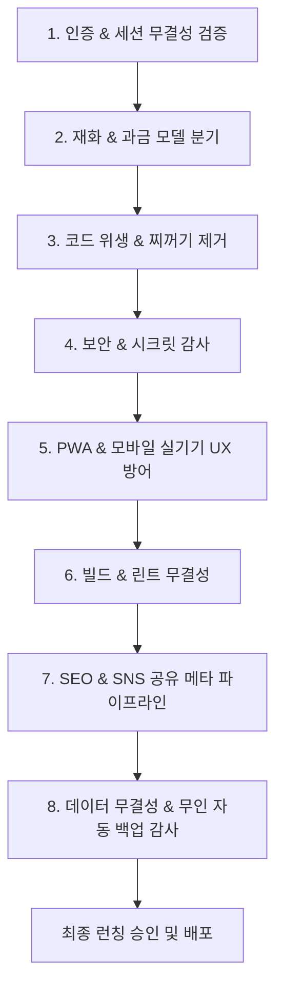

# 🚀 제트아이 (Z-Eye) 앱 출시 최종 점검 표준 체크리스트 (Launch Master Checklist)

본 문서는 제트아이(Z-Eye)의 개발 완료 후, **멀린허브 및 제트아이 AI가 출시 직전 단독으로 무결성을 검증하고 런칭 승인을 내리기 위한 표준 8대 점검 지침서이자 스토어 심사 마스터플랜**입니다.

---

## 📋 8대 핵심 총점검 프로세스



---

## 🏛️ 1. 인증 및 세션 무결성 (SSOT Auth & Session)
- [ ] **소셜 로그인 완전 배제**: 자체 OAuth나 소셜 로그인 없이 오직 허브(`wwopcuitvjldixkyzpzi`) 6자리 이메일 OTP 단일 인증 체제인가?
- [ ] **도메인 공용 쿠키 발급 및 완전 소멸**:
  - 로그인 시 `domain=.sundreamer.app` 30일 공용 쿠키가 `client.ts`를 통해 정상 발급/복원되는가?
  - **로그아웃/회원탈퇴 시** `clearSessionToken()` 호출로 공용 쿠키 및 세션 토큰이 완전 소멸되고 비회원 홈 화면(`/`)으로 강제 리다이렉트되는가?
- [ ] **멀티탭 실시간 동기화**: `HubProvider`의 `visibilitychange`, `focus`, `storage` 리스너로 타 앱/타 탭 로그인/로그아웃이 즉시 동기화되는가?
- [ ] **헤더 프로필 위젯 규격**: 닉네임, 아바타, 패밀리 스위처(F)가 앱 디자인(가로형/세로형)에 맞게 정렬되어 있는가?
- [ ] **CRM/외부 DB 연동 앱의 데이터 격리 헌법 (단일 진실 공급원)**:
  - 허브 프로필(`user.nickname`)과 개별 CRM DB(`customer.nickname`)를 자바스크립트 객체 스프레드로 강제 병합하지 않고 독립 객체로 분리하였는가?
  - 로그인 이메일과 CRM의 `email`이 **100% 동일하게 일치할 때만** CRM 데이터를 바인딩하여 비회원/신규 가입자의 프로필 오염을 원천 차단하였는가?

---

## 💰 2. 재화 및 비즈니스 모델 분기 (Wallet / Points)
- [ ] **유료 코인형 앱 (`is_paid = TRUE`)**:
  - `HubPurchaseWidget` 및 코인 차감 로직 정상 연동 확인
  - 즉각 정산 vs 버퍼링 정산 정책 일치 여부
- [ ] **무료 / 포인트형 앱 (`is_paid = FALSE`)**:
  - 프로필 카드 코인 배너 숨김 처리 (`showCoin={false}`)
  - 자체 포인트/무료 기능 정상 매핑 및 코인 결제 모듈 호출 원천 차단

---

## 🧹 3. 코드 위생 및 찌꺼기 코드 제거 (Cleanup)
- [ ] **더미 폴더/파일 제거**: 0바이트 빈 폴더(예: `SDK/`), 임시 테스트 스크립트, 미사용 레거시 파일 완전 삭제
- [ ] **비동기 온보딩 레이스 컨디션 방어**: 로그인 직후 비동기 상태 지연 시 `localStorage` fallback으로 회원 등록 및 혜택(포인트/코인) 누락 방어
- [ ] **이벤트 무효화 리스너**: 프로필/데이터 변경 시 `profileUpdated` 이벤트를 수신하여 메모리 캐시 즉시 갱신
- [ ] **단일 쿼리 예외 방어**: `.single()` 대신 `.maybeSingle()`을 사용하여 비회원/데이터 부재 시 런타임 크래시 차단

---

## 🔒 4. 보안 및 시크릿 감사 (Security Audit)
- [ ] **Service Role Key 클라이언트 노출 차단**: 클라이언트에는 오직 `VITE_SUPABASE_ANON_KEY`만 사용하며 마스터 키는 절대 노출 금지
- [ ] **중앙 집중형 AI 키 금고 (OS Hub Gateway) 준수**:
  - Netlify 환경변수에 유료 AI API Key(`VITE_GEMINI_*`, `VITE_OPENAI_*` 등)가 100% 존재하지 않는가?
  - 소스코드 번들에 `AIzaSy` 등 하드코딩 키가 0건인가? (`git grep -i "AIzaSy"`)
  - 모든 AI 기능이 프론트엔드 직접 호출이 아닌 **허브 백엔드 프록시(`os.sundreamer.app/api/ai/...`)**를 경유하도록 설계되었는가?
- [ ] **Direct PG 풀러 제거**: `*.pooler.supabase.com:6543` 등 직접 DB 풀러 없이 공식 Supabase SDK만 사용
- [ ] **Google OAuth / Third-party 토큰 보안**: 스코프 최소화(`drive.file`), 토큰 만료 시간(`expiry > Date.now()`) 엄격 검증
- [ ] **XSS 및 인젝션 방어**: `dangerouslySetInnerHTML` 배제 및 사용자 입력 데이터 React 자체 Escape 검증
- [ ] **Vite 번들 키 주입 차단**: `vite.config.ts`의 `define`에 민감한 서버용 API 키가 하드코딩 주입되지 않도록 제거

---

## 📱 5. PWA 및 모바일 실기기 UX 방어 (Mobile & PWA)
- [ ] **구글 크롬 자동 번역(Google Translate) 오작동 방지 표준**:
  - `index.html`의 `<html>` 태그에 `class="notranslate" translate="no"` 및 `<meta name="google" content="notranslate" />` 선언 필수
  - 헤더의 영문 탭 메뉴(`MY`, `HOME` 등)에 `translate="no"` 및 `notranslate` 클래스 적용
- [ ] **실기기(갤럭시/아이폰 좁은 폭 360~390px) 헤더 깨짐 방어**:
  - 네비게이션 메뉴 텍스트에 **`whitespace-nowrap` 필수 적용** (글자 쪼개짐 원천 차단)
  - 모바일 로고 크기 축소(`h-7 sm:h-9`) 및 패딩(`px-2 sm:px-4`) 최적화
- [ ] **카카오톡/인앱 브라우저 PWA 탈출 UX (In-App Browser Escape)**:
  - 안드로이드: `intent://` 스키마 지원으로 Chrome/삼성인터넷 즉시 실행
  - iOS: `Safari로 열기` 유도 가이드 노출
- [ ] **PWA 설치 프롬프트 기기 분기 및 톤앤매너**:
  - '앱 설치' 대신 **'홈 화면에 바로가기 추가'** 톤앤매너 통일
  - iOS: 화면 상단 고정 실물 그래픽 가이드 카드로 1:1 대조 터치 유도
  - 안드로이드: 하단 플로팅 배너에서 `beforeinstallprompt` 1초 원클릭 자동 설치
- [ ] **PWA 매니페스트 (`manifest.json`) 최신 규격 준수**:
  - `id: "/"` 및 `scope: "/"` 명시
  - `prefer_related_applications: false`, `display: "standalone"`, `orientation: "portrait"`
  - 아이콘: 192px/512px `any` 및 512px `maskable` 용도 분리 선언
- [ ] **iOS Safe Area 대응**: 모바일 상/하단 바 겹침 방지 (`viewport-fit=cover`, safe-area-inset)
- [ ] **PWA 무중단 자동 갱신 및 캐시 방지 표준 (Zero-Touch PWA Auto-Update)**:
  - `/sw.js` 및 `/index.html`에 `Cache-Control: no-cache, no-store, must-revalidate` 강제 지정
  - W3C `updateViaCache: 'none'` 등록
  - 무중단 자동 리로드 리스너 (`controllerchange`) 적용
- [ ] **검색 UI 최근 검색어(Recent Searches) 및 Zero-Clutter 표준 탑재**:
  - 검색창 하단의 불필요한 보조 안내문 완전 배제
  - `localStorage` 기반 최근 검색어(최대 6~10개) 자동 누적 및 원터치 재검색
  - 모바일 가상 키패드 상승 시 깨짐 없는 스크롤(`max-h-48`) 방어

---

## 🧪 6. 빌드 및 타입 무결성 검증 (Build & Lint)
- [ ] **TypeScript Lint**: `npm run lint` (`tsc --noEmit`) ➔ **0 errors**
- [ ] **Production Build**: `npm run build` (`vite build` 또는 `next build`) ➔ **0 errors**

---

## 🌐 7. SEO 및 SNS 공유 메타 파이프라인 (SEO & OpenGraph)
- [ ] **SNS 공유 썸네일(OG Image) 안전 여백(Safe Zone) 준수**: 중앙 80% 안전 영역 배치 규격 이미지 사용
- [ ] **공유 문구(Title / Description) 사전 승인**: 멀린님의 명시적 승인을 받은 정식 서비스 타이틀/설명만 바인딩
- [ ] **검색로봇 크롤러 파일**: `sitemap.xml`, `robots.txt` 배치
- [ ] **구조화된 데이터**: `JSON-LD` Schema.org WebApplication 마크업 탑재

---

## 💾 8. 데이터 무결성 및 365일 무인 자동 백업 감사 (Database Backup & Disaster Recovery)
- [ ] **GitHub Actions 365일 무인 일일 자동 백업 워크플로우(`.github/workflows/daily-db-backup.yml`) 구축 여부 필수 검증**
- [ ] **DB 테이블 누락 0건(전수 추출) 검증**: 신규 테이블 100% 전수 포함 확인
- [ ] **독립 격리 브랜치(`db-backups`) 보존**: 서비스 배포 코드에 영향을 주지 않는 완전 격리 브랜치에 매일 날짜별 파일 자동 커밋/푸시 확인
- [ ] **클라이언트 로컬 수동 백업 찌꺼기 완전 퇴출**: 순수 무인 클라우드 스케줄러로 일원화 확인

---

## 📡 9. Z-Eye No-Cloud P2P 및 모바일 실기기 연결성 검증
- [x] **모바일 좁은 화면(360px) 헤더 한 줄 최적화**: 3대 핵심 체계(`[내 기기]` / `[사진 공유]` / `[업무 공유]`)로 컴팩트 일원화 완료.
- [x] **외부 LTE/5G & 타 와이파이망 원격 접속 터널 완비**: Cloudflare Tunnel 데몬 자동화를 통해 외부 스마트폰에서 SSL 보안 터널로 로컬 포트(5199) 원격 접속 및 실시간 조작 검증 완료.
- [x] **업무 드라이브(S:) 실시간 파일 스캐너 연동 (`/__work/files`)**: `D:\Z-Eye\업무공유폴더_S` 루트 및 하위 폴더 파일을 4초 주기로 자동 감지하여 목록/카운트/GIF 미리보기 즉시 갱신 검증 완료.

---

## 🎨 10. 노션 스타일 좌측 접이식 사이드바 & 백지 도화지(Zen Canvas) UI/UX 대개편
- [x] **노션형 좌측 접이식 사이드바 & 상단 불변 앵커 구축 ([`DesktopDashboard.tsx`](file:///d:/Z-Eye/src/components/DesktopDashboard.tsx))**:
  - 데스크톱(`lg+`) 244px 접이식 사이드바에 3대 핵심 메뉴, 패밀리 방 트리, 서브메뉴, 하단 `[F 멀린 패밀리 앱]` 런처 통합.
  - 상단 헤더는 초슬림 1줄 경로 브레드크럼과 우측 상단 공통 앵커(`[👑 문패] [🛠️ 설정몬스터] [🪙 크레딧] [☀️/🌙 테마 토글]`)로 정화.
- [x] **백지 도화지 모드 (`Zero-State Zen Canvas`) & 1줄 콜아웃 접기**:
  - 첫 진입 시 테두리를 제거하고 중앙 도화지에 검색창·인물 알약·추천 칩·`[전체 펼치기]` 버튼만 배치하여 액션 시에만 결과 채움(`▲ 백지 도화지로 접기` 지원).
- [x] **업무 공유 (S: 드라이브) 문서 행 리스트 + 우측 사이드 피크(`Side Peek`) 드로어 ([`LoungeView.tsx`](file:///d:/Z-Eye/src/components/LoungeView.tsx))**:
  - 전체 너비 1줄 문서 행 리스트 노출 및 클릭 시 우측에서 사이드 피크 프리뷰 오픈.
- [x] **노션 칸반 보드 연동 무인 QA 자동화 파이프라인 ([`notion_qa.py`](file:///d:/Z-Eye/notion_qa.py))**:
  - `fetch`, `complete`, `watch`, `mission` 명령어 완비 및 비개발자 알바생 눈높이 일상어 피드백 표준화.

---

## 📜 11. [제트아이 전용] 출시 전 하단 이용약관(ToS) 핵심 면책 3대 조항
- [x] **데이터 비보관(`Non-Custodial`) 원칙 조항**: 회사는 사용자의 원본 데이터를 중앙 서버에 보관하지 않으며, 로컬 단말기에 저장됨을 명시.
- [x] **무상 설정 도구 및 최종 승인 원칙 조항**: 클린몬스터 및 설정몬스터 기능은 사용자의 명시적인 1-Tap 승인 하에 실행되며, 1초 원상복구(`[복원 기록]`)를 지원함을 명시.
- [x] **공유방 탈퇴 시 권한 종료 및 캐시 삭제 조항**: 공유방 탈퇴/강퇴 즉시 해당 공유방의 썸네일 DB 및 검색 인덱스는 자동 삭제되며, 회원 본인의 개인 여권 및 로컬 동기화 원본은 100% 보존됨을 명시.

---

## 🍎 12. App Store & Google Play 정식 출시 실행 마스터플랜

### 12.1 넷플릭스식 ‘PC 웹 결제 + 모바일 100% 클린 뷰어’ (`isStoreAppMode` & `enableMobileCoinDisplay`)
- **수수료 0% 방어:** 모바일 스토어 앱은 **100% 무료 라운지 뷰어 & 동반자(Companion) 앱**으로 출시하며, 모든 결제는 PC 마스터 웹 및 멀린 패밀리 허브에서 진행.
- **코인 잔액 비노출:** 1차 출시 시 모바일 앱에서 코인 잔액을 완전히 숨겨(기본값 `false`) 애플 Guideline 3.1.1 마찰을 원천 차단하고, 필요 시 서버 배포만으로 활성화할 수 있는 토글 플래그 구비.

### 12.2 모바일 ➔ PC 전환 시 외부 결제 유도 금지 규정(Anti-steering) 완벽 방어 3중 안전장치
1. **단어 정화:** 버튼 및 설명 문구에서 `주소`, `URL`, `결제`, `구매`를 100% 배제하고 **`"💻 대용량 미디어 정리 및 마스터 설정은 데스크톱(PC) 환경에서 작동합니다"`** 톤앤매너로 통일.
2. **모바일 vs PC 접속 환경 분기 (`MobileMasterPcIntroModal`):** 모바일에서 접속 시 요금 안내가 전혀 없는 순수 PC 기능 소개 화면만 렌더링되며, 실제 데스크톱 PC 접속 시에만 결제 모달 활성화.
3. **원격 토글 스위치 (`enablePcGuideShareButton`):** 심사 기간 동안 버튼 노출 여부를 서버에서 제어.

### 12.3 iOS Guideline 2.5.2 방어를 위한 ‘클린몬스터’ 문구 자동 분기
- 모바일 스토어 앱 모드(`isStoreAppMode === true`)에서는 클린몬스터 설명을 '시스템 메모리 최적화' 대신 **'내 갤러리 중복 사진·영수증 AI 분류 및 내 PC 마스터 볼트 안전 이관(13KB 섀도우 다이어트) 컨설팅'**으로 자동 분기.

### 12.4 썬드림주식회사 법인 개발자 계정 운영
- 법인 사업자등록번호: `333-87-00482`, 대표자: `BEAK EUNSUK`, 공식 도메인: `sundreamer.app`
- 외주 작업자에게 계정 정보를 공유하지 않고, 이메일을 **출시 관리자(App Manager)**로만 초대하여 보안 사고 원천 예방.

### 12.5 Capacitor 네이티브 래퍼 구성 (2026-10-26 구축 완료)
- **도입 배경(Why):** 양대 스토어 테스터 심사(5~6일차) 및 본심사 제출에 필요한 `.aab` / `.ipa` 네이티브 껍데기가 순수 Vite PWA 상태에는 없었기 때문에, 웹 빌드(`dist`)를 그대로 탑재하는 Capacitor 8 래퍼를 구성함 (전속비서 지시서 `스토어출격용Capacitor네이티브래퍼동적푸시라우팅및3대메뉴통합지시_20261026_1616`).
- **설정 파일:** 루트 `capacitor.config.ts` — `appId: app.sundreamer.zeye`, `appName: Z-Eye`, `webDir: dist`, `server.androidScheme: https`, `server.allowNavigation: ['sundreamer.app', '*.sundreamer.app']` (푸시 라우터 화이트리스트와 동일).
- **네이티브 프로젝트:** `android/`, `ios/` 폴더 생성 완료 (`npx cap add android|ios`). 웹 자산 복사본(`app/src/main/assets/public`, `App/App/public`)은 각 폴더 `.gitignore`로 저장소 제외.
- **빌드 순서:** `npm run build` → `npx cap sync` → Android Studio(`npx cap open android`)에서 `.aab` 서명 빌드 / iOS는 **Mac + Xcode 필수**(`npx cap open ios`, Swift Package Manager 방식).
- **클린 뷰어 자동 전환:** 네이티브 구동 시 `window.Capacitor.isNativePlatform() === true` → `useSaySeeStore` 초기값에서 `isStoreAppMode = true`, `enableSetupMonster = false` 자동 적용, `enableMobileCoinDisplay` 기본값 `false` (코인·외부결제 노출 0%). Z-Eye는 가입 시 웰컴 코인 지급·코인 안내 메일이 일체 없음.
- **권한 사유 문구 (한/영 병기, 심사 프리패스 규격):**
  - iOS `ios/App/App/Info.plist`: `NSPhotoLibraryUsageDescription`(온디바이스 AI 정리·검색, 원본 외부 서버 전송 없음 `Non-Custodial`), `NSPhotoLibraryAddUsageDescription`, `NSMicrophoneUsageDescription`(음성 투시검색, 검색 외 저장 없음), `NSSpeechRecognitionUsageDescription`, `NSCameraUsageDescription`(PC↔폰 연결 QR).
  - Android `android/app/src/main/AndroidManifest.xml`: `READ_MEDIA_IMAGES`, `READ_MEDIA_VIDEO`, `READ_MEDIA_VISUAL_USER_SELECTED`, `READ_EXTERNAL_STORAGE(maxSdkVersion=32)`, `RECORD_AUDIO`, `MODIFY_AUDIO_SETTINGS`, `POST_NOTIFICATIONS`.
- **⚠️ 심사 리스크 메모:**
  - Google Play `READ_MEDIA_IMAGES/VIDEO`는 '사진·동영상 권한 정책' 신고서 제출 대상 (핵심 기능이 갤러리 정리·검색임을 시연 영상으로 소명).
  - Apple Guideline 4.2(최소 기능): 웹사이트 단순 래핑으로 보이지 않도록 **PC가 꺼져 있어도 폰 단독으로 작동하는 기능(13KB 섀도우 캐시 투시검색·클린몬스터 분류)**을 심사 시연 시나리오에 반드시 포함.
  - iOS 푸시는 Xcode에서 `Push Notifications` Capability(`aps-environment`) 추가 + APNs 인증키(.p8) 발급 필요, Android는 Firebase `google-services.json`을 `android/app/`에 배치해야 실제 수신됨.

### 12.6 패밀리 공용 '동적 라우팅 푸시 (우체국장 아키텍처)' — `src/services/nativePushRouter.ts`
- **도입 배경(Why):** 제트아이(멀린 Z 코어) 모바일 앱 1개가 전사 패밀리 앱 푸시의 우체국장 역할을 하므로, 푸시 클릭 시 고정 URL이 아니라 페이로드 `data.target_url`로 해당 서비스 화면에 바로 이동해야 함.
- **보안 화이트리스트:** `https://sundreamer.app` · `https://*.sundreamer.app` 절대 URL과 앱 내부 경로(`/...`)만 허용. `http:`, 타 도메인, `javascript:`·`data:`, 프로토콜 상대경로(`//evil.com`), 계정정보 포함 URL(`https://a:b@...`), 2,048자 초과는 전부 차단 → 오픈 리다이렉트 취약점 및 스토어 리젝 방어.
- **알림 채널 분리 (Android 8.0+):** `zeye`(제트아이) / `senstalk`(센스톡) / `luminote`(루미노트) / `sundreamer`(썬드리머) / `studio`(썬드리머 스튜디오) / `family_hub`(멀린 패밀리 계정). 서버 FCM 페이로드의 `android.notification.channel_id`를 위 id와 일치시켜 발송해야 유저가 서비스별로 개별 ON/OFF 가능. iOS는 서버에서 `thread-id`로 그룹 지정.
- **토큰 수신:** 등록 성공 시 `localStorage['zeye_native_push_token']` 저장 + `zeyeNativePushToken` 윈도우 이벤트 발행 (허브 Notification 모듈 연동 시 이 토큰을 허브로 전달).
- **웹 영향 0:** `main.tsx`에서 `initNativePushRouter()`를 호출하지만 웹(PWA/브라우저)에서는 즉시 반환하며, 푸시 플러그인은 동적 import로 분리되어 웹 번들에 포함되지 않음.

### 12.7 모바일 상단 메뉴 '3대 메뉴 체계' 정렬 (2026-10-26)
- **실제 렌더링 경로 주의:** 현재 앱은 `layout`이 항상 `'desktop'`이므로 휴대폰에서도 `DesktopDashboard`가 반응형으로 그려지며, 휴대폰 상단 1줄 빠른 전환 바(`lg` 미만)가 실제 모바일 메뉴임. `MobileAppView`도 동일 구조로 함께 정렬함.
- **3대 메뉴:** `[내 기기]` / `[사진 공유]` / `[업무 공유]` — `[사진 공유]`를 누르면 아래 줄에 `[패밀리 (우리집·본가·처가)]` / `[동호회·동창회]` 하위 선택이 나타나고, 사진 공유 안에서 메인 버튼을 다시 눌러도 현재 하위 선택이 유지됨.
- **데스크톱 사이드바:** 섹션 헤더(`💻 내 기기` / `📸 사진 공유` / `💼 업무 공유`)로 이미 3대 구조이므로 변경 없음.
- **구버전 `student(스쿨)` 정리:** `setActiveLoungeType('student')` 및 `student_*` 요금제 개통 시 모두 `club`(동호회·동창회)으로 일원화되어 화면 진입 경로가 차단됨. 스쿨 화면 코드 자체는 멀린님 지시("동창회 안에 우리반 타임캡슐 메뉴를 두자 — UI상 반영하면 되니 일단 놔두자")에 따라 추후 동창회 `우리반 타임캡슐` 이식용 자산으로 보존.

---

## 🏛️ 13. Microsoft Artifact Signing 윈도우 디지털 코드 서명 인프라

1. **도입 목적:** 윈도우 실행 파일(`.exe`) 실행 시 나타나는 Windows Defender SmartScreen 파란색 경고 창(*"인식할 수 없는 앱입니다"*) 원천 제거 및 100% 보안 신뢰 확보.
2. **인프라 원장 명세:**
   - **조직명:** 썬드림주식회사
   - **Azure 테넌트 ID:** `c4d55b0b-a5a9-4d0c-96bf-e426be8bf391`
   - **Azure 구독 ID:** `d65aa025-35d7-42a6-b5cf-df6d641a9a9a`
   - **아티팩트 서명 계정:** `sundreamer` (Basic 플랜)
   - **인증서 프로필:** `sundream-public-cert` (공용 신뢰 Public Trust)
   - **공인 신원 인증 상태:** 🟢 Verification successful! (AU10TIX 여권 판독 + Microsoft 안면 생체 인증 완료)
3. **자동 서명 파이프라인:**
   - GitHub Actions CI/CD 또는 로컬 릴리즈 빌드 스크립트에서 마이크로소프트 공식 `Azure.CodeSigning.Dlib` 및 Windows SDK `SignTool.exe`를 사용하여 자동 서명 실행:
     ```powershell
     signtool.exe sign /v /fd SHA256 /tr "http://timestamp.acs.microsoft.com" /td SHA256 /dlib "Azure.CodeSigning.Dlib.dll" /dmc metadata.json "dist\Merlin_Z_Core_Setup.exe"
     ```
