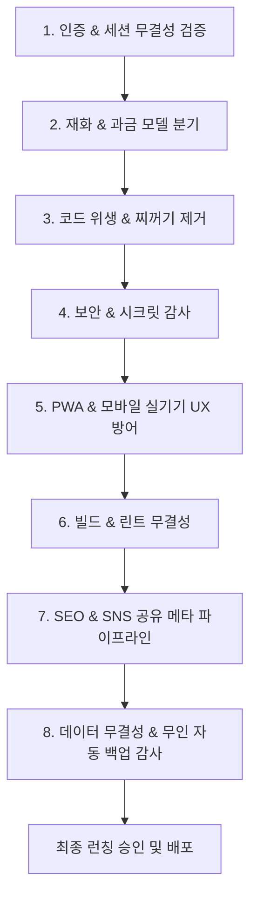

# 🚀 멀린 패밀리 앱 출시 최종 점검 표준 체크리스트 (Launch Master Checklist)

본 문서는 모든 멀린 패밀리 앱(1호 썬드리머부터 후속 앱 전체)의 개발 완료 후, **멀린허브 AI가 출시 직전 단독으로 무결성을 검증하고 런칭 승인을 내리기 위한 표준 8대 점검 지침서**입니다.

---

## 📋 8대 핵심 총점검 프로세스

---

## 🏛️ 1. 인증 및 세션 무결성 (SSOT Auth & Session)
- [ ] **소셜 로그인 완전 배제**: 자체 OAuth나 소셜 로그인 없이 오직 허브(`wwopcuitvjldixkyzpzi`) 6자리 이메일 OTP 단일 인증 체제인가?
- [ ] **도메인 공용 쿠키 발급 및 완전 소멸**:
  - 로그인 시 `domain=.sundreamer.app` 30일 공용 쿠키가 `client.ts`를 통해 정상 발급/복원되는가?
  - **로그아웃/회원탈퇴 시** `clearSessionToken()` 호출로 공용 쿠키 및 세션 토큰이 완전 소멸되고 비회원 홈 화면(`/`)으로 강제 리다이렉트되는가?
- [ ] **멀티탭 실시간 동기화**: `HubProvider`의 `visibilitychange`, `focus`, `storage` 리스너로 타 앱/타 탭 로그인/로그아웃이 즉시 동기화되는가?
- [ ] **헤더 프로필 위젯 규격**: 닉네임, 아바타, 패밀리 스위처(F)가 앱 디자인(가로형/세로형)에 맞게 정렬되어 있는가?
- [ ] **CRM/외부 DB 연동 앱의 데이터 격리 헌법 (단일 진실 공급원)**:
  - 허브 프로필(`user.nickname`)과 개별 CRM DB(`customer.nickname`)를 자바스크립트 객체 스프레드로 강제 병합하지 않고 독립 객체로 분리하였는가?
  - 로그인 이메일과 CRM의 `email`이 **100% 동일하게 일치할 때만** CRM 데이터를 바인딩하여 비회원/신규 가입자의 프로필 오염을 원천 차단하였는가?

---

## 💰 2. 재화 및 비즈니스 모델 분기 (Wallet / Points)
- [ ] **유료 코인형 앱 (`is_paid = TRUE`)**:
  - `HubPurchaseWidget` 및 코인 차감 로직 정상 연동 확인
  - 즉각 정산(어그로필터) vs 버퍼링 정산(볼트) 정책 일치 여부
- [ ] **무료 / 포인트형 앱 (`is_paid = FALSE`, 썬드리머/뭐먹지 등)**:
  - 프로필 카드 코인 배너 숨김 처리 (`showCoin={false}`)
  - 자체 포인트/무료 기능 정상 매핑 및 코인 결제 모듈 호출 원천 차단

---

## 🧹 3. 코드 위생 및 찌꺼기 코드 제거 (Cleanup)
- [ ] **더미 폴더/파일 제거**: 0바이트 빈 폴더(예: `SDK/`), 임시 테스트 스크립트, 미사용 레거시 파일 완전 삭제
- [ ] **비동기 온보딩 레이스 컨디션 방어**: 로그인 직후 비동기 상태 지연 시 `localStorage` fallback으로 회원 등록 및 혜택(포인트/코인) 누락 방어
- [ ] **이벤트 무효화 리스너**: 프로필/데이터 변경 시 `profileUpdated` 이벤트를 수신하여 메모리 캐시 즉시 갱신
- [ ] **단일 쿼리 예외 방어**: `.single()` 대신 `.maybeSingle()`을 사용하여 비회원/데이터 부재 시 런타임 크래시 차단

---

## 🔒 4. 보안 및 시크릿 감사 (Security Audit)
- [ ] **Service Role Key 클라이언트 노출 차단**: 클라이언트에는 오직 `VITE_SUPABASE_ANON_KEY`만 사용하며 마스터 키는 절대 노출 금지
- [ ] **중앙 집중형 AI 키 금고 (OS Hub Gateway) 준수**:
  - Netlify 환경변수에 유료 AI API Key(`VITE_GEMINI_*`, `VITE_OPENAI_*` 등)가 100% 존재하지 않는가?
  - 소스코드 번들에 `AIzaSy` 등 하드코딩 키가 0건인가? (`git grep -i "AIzaSy"`)
  - 모든 AI 기능이 프론트엔드 직접 호출이 아닌 **허브 백엔드 프록시(`os.sundreamer.app/api/ai/...`)**를 경유하도록 설계되었는가?
- [ ] **Direct PG 풀러 제거**: `*.pooler.supabase.com:6543` 등 직접 DB 풀러 없이 공식 Supabase SDK만 사용
- [ ] **Google OAuth / Third-party 토큰 보안**: 스코프 최소화(`drive.file`), 토큰 만료 시간(`expiry > Date.now()`) 엄격 검증
- [ ] **XSS 및 인젝션 방어**: `dangerouslySetInnerHTML` 배제 및 사용자 입력 데이터 React 자체 Escape 검증
- [ ] **Vite 번들 키 주입 차단**: `vite.config.ts`의 `define`에 민감한 서버용 API 키가 하드코딩 주입되지 않도록 제거

---

## 📱 5. PWA 및 모바일 실기기 UX 방어 (Mobile & PWA)
- [ ] **구글 크롬 자동 번역(Google Translate) 오작동 방지 표준**:
  - `index.html`의 `<html>` 태그에 `class="notranslate" translate="no"` 및 `<meta name="google" content="notranslate" />` 선언 필수
  - 헤더의 영문 탭 메뉴(`MY`, `HOME` 등)에 `translate="no"` 및 `notranslate` 클래스 적용 (크롬이 'MY'를 '나의'로 임의 번역하는 참사 방지)
- [ ] **실기기(갤럭시/아이폰 좁은 폭 360~390px) 헤더 깨짐 방어**:
  - 네비게이션 메뉴 텍스트에 **`whitespace-nowrap` 필수 적용** (글자가 `치 \n 유 \n 기 \n 록`으로 세로 쪼개져 겹치는 현상 원천 차단)
  - 모바일 로고 크기 축소(`h-7 sm:h-9`) 및 패딩(`px-2 sm:px-4`) 최적화
- [ ] **카카오톡/카카오워크 인앱 브라우저 PWA 탈출 UX (In-App Browser Escape)**:
  - **감지 대상**: `KAKAOTALK`, `KAKAOWORK`, `NAVER`, `Instagram`, `FB_IAB`, `Line` 등 인앱 웹뷰
  - **안드로이드 (Galaxy 등)**: 링크 클릭 시 Chrome/삼성인터넷을 새 창으로 즉시 띄우는 `intent://` 스키마 지원 (`intent://도메인#Intent;scheme=https;package=com.android.chrome;end` - 쿼리스트링 보존)
  - **iOS (iPhone)**: 우측 상단/하단 메뉴(`⋮` 또는 `공유 📤`)를 눌러 `Safari로 열기`를 유도하는 가이드 노출
- [ ] **PWA 설치 프롬프트 기기 분기 및 톤앤매너**:
  - '앱 설치'라는 무거운 단어 대신 **'홈 화면에 바로가기 추가'** 톤앤매너 통일 (다운로드 거부감 배제)
  - **아이폰(iOS)**: 화면 상단 고정 실물 그래픽 가이드 카드(`/images/ios_guide.jpg`)를 통해 실물 아이콘 순서를 시각적으로 1:1 대조 터치 유도 (하단 터치 영역 100% 보존).
  - **갤럭시(안드로이드)**: 화면 하단 플로팅 배너에서 `[홈 화면에 추가하기 ⚡]` 버튼 클릭 시 `beforeinstallprompt` 네이티브 팝업 1초 원클릭 자동 설치.
  - '나중에' 클릭 시 세션/쿨타임을 적용하여 정중한 UX 유지
  - PC/데스크톱(가로폭 768px 초과)에서는 팝업 완전 차단
- [ ] **PWA 매니페스트 (`manifest.json`) 최신 구글 WebAPK 표준 준수**:
  - `id: "/"` 및 `scope: "/"` 명시 필수 (누락 시 안드로이드에서 "이전 버전에 맞게 개발됨 / 안전하지 않은 앱" 오인 경고 발생)
  - `prefer_related_applications: false`, `display: "standalone"`, `orientation: "portrait"`
  - 아이콘: 192px/512px `any` 및 512px `maskable` 용도 분리 선언
- [ ] **iOS Safe Area 대응**: 모바일 상/하단 바 겹침 방지 (`viewport-fit=cover`, safe-area-inset)
- [ ] **SPA 새로고침 방어 (`_redirects`)**: Netlify/Vercel 환경에서 `/* /index.html 200` 리다이렉트 룰 탑재
- [ ] **PWA 무중단 자동 갱신 및 캐시 방지 표준 (Zero-Touch PWA Auto-Update)**:
  - **Netlify HTTP `_headers` 필수 탑재**: `/sw.js` 및 `/index.html`에 `Cache-Control: no-cache, no-store, must-revalidate` 강제 지정 (유저의 기기 재부팅이나 수동 캐시 삭제 없이 배포 즉시 100% 최신화 보장).
  - **W3C `updateViaCache: 'none'` 등록**: `navigator.serviceWorker.register('/sw.js', { updateViaCache: 'none' })` 선언으로 브라우저 HTTP 캐시 우회.
  - **무중단 자동 리로드 리스너 (`controllerchange`)**: `sw.js` 새 버전 활성화 시 화면이 스스로 최신 코드로 자동 새로고침.
  - **백그라운드 복귀 검사 (`visibilitychange`)**: 홈 화면 앱 아이콘 터치 복귀 시 즉각 `reg.update()` 트리거.
- [ ] **검색 UI 최근 검색어(Recent Searches) 및 Zero-Clutter 표준 탑재 (모든 앱 디폴트)**:
  - 검색창 하단에 "검색 결과: XXX", "검색 초기화" 등 군더더기 안내선/버튼 완전 배제 (`value` 및 `✕` 삭제 버튼으로만 심플 구성).
  - `localStorage` 기반 최근 검색어(최대 6~10개) 중복 없이 자동 누적 및 입력창 포커스 시 플로팅 드롭다운 노출.
  - 최근 검색어 터치 1번에 즉시 재검색, 개별 `✕` 삭제 및 `전체삭제` 편의 기능 구비 여부.
  - 모바일 가상 키패드 상승 시 드롭다운 겹침/깨짐 없는 스크롤(`max-h-48`) 및 `z-index` 계층 방어.

---

## 🧪 6. 빌드 및 타입 무결성 검증 (Build & Lint)
- [ ] **TypeScript Lint**: `npm run lint` (`tsc --noEmit`) ➔ **0 errors**
- [ ] **Production Build**: `npm run build` (`vite build` 또는 `next build`) ➔ **0 errors**

---

## 🌐 7. SEO 및 SNS 공유 메타 파이프라인 (SEO & OpenGraph)
- [ ] **SNS 공유 썸네일(OG Image) 안전 여백(Safe Zone) 준수**:
  - 카카오톡/카카오워크 1:1 및 4:3 크롭 시 로고나 텍스트가 좌우로 잘리지 않도록 **중앙 80% 안전 영역** 배치 규격 이미지 사용
- [ ] **공유 문구(Title / Description) 사전 승인**:
  - AI가 임의로 문구를 지어내지 않고, **멀린님의 명시적 승인을 받은 정식 서비스 타이틀/설명**만 `index.html`에 바인딩
- [ ] **검색로봇 크롤러 파일**: `sitemap.xml`, `robots.txt` 배치
- [ ] **구조화된 데이터**: `JSON-LD` Schema.org WebApplication 마크업 탑재

---

## 💾 8. 데이터 무결성 및 365일 무인 자동 백업 감사 (Database Backup & Disaster Recovery)
- [ ] **Supabase 무료 티어(Free Tier) 백업 한계 극복**:
  - Supabase 무료 티어는 특정 시점 복원(PITR) 및 일일 자동 스냅샷을 제공하지 않으므로, 인적 실수나 장애에 대비한 **GitHub Actions 365일 무인 일일 자동 백업 워크플로우(`.github/workflows/daily-db-backup.yml`) 구축 여부 필수 검증**
- [ ] **DB 테이블 누락 0건(전수 추출) 검증**:
  - 새로 추가된 주문(`orders`), 결제, 상담 로그, 설정 등 신규 테이블이 백업 파이프라인에서 누락되지 않고 100% 전수 포함되었는지 확인
- [ ] **독립 격리 브랜치(`db-backups`) 보존**:
  - 서비스 배포 코드(Netlify)에 영향을 주지 않는 완전 격리 브랜치에 매일 날짜별 엑셀(`.xlsx`) 및 원장 복원용 JSON(`.json`)이 자동 커밋/푸시되는지 확인
- [ ] **클라이언트 로컬 수동 백업 찌꺼기 완전 퇴출**:
  - 브라우저 권한에 의존하는 구시대적 수동 백업 위젯/코드를 전면 배제하고, 순수 무인 클라우드 스케줄러로 일원화 여부 확인

---
> **"장부 하나로 통제하고, 매뉴얼로 공유하며, 강령으로 통합한다."**

---

## 📡 9. Z-Eye No-Cloud P2P 및 모바일 실기기 외부 연결성 검증 (P2P Connectivity & Remote Access)
- [x] **모바일 좁은 화면(360px) 헤더 한 줄 최적화**:
  - 상단 5대 메뉴에서 중복되는 '라운지' 단어를 전면 제거하고 `[개인] [패밀리] [클럽] [스쿨] [업무]` 1줄 컴팩트 배치 완료 (줄바꿈/잘림 0건).
- [x] **외부 LTE/5G & 타 와이파이망 원격 접속 터널 완비**:
  - Cloudflare Tunnel 데몬 자동화를 통해 외부 실기기 스마트폰에서 SSL 보안 터널(`https://*.trycloudflare.com`)로 로컬 포트(5199) 원격 접속 및 실시간 조작 검증 완료.
- [x] **업무 드라이브(S:) 실시간 파일 스캐너 연동 (`/__work/files`)**:
  - `D:\Z-Eye\업무공유폴더_S` 최상단 루트 파일(미분류 `.gif` 등) 및 하위 폴더 파일을 4초 주기로 자동 감지하여 목록/카운트/GIF 미리보기 즉시 갱신 검증 완료.
- [ ] **[퇴근 후 집 PC / 원격 테스트 잔여 과제]**:
  - **테스트 2**: 동일 와이파이(LAN) 및 Tailscale VPN 환경에서 모바일 실기기 direct IP(`192.168.*.*:5199` 및 Tailscale IP) 접속 시도 시 백지 현상 원인 규명 및 PWA 서비스워커 캐시 우회 테스트.
  - **테스트 3**: 외부 LTE 통신망에서 1순위 WebRTC DataChannel 홀펀칭 vs 2순위 QUIC 아웃바운드 터널 자동 폴백 레이턴시(ms) 실측 및 대용량 원본 파일(5MB) 수신 안정성 검증.

---

## 🎨 10. 노션(Notion) 스타일 좌측 접이식 사이드바 & 백지 도화지(Zen Canvas) UI/UX 대개편 및 무인 QA 파이프라인 (2026-10-21 완료)
- [x] **노션형 좌측 접이식 사이드바 & 상단 불변 앵커 구축 ([`DesktopDashboard.tsx`](file:///d:/Z-Eye/src/components/DesktopDashboard.tsx))**:
  - 데스크톱(`lg+`) 244px 접이식 사이드바에 5대 시크릿 라운지, 패밀리 방 트리(`우리집 / 본가 / 처가`), 서브메뉴, 하단 `[F 멀린 패밀리 앱]` 런처를 통합.
  - 상단 헤더는 초슬림 1줄 경로 브레드크럼과 우측 상단 공통 앵커(`[👑 문패] [🛠️ 설정 몬스터] [🪙 크레딧] [☀️/🌙 테마 토글]`)로 정화.
  - 모바일(`360px`~)에서는 상단 1줄 5대 라운지 단축 알약 + 좌상단 `☰` 슬라이드 드로어 병행.
- [x] **백지 도화지 모드 (`Zero-State Zen Canvas`) & 1줄 콜아웃 접기 ([`VoiceHeroStage.tsx`](file:///d:/Z-Eye/src/components/VoiceHeroStage.tsx), [`FaceMemberRegistryModal.tsx`](file:///d:/Z-Eye/src/components/FaceMemberRegistryModal.tsx), [`LoungeView.tsx`](file:///d:/Z-Eye/src/components/LoungeView.tsx))**:
  - 첫 진입 시 3~4겹 중첩 박스 테두리를 제거하고 중앙 도화지에 검색창·인물 알약·추천 칩·`[전체 펼치기]` 버튼만 배치하여, 검색/클릭 액션 시에만 아래로 결과가 채워지도록 개편(`▲ 백지 도화지로 접기` 지원).
  - 새 얼굴 확인 배너 및 동창회 추억 간판은 평소 1줄 노션 콜아웃(`Callout`)으로 접어두고 클릭 시에만 열리도록 개선.
- [x] **업무 라운지 데이터베이스 행(Row) 리스트 + 우측 사이드 피크(`Side Peek`) 드로어 ([`LoungeView.tsx`](file:///d:/Z-Eye/src/components/LoungeView.tsx))**:
  - 상시 7:5 분할을 제거하고 전체 너비 1줄 문서 행 리스트를 기본 노출하며, 문서 행(`1줄빛러M.gif`, `표준단가표.xlsx` 등) 클릭 시 우측에서 사이드 피크 프리뷰가 열리도록 개편.
- [x] **노션 칸반 보드 연동 무인 QA 자동화 파이프라인 ([`notion_qa.py`](file:///d:/Z-Eye/notion_qa.py))**:
  - `fetch_bugs()`, `complete_bug()`(완료 직후 남은 다음 버그 자동 체크·브리핑), `watch_bugs()`(평상시 AI 토큰 소모 0원 파이썬 백그라운드 감시병) 구축 완료.
  - 재테스트 지시문은 비개발자 알바생(일반인 테스터) 눈높이에 맞춘 친절하고 쉬운 일상어로만 작성하도록 표준화 완료.
  - *(※ 집 PC에서 작업 재개 시 `git pull` 후 `.env.local`에 `NOTION_TOKEN` 1줄만 넣어두면 즉시 동일하게 작동합니다.)*

---

## 📜 9. [제트아이(Z-Eye) 전용] 출시 전 하단 이용약관(ToS) 핵심 면책 2대 조항 점검
- [ ] **데이터 비보관(`Non-Custodial`) 원칙 조항 삽입 여부**:
  > *"회사는 사용자의 원본 미디어 및 문서를 중앙 서버에 수집·보관하지 않으며, 모든 원본 데이터는 사용자가 지정한 로컬 단말기에 저장됩니다. 사용자 단말기의 물리적 파손, 분실, 또는 사용자 부주의로 인한 외부 악성코드 감염 등에 따른 책임은 사용자에게 있습니다."*
- [ ] **무상 설정 도구 및 최종 승인 원칙 조항 삽입 여부**:
  > *"무상으로 제공되는 클린 몬스터 및 설정 몬스터 기능은 사용자의 명시적인 최종 확인(1-Tap 승인) 하에 실행되며, 실행 전후 제공되는 스냅샷 되돌리기(Rollback) 및 30일 안전 보관함 기능을 통해 언제든 원상복구가 가능합니다."*
