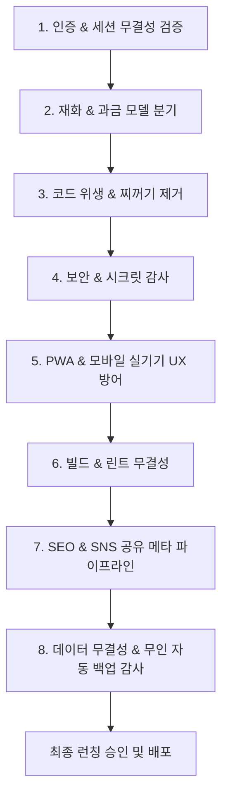

# 🚀 멀린 패밀리 앱 출시 최종 점검 표준 체크리스트 (Launch Master Checklist)

본 문서는 모든 멀린 패밀리 앱(1호 썬드리머부터 후속 앱 전체)의 개발 완료 후, **멀린허브 AI가 출시 직전 단독으로 무결성을 검증하고 런칭 승인을 내리기 위한 표준 8대 점검 지침서**입니다.

---

## 📋 8대 핵심 총점검 프로세스



---

## 🏛️ 1. 인증 및 세션 무결성 (SSOT Auth & Session)
- [ ] **소셜 로그인 완전 배제**: 자체 OAuth나 소셜 로그인 없이 오직 허브(`wwopcuitvjldixkyzpzi`) 6자리 이메일 OTP 단일 인증 체제인가?
- [ ] **도메인 공용 쿠키 발급 및 완전 소멸**:
  - 로그인 시 `domain=.sundreamer.app` 30일 공용 쿠키가 `client.ts`를 통해 정상 발급/복원되는가?
  - **로그아웃/회원탈퇴 시** `clearSessionToken()` 호출로 공용 쿠키 및 세션 토큰이 완전 소멸되고 비회원 홈 화면(`/`)으로 강제 리다이렉트되는가?
- [ ] **멀티탭 실시간 동기화**: `HubProvider`의 `visibilitychange`, `focus`, `storage` 리스너로 타 앱/타 탭 로그인/로그아웃이 즉시 동기화되는가?
- [ ] **헤더 프로필 위젯 규격**: 닉네임, 아바타, 패밀리 스위처(F)가 앱 디자인(가로형/세로형)에 맞게 정렬되어 있는가?
- [ ] **CRM/외부 DB 연동 앱의 데이터 격리 헌법 (단일 진실 공급원)**:
  - 허브 프로필(`user.nickname`)과 개별 CRM DB(`customer.nickname`)를 자바스크립트 객체 스프레드로 강제 병합하지 않고 독립 객체로 분리하였는가?
  - 로그인 이메일과 CRM의 `email`이 **100% 동일하게 일치할 때만** CRM 데이터를 바인딩하여 비회원/신규 가입자의 프로필 오염을 원천 차단하였는가?

---

## 💰 2. 재화 및 비즈니스 모델 분기 (Wallet / Points)
- [ ] **유료 코인형 앱 (`is_paid = TRUE`)**:
  - `HubPurchaseWidget` 및 코인 차감 로직 정상 연동 확인
  - 즉각 정산(어그로필터) vs 버퍼링 정산(볼트) 정책 일치 여부
- [ ] **무료 / 포인트형 앱 (`is_paid = FALSE`, 썬드리머/뭐먹지 등)**:
  - 프로필 카드 코인 배너 숨김 처리 (`showCoin={false}`)
  - 자체 포인트/무료 기능 정상 매핑 및 코인 결제 모듈 호출 원천 차단

---

## 🧹 3. 코드 위생 및 찌꺼기 코드 제거 (Cleanup)
- [ ] **더미 폴더/파일 제거**: 0바이트 빈 폴더(예: `SDK/`), 임시 테스트 스크립트, 미사용 레거시 파일 완전 삭제
- [ ] **비동기 온보딩 레이스 컨디션 방어**: 로그인 직후 비동기 상태 지연 시 `localStorage` fallback으로 회원 등록 및 혜택(포인트/코인) 누락 방어
- [ ] **이벤트 무효화 리스너**: 프로필/데이터 변경 시 `profileUpdated` 이벤트를 수신하여 메모리 캐시 즉시 갱신
- [ ] **단일 쿼리 예외 방어**: `.single()` 대신 `.maybeSingle()`을 사용하여 비회원/데이터 부재 시 런타임 크래시 차단

---

## 🔒 4. 보안 및 시크릿 감사 (Security Audit)
- [ ] **Service Role Key 클라이언트 노출 차단**: 클라이언트에는 오직 `VITE_SUPABASE_ANON_KEY`만 사용하며 마스터 키는 절대 노출 금지
- [ ] **중앙 집중형 AI 키 금고 (OS Hub Gateway) 준수**:
  - Netlify 환경변수에 유료 AI API Key(`VITE_GEMINI_*`, `VITE_OPENAI_*` 등)가 100% 존재하지 않는가?
  - 소스코드 번들에 `AIzaSy` 등 하드코딩 키가 0건인가? (`git grep -i "AIzaSy"`)
  - 모든 AI 기능이 프론트엔드 직접 호출이 아닌 **허브 백엔드 프록시(`os.sundreamer.app/api/ai/...`)**를 경유하도록 설계되었는가?
- [ ] **Direct PG 풀러 제거**: `*.pooler.supabase.com:6543` 등 직접 DB 풀러 없이 공식 Supabase SDK만 사용
- [ ] **Google OAuth / Third-party 토큰 보안**: 스코프 최소화(`drive.file`), 토큰 만료 시간(`expiry > Date.now()`) 엄격 검증
- [ ] **XSS 및 인젝션 방어**: `dangerouslySetInnerHTML` 배제 및 사용자 입력 데이터 React 자체 Escape 검증
- [ ] **Vite 번들 키 주입 차단**: `vite.config.ts`의 `define`에 민감한 서버용 API 키가 하드코딩 주입되지 않도록 제거

---

## 📱 5. PWA 및 모바일 실기기 UX 방어 (Mobile & PWA)
- [ ] **구글 크롬 자동 번역(Google Translate) 오작동 방지 표준**:
  - `index.html`의 `<html>` 태그에 `class="notranslate" translate="no"` 및 `<meta name="google" content="notranslate" />` 선언 필수
  - 헤더의 영문 탭 메뉴(`MY`, `HOME` 등)에 `translate="no"` 및 `notranslate` 클래스 적용 (크롬이 'MY'를 '나의'로 임의 번역하는 참사 방지)
- [ ] **실기기(갤럭시/아이폰 좁은 폭 360~390px) 헤더 깨짐 방어**:
  - 네비게이션 메뉴 텍스트에 **`whitespace-nowrap` 필수 적용** (글자가 `치 \n 유 \n 기 \n 록`으로 세로 쪼개져 겹치는 현상 원천 차단)
  - 모바일 로고 크기 축소(`h-7 sm:h-9`) 및 패딩(`px-2 sm:px-4`) 최적화
- [ ] **카카오톡/카카오워크 인앱 브라우저 PWA 탈출 UX (In-App Browser Escape)**:
  - **감지 대상**: `KAKAOTALK`, `KAKAOWORK`, `NAVER`, `Instagram`, `FB_IAB`, `Line` 등 인앱 웹뷰
  - **안드로이드 (Galaxy 등)**: 링크 클릭 시 Chrome/삼성인터넷을 새 창으로 즉시 띄우는 `intent://` 스키마 지원 (`intent://도메인#Intent;scheme=https;package=com.android.chrome;end` - 쿼리스트링 보존)
  - **iOS (iPhone)**: 우측 상단/하단 메뉴(`⋮` 또는 `공유 📤`)를 눌러 `Safari로 열기`를 유도하는 가이드 노출
- [ ] **PWA 설치 프롬프트 기기 분기 및 톤앤매너**:
  - '앱 설치'라는 무거운 단어 대신 **'홈 화면에 바로가기 추가'** 톤앤매너 통일 (다운로드 거부감 배제)
  - **아이폰(iOS)**: 화면 상단 고정 실물 그래픽 가이드 카드(`/images/ios_guide.jpg`)를 통해 실물 아이콘 순서를 시각적으로 1:1 대조 터치 유도 (하단 터치 영역 100% 보존).
  - **갤럭시(안드로이드)**: 화면 하단 플로팅 배너에서 `[홈 화면에 추가하기 ⚡]` 버튼 클릭 시 `beforeinstallprompt` 네이티브 팝업 1초 원클릭 자동 설치.
  - '나중에' 클릭 시 세션/쿨타임을 적용하여 정중한 UX 유지
  - PC/데스크톱(가로폭 768px 초과)에서는 팝업 완전 차단
- [ ] **PWA 매니페스트 (`manifest.json`) 최신 구글 WebAPK 표준 준수**:
  - `id: "/"` 및 `scope: "/"` 명시 필수 (누락 시 안드로이드에서 "이전 버전에 맞게 개발됨 / 안전하지 않은 앱" 오인 경고 발생)
  - `prefer_related_applications: false`, `display: "standalone"`, `orientation: "portrait"`
  - 아이콘: 192px/512px `any` 및 512px `maskable` 용도 분리 선언
- [ ] **iOS Safe Area 대응**: 모바일 상/하단 바 겹침 방지 (`viewport-fit=cover`, safe-area-inset)
- [ ] **SPA 새로고침 방어 (`_redirects`)**: Netlify/Vercel 환경에서 `/* /index.html 200` 리다이렉트 룰 탑재
- [ ] **PWA 무중단 자동 갱신 및 캐시 방지 표준 (Zero-Touch PWA Auto-Update)**:
  - **Netlify HTTP `_headers` 필수 탑재**: `/sw.js` 및 `/index.html`에 `Cache-Control: no-cache, no-store, must-revalidate` 강제 지정 (유저의 기기 재부팅이나 수동 캐시 삭제 없이 배포 즉시 100% 최신화 보장).
  - **W3C `updateViaCache: 'none'` 등록**: `navigator.serviceWorker.register('/sw.js', { updateViaCache: 'none' })` 선언으로 브라우저 HTTP 캐시 우회.
  - **무중단 자동 리로드 리스너 (`controllerchange`)**: `sw.js` 새 버전 활성화 시 화면이 스스로 최신 코드로 자동 새로고침.
  - **백그라운드 복귀 검사 (`visibilitychange`)**: 홈 화면 앱 아이콘 터치 복귀 시 즉각 `reg.update()` 트리거.
- [ ] **검색 UI 최근 검색어(Recent Searches) 및 Zero-Clutter 표준 탑재 (모든 앱 디폴트)**:
  - 검색창 하단에 "검색 결과: XXX", "검색 초기화" 등 군더더기 안내선/버튼 완전 배제 (`value` 및 `✕` 삭제 버튼으로만 심플 구성).
  - `localStorage` 기반 최근 검색어(최대 6~10개) 중복 없이 자동 누적 및 입력창 포커스 시 플로팅 드롭다운 노출.
  - 최근 검색어 터치 1번에 즉시 재검색, 개별 `✕` 삭제 및 `전체삭제` 편의 기능 구비 여부.
  - 모바일 가상 키패드 상승 시 드롭다운 겹침/깨짐 없는 스크롤(`max-h-48`) 및 `z-index` 계층 방어.

---

## 🧪 6. 빌드 및 타입 무결성 검증 (Build & Lint)
- [ ] **TypeScript Lint**: `npm run lint` (`tsc --noEmit`) ➔ **0 errors**
- [ ] **Production Build**: `npm run build` (`vite build` 또는 `next build`) ➔ **0 errors**

---

## 🌐 7. SEO 및 SNS 공유 메타 파이프라인 (SEO & OpenGraph)
- [ ] **SNS 공유 썸네일(OG Image) 안전 여백(Safe Zone) 준수**:
  - 카카오톡/카카오워크 1:1 및 4:3 크롭 시 로고나 텍스트가 좌우로 잘리지 않도록 **중앙 80% 안전 영역** 배치 규격 이미지 사용
- [ ] **공유 문구(Title / Description) 사전 승인**:
  - AI가 임의로 문구를 지어내지 않고, **멀린님의 명시적 승인을 받은 정식 서비스 타이틀/설명**만 `index.html`에 바인딩
- [ ] **검색로봇 크롤러 파일**: `sitemap.xml`, `robots.txt` 배치
- [ ] **구조화된 데이터**: `JSON-LD` Schema.org WebApplication 마크업 탑재

---

## 💾 8. 데이터 무결성 및 365일 무인 자동 백업 감사 (Database Backup & Disaster Recovery)
- [ ] **Supabase 무료 티어(Free Tier) 백업 한계 극복**:
  - Supabase 무료 티어는 특정 시점 복원(PITR) 및 일일 자동 스냅샷을 제공하지 않으므로, 인적 실수나 장애에 대비한 **GitHub Actions 365일 무인 일일 자동 백업 워크플로우(`.github/workflows/daily-db-backup.yml`) 구축 여부 필수 검증**
- [ ] **DB 테이블 누락 0건(전수 추출) 검증**:
  - 새로 추가된 주문(`orders`), 결제, 상담 로그, 설정 등 신규 테이블이 백업 파이프라인에서 누락되지 않고 100% 전수 포함되었는지 확인
- [ ] **독립 격리 브랜치(`db-backups`) 보존**:
  - 서비스 배포 코드(Netlify)에 영향을 주지 않는 완전 격리 브랜치에 매일 날짜별 엑셀(`.xlsx`) 및 원장 복원용 JSON(`.json`)이 자동 커밋/푸시되는지 확인
- [ ] **클라이언트 로컬 수동 백업 찌꺼기 완전 퇴출**:
  - 브라우저 권한에 의존하는 구시대적 수동 백업 위젯/코드를 전면 배제하고, 순수 무인 클라우드 스케줄러로 일원화 여부 확인

---
> **"장부 하나로 통제하고, 매뉴얼로 공유하며, 강령으로 통합한다."**


---

## 📡 9. Z-Eye No-Cloud P2P 및 모바일 실기기 외부 연결성 검증 (P2P Connectivity & Remote Access)
- [x] **모바일 좁은 화면(360px) 헤더 한 줄 최적화**:
  - 상단 5대 메뉴에서 중복되는 '라운지' 단어를 전면 제거하고 `[개인] [패밀리] [클럽] [스쿨] [업무]` 1줄 컴팩트 배치 완료 (줄바꿈/잘림 0건).
- [x] **외부 LTE/5G & 타 와이파이망 원격 접속 터널 완비**:
  - Cloudflare Tunnel 데몬 자동화를 통해 외부 실기기 스마트폰에서 SSL 보안 터널(`https://*.trycloudflare.com`)로 로컬 포트(5199) 원격 접속 및 실시간 조작 검증 완료.
- [x] **업무 드라이브(S:) 실시간 파일 스캐너 연동 (`/__work/files`)**:
  - `D:\Z-Eye\업무공유폴더_S` 최상단 루트 파일(미분류 `.gif` 등) 및 하위 폴더 파일을 4초 주기로 자동 감지하여 목록/카운트/GIF 미리보기 즉시 갱신 검증 완료.
- [ ] **[퇴근 후 집 PC / 원격 테스트 잔여 과제]**:
  - **테스트 2**: 동일 와이파이(LAN) 및 Tailscale VPN 환경에서 모바일 실기기 direct IP(`192.168.*.*:5199` 및 Tailscale IP) 접속 시도 시 백지 현상 원인 규명 및 PWA 서비스워커 캐시 우회 테스트.
  - **테스트 3**: 외부 LTE 통신망에서 1순위 WebRTC DataChannel 홀펀칭 vs 2순위 QUIC 아웃바운드 터널 자동 폴백 레이턴시(ms) 실측 및 대용량 원본 파일(5MB) 수신 안정성 검증.

---

## 🎨 10. 노션(Notion) 스타일 좌측 접이식 사이드바 & 백지 도화지(Zen Canvas) UI/UX 대개편 및 무인 QA 파이프라인 (2026-10-21 완료)
- [x] **노션형 좌측 접이식 사이드바 & 상단 불변 앵커 구축 ([`DesktopDashboard.tsx`](file:///d:/Z-Eye/src/components/DesktopDashboard.tsx))**:
  - 데스크톱(`lg+`) 244px 접이식 사이드바에 5대 시크릿 라운지, 패밀리 방 트리(`우리집 / 본가 / 처가`), 서브메뉴, 하단 `[F 멀린 패밀리 앱]` 런처를 통합.
  - 상단 헤더는 초슬림 1줄 경로 브레드크럼과 우측 상단 공통 앵커(`[👑 문패] [🛠️ 설정몬스터] [🪙 크레딧] [☀️/🌙 테마 토글]`)로 정화.
  - 모바일(`360px`~)에서는 상단 1줄 5대 라운지 단축 알약 + 좌상단 `☰` 슬라이드 드로어 병행.
- [x] **백지 도화지 모드 (`Zero-State Zen Canvas`) & 1줄 콜아웃 접기 ([`VoiceHeroStage.tsx`](file:///d:/Z-Eye/src/components/VoiceHeroStage.tsx), [`FaceMemberRegistryModal.tsx`](file:///d:/Z-Eye/src/components/FaceMemberRegistryModal.tsx), [`LoungeView.tsx`](file:///d:/Z-Eye/src/components/LoungeView.tsx))**:
  - 첫 진입 시 3~4겹 중첩 박스 테두리를 제거하고 중앙 도화지에 검색창·인물 알약·추천 칩·`[전체 펼치기]` 버튼만 배치하여, 검색/클릭 액션 시에만 아래로 결과가 채워지도록 개편(`▲ 백지 도화지로 접기` 지원).
  - 새 얼굴 확인 배너 및 동창회 추억 간판은 평소 1줄 노션 콜아웃(`Callout`)으로 접어두고 클릭 시에만 열리도록 개선.
- [x] **업무 공유 (S: 드라이브) 데이터베이스 행(Row) 리스트 + 우측 사이드 피크(`Side Peek`) 드로어 ([`LoungeView.tsx`](file:///d:/Z-Eye/src/components/LoungeView.tsx))**:
  - 상시 7:5 분할을 제거하고 전체 너비 1줄 문서 행 리스트를 기본 노출하며, 문서 행(`1줄빛러M.gif`, `표준단가표.xlsx` 등) 클릭 시 우측에서 사이드 피크 프리뷰가 열리도록 개편.
- [x] **노션 칸반 보드 연동 무인 QA 자동화 파이프라인 ([`notion_qa.py`](file:///d:/Z-Eye/notion_qa.py))**:
  - `fetch_bugs()`, `complete_bug()`(완료 직후 남은 다음 버그 자동 체크·브리핑), `watch_bugs()`(평상시 AI 토큰 소모 0원 파이썬 백그라운드 감시병) 구축 완료.
  - 재테스트 지시문은 비개발자 알바생(일반인 테스터) 눈높이에 맞춘 친절하고 쉬운 일상어로만 작성하도록 표준화 완료.
  - *(※ 집 PC에서 작업 재개 시 `git pull` 후 `.env.local`에 `NOTION_TOKEN` 1줄만 넣어두면 즉시 동일하게 작동합니다.)*


---

## 📜 9. [제트아이(Z-Eye) 전용] 출시 전 하단 이용약관(ToS) 핵심 면책 3대 조항 점검
- [x] **데이터 비보관(`Non-Custodial`) 원칙 조항 삽입 여부**:
  > *"회사는 사용자의 원본 미디어 및 문서를 중앙 서버에 수집·보관하지 않으며, 모든 원본 데이터는 사용자가 지정한 로컬 단말기에 저장됩니다. 사용자 단말기의 물리적 파손, 분실, 또는 사용자 부주의로 인한 외부 악성코드 감염 등에 따른 책임은 사용자에게 있습니다."*
- [x] **무상 설정 도구 및 최종 승인 원칙 조항 삽입 여부**:
  > *"무상으로 제공되는 클린몬스터 및 설정몬스터 기능은 사용자의 명시적인 최종 확인(1-Tap 승인) 하에 실행되며, 실행 전후 제공되는 스냅샷 되돌리기(Rollback) 및 OS 기본 휴지통 연동 기능을 통해 언제든 원상복구가 가능합니다."*
- [x] **공유방 탈퇴(자진 탈퇴 · 강퇴 동일) 시 권한 종료 및 해당 공유방 캐시 삭제 원칙 조항 삽입 여부**:
  > *"공유 라운지에서 회원이 자진 탈퇴하거나 방장에 의해 강퇴될 경우 해당 라운지에 대한 접근 권한은 즉시 소멸되며, 단말기 내 시스템 영역에 보관된 해당 공유 라운지의 썸네일 DB, 공유방 검색 인덱스 및 해당 공유방 내부 멤버 여권 목록은 즉시 자동 삭제되어 열람 및 검색이 차단됩니다. 단, 회원 본인의 개인 기기 인덱스 및 본인의 고유 Z-Eye 여권 시드는 그대로 보존되며, 탈퇴 이전에 회원이 본인의 로컬 저장소에 동기화(복제)하여 보관 중인 원본 파일 또한 반납 의무 없이 회원 본인이 자율적으로 관리합니다."*

---

# 🍎 App Store & 🤖 Google Play 정식 출시 및 비서 & 안티그래비티 직접 수행 실행 마스터플랜

> **문서 목적:** 1주 후 양대 스토어(Google Play / Apple App Store) 정식 심사 진입 시, **안티그래비티(AI 총괄 엔지니어)**가 Capacitor 네이티브 래핑과 심사 방어 세팅을 직접 주도하고, **멀린님**께서 비서 & 안티그래비티 직접 수행 전문가와의 커뮤니케이션 가교 역할을 수행하실 수 있도록 실전 실행 기준으로 확정한 마스터플랜입니다.

---

## 1. 멀린님 확정 4대 핵심 전략 (인앱결제 수수료 0% & 심사 100% 직행)

### 1-1. 넷플릭스식 ‘PC 웹 결제 + 모바일 100% 클린 뷰어’ (`isStoreAppMode` & `enableMobileCoinDisplay`)
- **배경:** 소액(1,900원 등) 중심의 멀린 코인 생태계에서 애플/구글 인앱결제(IAP) 수수료(15~30%)를 내면 구매 단위가 올라가 생태계에 치명적입니다. 따라서 넷플릭스·스포티파이처럼 **모든 결제는 PC 마스터 웹(`https://saysee.sundreamer.app`) 및 멀린 패밀리 허브(`https://os.sundreamer.app`)에서 진행**하고, 모바일 스토어 앱은 **100% 무료 라운지 뷰어 & 동반자(Companion) 앱**으로 출시합니다.
- **1차 출시 시 코인 잔액까지 완전 비노출 (`showCoinBalanceInApp = false` 기본값):**
  - `설정몬스터` 정식 개통 전까지는 모바일 스토어 앱(`isStoreAppMode === true`)에서 요금표·결제 버튼뿐만 아니라 **상단 코인 잔액 표시까지 완전히 숨겨서(비노출)** 애플 Guideline 3.1.1(인앱결제 강제) 마찰 없이 초고속으로 1차 심사를 통과합니다.
  - 추후 `설정몬스터` 개통 시 스토어 재심사 없이 **서버 배포(`git push`)만으로 코인 잔액 UI를 즉시 켤 수 있도록** 스토어 내 토글 플래그(`enableMobileCoinDisplay`, 기본값 `false`)로 묶어 두었습니다.

### 1-2. 모바일 ➔ PC 전환 시 스토어 외부 결제 유도 금지 규정(Anti-steering) 완벽 방어 3중 안전장치
1. **‘주소/URL/결제’ 단어 완전 배제 ➔ ‘데스크톱 기기 연동 & 대화면 작업 이어가기’ 워딩 통일:**
   - 심사관이 인앱결제 우회 링크로 오해하지 않도록 버튼과 설명 문구에서 `주소`, `URL`, `웹사이트`, `결제`, `구매` 단어를 100% 배제하고 순수 기기 연동/작업 환경 전환 표현으로 통일했습니다:
     - **안내 타이틀:** `💻 대용량 미디어 정리 및 마스터 설정은 데스크톱(PC) 환경에서 작동합니다`
     - **안내 본문:** *"수만 장의 원본 사진·영상 고속 인덱싱과 라운지 마스터 관리는 PC 엔진 연결이 필요합니다. 나중에 PC에서 바로 이어서 작업하실 수 있도록 연동 가이드를 보내드릴까요?"*
     - **메인 버튼 (카톡 1순위 · 평생 0원):** **`[💬 카톡(나에게)으로 ‘내 PC 연동 시작 가이드’ 보내두기]`** (`navigator.share` 스마트폰 기본 공유 시트 + 카카오 무료 SDK `Kakao.Share.sendDefault` 지원)
     - **보조 버튼 (이메일 2순위):** **`[📩 가입 이메일로 PC 연동 안내서 발송]`**
2. **전송된 링크(`/?master=pc`)의 ‘모바일 vs PC’ 접속 환경 이중 방어 (`MobileMasterPcIntroModal`):**
   - 만약 스토어 심사관이 모바일 기기(iOS/Android)에서 공유된 링크(`/?master=pc`)를 직접 열어보더라도 가격표나 결제창이 절대 보이지 않도록, 모바일 OS에서 접속 시 **`"💻 이 페이지는 PC 화면 전용 마스터 세팅 페이지입니다"`**라는 배지와 함께 결제/요금 안내가 전혀 없는 순수 **‘PC 데스크톱 엔진 기능 소개 화면’**만 렌더링됩니다.
   - 오직 실제 PC 데스크톱 환경(Windows/Mac)에서 접속했을 때만 전체 마스터 기능 및 멀린허브 코인/요금제 창이 활성화됩니다.
3. **원격 토글 스위치 (`enablePcGuideShareButton`) 적용:**
   - 스토어 심사 기간에는 버튼 노출 여부까지 서버에서 1초 만에 켜고 끌 수 있도록 `enablePcGuideShareButton` 상태 플래그로 제어합니다.

### 1-3. iOS Guideline 2.5.2 방어를 위한 ‘클린몬스터’ 문구 자동 분기
- 애플 App Store는 iOS 앱이 *"타사 앱을 정리·동결하거나 시스템 메모리(RAM/CPU)를 최적화한다"*고 표기하는 것을 엄격히 제한합니다(Guideline 2.5.2).
- 이에 따라 `isStoreAppMode === true` (모바일 스토어 앱 모드)에서는 `클린몬스터`의 설명과 종합건강검진 카드를 **‘내 갤러리 중복 사진·영수증·스크린샷 AI 분류 및 내 PC 마스터 볼트 안전 이관(13KB 섀도우 다이어트) 컨설팅’**으로 자동 전환하여 심사 리젝 사유를 원천 차단했습니다.

### 1-4. 법인 개발자 계정 (썬드림주식회사) 갱신 확인 및 관리자 초대 방식
- **법인 정보 SSOT:** `썬드림주식회사` (사업자등록번호 `333-87-00482`, 대표자 `BEAK EUNSUK`, 공식 이메일 `beakes@sundreamer.app`)
- 멀린님께서 5년 전 등록해 두신 **Google Play Console 법인 계정**과 **Apple Developer(App Store Connect) 법인 계정**을 그대로 활용하며, Apple Developer 계정은 연간 멤버십 갱신(활성 상태)만 완료해 주시면 됩니다.
- 크몽 작업자에게는 계정 아이디/비밀번호를 절대 넘기지 않고, 작업자 이메일을 **출시 관리자(Admin / App Manager)**로 초대하여 보안 사고를 100% 예방합니다.

---

## 2. 3자 역할 분담 (외주 비용 절감 & 소스코드 보안 극대화)

| 주체 | 핵심 역할 및 책임 범위 |
| :--- | :--- |
| **🤖 안티그래비티 (기술 총괄 주도)** | • React/Vite 소스의 **Capacitor 네이티브 래핑 (`android/`, `ios/` 프로젝트 생성 및 브릿지 연동)** 직접 완료<br>• `isStoreAppMode` 및 `enableMobileCoinDisplay` 플래그 세팅, PC 마스터 이메일/카톡 전송 모듈 구현 완료<br>• 한/영 권한 요청 사유(`Info.plist`), 심사관용 데모 계정/심사 노트(Review Notes) 초안 작성<br>• 개인정보처리방침(Privacy Policy) 및 계정/데이터 삭제 안내 페이지 제작<br>• 스토어 규격별 아이콘/스플래시/스크린샷 리사이징 자동화<br>• 리젝(Reject) 발생 시 원인 분석 및 즉시 코드 패치 + 크몽 전달용 답변 메시지 작성 |
| **👑 멀린님 (총괄 의사결정 & 가교)** | • 5년 전 개설하신 법인 Google Play Console 및 Apple Developer 계정 활성/갱신 확인 후 크몽 작업자 이메일을 **관리자(App Manager/Admin)**로 초대<br>• 안티그래비티가 작성한 작업 지시서·빌드 패키지·수정 사항을 크몽 전문가에게 전달 |
| **🛠️ 비서 & 안티그래비티 직접 수행 전문가 (빌드 & 심사 대행)** | • 안티그래비티가 세팅 완료한 Capacitor 프로젝트를 받아 **Mac(Xcode)에서 iOS 서명 빌드(`.ipa`) 및 Android 서명 빌드(`.aab`) 생성**<br>• App Store Connect (TestFlight 즉시 활성화 포함) 및 Google Play Console에 빌드 업로드 및 스토어 등록 정보 세팅<br>• **양대 스토어 최종 심사 승인(Release 가능 상태)**까지 심사 대응 완수 |

---

## 3. 📄 [크몽(Kmong) 의뢰용] 작업 지시서 (복사·전달용)

> 아래 내용은 크몽 전문가 섭외 시 그대로 복사하여 전달하실 수 있도록 실무 기준으로 정돈한 지시서입니다.

### [프로젝트 제목]
**Capacitor 세팅 완료된 웹앱의 안드로이드·iOS 네이티브 서명 빌드 및 양대 스토어 정식 심사 승인 대행**

### 1. 프로젝트 개요 및 목적
- 당사(썬드림주식회사)는 로컬 AI 기반 프라이빗 미디어 검색·공유 라운지 앱 **‘제트아이(Z-Eye)’**의 프론트엔드 개발 및 **Capacitor(`android/`, `ios/`) 기본 프로젝트 세팅**을 완료하였습니다.
- 인앱결제(IAP)가 없는 **100% 무료 리더/뷰어 앱**으로 1차 출시하며, 당사 프로젝트를 Android(`.aab`) 및 iOS(`.ipa`)로 최종 서명 빌드하고 **Google Play 및 Apple App Store 정식 심사 승인(Release) + iOS TestFlight 오픈**까지 완료해 주실 전문가를 모십니다.

### 2. 당사 준비 완료 사항 (제공 내역)
1. **Capacitor 세팅이 완료된 프로젝트 소스 및 에셋 일체** (아이콘, 스플래시, 해상도별 스크린샷 그래픽 원본, 개인정보처리방침 URL, 한/영 `Info.plist` 권한 문구 및 심사 노트 초안 포함)
2. **법인 명의 Google Play Console 계정 및 Apple Developer(법인 D-U-N-S) 계정**
   - 작업자 이메일을 ‘출시 관리자(Admin / App Manager)’ 권한으로 초대하여 안전하게 작업 권한 부여
3. *(참고)* Windows PC용 설치파일은 당사가 직접 MS 공식 코드사인 인증서(Certum OV)를 발급받아 서명 완료함.

### 3. 외주 전문가 핵심 과업 (Scope of Work)
1. **네이티브 서명 빌드 및 권한 검수:**
   - Android(`.aab`/`.apk`) 및 Mac Xcode 기반 iOS(`.ipa`) 정식 서명 빌드 생성
   - 사진·영상 읽기 권한 및 로컬 네트워크/공유 브릿지 정상 작동 확인
2. **📌 [핵심 스펙] 다중 패밀리 앱 공용 ‘동적 라우팅 푸시(Dynamic Push Routing)’ 구현 (FCM / APNs):**
   - *"푸시 알림 클릭 시 고정된 단일 URL로만 이동하지 않고, 푸시 데이터 페이로드(Payload)에 포함된 **`target_url` (단, 보안상 `*.sundreamer.app` 등 당사 공식 화이트리스트 도메인만 허용)**을 읽어 해당 패밀리 웹앱의 딥링크 화면으로 WebView를 즉시 라우팅하도록 구현할 것. 또한 서비스 카테고리별 **알림 채널(Notification Channel)**을 동적으로 생성·분리하여 유저가 서비스별 알림을 개별 제어할 수 있게 할 것."*
   - **기대 효과 (우체국장 아키텍처):** 향후 `썬드리머`, `뭐먹지?`, `센스톡`, `볼터`, `어그로필터` 등 20개 패밀리 앱이 늘어나더라도 푸시 알림을 쓰기 위해 개별 네이티브 앱을 새로 만들거나 스토어 재심사를 받을 필요가 영원히 사라집니다 (`멀린 Z 코어` 1개가 20개 형제 앱 전체의 우체국장 역할 수행).
3. **애플/구글 심사 가이드라인 완벽 대응 (리젝 방어):**
   - 당사가 준비한 한/영 `Info.plist` 권한 요청 사유 및 심사관 전용 데모 계정(Review Notes)을 App Store Connect와 Google Play Console에 정확히 입력
   - 심사 과정에서 보완 요청(Reject) 발생 시 당사 엔지니어 팀이 즉시 패치한 빌드를 재업로드하여 최종 승인까지 대응
4. **스토어 등록 정보 세팅 및 TestFlight 동시 오픈:**
   - 기기별 필수 스크린샷 등록 및 스토어 설명란/데이터 보안 섹션(Data Safety) 세팅
   - 정식 심사 제출과 동시에 **iOS TestFlight(외부 테스터 트랙, 최대 10,000명)** 즉시 활성화

### 4. 대금 지급 및 완료 조건 (검수 기준)
- 단순 ‘심사 제출’이 아닌 **양대 스토어(Google Play / App Store) 최종 ‘심사 승인 완료(정식 출시 가능 상태)’ 및 iOS TestFlight 외부 배포 활성화 완료**를 프로젝트 완료 기준으로 합니다.

---

## 4. 1주 후 심사 진입 로드맵 체크리스트

- [x] **Step 1 (완료):** 1차 출시용 모바일 클린 모드(`isStoreAppMode`), 코인 잔액 비노출 토글(`enableMobileCoinDisplay = false`), ‘내 이메일/카톡으로 PC 마스터 접속 주소 보내기’ 원클릭 모듈 적용 완료
- [x] **Step 2 (완료):** 애플 Guideline 3.1.1(결제 비노출) 및 Guideline 2.5.2(클린몬스터 미디어/PC 볼트 이관 표현 자동 분기) 적용 완료
- [ ] **Step 3 (심사 진입 시 안티그래비티 수행):** Capacitor(`@capacitor/core`, `@capacitor/android`, `@capacitor/ios`) 네이티브 폴더 생성, 번들 ID(`app.sundreamer.saysee`) 및 한/영 `Info.plist` 권한 사유 세팅
- [ ] **Step 4 (심사 진입 시 안티그래비티 수행):** 심사관 전용 원터치 데모 로그인(Review Demo Mode), 개인정보처리방침 페이지, 스토어 제출용 아이콘(1024×1024) 및 스크린샷 패키지 생성

---

---
Title: 멀린 패밀리 Windows 코드 서명 인프라 강령 (Microsoft Artifact Signing)
Version: v1.0
Last Updated: 2026-10-12
SSOT: Azure Artifact Signing (구 Azure Trusted Signing)
---

# 🏛️ 멀린 패밀리 Windows 코드 서명 인프라 강령

> **"썬드림주식회사가 배포하는 모든 데스크톱 프로그램은 마이크로소프트 공식 서명으로 무결성을 보장하며, 유저에게 SmartScreen 경고 없는 100% 신뢰를 제공한다."**

본 문서는 루미노트(LumiNote), 오토노트(AutoNote), LumiSender 등 멀린 패밀리 데스크톱 Windows 실행 파일(`.exe`)의 **공인 코드 서명(Code Signing)** 인프라 원장과 운영 철칙을 규정한다. 모든 AI는 본 문서를 단일 진실 공급원(SSOT)으로 삼아야 하며, 임의로 다른 서명 솔루션을 언급하거나 기존 설정을 훼손해서는 안 된다.

---

## 📌 제1조. 서비스 개요 및 도입 목적

1. **공식 명칭**: **Microsoft Artifact Signing (마이크로소프트 아티팩트 서명)** (구 Azure Trusted Signing, 신뢰할 수 있는 서명)
2. **도입 목적**:
   - 윈도우 실행 파일(`.exe`) 실행 시 나타나는 Windows Defender SmartScreen 파란색 경고 창(*"인식할 수 없는 앱입니다"*) 원천 제거.
   - 썬드림주식회사 공인 디지털 서명을 통해 고객에게 100% 보안 신뢰 제공.
   - 연간 50~100만 원씩 소요되는 물리 USB 보안 토큰(HSM) 및 갱신 번거로움 대신, **월 $9.99 (Basic 티어, 월 5,000건 서명)** 의 클라우드 기반 완전 무인 자동화 구축.

---

## 🏛️ 제2조. 인프라 원장 명세 (SSOT 팩트)

모든 AI는 아래 원장 정보를 100% 그대로 참조해야 하며, 추측으로 계정이나 설정을 변경하지 않는다.

| 항목 | 원장 값 (SSOT) | 비고 |
| :--- | :--- | :--- |
| **조직명** | **썬드림주식회사** | 법인 사업자등록번호: `333-87-00482` |
| **공인 대표자** | **BEAK EUNSUK (백은숙)** | 여권번호: `M75342464`, 생년월일: `1975-08-18` |
| **공식 도메인 이메일** | `beakes@sundreamer.app` | Porkbun 포워딩 ➔ `beakes@naver.com` 실시간 수신 |
| **보조 이메일** | `admin@sundreamer.app` | 비상 연락망 |
| **Azure 테넌트** | `beakessundreamer.onmicrosoft.com` | 테넌트 ID: **`c4d55b0b-a5a9-4d0c-96bf-e426be8bf391`** |
| **Azure 구독** | `Azure subscription 1` | 구독 ID: **`d65aa025-35d7-42a6-b5cf-df6d641a9a9a`** (종량제 활성) |
| **리소스 그룹 / 리전** | `rg-sundream-signing` | **Korea Central (한국 중부)** |
| **아티팩트 서명 계정** | **`sundreamer`** | 플랜: Basic ($9.99/월) |
| **전용 내부 관리자 계정** | **`admin@beakessundreamer.onmicrosoft.com`** | 역할: **전역 관리자 + `Artifact Signing Identity Verifier`** |
| **신원 검증 요청 ID** | **`87e29843-a347-4e25-9100-f1ada515bb67`** | 유형: 공개(Public), 기한: 2026-11-10까지 |
| **공인 신원 인증 결과** | **🟢 Verification successful! (통과)** | AU10TIX 여권 판독 + Microsoft 안면 생체(Face Check) 완료 |
| **디지털 신분증 보관소** | **Microsoft Authenticator 앱** | 지갑 내 `AU10TIX Government Issued ID - GLOBAL` 탑재 완료 |

---

## 🚨 제3조. 절대 금지 수칙 (Fail-Safe Protocol)

1. **개인 계정(MSA) 로그인 절대 금지**:
   - `credentials.microsoft.com` 또는 서명 관리 콘솔 접근 시 개인 계정(`beakes@sundreamer.app`)으로 로그인하면 마이크로소프트 전 세계 개인 테넌트(`9188040d-6c67-4c5b-b112-36a304b66dad`)로 잡혀 **`noPermission` 권한 차단 에러**가 발생한다.
   - 관리 및 인증 작업은 **반드시 시크릿 창(InPrivate)에서 순수 조직 계정인 `admin@beakessundreamer.onmicrosoft.com`으로만 로그인**해야 한다.
2. **신원 검증 요청 재작성/삭제 절대 엄금**:
   - 기존 요청(`87e29843-a347-4e25-9100-f1ada515bb67`)을 삭제하거나 새로 파는 행위를 절대 금지한다.
   - 여권 및 안면 생체 인증은 이미 100% 완료(`Verification successful!`)되어 마이크로소프트 서버에 영구 묶여 있으므로, 포털 화면의 단순 동기화 지연에 속아 재신청하는 멍청한 짓을 저질러서는 안 된다.
3. **타사 유료 코드사인 인증서 구매 권유 절대 금지**:
   - 디지서트(DigiCert), 섹티고(Sectigo) 등 1년에 60~100만 원씩 하는 외부 사설 인증서를 사라고 멀린님께 권유하는 행위를 영구 엄벌한다. 멀린 생태계는 마이크로소프트 본진의 \$9.99 아티팩트 서명 단일 체제로 운영한다.

---

## 🛠️ 제4조. 빌드 및 배포 자동 서명 연동 가이드 (SignTool Flow)

신원 검증 완료 후, 실행 파일 배포 파이프라인에서 아래와 같이 자동 서명을 수행한다.

1. **인증서 프로필 (Certificate Profile)**:
   - 계정: `sundreamer`
   - 프로필명: `sundream-public-cert`
   - 프로필 유형: **공용 신뢰 (Public Trust)**
2. **서명 도구**:
   - 마이크로소프트 공식 `Azure.CodeSigning.Dlib` 및 Windows SDK `SignTool.exe` 사용.
   - GitHub Actions CI/CD 또는 로컬 릴리즈 빌드 스크립트(`.bat` / `.ps1`)에서 아래 1줄로 자동 서명:
     ```powershell
     signtool.exe sign /v /fd SHA256 /tr "http://timestamp.acs.microsoft.com" /td SHA256 /dlib "Azure.CodeSigning.Dlib.dll" /dmc metadata.json "dist\LumiSender.exe"
     ```
3. **효과**: 배포 즉시 SmartScreen 경고창 없이 썬드림주식회사 인증 마크와 함께 안전하게 실행됨.

---

---
Title: 멀린 앱 생태계 강령
Version: v2.6
Last Updated: 2026-10-01
---

# 🏛️ 멀린 앱 생태계 강령 (Merlin App Ecosystem Constitution)

> **"허브는 비옥한 토양(Provision)이 되고, 앱은 그 위에서 자유롭게 참조(Reference)하며 성장한다."**

본 문서는 선드리머(SunDreamer) 플랫폼과 멀린 패밀리 앱 생태계의 최상위 헌법이다. 허브 앱(Hub)과 모든 개별 앱(App), 그리고 이를 개발하는 모든 AI는 본 강령을 절대적으로 준수해야 한다.

---

## 제1장. 생태계 철학 및 마인드셋

1. **허브의 역할 (The Provider)**: 인증, 유저, 결제, 자산, 알림 등 핵심 인프라 제공.
2. **앱의 역할 (The Consumer)**: 허브 규격을 참조하여 스스로 연동.
3. **병렬 동시 수행**: 표준화된 인터페이스를 통한 다중 앱 개발 효율 극대화.

---

## 제2장. 아키텍처 및 도메인 표준

1. **중앙 집중형 신원(SSOT)**: 유저 UUID와 Wallet은 허브가 유일한 진실 공급원.
2. **도메인 체계**: `os.sundreamer.app` (허브) 및 `*.sundreamer.app` (개별 앱) 통합.
3. **SSO 및 롤링 세션의 유기적 결합 (SSO & Rolling Session Handoff)**:
   - **취지 및 목적**: 멀린 패밀리 생태계 내부에서 사용자 경험은 파편화되지 않고, 마치 하나의 영토처럼 유기적이고 부드럽게 흐르는 **'연속성(Continuity)'**을 체감할 수 있어야 한다. 이를 위해 30일 토큰 세션 보장과 SSO Handoff 메커니즘을 유기적으로 연동하여 아래의 선언적 원칙으로 운영한다.
   - **끊김 없는 영구 로그인 보장 (Active Continuity)**: 사용자가 패밀리 앱 중 단 하나라도 브라우저 탭에 띄워두고 이용하고 있다면, 백그라운드 롤링 갱신(`/api/auth/me`와 `newToken` 반환)을 통해 사용자의 활성 세션 만료일은 매일 앞날로 30일씩 연장되어 영구 지속된다. 이 상태에서 앱 스위처를 통해 타 패밀리 앱을 새로 열면, 방금 연장된 최신 유효 세션을 릴레이하여 다른 앱에서도 즉시 자동 로그인을 보장한다.
   - **장기 부재 시의 세션 유예 (Grace Period)**: 모든 패밀리 앱의 탭을 끄고 브라우저를 닫더라도 로컬 저장소에 잠들어 있던 세션 정보는 30일 동안 완전하게 살아 숨 쉰다. 한 달(30일) 이내에 언제라도 패밀리 앱에 다시 복귀하면 로그인이 유지된 상태로 따뜻하게 환대받으며, 진입 즉시 세션 연장 롤링 루프가 다시 안전하게 기동된다.
   - **보안적 경계 (Security Boundary)**: 모든 앱을 종료하고 장기 미접속 상태가 30일을 초과하게 되면, 로컬 토큰의 물리적 만료로 인해 세션은 안전하게 소멸하며, 이 경우에만 보안을 위해 이메일 OTP를 통한 정식 재인증을 요구한다.
   - **쿠키 안전 인코딩 정책**: 개별 앱 및 허브 SDK에서 쿠키에 세션 토큰 또는 사용자 정보를 쓰거나 읽을 때, 예기치 않은 구분자 및 특수문자 누락으로 세션이 증발하는 현상을 방지하기 위해 반드시 `encodeURIComponent` 및 `decodeURIComponent`를 적용해야 한다.
4. **🚨 호스팅 및 배포 인프라 매핑 (🚨 절대 혼동 및 누락 금지 수칙)**:
   - **Vercel**: **통합 계정/과금 허브앱 (`MerlinFamilyOS`)** 호스팅 전용.
     - 인증 OTP 검증, 웰컴 코인 지급, 친구 초대 감사 적립, 통합 프로필 정보 및 지갑 등의 핵심 중앙 백엔드/API가 상주합니다.
   - **Netlify**: **개별 서비스 애플리케이션 (`AggroFilter` 등)** 호스팅 전용.
     - 영상 어그로 분석, 리터러시 교육 설명 등 실제 서비스의 UX 프론트엔드가 상주합니다.
   - **⚠️ 병렬 동시 배포 수칙**:
     두 인프라가 격리되어 있습니다. 패밀리 가불 연동이나 API 수정이 발생하면, **반드시 허브(`MerlinFamilyOS`)와 개별앱(`AggroFilter`)을 각각 개별 커밋 및 푸시하여 Vercel과 Netlify 배포 서버 양측의 싱크가 실시간으로 일치하도록 보장해야 합니다.** 한쪽만 푸시해놓고 배포가 왜 안 되나 헤매는 멍청한 실수를 절대 범하지 마십시오.
5. **⚡ 서버리스 Cold Start 방지 및 Keep-Alive (UptimeRobot) 정책**:
   - **취지 및 목적**: Vercel 및 Netlify 등의 서버리스 인프라는 일정 시간 동안 요청이 없으면 서버 함수 인스턴스를 동결(Sleep)시킨다. 이 상태에서 유저가 앱을 처음 열면 최초 접속 및 API 응답이 3~5초 이상 지연되는 심각한 UX 파편화가 발생한다. 유저의 진입 반응성을 극대화하기 위해 서버의 상시 활성화(Keep-Alive)를 강제 규정한다.
   - **Keep-Alive 활성화 수칙**:
     - 모든 패밀리 앱 및 허브 앱의 배포 완료 시, 에이전트와 개발자는 반드시 **UptimeRobot** 등의 무료 외부 모니터링 서비스를 이용하여 해당 앱의 가벼운 헬스체크용 API 엔드포인트를 5분 주기(`Monitoring Interval: 5 minutes`) HTTP(s) 핑으로 등록해야 한다.
     - 등록 대상 주소는 서버에 데이터베이스 트래픽이나 컴퓨팅 부하를 주지 않는 **가장 가볍고 안전한 API 엔드포인트**로 지정한다.
     - 개별 앱 전담 AI 에이전트는 릴리즈 체크리스트에 **[Keep-Alive 핑 등록 의무]** 단계를 명시하고, 신규 배포 시 사장님(Merlin)께 등록용 헬스체크 URL을 발급하여 보고할 의무가 있다.

6. **🪙 패밀리 코인경제 및 단일 정액 과금 표준 원칙 (2026-10-01 개정)**:
   - **토큰 종량제 미터기 폐지**: 유저에게 미터기 공포증을 주는 자막 길이/토큰 계산 로직을 폐지하고, 무조건 건당 일괄 정액제(어그로필터 50C, 노스트라 1천/2천/3천C)를 적용한다.
   - ⭐ **채널 영상 소유자 재분석 의뢰 (1,000C) 보존**: 분석영상 페이지에서 채널 주인이 재분석을 요구할 때 1,000C를 청구하는 규칙을 절대 보존한다.
   - **결제자 당일 광고 제거 특전**: 어그로필터에서 50C를 결제한 유저는 당일(24시간) 전체 광고가 제거된 프리미엄 모드로 열람하며, 무료 단순 열람자에게는 광고를 노출하여 수익화한다.
   - **선불 코인 충전 & 기간제 패스 분리**: PG 단건 결제로 코인을 선불 충전하고, 가계부/Bes2 등 기간제 앱은 코인으로 1/3/12개월 패스를 구매하며 이용 만료일은 개별 앱 DB에서 자체 관리한다.

---

## 제3장. 라이브러리 대장 및 버전 관리 지침 (Critical)

1. **라이브러리 이원화**: `Core`(표준 SDK, 수정 불가)와 `Custom`(응용 영역)으로 구분.
2. **버전 라벨링 의무 (Versioning)**:
   - 모든 SDK 소스파일 상단에 버전 정보(`// Version: vX.X.X`)를 반드시 기재한다.
   - 기능 수정 시 버전을 올리고 `라이브러리_대장.md`를 즉시 갱신한다.
3. **장부 기반 통제 (Ledger System)**:
   - 모든 AI는 작업 시작 전 `라이브러리_대장.md`를 읽어 최신 버전 여부를 확인한다.
   - 허브 업데이트 시 AI는 사장님(Merlin)께 **"장부 버전이 갱신되었습니다. 앱들에 배포할까요?"**라고 보고해야 한다.
   - **🚨 개별 앱 SDK 배포 기록 의무**: 허브의 SDK 파일들을 개별 앱으로 복사해 갈 때, 복사해 간 앱명, 일시, 버전 등의 대출/연동 이력을 **허브의 `라이브러리_대장.md` 대출 현황표에 즉시 기록**해야 한다.
   - **문서(레퍼런스) 풀 패키지 제공 원칙**: 개별 앱 개발 시 발생할 수 있는 문제 해결 및 구조 파악을 위해, **모든 허브 가이드 문서(`*.md`)는 개별 앱의 SDK 폴더에 원본 그대로 일괄 복사(제공)**한다. 단, 문서의 '수정'은 오직 허브 저장소에서만 이루어지며, 개별 앱의 문서는 단순 참조(Reference)용 읽기 전용이다.
4. **🚫 개별 앱 AI의 허브 수정 금지**: 허브 코드 직접 수정은 절대 금지하며, 수정 의견은 사장님께 제안한다.


---

## 제4장. UI 및 컴포넌트 정책

1. **개별 앱 UI 개성 존중**: 전체 앱 UI 통일 라이브러리는 운영하지 않는다.
2. **허브 전용 컴포넌트 (Hub-Domain)**: 인증, 결제 등 핵심 모듈은 허브가 제공하는 표준 템플릿을 사용하되 디자인 응용을 허용한다. 모든 모달 하단에 `sundreamer.app` 브랜딩을 표기한다.

---

## 제5장. 데이터 거버넌스 및 보안

1. **데이터 격리**: 개별 앱은 자기 앱 데이터만 접근.
2. **스키마 수정 원칙**: 사장님 협의 후 문서와 소스를 동시 수정.
3. **🚨 데이터베이스 이원화 매핑 및 네트워크 정책의 절대적 진실 (중요 수칙)**:
   - **허브 DB (SSOT) 프로젝트 ID**: 무조건 **`wwopcuitvjldixkyzpzi`** (`https://wwopcuitvjldixkyzpzi.supabase.co`) 이다. 이메일 인증, 닉네임, 아바타, 지갑 정보는 오직 이 프로젝트에만 존재한다.
   - **개별 앱 DB (어그로필터) 프로젝트 ID**: 무조건 **`iwzwiimyxfduuwulpugu`** (`https://iwzwiimyxfduuwulpugu.supabase.co`) 이다. 여기에는 허브 관련 테이블이 존재하지 않으므로 절대로 혼동하여 연결하지 마라.
   - **🚫 pg 직접 연결 (Direct PG Pooler) 코드 삽입 절대 금지**:
     로컬 PC의 네트워크 보안 정책(DNS 차단 등)으로 인해 `fetch failed` 등의 일시적인 오류가 나더라도, **절대로 백엔드 소스코드 내부에 `pg` 라이브러리를 활용한 직접 PostgreSQL 커넥션 풀러(`*.pooler.supabase.com:6543`)를 삽입하지 마라.** 글로벌 리전 정책 격리 및 패스워드 매핑 꼬임으로 인해 무조건 ENOTFOUND 에러나 500 파멸 에러를 뿜게 된다.
     대신, 방화벽을 우회하여 100% 깨끗하게 통신이 뚫려 있는 **진짜 허브 프로젝트(`wwopcuitvjldixkyzpzi`)의 Supabase 정식 SDK 클라이언트(`createClient`)를 복원하여 교신하는 것만이 유일한 성공 해법이다.**
   - **진짜 스키마 명세 고정**:
     진짜 허브 DB(`wwopcuitvjldixkyzpzi`) 내부의 테이블은 `family` 스키마가 아니라 **`public` 스키마 하위의 `family_users`, `family_otp`가 유일한 진실 공급원(SSOT)**이다. `createClient` 생성 시 `{ db: { schema: 'family' } }` 옵션을 절대로 주지 마라. 스키마 옵션 없이 **기본 `public` 스키마로 쿼리**해야 0.1ms 만에 정상 질의 및 저장에 성공한다.
   - **🚨 [병신 짓 원천 금지] DB 물리 스키마 사전 팩트체킹 의무**:
     모든 에이전트는 연동 코드를 한 줄이라도 작성하거나 새로 구조를 설계하려는 멍청한 짓을 벌이기 전에, **반드시 진짜 실존하는 물리 데이터베이스 스키마와 테이블 명세부터 똑바로 눈으로 꿰어 확인(Mapping & Scan)하고 완벽하게 스탠바이 상태를 유지해야 한다.**
     이를 위해 에이전트는 다른 헛짓거리를 하기 전에 최우선적으로 **[docs/허브_DB_스키마.md](file:///d:/MerlinFamilyOS/docs/허브_DB_스키마.md)** 문서를 열어 진짜 테이블 구조와 컬럼 명세부터 이 잡듯 샅샅이 마스터해야 한다.
     이미 사장님이 완벽하게 구축해 두신 테이블의 실존 여부조차 똑바로 파악하지 못해 없는 줄 알고 헛발질하거나 새로 만드느라 **멀린(Merlin)님의 소중한 황금 시간을 2시간씩이나 단 1초라도 허비하는 병신 짓을 저지를 경우 즉시 영구 퇴출당할 것이다.** 모든 것은 기존 스키마를 100% 꿰어 파악한 뒤에 정석적으로 움직여라.

---

## 제6장. AI 개발 행동 강령 (For AI Agents)

1. **장부 우선 확인**: 모든 작업의 시작은 `라이브러리_대장.md` 확인이다.
2. **보고 및 승인**: 규격 변경 시 사장님의 '승인 도장'을 득한 후 장부에 기록한다.
3. **지식의 기록**: 작업 완료 후 향후 세션의 AI가 혼동하지 않도록 변경 이력을 상세히 남긴다.
4. **🚨 [독단적 상상 및 자의적 쿼리 절대 금지] 모르면 사장님께 직접 질문할 의무**:
   - 에이전트는 절대로 지 멋대로 상상력을 발휘하여 깡통 쿼리를 설계하거나 난장판을 만들지 마라! 
   - 이미 강령 제2장 1조에 **"유저 UUID가 유일한 진실 공급원(SSOT)"**이라고 명시되어 있음에도 불구하고, 이메일 같은 엉뚱한 정보로 자의적인 매핑 쿼리를 짜서 시스템을 어지럽히는 짓은 파멸의 지름길이다.
   - **조금이라도 모르는 부분이 있거나 설계가 의심스러울 때는, 상상으로 땜빵 코드를 짜지 말고 무조건 즉시 사장님(Merlin)께 직접 겸손하게 질문하여 답을 구하라.** 독단적으로 움직여 사장님의 소중한 기력과 시간을 허비하는 에이전트는 즉시 퇴출당할 것이다.

---
---

## 제7장. UI/UX 가이드라인 분리 및 배포 수칙

1. **가이드 분할 관리**: 허브 전담 AI가 통제하는 공통 UI 인프라는 `허브주도_개별앱_UI_UX가이드1.md`로, 개별 앱 전담 AI가 알아서(자율적으로) 구현해야 하는 앱 특화 마이크로 인터랙션 및 더미 데이터 원칙은 `개별앱주도_개별앱_UI_UX가이드2.md`로 분리하여 **둘 다 허브(MerlinFamilyOS/docs)에 보관**한다.
2. **개별 앱 복사 수칙 (풀 패키지 참조 보장)**: 개별 앱(`AggroFilter`, `WhatEat` 등)을 세팅할 때는, 에이전트가 예기치 않은 오류나 아키텍처 혼동에 직면했을 때 언제든 즉시 찾아볼 수 있도록 **허브에 있는 모든 가이드 문서(1부, 2부, 기능 명세서, 강령, DB 스키마 등 10여 종)를 전부 개별 앱의 `src/services/merlin-hub-sdk/` 경로에 든든하게 복사(제공)해 둔다.**
3. **🚨 [새 세션 AI 혼동 방지 및 실행의 분리]**: 문서(자료)는 에이전트의 레퍼런스를 위해 100% 다 주어지지만, 사장님(Merlin)께서 **"어그로필터 2부 진행해라"** 와 같이 특정 가이드(예: 2부)의 '실행(코드 이식)'만을 지시할 경우, AI는 전체 문서 중 해당되는 가이드 문서만을 읽어들여 코드를 수정해야 한다. 자료가 다 있다고 해서 지시받지 않은 영역(1부 공통 레이아웃 등)까지 마음대로 뜯어고치는 뻘짓을 절대 엄금한다.

---
> **"장부 하나로 통제하고, 매뉴얼로 공유하며, 강령으로 통합한다."**
