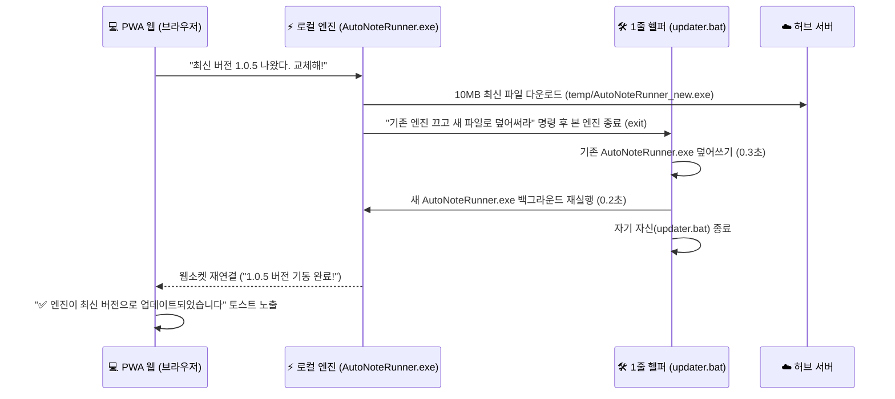

# 🖥️ 하이브리드 로컬 엔진 배포, EV 코드사이닝 및 자동 업데이트 표준 가이드

본 문서는 멀린 패밀리 생태계의 모든 하이브리드 앱(웹 PWA + PC 로컬 경량 엔진) 및 데스크톱 프로그램(오토노트 러너, 루미노트 CRM, 쇼츠 마케터 등)을 **'원클릭 인스톨러 + EV 코드사이닝 + 멀린패밀리 전용 폴더 통합 + 무소음 백그라운드 자동 업데이트'** 체제로 구축하기 위한 표준 지침서입니다.

---

## ⚡ 1. 하이브리드 아키텍처의 혁신 (PWA 웹 + 로컬 경량 엔진)

안티그래비티나 VS Code 같은 기존 데스크톱 프로그램은 화면(IDE)과 엔진이 하나의 거대한 프로세스로 뭉쳐 있어, 업데이트할 때마다 유저가 작업 중이던 화면을 강제로 끄고(Kill) 재부팅해야 합니다.

반면 **멀린 패밀리 하이브리드 앱은 화면과 엔진이 완벽히 분리**되어 있습니다.

```mermaid
flowchart TD
    subgraph UI ["💻 유저 인터페이스 (화면)"]
        PWA["오토노트 / 루미노트 PWA 웹앱<br>• 브라우저 접속 (설치 0초, 모바일/PC 반응형)<br>• 화면 새로고침 없이 상시 유지<br>• 0.001초 실시간 클라우드 배포"]
    end

    subgraph Engine ["⚡ 로컬 경량 실행 엔진 (하드웨어 제어)"]
        Runner["오토노트 러너 / LumiSender (10MB)<br>• 유저 PC 백그라운드 무소음 상주<br>• 윈도우 '휴대폰과 연결' 창 & 클립보드 제어<br>• 1초 셀프 재기동(Re-spawn) 자동 업데이트"]
    end

    PWA <===>|로컬 웹소켓 (localhost:18501) 버전 핸드셰이크 & 명령 전달| Runner
```

### 🎯 핵심 사용자 경험 (UX)
1. **최초 1회 실행 원칙**:
   - 유저 PC에 하드웨어를 제어할 10MB 엔진이 아직 없으므로, **최초 딱 1회만 인스톨러(또는 파일)를 받아 실행**합니다.
   - 실행 즉시 윈도우 시작 프로그램 / 백그라운드 트레이에 조용히 상주하므로, 유저는 **그 이후 평생 다시는 설치나 다운로드를 신경 쓸 필요가 없습니다.**
2. **화면 꺼짐 없는 3초 자동 업데이트 (Silent Self-Update)**:
   - 유저가 브라우저에서 PWA를 열면, PWA 웹이 로컬 엔진과 버전을 대조합니다.
   - 새 버전이 있으면 엔진이 백그라운드에서 10MB 새 파일을 다운받고, **0.5초 만에 기존 엔진 종료 ➔ 파일 덮어쓰기 ➔ 새 엔진 재기동**을 스스로 완료합니다.
   - **유저가 보던 PWA 화면은 전혀 꺼지지 않고**, 브라우저 화면에 `"✅ 발송 엔진이 최신 버전으로 업데이트되었습니다"` 토스트 하나 뜨고 끝납니다.

---

## 🤔 2. 실무 팩트 분석: 왜 과거에는 ZIP으로 배포했는가?

### Q. "불편도가 같으면 그냥 EXE 다운받아 경고창 보는 게 나은데, 왜 번거롭게 ZIP을 받아 압축 풀라고 가이드하는가?"

| 배포 형태 | **과거의 ZIP 배포 방식** | **멀린 패밀리 원클릭 인스톨러 (Setup.exe)** |
| :--- | :--- | :--- |
| **브라우저 다운로드 시** | 크롬/엣지가 일반 압축파일로 인식하여 **경고 없이 1초 만에 다운로드** | 미인증 EXE의 경우 크롬에서 *"위험할 수 있습니다"* 다운로드 보류 경고 발생 가능 |
| **다운로드 후 유저 작업** | **최악의 이탈 구간 발생**:<br>1) 다운로드 폴더 열기<br>2) 우클릭 '압축 풀기'<br>3) 풀린 폴더에서 복잡한 파일 중 exe 찾기<br>4) 더블클릭 시 **결국 파란 SmartScreen 경고 또 뜸!** | **작업 제로**:<br>다운로드된 `Setup.exe` 더블클릭 1번에 설치 및 바탕화면 바로가기 완료 |
| **포털/메일 첨부 여부** | 네이버 카페/블로그/지메일에서 첨부 가능 | 보안 정책상 웹메일/포털 직접 첨부 불가 (서버 다운로드 링크로 제공) |

> **📢 [공식 선언: ZIP 배포 완전 폐기 및 단일 Setup.exe 전면 대체]**:  
> 멀린 패밀리는 유저에게 극심한 혼란과 이탈을 초래하는 **구시대적 ZIP 압축 배포를 전면 영구 폐기**하고, 모든 하이브리드 로컬 엔진 및 PC 프로그램을 **원클릭 인스톨러(`Setup.exe`)로 100% 단일화**한다.  
> 
> **[테스트 기간 운용 방침]**:  
> EV 인증서 도입 전인 개발 및 사내/클로즈드 테스트 기간에는, 브라우저의 다운로드 일시 보류(`[유지] ➔ [계속 다운로드]`)와 윈도우 SmartScreen 파란 경고(`[추가 정보] ➔ [실행]`)를 1회성으로 감수하고 테스트를 속전속결로 진행한다. 복잡하게 ZIP을 푸는 것보다 경고창 1번 누르고 바로 설치되는 것이 체감상 10배 빠르고 직관적이기 때문이다.

---

## 🛡️ 3. 공인 코드 서명 인프라: Microsoft Artifact Signing 구축 완료 (SSOT)

과거 연간 50~100만 원씩 들던 사설 물리 토큰(HSM) 방식 대신, **마이크로소프트 공식 `Artifact Signing` (월 $9.99 Basic, 월 5,000건 서명) 인프라를 2026-10-12 구축 완료**하였다.

### 1) 마이크로소프트 아티팩트 서명 비교

| 구분 | **서명 없음 (미인증)** | **마이크로소프트 Artifact Signing (현재 구축 완료)** |
| :--- | :--- | :--- |
| **비용** | **0원** | **월 $9.99** (연 약 16만 원, 마이크로소프트 본진 종량제) |
| **최초 1회 설치** | 파란색 SmartScreen 창 노출<br>(*"추가 정보 ➔ 실행"* 1클릭 통과) | **파란 경고창 0초 완전 패스**<br>(MS 공인 디지털 서명으로 대기업 앱처럼 바로 실행) |
| **브라우저 다운로드** | 크롬/엣지에서 "보존/유지" 확인 1클릭 감수 | 브라우저 다운로드 경고 100% 프리패스 |
| **백신 오진 방어** | V3/알약 등 백신이 미인증 백그라운드 교체 시 **랜섬웨어 오진 삭제 위험** 간혹 발생 | 백신들이 **'마이크로소프트 보증 기업(썬드림주식회사)'으로 인식**하여 백그라운드 파일 교체 100% 프리패스 허용 |

### 2) 구축 완료 인프라 원장 요약
- **계정**: `sundreamer` (Azure Korea Central)
- **조직**: **썬드림주식회사** (대표자: `BEAK EUNSUK`, 여권 + 안면 생체 AU10TIX 검증 통과)
- **빌드 연동**: Windows SDK `SignTool.exe` + `Azure.CodeSigning.Dlib` 1줄 연동
- **세부 원장 규격**: [`docs/코드서명_인프라_강령.md`](./코드서명_인프라_강령.md) 100% 준수

---

## 📂 4. 멀린 패밀리 윈도우 전용 폴더 표준 규격

모든 패밀리 프로그램은 UAC(관리자 권한)를 묻지 않는 **사용자 전용 프로그램 디렉토리(`%LOCALAPPDATA%\Programs\MerlinFamily`)**에 폴더별로 일괄 배치됩니다.

```
C:\Users\{사용자계정}\AppData\Local\Programs\MerlinFamily\
├── AutoNote\                 # 1. 오토노트 로컬 러너 (10MB 백그라운드 데몬)
│   ├── AutoNoteRunner.exe
│   └── updater.bat
├── LumiNote\                 # 2. 루미노트 CRM (LumiSender)
│   ├── LumiNote.exe
│   └── ...
├── ShortsMaker\              # 3. 쇼츠 자동화 제작기 (Python)
└── CafeMarketer\             # 4. 맘카페 반자동 댓글 마케터
```

- **시작 메뉴**: `시작 메뉴 > Merlin Family > [프로그램명]` 그룹 폴더 생성.
- **바탕화면**: `Merlin Family [프로그램명]` 아이콘 자동 생성.

---

## 🔄 5. 로컬 엔진의 3초 무소음 자동 교체 (Self-Replacement) 상세 로직

로컬 엔진이 실행 중일 때는 OS 파일 락이 걸리므로, 다음과 같은 초경량 3초 교체 시퀀스를 사용합니다.



### 1줄 헬퍼 스크립트 (`updater.bat`)
```bat
@echo off
timeout /t 1 /nobreak >nul
move /y "temp\AutoNoteRunner_new.exe" "AutoNoteRunner.exe" >nul
start "" "AutoNoteRunner.exe"
exit
```

---

## 🚀 6. 몇 주 후 실행을 위한 4단계 마스터 체크리스트

- [ ] **1단계: 로컬 엔진(Runner) 웹소켓 핑 및 버전 비교 API 연동**
  - PWA와 로컬 엔진 간 `localhost:18501` 핸드셰이크 규격 수립
- [ ] **2단계: 초경량 `updater.bat` 기반 셀프 교체 로직 검증**
  - 다운로드 ➔ 프로세스 재기동 ➔ 웹소켓 재연결 3초 사이클 사내 테스트
- [ ] **3단계: Inno Setup 기반 원클릭 인스톨러(`AutoNote-Setup.exe`) 스크립트 작성**
  - `%LOCALAPPDATA%\Programs\MerlinFamily` 설치 경로 및 시작메뉴/바탕화면 등록 자동화
- [ ] **4단계: EV 코드사이닝 인증서 발급 및 `signtool` 자동 서명 결합**
  - 런칭 직전 파란 경고창 및 백신 오진 100% 완전 소멸
