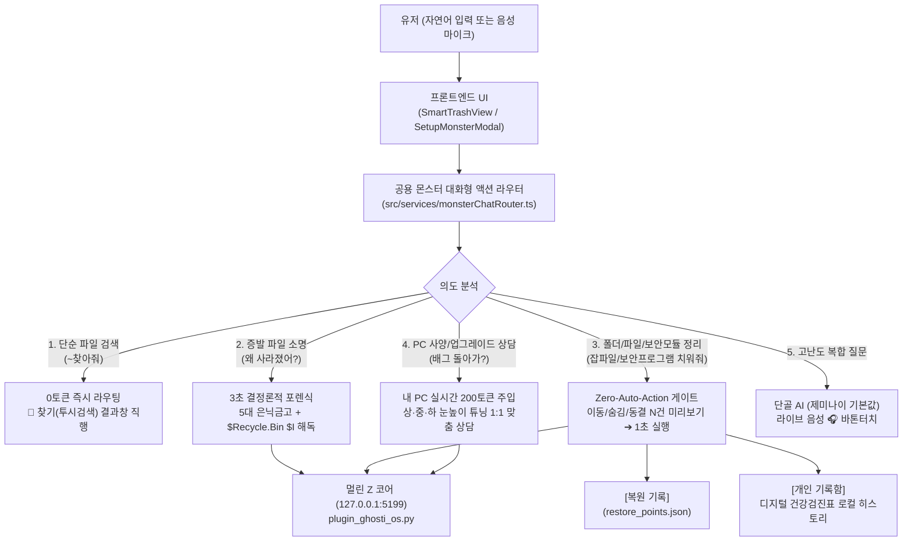
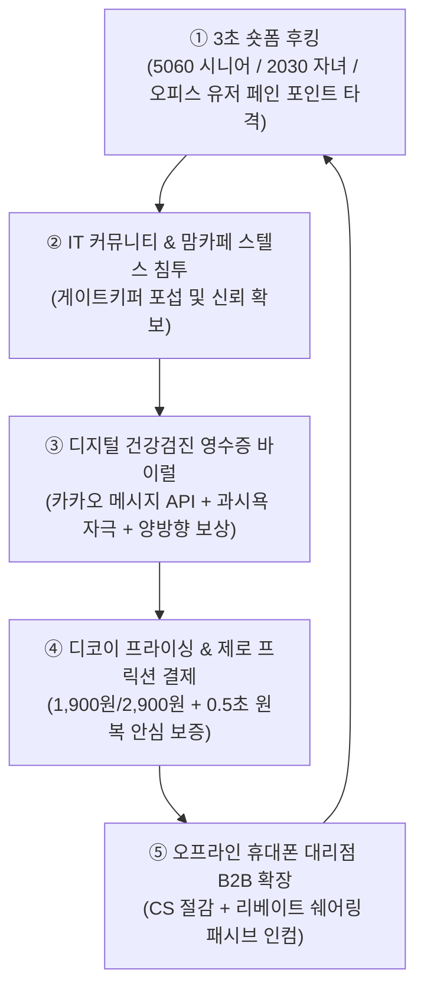
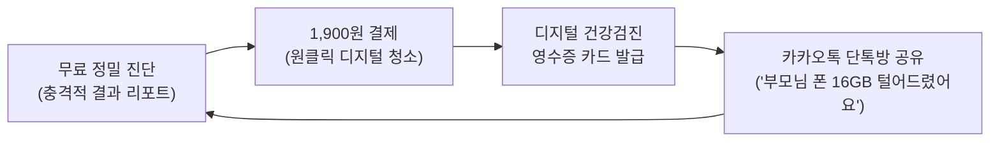
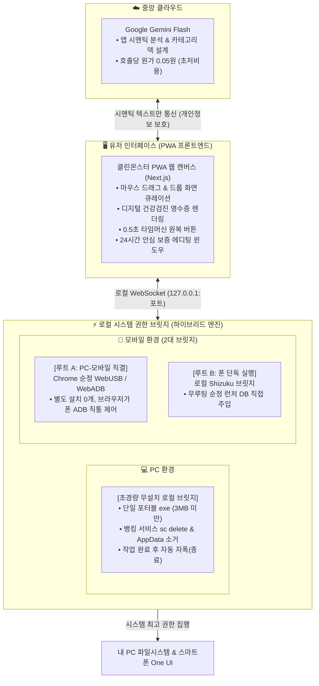

# 🧹 치우기(클린몬스터) & ⚙️ 고치기(설정몬스터) — 최종 통합 기획 및 엔지니어링 명세서

> **문서 상태:** 멀린님 최종 승인 확정본 (SSOT)  
> **최종 확정일:** 2026-10-28  
> **적용 앱:** 『귀신같이』 (Ghosti) — `[🧹 치우기]` & `[⚙️ 고치기]`  
> **통합 엔진:** 『멀린 Z 코어 (Merlin Z-Core)』 (단일 표준 포트 `127.0.0.1:5199`)  
> **기본 철학:** **"혼자 쓸 땐 언제나 0원(100% 무료 무제한), 노인 전용 모드를 따로 두지 않아도 귀신같이 자체가 이미 효도 그 자체!"**

---

## 1. 🎯 전략적 배경 및 헌법 5대 원칙

1. **내 기기 전면 무료 원칙 (언제나 0원 · 무제한 혜택):**
   - `[내 기기]`의 치우기·고치기는 진단, 스캔, 대화형 상담, 실제 정리 및 수리까지 **평생 0원**입니다.
   - 구버전 문서 및 코드에 남아있던 코인 차감(100/300/500 코인), 잔액 부족 시 충전 유도 모달, 에스크로 환불 로직을 전면 제거합니다.
2. **이원화 실행 및 1초 무위험(Zero-Risk) 원칙:**
   - **파일 삭제:** 복잡한 임의 격리 폴더(`.zeye_quarantine`)를 폐기하고, **`OS 기본 [휴지통]` 직행 + `[↩️ 1초 실행 취소]`**로 직결합니다.
   - **대화형 폴더 이동/숨김:** 로컬 트랜잭션 원장(`[복원 기록]`, `restore_points.json`)에 기록되며, **`[↩️ 1초 원상복구]`**로 되돌립니다.
3. **실물 증거 확인 게이트 (`Zero-Auto-Action`):**
   - AI가 스스로 판단하여 임의로 파일을 지우거나 옮기지 않습니다.
   - 반드시 **`[이동 N건 / 숨김 N건]` 미리보기 카드** 또는 **`실물 증거 텍스트 5줄`**을 유저에게 먼저 제시하고, 유저가 `[⭕ 그대로 실행해 줘]`를 클릭한 순간에만 실행합니다.
4. **통합 AI 두뇌 (공용 대화형 엔진):**
   - 좌측 메뉴는 **`[🧹 치우기]`**와 **`[⚙️ 고치기]`**로 나뉘어 접근성을 높이되, 내부적으로는 **동일한 단일 대화형 엔진**을 공유합니다.
   - `🧹 치우기`에서 OS 고장을 말하든, `⚙️ 고치기`에서 파일 정리를 말하든 유저를 쫓아내지 않고 그 자리에서 즉시 처리합니다.
5. **일상성 기반의 자연스러운 효도 UX:**
   - '노인/효도 전용 모드'를 인위적으로 분리하지 않습니다.
   - 크고 시원한 폰트, 직관적인 시각 피드백, 친절한 일상 비유, `현수` 성우 음성 브리핑이 기본 탑재되어 있어 **누가 써도 자연스럽고 편안한 '효도 그 자체'의 경험**을 제공합니다.

---

## 2. 🏗️ 시스템 아키텍처 및 데이터 흐름

---

## 3. 💬 공용 대화형 엔진 7대 핵심 기능 사양

### ① 자연어 대화형 폴더 & 잡파일 & 보안모듈 정리 (`Zero-Auto-Action`)
- **수행 범위:**
  - 바탕화면/다운로드 폴더 내 업무 무관 잡파일을 `'기타'` 폴더로 이동하거나 오래된 폴더 숨김 처리.
  - 다운로드 폴더 내 **출처 불명 사설 설치파일(`.apk`, `.exe`, `.msi`) 및 방치된 대용량 인스톨러 찌꺼기** 탐지 및 청소.
  - PC 부팅 및 메모리를 잠식하는 **뱅킹/관공서 보안 모듈(`AnySign`, `MagicLine`, `Veraport`, `TouchEn` 등) 및 불필요한 시작프로그램** 탐지 및 안전 동결.
    - **현재 구현 상태 (2026-10-29):** 보안 모듈 동결은 관리자 권한이 필요하고 잘못 멈추면 인터넷뱅킹 접속이 막힐 수 있어 **자동 실행하지 않습니다.** Z-코어가 실측한 시작프로그램 목록(HKCU/HKLM Run·시작프로그램 폴더)만 보여주고, 윈도우 [설정 › 앱 › 시작프로그램]에서 직접 끄도록 안내합니다.
  - **정리 후보 선정 규칙 (Zero-LLM 실측, 2026-10-29 구현):** 바탕화면·다운로드 폴더 **바로 아래 파일만** 대상(하위 폴더·바로가기 `.lnk/.url`·시스템 파일 제외, 파일 본문은 읽지 않음).
    - 다운로드 설치파일 정리: 3일 이상 지난 `.exe/.msi/.apk/.msix/.appx` + 1일 이상 지난 받다 만 파일(`.crdownload/.part/.tmp/.download`).
    - 바탕화면·다운로드 잡파일 정리: 3일 이상 지난 `.tmp/.bak/.log/.crdownload/.part/.zip/.7z/.rar/.exe/.msi/.apk`.
    - 실행 시 삭제하지 않고 **같은 폴더 안의 `기타_정리함`으로 이동**하며, 같은 이름이 있으면 덮어쓰지 않고 `(2)` 등 새 이름을 붙입니다. 이동한 실제 경로(from → to)를 `[복원 기록]`에 남깁니다.
  - 유저가 채팅창에서 요구하는 **"자주 가는 단골 사이트(카페, 유튜브 등) 바탕화면 바로가기 만들어줘"** 등의 OS 편의 요청 유연 처리.
- **실행 게이트:**
  - 대화창에 즉시 **`[정리 미리보기: 이동 N건 / 숨김 N건 / 동결 N건]` 카드** 제시.
  - 유저의 최종 `[⭕ 확인 완료 · 그대로 실행해 줘]` 클릭 전에는 단 1건의 물리 변경도 발생하지 않음.

### ② `[복원 기록]` 3단계 사전 무결성 검진 (`Pre-Check`) & 1초 타임머신 원복
- **공식 명칭:** **`[복원 기록]`** (코더 용어인 커밋/스냅샷 노출 금지).
- **대화형 호출:** *"최근 한 달 복원기록 보여줘"*, *"아까 옮긴 거 다시 돌려놔 줘"*, *"어제 숨긴 폴더 다시 보이게 해줘"*.
- **3단계 무결성 배지:**
  - 🟢 **`[100% 완벽 복원 가능]`**: 대상 파일이 이동 위치에 온전히 보존됨.
  - 🟡 **`[부분 복원 가능 (M건 중 N건)]`**: 일부 파일이 유저에 의해 수정/이동됨.
  - 🔴 **`[복원 불가 (파일 없음)]`**: 대상 파일이 이미 영구 삭제됨.
- **원복 실행:** 유저 확인 즉시 1초 만에 원래 위치로 롤백.

### ③ 3초 결정론적 포렌식 & 윈도우 휴지통 `$I` 바이너리 해독 ‘1초 초월적 소명’
- **대화형 호출:** *"내 파일 왜 사라졌어?"*, *"아까 쓰던 문서가 없어졌어, 네가 지웠어?"*.
- **동작 방식:**
  - AI가 추측하거나 되묻지 않고 0.01초 만에 `[복원 기록]` + 5대 은닉 금고 + 윈도우 `$Recycle.Bin`의 `$I` 바이너리를 동시 스캔.
  - 3초 내에 **"고객님의 문서는 지워진 것이 아니라 휴지통에 보관되어 있습니다(실제 파일명, 크기, 삭제 일시)"**와 함께 **실물 증거 텍스트 5줄 미리보기 + `[📂 1초 원래 위치로 복구]`** 버튼 제공.
  - 10초 내 흔적이 없으면 3대 불가 영역(영구 파쇄, 물리 파손, 타인 암호)을 정직하게 안내(`DOCTOR_3_RED_LINES_NOTICE`).
  - **현재 구현 상태 (2026-10-29):**
    - 오피스 자동복구 금고 스캔은 **3초 제한을 실제로 집행**하며, 시간이 넘으면 확인하지 못한 금고 이름을 결과에 그대로 밝힙니다(`timedOut`, `skippedVaults`). 휴지통 해독 스캔은 10초 제한.
    - 휴지통 조회는 **현재 로그인한 사용자의 휴지통(SID)만**, 모든 로컬 고정 디스크를 대상으로 합니다(다른 계정의 삭제 이력 열람 금지).
    - 복구 방식: ① `[복원 기록]` 항목 → 기록된 경로로 되돌림 ② 휴지통 항목 → `$R` 실물을 원래 경로로 이동(같은 이름이 있으면 `(복원본)` 새 이름) ③ 오피스 자동복구 파일 → 원본은 그대로 두고 바탕화면에 `(복구본)` 사본 생성.
    - 찾지 못하면 "찾지 못했습니다"라고만 답하며, 확인하지 않은 사실(예: "휴지통 비우기로 소멸됨")을 단정하지 않습니다.
    - `DOCTOR_3_RED_LINES_NOTICE`의 현재 문구는 '영구 삭제 불가 / OS 시스템 폴더 개조 불가 / 금융·메신저 대리 전송 불가'이며, 위 기획의 3대 불가 영역(영구 파쇄·물리 파손·타인 암호) 문구로 교체는 아직 반영되지 않았습니다.

### ④ 단순 파일 검색 의도 0토큰 감지 및 `🎯 찾기` 직행 라우팅
- 유저가 대화창에 *"작년 세무 계약서 찾아줘"*, *"제주도 바다 사진"* 등 단순 검색어를 입력할 경우:
  - LLM 호출 비용 0원으로 의도를 즉시 감지(`detectZeroLlmPerspectiveSearchIntent`).
  - **`[🎯 '찾기(투시검색)'에서 결과 보기]` 원클릭 이동 버튼**을 띄우고 즉시 결과 탭으로 전환.

### ⑤ 내 PC 실시간 사양(200토큰) 주입 & IT 이해도(상·중·하) 적응형 1:1 상담
- **스펙 주입:** 로컬 Z-코어에서 CPU, RAM, GPU, 디스크 잔여량 정보를 200토큰 분량의 메타데이터로 시스템 프롬프트에 자동 주입.
  - **현재 구현 상태 (2026-10-29):** Z-코어 `pc-spec` 액션이 CPU(레지스트리 ProcessorNameString), RAM(GlobalMemoryStatusEx), GPU(디스플레이 어댑터 DriverDesc), 시스템 드라이브 여유 공간, 모니터 주사율(EnumDisplaySettings), OS 버전을 실측합니다. 읽지 못한 값은 "확인 불가"로 표시하며 예시값으로 채우지 않습니다. 특정 게임·프로그램의 권장 사양 비교는 아직 지원하지 않는다고 명시합니다.
- **적응형 말투 (Adaptive Literacy Triage):**
  - **`🌱 초급 (어르신/컴맹)`**: 전문 용어 0%, 일상 비유 (*"책상 위에 서류가 꽉 차서 펜 놓을 자리가 없어요"*, *"몰래 전기 쓰는 경비원 2명을 안전하게 퇴근시켰어요"*).
  - **`🌿 중급 (일반인/학생)`**: 직관적 원인 설명 + 가성비 업그레이드 가이드 (*"RAM 8GB 증설 추천"*).
  - **`🌳 고급 (전문가/엔지니어)`**: 프로세스명, PID, 레지스트리 경로, 리소스 점유율(%) 팩트 브리핑.

### ⑥ 무료 무제한 신경망 성우 `현수` & 단골 AI `제미나이` 라이브 음성 바톤터치
- **기본 브리핑 성우:** **`ko-KR-HyunsuNeural (현수)`** 차분하고 신뢰감 있는 남성 중저음 음성으로 일일 제한 없이 100% 무료 무제한 낭독.
- **음성 마이크 입력:** 원클릭 STT 음성 명령 지원.
- **단골 AI 바톤터치:** 시스템 수리/정리 범위를 넘어서는 고난도 전문 질의 발생 시, 유저의 단골 AI(열어본 기록 0건인 초기 유저 기본값: **`제미나이 Gemini`**) 입력창에 질문을 자동으로 채워주고 **`[🎧 제미나이 라이브 음성으로 이어서 대화하기]`** 버튼으로 스무스하게 인계.

### ⑦ 영구 보관 `[디지털 건강검진표]` 발급 & 개인 히스토리 로컬 저장
- **발급 시점:** `🧹 치우기` 또는 `⚙️ 고치기` 작업 완료 시 자동 발급.
- **보관 및 용도:**
  - 외부 공유나 유료 쿠폰 지급을 강제하지 않고, **오직 내 기기 로컬의 `[개인 건강검진 기록함]`에 히스토리 형태로 차곡차곡 영구 보관**.
  - 확보된 용량(GB), 소탕된 보안 모듈 수, 정리된 중복 파일, 속도 개선율 추이를 언제든 이전 기록과 비교 열람 가능.

---

## 4. 🖼️ 메뉴별 UI/UX 인터랙션 설계

### 4.1 `[🧹 치우기]` 탭 ([`SmartTrashView.tsx`](file:///d:/Ghosti/src/components/SmartTrashView.tsx))
- **상단 그리드:**
  - ① 중복·연사 선택 (최고화질 1장 보존)
  - ② 주차장·영수증·사물 메모
  - ③ 스크린샷·캡처
  - ④ 흔들림·오촬영
  - ⑤ 휴지통 보관함 및 서류함 분리 확인
- **우측/하단 대화창:**
  - 기존 3줄 하드코딩 응답을 제거하고, **공용 몬스터 대화창** 탑재.
  - 마이크 음성 입력, 성우 `현수` 음성 켜기/끄기 토글, 추천 질의 칩 배치.
  - 정리 미리보기 승인 카드 (`이동 N건 / 숨김 N건`) ➔ `[⭕ 확인 완료 · 그대로 실행해 줘]` ➔ 실행 후 `[개인 건강검진표]` 카드 발급.

### 4.2 `[⚙️ 고치기]` 탭 ([`SetupMonsterModal.tsx`](file:///d:/Ghosti/src/components/SetupMonsterModal.tsx))
- **상단 고정:**
  - 자주 찾는 증상 선택 칩 (소리 안 남, 프린터 안 됨, 네트워크 끊김, PC 느림 등).
- **메인 영역:**
  - 코인 결제/충전/에스크로 잔재 전면 삭제 (상시 0원 무료 배지 표출).
  - 3초 포렌식 증발 문서 소명 카드 (5줄 미리보기 + 원클릭 복원).
  - PC 스펙 기반 1:1 상담 및 단골 AI 바톤터치 카드.

---

## 5. 🛠️ 엔지니어링 실행 체크리스트

> **2026-10-29 전수조사·수정 반영 상태** (근거 커밋: `fc3b190` · `4d8fa61` · `1a55aeb` · `499ab42` · `13996c6` · `9920d39` · `7ef857c`)

- [x] **1. 공용 라우터 구현 (`src/services/monsterChatRouter.ts`):** 7대 의도 판별 및 Z-코어 브릿지 직결 파이프라인.
  - 모든 Z-코어 호출은 `getZCoreUrl()`을 거쳐 웹 배포본에서도 `127.0.0.1:5199`로 연결됩니다.
  - Z-코어 미연결·실패·미발견 시 가짜 성공이나 예시 데이터로 대체하지 않고 그대로 알립니다(정직 원칙).
- [~] **2. 스토어 상태 정돈 (`src/store/useSaySeeStore.ts`):**
  - [x] 사진 정리 이동/복원: Z-코어 실제 결과(`moved`/`restored`)만 화면에 반영, 실패 시 화면 미변경. Z-코어 미연결 시 `🧪 체험 모드(실제 파일은 그대로)`로 명시.
  - [x] 화면에 보이던 코인 환불·에스크로·본사 전송·전 세계 배포 허위 문구 제거.
  - [ ] 내부 코인·에스크로 상태값/함수(`setupEscrowHoldingCoins`, `topupMerlinCoinAndStartEscrowRepair` 등) 코드 자체 제거는 미완료 (화면 문구만 정리됨, 별도 리팩토링 필요).
  - [x] 로컬 `[개인 건강검진 기록함]`: 실제로 실행된 작업만 기록 (예시 시드 기록·근거 없는 건강점수 제거).
- [x] **3. `SmartTrashView.tsx` 대화창:** 미리보기 게이트(실측 후보 전체 목록) 및 `[복원 기록]` 원복 연동, 실패 사유 표시.
- [x] **4. `SetupMonsterModal.tsx`:** 자동 실행하지 않은 설정 플랜은 "수리 완료" 대신 "설정을 바꾸지 않았다"고 표시. 현재 자동 실행 지원 항목은 S: 업무 드라이브 연결 1종.
- [x] **5. Z-코어 데몬 실동작 (`universal_z_core/os_agent/ghosti_safe_ops.py`):**
  - 사진 정리 = **윈도우 OS 휴지통 실제 이동**(`SHFileOperationW` + `FOF_ALLOWUNDO`) 및 휴지통에서 원위치 복원. 휴지통이 없는 드라이브(USB·네트워크)는 영구삭제 위험 때문에 거부.
  - 파일을 옮기거나 만드는 요청은 멀린 패밀리 공식 도메인(`*.sundreamer.app`)·로컬 개발 화면에서만 허용(그 외 출처 403).
  - 알 수 없는 액션은 OS 실행으로 넘기지 않고 거절.
- [x] **6. 검증:** `npm run build` 통과, 파이썬 단위·통합 테스트 16건(`universal_z_core/tests/`), 데몬 실구동 HTTP E2E 20건, 사진 휴지통 왕복(이동→휴지통 미리보기→원위치 복원) 통과.
- [ ] **7. 노션 QA 미션 출제:** 해나라님 테스트 미션 카드 등록 (본 반영 직후 진행).

---

# 🛡️ 전사 Z-코어(엔진) × Z몬스터(두뇌) 범용 아키텍처 & 'PC·모바일 Git 타임머신' 명세서

> **제정 및 확장일:** 2026-10-22  
> **핵심 사상:**  
> 1. 오피스 문서 분실뿐만 아니라 **PC·모바일의 모든 문제(파일 증발, 설정 꼬임, 장치 먹통, 속도 저하)**를 해결하는 전사 범용 아키텍처로 통합한다.  
> 2. 단타성 사후 수리를 넘어, **PC·모바일의 주요 설정과 작업 상태 변경 이력을 '깃허브(Git) 커밋'처럼 초경량(부하 0.1% 미만)으로 기록**하여 언제든 정상 시점으로 되돌리는 **'OS 타임머신'**을 구축한다.  
> 3. 설정·클린몬스터를 1회 이상 경험한 유저에게는 고장 나기 전에 구체적 변화(Git Diff)를 짚어 알려주는 **'무(無)어그로 사전 예방형 주치의(Preventive Care)'** 모델을 가동한다.

---

## 🏗️ 1. `Z-코어`의 정체성: 크롬 확장팩인가, OS 내장 에이전트인가?

### ✅ 결론: 본체는 **'OS 속에 들어가는 초경량 시스템 비서(`.exe` / `APK`)'**이며, 웹브라우저와는 확장팩 설치 없이도 로컬 브릿지로 직결됩니다.

| 구분 | 🌐 크롬 확장팩 (Browser Extension) | 💻 OS 내장형 `Z-코어` (`Merlin_Z_Core.exe / APK`) |
|---|---|---|
| **작동 범위** | 크롬 브라우저 창 내부에만 갇힘 (크롬 끄면 작동 중지) | 윈도우/안드로이드 부팅 시 백그라운드 트레이에서 **24시간 상시 작동** |
| **파일·OS 제어** | 샌드박스 보안 때문에 내 PC의 엑셀·폴더·레지스트리·프린터 제어 **불가** | OS 권한으로 **숨김 폴더 포렌식, 설정 Git 스냅샷, `S:` 드라이브, 시스템 수리 100% 가능** |
| **화면 화살표(`👆`)** | 브라우저 탭 안에서만 표시 가능 | 윈도우 제어판·엑셀·타사 앱 등 **OS 모든 창 맨 위에 화살표 오버레이 투사 가능** |
| **웹앱 연동 방식** | 별도로 웹스토어에서 확장팩을 또 설치해야 함 | 로컬 보안 브릿지(`/__merlin/query`)를 통해 **확장팩 추가 설치 없이 모든 멀린 패밀리 웹앱(`*.sundreamer.app`)과 0.01초 자동 연결** |

> 💡 **PC·모바일 모두 '크롬 확장팩 없이' `Z-코어` 단독으로 100% 작동 (One-Core 천하통일):**
> - **모바일과 PC 완벽 동일 구조:** 모바일에서 크롬 확장팩 없이 `Z-코어(1MB APK)` 혼자 유튜브 앱 위에 배지를 띄우고 자막을 따는 것처럼, **PC에서도 크롬 확장팩을 아예 설치하지 않아도 `Z-코어(Merlin_Z_Core.exe)` 단독으로 100% 작동**합니다.
>   1. **브라우저 무관(크롬·엣지·웨일·카톡 인앱) 영상 자동 감지:** 확장팩 없이도 Windows `UI Automation`과 OS 미디어 세션 감지로 현재 화면에 떠 있는 유튜브 영상의 URL·제목·썸네일 좌표를 0.01초 만에 읽어냅니다.
>   2. **로컬 직통 자막(대본) 추출:** 유저 PC/폰의 로컬 IP로 유튜브 자막 트랙(`timedtext`)을 직접 추출(자막 없는 영상은 로컬 오디오/OCR 추출)하므로 서버 비용 0원·유튜브 봇 차단율 0%를 달성합니다.
>   3. **OS TopMost 투명 오버레이 배지:** 웹페이지 DOM을 건드리는 확장팩 대신, `Z-코어`의 OS 최상단 투명 레이어(`uiAccess="true"` / Android 오버레이)가 영상 화면 바로 위에 **`[🟢 진짜 정보 / 🔴 낚시 주의]`** 신호등 배지와 요약 카드를 직접 띄웁니다. (기승인된 크롬 확장팩은 `Z-코어` 미설치 유저 유입용 보조 채널로만 활용 가능하며, `Z-코어` 설치 시 확장팩은 전혀 필요 없습니다.)

---

## ⚡ 2. 전역 확대 시 PC 부하를 `0.1% 미만`으로 유지하는 'PC·모바일 Git(깃허브)' 기록 원리

컴퓨터 전체를 1초마다 무식하게 스캔(Polling)하면 PC가 느려집니다. `Z-코어`는 **OS 커널이 보내는 변경 이벤트(Event-Driven)만 받아 '바뀐 차이점(Diff)'만 텍스트(JSON)로 커밋**하기 때문에 평상시 **CPU 점유율 0.1% 미만, 메모리 15MB 이하**로 작동합니다.

### [부하 제로(Zero-Overhead) 3대 Git 커밋 메커니즘]
1. **시스템 설정 Git 커밋 (`System Config Git` — 1년 치 기록 = 5MB 미만):**
   - 감시 대상: 오디오 입출력 장치, 네트워크/DNS/프록시 상태, 프린터 스풀러, 시작프로그램 목록, 기본 앱 연결, 주요 레지스트리 키.
   - 작동 방식: 평상시에는 잠자고 있다가, 윈도우 WMI/레지스트리 변경 이벤트가 발생할 때만 `0.001초` 깨어나서 **`[2026-10-22 14:20] 스피커 출력: Realtek -> 모니터(HDMI)로 변경됨 (원인: 그래픽 드라이버 업데이트)`** 한 줄을 로컬 Git 로그에 커밋합니다.
   - 효과: 유저가 *"갑자기 소리가 안 나요!"*라고 하면 30분 헤맬 필요 없이 직전 커밋과 비교(`git diff`)하여 **0.1초 만에 원인을 찾고 직전 정상 커밋으로 `git revert` 복원**합니다.
2. **열려 있는 작업 문서 핀셋 그림자 백업 (`Active Document Shadow Vault`):**
   - 하드디스크의 수십만 개 파일을 다 백업하는 것이 아니라, **지금 사용자가 화면에 띄워놓고 타이핑 중인(`Foreground Active`) 엑셀·워드·한글 파일 딱 1~2개**만 타겟팅합니다.
   - 오피스 자동복구 주기를 `1분`으로 단축함과 동시에, 저장/창 닫힘 이벤트 시 `%LOCALAPPDATA%\Merlin\ShadowVault\`에 **최근 10개 버전만 링버퍼(오래된 순 자동 덮어쓰기)로 보관**하여 디스크 용량 낭비와 부하가 전혀 없습니다.
3. **파일 이동·다운로드 경로 블랙박스 (`Recent & Download Tracker`):**
   - 카카오톡, 이메일, 브라우저에서 내려받거나 저장한 파일의 **최종 저장 경로 텍스트만 기록**해 두어, *"방금 저장한 파일이 어디 갔는지 모르겠어요"*라고 할 때 하드 전체를 뒤지지 않고도 **0.01초 만에 위치를 대답**합니다.

---

## 🩺 3. 기존 백신(알약·V3 등)의 '공포 어그로' vs 우리의 '사전 예방형 주치의 (Preventive Care)'

### 3.1 왜 기존 백신들의 알림은 '어그로(극혐 광고)'로 느껴질까?
- **기존 백신의 한계:** 바이러스 시그니처와 단순 임시파일 용량만 볼 줄 알 뿐, 사용자의 **작업 맥락(저장 안 된 엑셀)**이나 **설정 변경 인과관계(Git Diff)**를 전혀 모릅니다.
- **공포 마케팅:** 아무 문제도 없는데 우측 하단에 시뻘건 모달로 *"⚠️ PC에 1,500개의 심각한 위협 발견! 지금 결제하세요!"*라고 뻥튀기 경고를 띄우기 때문에, 유저들은 이를 스파이웨어/광고로 인식하고 피로감을 느낍니다.

### 3.2 Z-코어 × 몬스터의 '사전 예방(Pre-Emptive Rescue)' 및 자연스러운 결제 유도 전략
1. **발동 조건 (신뢰 기반 활성화):**
   - 아무에게나 무작정 팝업을 띄우지 않고, **클린몬스터나 설정몬스터를 최소 1회 이상 이용해 본 유저**(또는 '내 PC 주치의 사전 보호 켜기'에 동의한 유저)에게만 작동합니다.
2. **추상적 공포가 아닌 '100% 구체적 팩트(Git Diff 증거)'만 알림:**
   - **사례 A (작업물 증발 사전 방어 — 무료 효능감 제공):**
     > *"💡 지금 작성 중인 `[거래처_정산.xlsx]` 파일이 **40분째 저장 없이 열려 있어**, 만약을 대비해 Z-코어 안전금고에 임시 보호본을 떠두었습니다. 안심하고 작업하세요!"*
   - **사례 B (부팅/속도 저하 원인 사전 감지 ➔ 원터치 수리·결제 연결):**
     > *"🩺 **오늘 오후 3시 12분**에 설치된 `[○○보안 플러그인]` 때문에 부팅 속도가 **12초 느려졌고** 메모리를 1.4GB 점유 중입니다. 설치 이전의 쾌적한 상태(어제 커밋)로 1초 만에 되돌릴까요? `[⚡ 1초 원상복구 하기]`"*
   - **사례 C (장치/용량 먹통 임박 사전 예방 ➔ 클린·설정몬스터 연결):**
     > *"⚠️ C드라이브 여유 공간이 **1.8GB**밖에 남지 않아 곧 엑셀 저장 오류나 카톡 멈춤이 발생할 수 있습니다. 숨은 중복 캐시 **14.2GB**를 찾아두었는데 지금 안전 격리할까요? `[🧹 미리보고 정리하기]`"*

---

## ⚖️ 4. 전사 Z-코어(손발) × 몬스터(두뇌) 범용 3대 절대 헌법 요약

| 원칙 | 담당 주체 | 핵심 작동 규칙 (오피스·설정·속도 전 영역 공통) |
|---|---|---|
| **제1원칙: 3초 결정론적 진단 & 10초 정직 컷오프** | `Z-코어` + `몬스터` | AI가 임의로 30분간 추측 수색하는 것을 원천 금지. **PC Git 히스토리 비교(`Diff`) 및 5대 은닉 금고 공식**으로 3초 만에 진단하고, 흔적/해결책이 없으면 **10초 내에 정직하게 고지 후 과금 0원으로 종료**한다. |
| **제2원칙: 실물 증거 미리보기 게이트 (무할루시네이션)** | `설정·클린몬스터` | AI가 먼저 *"다 고쳤습니다"*라고 선언하는 것을 원천 금지. 반드시 **복구할 파일의 내부 텍스트 5줄, 변경 전후 설정값 비교, 확보될 용량 목록**을 먼저 보여주고 유저가 **`[⭕ 확인 완료]`를 눌러야만 완료 및 코인 정산**된다. |
| **제3원칙: PC·모바일 Git 타임머신 & 사전 예방** | `Z-코어` 데몬 | 부하 0.1% 미만의 이벤트 감지 방식으로 **정상 설정 커밋과 작업 문서 그림자 백업**을 상시 유지하며, 고장 나기 전에 구체적 변화(Fact)를 짚어 **사전 예방 브리핑**을 제공한다. |

---

## 🔬 5. 윈도우 휴지통(`$Recycle.Bin`) `$I` 바이너리 헤더 해독 & `[복원 기록]`(`restore_points.json`) 3단계 무결성 사전 검진 상세 스펙 (`plugin_ghosti_os.py`)

1. **`1초 투시검색` & `클린몬스터` · `설정몬스터` 공통 3초 포렌식 (`trace_missing_file_omni`):**
   - 윈도우 휴지통(`C:\$Recycle.Bin\{SID}\`) 내부에서 파일명이 `$Rxxxxxx.xlsx`처럼 난수로 변경되어 일반 검색기로는 찾을 수 없는 문제를 해결하기 위해, 짝꿍 메타데이터 파일인 **`$Ixxxxxx` 바이너리 헤더(Version 1 Vista/7 및 Version 2 Win10/11 규격: 64-bit File Size + 64-bit FILETIME 삭제 시각 + UTF-16LE 원본 전체 경로)**를 직접 파싱하여 삭제 전 원래 파일명과 원래 폴더 경로를 0.5초 만에 정확히 복원합니다.
2. **`[복원 기록]` (`restore_points.json`) 공식 명칭 통일 및 3단계 무결성 사전 검진(Pre-Check):**
   - 코더 용어(`Git 커밋`) 대신 유저 친화적인 **`[복원 기록]`**으로 공식 명칭을 통일합니다.
   - 목록 조회 시 0.01초 만에 백업 파일 및 대상 경로 존재 여부를 사전 대조하여 **`🟢 [100% 완벽 복원 가능]`**, **`🟡 [부분 복원 가능 (M건 중 N건)]`**, **`🔴 [복원 불가 (파일 없음)]`** 3단계 상태 배지로 투명하게 안내하고 1초 만에 원상복구합니다.

---

# 🛡️ 전사 Z-코어(엔진) × 3몬스터(두뇌) 범용 아키텍처 & 'PC·모바일 Git 타임머신' 명세서

> **제정 및 확장일:** 2026-10-22  
> **핵심 사상:**  
> 1. 오피스 문서 분실뿐만 아니라 **PC·모바일의 모든 문제(파일 증발, 설정 꼬임, 장치 먹통, 속도 저하)**를 해결하는 전사 범용 아키텍처로 통합한다.  
> 2. 단타성 사후 수리를 넘어, **PC·모바일의 주요 설정과 작업 상태 변경 이력을 '깃허브(Git) 커밋'처럼 초경량(부하 0.1% 미만)으로 기록**하여 언제든 정상 시점으로 되돌리는 **'OS 타임머신'**을 구축한다.  
> 3. 설정·클린 몬스터를 1회 이상 경험한 유저에게는 고장 나기 전에 구체적 변화(Git Diff)를 짚어 알려주는 **'무(無)어그로 사전 예방형 주치의(Preventive Care)'** 모델을 가동한다.

---

## 🏗️ 1. `Z-코어`의 정체성: 크롬 확장팩인가, OS 내장 에이전트인가?

### ✅ 결론: 본체는 **'OS 속에 들어가는 초경량 시스템 비서(`.exe` / `APK`)'**이며, 웹브라우저와는 확장팩 설치 없이도 로컬 브릿지로 직결됩니다.

| 구분 | 🌐 크롬 확장팩 (Browser Extension) | 💻 OS 내장형 `Z-코어` (`Merlin_Z_Core.exe / APK`) |
|---|---|---|
| **작동 범위** | 크롬 브라우저 창 내부에만 갇힘 (크롬 끄면 작동 중지) | 윈도우/안드로이드 부팅 시 백그라운드 트레이에서 **24시간 상시 작동** |
| **파일·OS 제어** | 샌드박스 보안 때문에 내 PC의 엑셀·폴더·레지스트리·프린터 제어 **불가** | OS 권한으로 **숨김 폴더 포렌식, 설정 Git 스냅샷, `S:` 드라이브, 시스템 수리 100% 가능** |
| **화면 화살표(`👆`)** | 브라우저 탭 안에서만 표시 가능 | 윈도우 제어판·엑셀·타사 앱 등 **OS 모든 창 맨 위에 화살표 오버레이 투사 가능** |
| **웹앱 연동 방식** | 별도로 웹스토어에서 확장팩을 또 설치해야 함 | 로컬 보안 브릿지(`/__merlin/query`)를 통해 **확장팩 추가 설치 없이 모든 멀린 패밀리 웹앱(`*.sundreamer.app`)과 0.01초 자동 연결** |

> 💡 **PC·모바일 모두 '크롬 확장팩 없이' `Z-코어` 단독으로 100% 작동 (One-Core 천하통일):**
> - **모바일과 PC 완벽 동일 구조:** 모바일에서 크롬 확장팩 없이 `Z-코어(1MB APK)` 혼자 유튜브 앱 위에 배지를 띄우고 자막을 따는 것처럼, **PC에서도 크롬 확장팩을 아예 설치하지 않아도 `Z-코어(Merlin_Z_Core.exe)` 단독으로 100% 작동**합니다.
>   1. **브라우저 무관(크롬·엣지·웨일·카톡 인앱) 영상 자동 감지:** 확장팩 없이도 Windows `UI Automation`과 OS 미디어 세션 감지로 현재 화면에 떠 있는 유튜브 영상의 URL·제목·썸네일 좌표를 0.01초 만에 읽어냅니다.
>   2. **로컬 직통 자막(대본) 추출:** 유저 PC/폰의 로컬 IP로 유튜브 자막 트랙(`timedtext`)을 직접 추출(자막 없는 영상은 로컬 오디오/OCR 추출)하므로 서버 비용 0원·유튜브 봇 차단율 0%를 달성합니다.
>   3. **OS TopMost 투명 오버레이 배지:** 웹페이지 DOM을 건드리는 확장팩 대신, `Z-코어`의 OS 최상단 투명 레이어(`uiAccess="true"` / Android 오버레이)가 영상 화면 바로 위에 **`[🟢 진짜 정보 / 🔴 낚시 주의]`** 신호등 배지와 요약 카드를 직접 띄웁니다. (기승인된 크롬 확장팩은 `Z-코어` 미설치 유저 유입용 보조 채널로만 활용 가능하며, `Z-코어` 설치 시 확장팩은 전혀 필요 없습니다.)

---

## ⚡ 2. 전역 확대 시 PC 부하를 `0.1% 미만`으로 유지하는 'PC·모바일 Git(깃허브)' 기록 원리

컴퓨터 전체를 1초마다 무식하게 스캔(Polling)하면 PC가 느려집니다. `Z-코어`는 **OS 커널이 보내는 변경 이벤트(Event-Driven)만 받아 '바뀐 차이점(Diff)'만 텍스트(JSON)로 커밋**하기 때문에 평상시 **CPU 점유율 0.1% 미만, 메모리 15MB 이하**로 작동합니다.

### [부하 제로(Zero-Overhead) 3대 Git 커밋 메커니즘]
1. **시스템 설정 Git 커밋 (`System Config Git` — 1년 치 기록 = 5MB 미만):**
   - 감시 대상: 오디오 입출력 장치, 네트워크/DNS/프록시 상태, 프린터 스풀러, 시작프로그램 목록, 기본 앱 연결, 주요 레지스트리 키.
   - 작동 방식: 평상시에는 잠자고 있다가, 윈도우 WMI/레지스트리 변경 이벤트가 발생할 때만 `0.001초` 깨어나서 **`[2026-10-22 14:20] 스피커 출력: Realtek -> 모니터(HDMI)로 변경됨 (원인: 그래픽 드라이버 업데이트)`** 한 줄을 로컬 Git 로그에 커밋합니다.
   - 효과: 유저가 *"갑자기 소리가 안 나요!"*라고 하면 30분 헤맬 필요 없이 직전 커밋과 비교(`git diff`)하여 **0.1초 만에 원인을 찾고 직전 정상 커밋으로 `git revert` 복원**합니다.
2. **열려 있는 작업 문서 핀셋 그림자 백업 (`Active Document Shadow Vault`):**
   - 하드디스크의 수십만 개 파일을 다 백업하는 것이 아니라, **지금 사용자가 화면에 띄워놓고 타이핑 중인(`Foreground Active`) 엑셀·워드·한글 파일 딱 1~2개**만 타겟팅합니다.
   - 오피스 자동복구 주기를 `1분`으로 단축함과 동시에, 저장/창 닫힘 이벤트 시 `%LOCALAPPDATA%\Merlin\ShadowVault\`에 **최근 10개 버전만 링버퍼(오래된 순 자동 덮어쓰기)로 보관**하여 디스크 용량 낭비와 부하가 전혀 없습니다.
3. **파일 이동·다운로드 경로 블랙박스 (`Recent & Download Tracker`):**
   - 카카오톡, 이메일, 브라우저에서 내려받거나 저장한 파일의 **최종 저장 경로 텍스트만 기록**해 두어, *"방금 저장한 파일이 어디 갔는지 모르겠어요"*라고 할 때 하드 전체를 뒤지지 않고도 **0.01초 만에 위치를 대답**합니다.

---

## 🩺 3. 기존 백신(알약·V3 등)의 '공포 어그로' vs 우리의 '사전 예방형 주치의 (Preventive Care)'

### 3.1 왜 기존 백신들의 알림은 '어그로(극혐 광고)'로 느껴질까?
- **기존 백신의 한계:** 바이러스 시그니처와 단순 임시파일 용량만 볼 줄 알 뿐, 사용자의 **작업 맥락(저장 안 된 엑셀)**이나 **설정 변경 인과관계(Git Diff)**를 전혀 모릅니다.
- **공포 마케팅:** 아무 문제도 없는데 우측 하단에 시뻘건 모달로 *"⚠️ PC에 1,500개의 심각한 위협 발견! 지금 결제하세요!"*라고 뻥튀기 경고를 띄우기 때문에, 유저들은 이를 스파이웨어/광고로 인식하고 피로감을 느낍니다.

### 3.2 Z-코어 × 몬스터의 '사전 예방(Pre-Emptive Rescue)' 및 자연스러운 결제 유도 전략
1. **발동 조건 (신뢰 기반 활성화):**
   - 아무에게나 무작정 팝업을 띄우지 않고, **클린 몬스터나 설정 몬스터를 최소 1회 이상 이용해 본 유저**(또는 '내 PC 주치의 사전 보호 켜기'에 동의한 유저)에게만 작동합니다.
2. **추상적 공포가 아닌 '100% 구체적 팩트(Git Diff 증거)'만 알림:**
   - **사례 A (작업물 증발 사전 방어 — 무료 효능감 제공):**
     > *"💡 지금 작성 중인 `[거래처_정산.xlsx]` 파일이 **40분째 저장 없이 열려 있어**, 만약을 대비해 Z-코어 안전금고에 임시 보호본을 떠두었습니다. 안심하고 작업하세요!"*
   - **사례 B (부팅/속도 저하 원인 사전 감지 ➔ 원터치 수리·결제 연결):**
     > *"🩺 **오늘 오후 3시 12분**에 설치된 `[○○보안 플러그인]` 때문에 부팅 속도가 **12초 느려졌고** 메모리를 1.4GB 점유 중입니다. 설치 이전의 쾌적한 상태(어제 커밋)로 1초 만에 되돌릴까요? `[⚡ 1초 원상복구 하기]`"*
   - **사례 C (장치/용량 먹통 임박 사전 예방 ➔ 클린·설정 몬스터 연결):**
     > *"⚠️ C드라이브 여유 공간이 **1.8GB**밖에 남지 않아 곧 엑셀 저장 오류나 카톡 멈춤이 발생할 수 있습니다. 숨은 중복 캐시 **14.2GB**를 찾아두었는데 지금 안전 격리할까요? `[🧹 미리보고 정리하기]`"*

---

## ⚖️ 4. 전사 Z-코어(손발) × 몬스터(두뇌) 범용 3대 절대 헌법 요약

| 원칙 | 담당 주체 | 핵심 작동 규칙 (오피스·설정·속도 전 영역 공통) |
|---|---|---|
| **제1원칙: 3초 결정론적 진단 & 10초 정직 컷오프** | `Z-코어` + `몬스터` | AI가 임의로 30분간 추측 수색하는 것을 원천 금지. **PC Git 히스토리 비교(`Diff`) 및 5대 은닉 금고 공식**으로 3초 만에 진단하고, 흔적/해결책이 없으면 **10초 내에 정직하게 고지 후 과금 0원으로 종료**한다. |
| **제2원칙: 실물 증거 미리보기 게이트 (무할루시네이션)** | `설정·클린 몬스터` | AI가 먼저 *"다 고쳤습니다"*라고 선언하는 것을 원천 금지. 반드시 **복구할 파일의 내부 텍스트 5줄, 변경 전후 설정값 비교, 확보될 용량 목록**을 먼저 보여주고 유저가 **`[⭕ 확인 완료]`를 눌러야만 완료 및 코인 정산**된다. |
| **제3원칙: PC·모바일 Git 타임머신 & 사전 예방** | `Z-코어` 데몬 | 부하 0.1% 미만의 이벤트 감지 방식으로 **정상 설정 커밋과 작업 문서 그림자 백업**을 상시 유지하며, 고장 나기 전에 구체적 변화(Fact)를 짚어 **사전 예방 브리핑**을 제공한다. |

---

<!-- Source: 클린몬스터_브랜드_마케팅_GTM전략.md -->

# 🚀 클린몬스터 (CleanMonster) 브랜드 포지셔닝 및 GTM(Go-To-Market) 심층 마케팅 전략서
> **부제**: "단순 유틸리티를 넘어 '전속 디지털 주치의'로 — AARRR 기반의 초기 10만 유저 바이럴 및 B2B 확장 청사진"  
> **문서 버전**: v1.0.0 (공식 전략서)  
> **작성 일자**: 2026-10-14  
> **총괄 전략**: 마법사멀린 & MerlinSecretary

---

## 1. 서론: 디지털 부채(Digital Debt)의 누적과 시장 기회 분석

스마트폰과 PC의 하드웨어 성능이 비약적으로 발전하고 운영체제가 고도화됨에 따라, 역설적으로 사용자 경험(UX)의 피로도는 극단적으로 누적되고 있다. 일반적인 사용자의 스마트폰에는 수백 개의 애플리케이션이 방치되어 있으며, 이 중 실질적으로 사용되는 앱은 8개 내외에 불과하다. PC 환경 역시 인터넷 뱅킹 및 관공서 웹사이트 접속 시 강제로 설치되는 키보드 보안, 공인인증서 관련 모듈 등 수십 개의 보안 프로그램이 메모리에 상주하며 치명적인 시스템 속도 저하를 유발하고 있다. 이러한 '디지털 부채'는 세대와 기기를 불문하고 심각한 페인 포인트(Pain Point)로 작용하고 있다.

기존의 시장 솔루션들은 이러한 문제를 근본적으로 해결하지 못하고 있다. 
* 한때 국내 PC 최적화의 대명사였던 **'고클린'**은 과도한 광고 탑재와 2년 이상의 업데이트 중단으로 인해 신뢰를 잃었다. 
* 한편, 은행 및 공공기관 보안 모듈 삭제에 특화된 개인 개발 유틸리티인 **'구라제거기'**는 뛰어난 성능을 자랑하지만, 사용자가 직접 공식 배포처나 GitHub에서 압축 파일을 다운로드하고 패스워드(`teus.me`)를 입력하여 해제해야 하는 등 일반 대중이 접근하기에는 UI/UX 측면에서 명확한 한계를 지니고 있다. 
* 스마트폰 환경에서도 부모님 세대를 위한 서드파티 런처(예: 효도폰 앱)들이 존재하지만, 이는 삼성 갤럭시 고유의 시스템인 One UI와의 충돌을 일으키거나 순정 제스처 기능을 무력화시키는 치명적인 단점을 내포하고 있다.

이러한 파편화된 시장 환경 속에서 **'클린몬스터(CleanMonster)'**는 단순한 유틸리티를 넘어선 **'전속 디지털 주치의'**로서의 포지셔닝을 취한다. 런처 교체 없이 갤럭시 순정 One UI를 100% 유지하고, PC 대화면에서 모바일을 원격 큐레이션하며, 악성 보안 모듈을 완벽히 동결시키는 전천후 솔루션이다. 본 보고서는 그로스 해킹(Growth Hacking)의 핵심 프레임워크인 **AARRR(유입-활성화-유지-수익화-추천) 모델과 행동 경제학**을 클린몬스터에 이식하여, 초기 바이럴과 전환율을 폭발적으로 견인할 Go-To-Market(GTM) 전략을 심층적으로 설계한다.

---

## 2. 타깃 페르소나별 핀포인트 후킹(Hooking) 및 포지셔닝 전략

최근 디지털 마케팅 환경, 특히 숏폼(Short-form) 콘텐츠 시장에서 시청자의 이탈을 방지하고 전환을 유도하는 핵심은 '첫 3초'에 달려 있다. 평균적으로 사용자가 스와이프를 결정하기까지 걸리는 시간은 2.8초에 불과하며, 이 짧은 시간 안에 시청자 본인의 구체적인 상황을 거울처럼 비추는 통증 지점을 정확히 타격해야 한다. 클린몬스터의 다면적인 기능을 4개의 핵심 페르소나로 분할하여, 각 집단의 심리적 기저를 자극하는 초개인화 메시지 전략을 수립한다.

### 2.1 타깃 페르소나 분석 및 3초 숏폼 후킹 시나리오

| 타깃 페르소나 | 페인 포인트 (Pain Point) | 브랜드 포지셔닝 및 핵심 소구점 | 3초 후킹 카피라이팅 및 영상 시나리오 |
| :--- | :--- | :--- | :--- |
| **A. 5060 부모님 세대** (앱 과부하 및 두려움) | 앱이 300개 쌓여 폰이 버벅거리나, 실수로 지웠다가 폰이 고장 날까 봐 섣불리 만지지 못하는 심리적 장벽. 보이스피싱에 대한 공포. | **디지털 경호원**: AI(Gemini Flash) 기반 필수 앱 자동 정렬, 삭제가 아닌 **'안전 동결'** 기능, 스미싱 사설 APK 원천 차단. | • **[0~1초 시각적 후킹]** 아무리 넘겨도 끝이 없는 복잡한 홈 화면 클로즈업. • **[1~3초 카피]** "어머니, 폰에 깔린 앱 300개 중 진짜 쓰는 건 딱 8개입니다." • **[3~10초 해결]** "지우지 말고 얼리세요. 클린몬스터 '어르신 모드'가 배터리 도둑 앱만 몰래 재워드립니다." |
| **B. 2030 자녀 세대** (효도 마케팅 타깃) | 명절마다 부모님 폰을 정리해 드리고 싶지만, 원격 제어 앱(TeamViewer 등) 설치 및 접근성 권한 허용 과정에서 극심한 피로도와 설명의 어려움 발생. | **명절 스트레스 해결사**: 스마트폰에 복잡한 권한 설정 없이, 자녀의 PC 모니터 대화면(가상 캔버스)에서 드래그 앤 드롭으로 부모님 폰 원격 큐레이션. | • **[0~1초 통념 반박]** 자녀가 작은 폰을 들고 한숨 쉬는 장면. • **[1~3초 카피]** "이번 명절, 아직도 부모님 폰 붙잡고 2시간씩 씨름하시나요?" • **[3~10초 해결]** "PC 넓은 화면에서 마우스로 쓱쓱 옮기면 부모님 폰에 실시간 적용됩니다. 원격 앱 권한 설정? 필요 없습니다." |
| **C. 직장인 / 얼리어답터** (비즈니스 덱 세팅) | 서드파티 런처 사용 시 발생하는 삼성 One UI 제스처 충돌 및 애니메이션 끊김 현상. 통신사 기본 앱(블로트웨어)에 대한 불만. | **초경량 순정 튜닝 엔진**: 런처 교체 없는 One UI 100% 유지. 무루팅 통신사 좀비 앱 동결. 단골 웹사이트 원클릭 PWA/홈아이콘 자동 생성. | • **[0~1초 2인칭 호명]** 폰 화면이 튀는 에러 화면 노출. • **[1~3초 카피]** "갤럭시 S24 사고 아직도 제스처 씹히는 사제 런처 쓰시는 분?" • **[3~10초 해결]** "순정 애니메이션은 100% 살리고, 루팅 없이 통신사 좀비 앱만 싹 얼려버립니다. 궁극의 비즈니스 덱을 완성하세요." |
| **D. 3040 오피스 유저** (PC 성능 저하) | 연말정산이나 인터넷 뱅킹 후 강제 설치된 20여 종의 보안 모듈로 인한 PC 속도 저하. 고클린의 노후화와 구라제거기의 UI 진입 장벽. | **차세대 PC 클리너 종결자**: 은행/공공기관 보안 모듈 20종 동시 타격, AppData 내 수십 GB 찌꺼기 원클릭 소거. | • **[0~1초 구체적 상황]** 작업 관리자 CPU 점유율 99% 화면. • **[1~3초 카피]** "백신을 돌려도 PC가 느리다면? 범인은 은행 들어갈 때 깔린 이 '구라 보안프로그램' 20개입니다." • **[3~10초 해결]** "클릭 한 번에 악성 보안 모듈을 영구 동결합니다. 수십 GB 찌꺼기까지 1초 만에 날려버리세요." |

### 2.2 페르소나별 심층 행동 분석 및 메시지 전개 방향

* **페르소나 A (5060 시니어): 심리적 안전망 제공**  
  부모님 세대의 스마트폰 사용에 있어 가장 큰 문제는 앱이 많은 것 자체보다, *"실수로 무엇인가를 눌러 데이터가 날아가거나 보이스피싱 범죄에 노출될까 봐 두려워하는 심리"*이다. 기존 제조사들이 제공하는 '간편 모드(이지 모드)'는 단순히 화면 글씨와 아이콘 크기만을 키워줄 뿐, 백그라운드에서 실행되며 배터리를 소모하는 악성 앱이나 스미싱 유도 사설 APK를 통제하지 못한다. 따라서 클린몬스터의 마케팅 메시지는 '삭제'라는 단어 대신 **'안전 동결(Freezing)'**이라는 용어를 사용하여 심리적 안도감을 부여해야 한다. AI가 사용 패턴을 분석하여 카카오톡, 유튜브, 카메라, 사진, 전화, 은행 등 필수 앱 8개만을 엄지존에 크게 남겨두고, 나머지는 사용자가 인지하지 못하는 백그라운드에서 비활성화 처리됨을 강조한다.

* **페르소나 B (2030 자녀): 원격 지원의 물리적/소프트웨어적 마찰 제거**  
  자녀 세대가 부모님의 스마트폰을 원격으로 지원하기 위해 주로 사용하는 'TeamViewer(팀뷰어)' 등의 앱은 설치 과정부터 엄청난 마찰(Friction)을 발생시킨다. 안드로이드 13 버전 이상부터는 기밀 정보 보호를 위해 '제한된 설정 허용', '접근성 켜기', '배터리 최적화 예외' 등 고도의 권한 설정이 필수적이며, 스마트폰 조작에 서툰 부모님에게 전화상으로 이를 설명하는 것은 극도의 스트레스를 유발한다. 또한 원격 제어 앱은 보이스피싱 범죄의 주요 통로로 악용되어 맹목적인 거부감이 존재한다. 클린몬스터는 **PC 모니터의 '대화면 가상 캔버스'**를 도입하여 이러한 한계를 돌파한다. 자녀가 본인의 PC에서 마우스 드래그 앤 드롭만으로 직관적인 홈 화면 큐레이션을 수행하면, 부모님의 기기에 즉시 동기화되는 방식을 채택하여 소프트웨어적 권한 승인의 번거로움을 원천 차단한다는 점을 마케팅의 전면에 내세운다.

* **페르소나 C (얼리어답터): 순정 경험(Stock Experience)의 극대화**  
  안드로이드 사용자, 특히 최신 갤럭시 S 및 Z 시리즈 유저들은 서드파티 런처(Nova Launcher 등) 사용 시 발생하는 제스처 호환성 문제에 매우 민감하다. One UI 업데이트 이후, 서드파티 런처 환경에서는 '제스처로 이전 앱 전환' 기능이 충돌하여 화면이 끊기거나 앱 전환 애니메이션이 부자연스러워지는 현상이 지속적으로 보고되고 있다. 클린몬스터는 기존 런처를 대체하는 방식이 아니라, **One UI의 코어 시스템 위에 기생하는 '초경량 튜닝 엔진'**임을 강조해야 한다. 또한 자주 방문하는 웹사이트(카페, 커뮤니티 등)를 PWA(Progressive Web App) 형태로 변환하여 홈 아이콘으로 자동 생성해 주는 기능을 통해 직장인들의 업무용 비즈니스 덱 세팅을 완벽하게 지원한다는 점을 소구한다.

* **페르소나 D (오피스 유저): 레거시 유틸리티의 대체재**  
  한국의 특수한 IT 환경에서는 AnySign, WIZVERA, AhnLab Safe Transaction 등 관공서 및 금융기관 웹사이트 접속 시 설치되는 보안 모듈이 PC 시스템 자원을 과도하게 점유한다. 이를 제거하기 위해 대중적으로 사용되던 '구라제거기'는 매우 효과적이나, 공식 배포 사이트(teus.me)에 접속하여 압축 파일을 다운로드하고, 패스워드를 입력하여 해제한 뒤 실행해야 하는 복잡한 뎁스(Depth)를 요구한다. 클린몬스터는 구라제거기의 강력한 모듈 탐지 및 일괄 삭제 기능은 물론, 고클린이 담당했던 AppData 찌꺼기 청소 기능을 단일 패키지로 통합하고 직관적인 One-Click UI를 제공함으로써, **레거시 유틸리티 시장의 완전한 세대교체**를 선언하는 포지셔닝을 취한다.

---

## 3. 바이럴 획득 채널 및 커뮤니티 침투 전략 (Zero-Dollar Growth)

초기 10만 유저 확보(Acquisition)는 막대한 퍼포먼스 마케팅(광고) 예산에 의존하기보다, 오가닉(Organic) 바이럴을 극대화하여 고객 획득 비용(CAC)을 제로에 가깝게 수렴시키는 그로스 해킹 전략이 필수적이다. 이를 위해 커뮤니티의 '게이트키퍼(Gatekeeper)'를 포섭하는 시나리오와 카카오톡 플랫폼을 활용한 'K-Factor(바이럴 계수)' 폭발 전략을 병행한다.

### 3.1 커뮤니티 바이럴 시나리오: 게이트키퍼 공략 및 여론 형성

디지털 최적화 서비스의 초기 성패는 IT 기기에 대한 이해도가 높고 주변 지인들의 디지털 문제를 해결해 주는 오피니언 리더, 즉 '게이트키퍼'들의 입소문에 달려 있다.

* **A. 대형 IT 커뮤니티 (뽐뿌, 클리앙 알뜰폰/자급제 게시판)**:  
  이들 커뮤니티 유저들은 벤치마크 데이터에 민감하며, 노골적인 기업의 광고성 게시물을 철저히 배척한다. 따라서 유용한 정보 공유의 탈을 쓴 '스텔스(Stealth) 바이럴' 시나리오가 필요하다.
  - **시나리오 설계**: *"드디어 고클린 + 구라제거기를 합친 종결 유틸리티가 나왔네요."*라는 제목의 자발적 리뷰 형태를 차용한다.
  - **침투 메시지**: *"매번 구라제거기 배포 사이트 들어가서 패스워드(teus.me) 치고 압축 푸는 과정이 번거로웠는데, 클린몬스터는 UI도 세련됐고 클릭 한 번에 금융 보안 모듈을 싹 날려줍니다. 특히 모바일 버전은 런처 교체 없이 통신사 기본 앱(블로트웨어)을 루팅 없이 동결해 줘서, 갤럭시 S24 순정 제스처 씹힘 현상이 전혀 없습니다. PWA 아이콘 빼주는 기능도 유용하네요."*와 같이 구체적인 페인 포인트를 해결한 비포/애프터 벤치마크 데이터를 첨부하여 기술적 신뢰도를 확보한다.

* **B. 네이버 대형 맘카페 (레몬테라스, 맘스홀릭 등)**:  
  명절 전후 또는 가정의 달을 기점으로 '친정/시댁 부모님 폰 정리'라는 강력한 감성적 공감대를 자극한다.
  - **시나리오 설계**: *"명절에 친정엄마 폰 이걸로 싹 세팅해 드렸더니 너무 좋아하시네요 ㅠㅠ"*
  - **침투 메시지**: *"엄마가 폰이 자꾸 느려지고 이상한 알림이 뜬다고 속상해하시길래 봤더니, 설치한 적도 없는 이상한 앱이 200개나 깔려있더라고요. 팀뷰어 같은 거 깔려다가 너무 복잡해서 포기하고, 클린몬스터 패밀리팩으로 제 PC 화면 띄워서 홈 화면 싹 정리해 드렸습니다. 어르신 대왕 아이콘 모드 켜드리고 쓸데없는 건 다 동결시켰더니 새 폰 샀다고 동네방네 자랑하시네요. 첫 진단은 무료니까 부모님 댁 가시면 꼭 해드려 보세요."*라는 공감대 형성 스토리텔링을 통해 '효도 필수템'으로 포지셔닝한다.

### 3.2 '디지털 건강검진 영수증' 설계 및 K-Factor 극대화 메커니즘

토스(Toss)의 '송금 지원금'이나 '신용점수 조회' 서비스가 초기 폭발적인 성장을 이룰 수 있었던 근본적인 이유는 강력한 공유 보상과 인간의 심리적 트리거(경쟁심, 과시욕)를 결합했기 때문이다. 클린몬스터 역시 AARRR 퍼널의 최종 단계인 추천(Referral) 단계에서 카카오톡 공유를 자발적으로 유도하는 강력한 장치를 설계한다.

* **디지털 건강검진 영수증 모델**:  
  최적화 결과를 단순한 텍스트나 경고창으로 보여주는 대신, MZ세대가 열광하는 MBTI 테스트 결과지나 트렌디한 영수증 형태의 **'디지털 건강검진 영수증'** 이미지로 렌더링한다. 여기에는 사용자의 기기 상태를 의인화하거나 구체적인 수치로 표현하여 공유 욕구를 자극한다.
  - **경쟁 및 우월감 자극**: 영수증 상단에 *"내 스마트폰의 신체 나이는 22세 (상위 5%)"*, *"소탕된 악성 좀비 앱: 42개"*, *"절약된 배터리 타임: 2시간 15분"* 등의 구체적인 데이터를 시각화하여, 지인 단톡방에 자신의 철저한 관리 상태를 과시하고 비교하고 싶게 만든다.
  - **상호 보상(Double-sided Reward) 체계**: 카카오톡 단톡방에 영수증을 공유하고, 이를 클릭한 지인이 '무료 진단'을 완료하면 두 사람 모두에게 **'PC 최적화 단품(1,900원 상당) 쿠폰'이나 '앱 내 프리미엄 테마 스킨'**을 즉시 지급한다. 이는 바이럴 계수($K\text{-factor} = \text{초대 유저 수} \times \text{전환율}$)를 서비스 성장의 임계점인 1 이상으로 끌어올리는 핵심 동력이 된다.

* **카카오 메시지 API를 활용한 UX 최적화**:  
  바이럴의 마찰을 줄이기 위해 단순 텍스트 링크 복사가 아닌, 카카오 디벨로퍼스(Kakao Developers)의 **'메시지 템플릿(FeedTemplate)' API**를 적극 활용한다. 해당 템플릿 구조 내에 사용자별 맞춤형 진단 결과 변수(예: `${user_age}`, `${saved_ram}`)를 자동으로 삽입하여 고도로 개인화된 메시지를 전송한다. 메시지 하단의 콜투액션(CTA) 버튼은 **"내 폰 건강 나이 확인하기"**로 명확히 설정하며, 사용자가 버튼 클릭 시 웹 뷰에 머무르지 않고 즉각적으로 딥링크(Deep Link)를 통해 기기에 설치된 앱이 실행되거나 웹 서비스로 랜딩되도록 설계하여 획득 단계(Acquisition)에서의 사용자 이탈(Drop-off)을 최소화한다.

---

## 4. 가격 심리학 및 24시간 안심 보증제의 전환율 극대화 설계

그로스 해킹의 수익화(Revenue) 단계는 유입된 트래픽을 실제 비즈니스 가치로 치환하는 가장 결정적인 관문이다. 이 단계에서는 사용자의 지불 저항을 최소화하는 정교한 가격 설계와 더불어, 결제 직전의 심리적 이탈을 방어하는 안전망 구축이 요구된다.

### 4.1 앵커링(Anchoring) 효과와 디코이(Decoy) 프라이싱 전략

인간의 의사 결정 과정은 초기에 제시된 정보(앵커)에 과도하게 의존하는 인지 편향을 보이며, 이를 앵커링 효과라고 한다. 클린몬스터의 가격 구조는 이러한 앵커링 효과와 더불어, 특정 옵션을 선택하도록 유도하는 미끼(Decoy) 요금제를 결합한 치밀한 설계의 결과물이다.

| 요금제 명칭 | 가격 정책 | 제공 가치 및 심리학적 역할 (Role) |
| :--- | :---: | :--- |
| **진단 서비스** | **100% 무료** | **가치 입증의 선행**: 결제 전 기기의 심각한 상태(숨은 좀비 앱 개수, 악성 모듈 등)를 시각적으로 진단하여 문제 인식을 극대화함. |
| **모바일 단품** | **1,900원** | **미끼(Decoy) 요금제 1**: '자릿수 효과(Left-Digit Effect)'를 활용하여 2,000원 대비 심리적 저항선을 대폭 낮춤. |
| **PC 단품** | **1,900원** | **미끼(Decoy) 요금제 2**: 풀코스 콤보의 가치를 상대적으로 높여보이게 만드는 비교 기준점(Anchor) 역할 수행. |
| **👑 풀코스 콤보** | **2,900원** | **타깃 유도(Target) 요금제**: 단품 2개(3,800원) 대비 압도적인 가성비를 제공. 영국의 이코노미스트 잡지 구독 모델과 유사하게, 단품 요금제들을 미끼로 사용하여 유저 스스로가 콤보 요금제를 '합리적인 이득'으로 인지하고 상향 구매(Up-selling)하도록 유도함. |
| **👨‍👩‍👧‍👦 효도 패밀리팩** | **4,900원** (3회) | **객단가 극대화**: 2030 자녀 세대를 타깃으로, 명절 기간 부모님 양가 폰 정리에 최적화된 다회권 구성. |

이러한 디코이 프라이싱 구조 아래에서, 당초 모바일 청소만을 목적으로 유입된 사용자조차 1,000원만 추가하면 PC까지 관리받을 수 있다는 인지적 계산을 거쳐 자연스럽게 **2,900원 콤보 요금제를 결제**하게 된다.

더불어 결제 과정의 물리적 마찰(Friction)을 제거하는 것이 필수적이다. 1,900원이나 2,900원과 같은 커피 한 잔 값 미만의 마이크로 결제(Micro-payment) 상황에서는, 결제 창의 단계(Depth)가 3단계를 넘어가는 순간 이탈률이 급증한다. 이를 방지하기 위해 **토스페이, 카카오페이 등 간편 결제 API를 완벽하게 연동하여 생체 인식(지문/Face ID) 단 한 번의 액션만으로 결제가 완료되는 '제로 프릭션(Zero-Friction)' UX**를 구현한다.

### 4.2 리스크 리버설(Risk Reversal): 0.5초 타임머신 원복 보증제

사용자가 시스템 유틸리티 소프트웨어 결제를 망설이는 가장 큰 이유는 기능에 대한 의구심보다 *"이 프로그램을 실행했다가 오히려 기기가 벽돌이 되거나, 지워지면 안 되는 중요한 인증서/사진이 날아가면 어떡하지?"*라는 리스크에 대한 근원적 공포 때문이다.

결제 심리를 자극하는 최종 레버리지는 이 공포를 100% 제거하는 **'리스크 리버설(위험 역전)' 전략**이다. 결제 직전의 랜딩 페이지 하단에 다음과 같은 마이크로 카피(Micro-copy)를 명시하여 심리적 안전망(Safety Net)을 구축한다.

> *"클린몬스터의 신뢰 제1원칙: 저희는 사용자의 데이터를 절대 무단으로 '삭제'하지 않습니다. 모든 작업은 백그라운드 '안전 동결(Freezing)' 방식으로 처리되며, 최적화 후 단 하나의 앱이나 기능이라도 마음에 들지 않는다면 **단 0.5초 만에 최적화 이전 상태로 100% 원상복구(Undo)** 해드립니다. **24시간 내에는 몇 번이든 안심하고 무제한 수정**하세요."*

이러한 강력한 안심 보증제는 사용자가 구매 결정을 내리는 마지막 순간에 인지적 편안함(Cognitive Ease)을 제공하여, 최종 결제 전환율(CVR)을 폭발적으로 상승시키는 핵심 자산으로 작용한다.

---

## 5. B2B 오프라인 확장 파트너십 (Phone Retailer Model)

초기 B2C 시장에서의 바이럴 트래픽과 사용자 검증(Product-Market Fit)이 안정화 궤도에 오르면, 전국 단위의 오프라인 휴대폰 유통망(휴대폰 성지, 대리점, 알뜰폰 개통 업체)과 제휴하여 B2B 파트너십 모델로 확장을 도모한다. 휴대폰 개통 오프라인 매장은 스마트폰이라는 하드웨어와 사용자가 만나는 최초이자 가장 확실한 인바운드 트래픽 접점이다.

### 5.1 오프라인 휴대폰 유통망의 페인 포인트 분석
현재 대한민국의 휴대폰 유통 시장 구조는 단말기 판매 시 제조사 및 통신사로부터 지급받는 판매 마진(리베이트)과 가입 유치 고객이 매월 납부하는 요금의 일정 비율을 지급받는 '관리 수수료(약 7% 내외)'로 양분되어 운영된다.
* 대리점들은 이윤을 극대화하기 위해 종종 고객에게 원치 않는 고가 요금제 유지를 강요하거나, V 컬러링, 캐치콜 등 월 3~4만 원에 달하는 불필요한 부가서비스를 강제로 가입시키는 영업 관행을 지속해 왔다. 이는 고객에게 심각한 기만감과 금전적 피해를 유발하며, 궁극적으로 해당 매장에 대한 불신과 낮은 NPS(순고객추천지수)로 귀결된다.
* 더불어, 중장년층 어르신 고객들이 폰 개통 직후 *"앱이 다 어디 갔냐"*, *"자꾸 이상한 알림이 뜬다"*며 매장으로 재방문하여 클레임을 제기하는 빈도가 매우 높다. 이는 판매점의 소중한 영업 시간을 갉아먹는 엄청난 CS(Customer Service) 리소스 낭비로 이어진다.

### 5.2 '개통 고객 프리미엄 세팅 솔루션' 제안서 골자

대리점 파트너에게 클린몬스터의 B2B 기업용 엔터프라이즈 라이선스를 공급하여, 개통 고객에게 '프리미엄 세팅 서비스'를 무상(혹은 기존 부가서비스 대체재)으로 제공하도록 유도하는 상생 모델을 구축한다.

1. **제안 1: CS(고객 응대) 유지 보수 비용의 획기적 절감**:  
   - *"개통만 해 드리고 끝나는 시대는 지났습니다. 클린몬스터 솔루션을 통해 개통 즉시 홈 화면 구성을 잠금 처리하고, 어르신 맞춤형 덱(엄지존)을 세팅해 드리면, '스마트폰 사용법을 모르겠다'며 매장으로 다시 찾아오는 중장년층 고객의 클레임 방문율을 80% 이상 혁신적으로 줄일 수 있습니다."*
2. **제안 2: '호갱 영업' 이미지를 탈피하는 프리미엄 부가가치 창출**:  
   - *"고객에게 원치 않는 통신사 부가서비스 3~4개를 강제하여 신뢰를 잃는 대신, '클린몬스터 3개월 프리미엄 케어 솔루션'을 사은품으로 제공하십시오. 대리점 직원이 직접 PC 대화면 캔버스에 고객의 폰 화면을 띄우고 전문가답게 커스텀 세팅을 시연해 주는 경험은, 고객의 NPS(순고객추천지수)를 50점 이상의 훌륭한 수준(Excellent)으로 치솟게 만듭니다. 이는 강력한 지인 추천과 단골 확보로 직결됩니다."*
3. **제안 3: 리베이트 쉐어링(Rebate Sharing)을 통한 패시브 인컴 창출**:  
   - 3개월의 무상 프리미엄 케어 기간이 종료된 후, 만족한 고객이 클린몬스터 멤버십을 유료로 연장 결제할 경우, **해당 고객을 최초 유치한 대리점과 평생 수익을 쉐어링(Revenue Sharing)하는 B2B 코드**를 부여한다. 이는 대리점주에게 기존 통신사의 관리 수수료 외에도 지속 가능하고 새로운 패시브 인컴(Passive Income) 파이프라인을 제공하는 가장 강력한 경제적 유인이 된다.

---

## 6. 결론: 지속 가능한 성장을 위한 그로스 플라이휠 (Growth Flywheel) 설계

클린몬스터의 Go-To-Market 전략은 트래픽을 돈으로 사 와서 일회성 설치를 강요하는 1차원적인 퍼포먼스 마케팅이 아니다. 토스, 당근마켓이 증명했던 끈끈한 **'그로스 플라이휠(Growth Flywheel)'**을 유틸리티 시장에 재현하는 것이다.

1. **5060 시니어, 2030 자녀 세대, 그리고 오피스 유저** 등 명확한 페르소나별로 가장 아픈 곳을 찌르는 3초 숏폼 후킹을 통해 시선을 사로잡는다.
2. **IT 커뮤니티와 맘카페**의 깐깐한 게이트키퍼들을 스텔스 마케팅으로 포섭하여 기술적, 감성적 신뢰를 구축한다.
3. **카카오톡 메시지 API를 활용한 '디지털 건강검진 영수증'**을 설계하여 인간의 심리적 과시욕을 자극, 획득 비용(CAC) 0원의 폭발적인 자발적 바이럴 루프($K\text{-Factor} > 1$)를 회전시킨다.
4. **1,900원이라는 자릿수 효과와 디코이 프라이싱, 그리고 0.5초 원복 안심 보증제**를 결합하여 지불 저항을 0으로 만드는 마찰 없는 수익화(Revenue)를 실현한다.
5. 최종적으로 **오프라인 B2B 대리점 유통망과 리베이트 쉐어링 모델**로 제휴하여 전국 단위의 견고한 인프라로 안착한다.

이러한 AARRR 프레임워크 기반의 유기적 전략 실행을 통해, 클린몬스터는 단순한 모바일/PC 유틸리티 앱의 한계를 넘어 **대한민국 모든 스마트폰과 PC의 쾌적함을 책임지는 '디지털 건강 관리의 뉴 노멀(New Normal)'**로 확고히 자리매김할 것이다.

---

<!-- Source: 클린몬스터_프로젝트기획.md -->

# 🩺 CleanMonster (클린몬스터) 프로젝트 기획서
> **부제**: "당신의 스마트폰과 PC를 위한 전속 디지털 주치의"  
> **영문**: CleanMonster - Your Personal AI Digital Doctor  
> **버전**: v1.0.0 (공식 기획 초안)  
> **작성일**: 2026-10-14  
> **총괄 기획**: 마법사멀린 & MerlinSecretary

---

## 📌 1. 프로젝트 개요 (Executive Summary)

### 1.1 제품 정의
**CleanMonster(클린몬스터)**는 별도의 무거운 런처나 위험한 루팅(Rooting) 없이, 웹 브라우저(WebUSB/WebADB) 또는 무선 디버깅을 통해 **스마트폰과 PC의 불필요한 파일/상주 서비스, 위험 악성 앱을 족집게 진단·제거하고, 사용자 라이프스타일에 맞게 순정 홈 화면 아이콘을 원클릭으로 큐레이션해 주는 올인원 디지털 주치의 PWA(Web/App) 서비스**입니다.

### 1.2 핵심 브랜드 가치
1. **No Launcher Change (순정 100% 보존)**: 삼성 One UI의 부드러운 제스처와 배터리 수명을 1%도 해치지 않음.
2. **PC 대화면 마우스 드래그 & 드롭**: 스마트폰의 좁은 화면에서 손가락으로 낑낑대는 스트레스 영구 해방.
3. **인간적인 맥락 진단 (Context-aware AI)**: 고클린식 단순 규칙이 아닌, AI가 용도와 라이프스타일을 이해하고 제안.
4. **신뢰의 제1원칙 (1초 타임머신 원복)**: 마음에 들지 않으면 언제든 0.5초 만에 이전 상태로 완벽 롤백.
5. **어르신 효도 디지털 케어**: 말로 하는 음성 대화형 정리 + 단골 PWA/카페 원클릭 홈아이콘 생성.

---

## 🥊 2. 시장의 문제점 및 기존 툴의 한계 (Market Pain Points)

| 구분 | 기존 솔루션 (런처 앱 / 고클린 등) | 클린몬스터 (CleanMonster) 의 혁신 |
| :--- | :--- | :--- |
| **모바일 홈 정리** | **서드파티 런처 강제 (스마트런처, 나이아가라 등)** • 순정 제스처 뚝뚝 끊김, 굿락 호환 불가 • 24시간 백그라운드 상주로 배터리/RAM 낭비 • '도구, 소셜, 금융' 식의 기계적인 멍청한 분류 | **삼성 순정 One UI 100% 유지** • 런처 교체 없음 (배터리·제스처 손실 0%) • 무선 ADB로 순정 런처 DB 직접 큐레이션 • '카페운영, 치유, 자산' 등 실제 업무 동선 매핑 |
| **모바일 UX** | **스마트폰 화면 터치 노가다** • 좁은 화면에서 앱 겹치다가 엉뚱한 페이지로 튕김 • 어르신들은 정리 자체를 엄두도 못 냄 | **PC 모니터 대화면 인터랙티브 캔버스** • PC 마우스로 쓱쓱 드래그 앤 드롭 • AI가 90% 자동 배치 ➔ 유저가 10% 미세조정 |
| **PC 시스템 정리** | **1세대 정크 클리너 (고클린, 알약 등)** • 10년 전 고정 룰셋(Temp, 쿠키 비우기) • 유저에게 "지울까요?" 물어봐서 불안감 유발 • 팝업 광고 도배 및 제휴 프로그램 설치 악순환 | **원인-결과를 설명하는 AI 디지털 주치의** • "이 뱅킹 모듈은 지금도 CPU를 먹고 있습니다" • 맥락 브리핑 후 원클릭 일괄 박멸 (33GB 확보 실증) |
| **보안 및 앱 안전** | **단순 광고 검사 또는 백신 흉내** • 실제 스미싱 APK나 과도한 권한 추적 미흡 | **가족 안심 보안관 (스미싱·광고폭탄 족집게)** • 사설 APK, 접근성/오버레이 권한 탈취 앱 적발 • 통신사 블로트웨어 원클릭 동결(Debloat) |

---

## 🌟 3. 핵심 6대 기능 사양 (Core Features)

### ① PC 대화면 가상 캔버스 (Drag & Drop Canvas)
- PC 브라우저에 실시간 스마트폰 화면(1페이지, 2페이지, 독바)이 와이어프레임으로 렌더링.
- **AI 1차 자동 정렬**: AI가 유저의 직업/성향에 맞춰 최적의 '엄지존(Thumb Zone)' 및 카테고리 덱 구성.
- **마우스 미세조정**: 사용자가 PC 마우스로 아이콘 위치를 1초 만에 수정.
- **[폰에 적용] 버튼**: 클릭 시 0.5초 만에 실제 스마트폰 홈 화면에 동기화.

### ② 위험 요소 진단 & 통신사 블로트웨어 청소 (Debloat)
- **보이스피싱/스미싱 원천 차단 (어르신 특화)**:
  - Play스토어 외부에서 깔린 미인증 사설 APK 즉시 탐지.
  - 접근성(화면 탈취/원격제어), 오버레이(가짜 은행창) 권한 남용 앱 식별 및 삭제.
- **배터리 도둑/광고 폭탄 앱 적발**:
  - 화면 켤 때마다 전체 화면 광고를 띄우는 악성 손전등/만보기 앱 즉시 적발.
- **블로트웨어 무루팅 동결**:
  - 1년 넘게 안 켠 통신사 기본 앱을 `pm disable-user`로 안전 비활성화.

### ③ 단골 사이트 원클릭 PWA / 홈 아이콘 생성
- 삼성 인터넷/크롬의 최근 30일 방문 기록 분석 (TOP 3 단골 사이트 추출).
- 어르신이 '홈 화면에 추가' 방법을 몰라도, AI가 홈 화면 명당자리에 네이티브 앱 같은 **고화질 PWA/웹 바로가기 아이콘을 직접 주입 생성** (`sundreamd 카페`, `단골 유튜브`, `병원 예약` 등).

### ④ 어르신 전용 음성 AI 모드 (Voice-driven Senior Mode)
- 복잡한 조작 없이 마이크 버튼 누르고 말로 명령:
  - *"나 눈이 침침한데 카톡이랑 유튜브만 크게 해줘"*
  - ➔ AI가 **'3x4 대왕 아이콘 모드'**로 자동 전환 및 핵심 앱만 중앙 배치.
  - ➔ 음성(TTS)으로 친절하게 완료 브리핑.
- **자녀 대리 효도 모드**: 서울에 사는 자녀가 시골 부모님 폰을 PC 화면으로 보면서 대신 정리해 드리는 원격 케어 지원.

### ⑤ 저장공간 다이어트 병원 (Deep Cache & Duplicate Diet)
- 카카오톡 단톡방 미디어 캐시 폭탄 수 GB 소거.
- `Download/` 폴더 방치 문서/APK 정리.
- 같은 각도 연사 사진 중 베스트 1장 추천 및 흔들린 사진/스크린샷 일괄 정리.

### ⑥ 신뢰의 제1원칙: 1초 타임머신 원복 (Undo / Rollback)
- 정리 작업 직전, 순정 홈 화면 배치 DB와 상태를 100% 로컬 스냅샷 백업.
- 화면 상단에 **`[ ↩️ 원래대로 원복하기 (1초 롤백) ]`** 항시 제공.
- 유저 불안감 제로 실현.

### ⑦ 제로-프릭션 고객 경험 (Zero-Friction Customer Experience)
- **개발자/도스창/파워셸 노출 0%**: 일반 유저는 코드나 터미널을 평생 보지 못함.
- **PC**: 웹에서 다운로드된 단 2~3MB 단일 파일(`클린몬스터_진단기.exe`)을 **더블클릭 딱 1번** 누르면 3초 만에 웹 화면에 진단표가 팝업되며, 청소 완료 후 파일은 **스스로 자폭(Self-Delete)**하여 찌꺼기를 전혀 남기지 않음.
- **모바일**: C타입 케이블을 PC에 꽂으면 크롬 순정 **WebUSB**가 자동 인식하여 별도 다운로드조차 없이 웹 화면에서 즉시 시작.

### ⑧ 영구 보관 디지털 건강기록부 & 친절한 하드웨어 처방전 (Persistent Hardware Health Chart)
- **어려운 컴퓨터 사양의 인간 언어 번역**:
  - 초보자가 알기 어려운 사양(CPU 세대, RAM 클럭, GPU VRAM, SSD 남은 수명과 쓰로틀링)을 친절한 주치의 말투로 풀어서 설명.
  - *"고객님의 CPU(인텔 i5 10세대)는 포토샵이나 사무용으로 앞으로 3년은 쌩쌩합니다. 다만 RAM이 8GB라 인터넷 창을 20개 띄우면 숨이 찹니다."*
- **용도별 족집게 가성비 업그레이드 처방전**:
  - *"컴퓨터 전체를 바꿀 필요가 전혀 없습니다! 단돈 3만 원짜리 8GB RAM 하나만 추가하시면 체감 속도가 2배 빨라집니다."*
- **고유 URL 영구 보관**:
  - 고객별 고유 진단 링크(`cleanmonster.kr/chart/user-id`)를 제공하여, 청소 이후에도 언제든 다시 들어와 내 PC의 사양표와 처방전을 열람 가능.

### ⑨ [킬러 피처] 내 PC 사양 기반 1:1 AI 전속 주치의 상담소 (In-Context Hardware AI Assistant)
- **외부 일반 LLM(ChatGPT 등)의 한계 극복**:
  - 챗GPT에게 *"나 롤이나 배그 하려는데 컴퓨터 뭐 바꿔야 해?"*라고 물으면, 내 사양을 모르기 때문에 *"현재 CPU와 그래픽카드를 확인해 주세요"*라며 뜬구름 잡는 소리를 함.
- **클린몬스터 AI의 압도적 차별점 (내 하드웨어 컨텍스트 보유)**:
  - 이미 정밀 진단된 **내 PC의 100% 실시간 하드웨어 스펙(CPU/메인보드/파워/RAM/SSD 여유공간)**이 200토큰짜리 초소형 차트로 AI 두뇌에 즉시 주입되어 있음.
  - *"내가 이번에 유튜브 4K 영상편집 시작하려는데, 본체 새로 사야 해? 뭐만 바꾸면 돼?"*  
    ➔ **AI 주치의**: *"새로 사실 필요 전혀 없습니다! 현재 그래픽카드(RTX 3060)는 4K 렌더링에 충분히 좋습니다. 다만 C드라이브 용량이 15GB밖에 안 남아 렌더링 중 튕길 수 있으니, 8만 원대 1TB NVMe SSD 하나만 달아주시면 완벽합니다!"*
- **초저비용 토큰 방어 설계**:
  - 내 PC 사양 차트는 약 200토큰에 불과하여, Gemini 2.5 Flash API 기준 **1회 질문당 비용은 0.01원 미만**.
  - 극단적인 0원 마진 구조로 유저에게 무제한에 가까운 평생 상담 가치를 제공하며 압도적인 락인(Lock-in) 효과 창출.

### ⑩ [초개인화] 고객 IT 이해도(상·중·하) 적응형 톤앤매너 튜닝 (Adaptive Literacy Triage)
- **도입 배경**: 진단 결과가 아무리 정확해도, 컴맹이나 어르신에게 "IOPS 쓰로틀링", "스크래치 디스크 오버플로우" 같은 전문 용어를 쓰면 거부감과 공포심을 유발함.
- **사전 1초 문진 (입력 선택)**:
  - 진단 시작 전, *"컴퓨터/스마트폰을 얼마나 잘 아시나요?"* 선택 (① 초급/컴맹, ② 중급/일반인, ③ 고급/전문가).
- **수준별 3단 리포팅 & AI 상담 톤앤매너 분기**:
  1. **[초급 / 하 (컴맹·어르신 모드)]**:
     - 전문 용어 100% 배제! 쉬운 일상 비유와 따뜻한 주치의 말투.
     - *"C드라이브 잔여 14GB"* ➔ *"고객님, 책상 위에 서류가 꽉 차서 펜 놓을 자리도 없습니다! 옆에 텅 빈 큰 책장(D드라이브)으로 서류를 옮겨 드릴게요."*
     - *"보안 모듈 상주"* ➔ *"손님 몰래 전기를 훔쳐 쓰는 경비원 2명이 숨어 있습니다. 안전하게 퇴근시켜 드릴게요."*
  2. **[중급 / 중 (일반 직장인·학생 모드)]**:
     - 직관적인 문제점 설명 + 가성비 업그레이드 견적 중심.
     - *"포토샵 대형 작업 시 가상 메모리 공간이 부족해 프로그램이 강제 종료될 수 있습니다. D드라이브(897GB 여유)로 작업 경로를 변경하고, 3만 원대 RAM 추가를 추천합니다."*
  3. **[고급 / 상 (개발자·디자이너·엔지니어 모드)]**:
     - 하드웨어 세대, 클럭, IOPS, PID, 레지스트리 경로 등 엔지니어링 팩트 중심.
     - *"Core i5-2500 (Sandy Bridge 4C/4T), DDR3 16GB, GTX 960 (2GB VRAM). C: 드라이브 여유 14GB(12.6%)로 인한 Windows Pagefile 및 Adobe Scratch Disk I/O 병목 경고. MagicLine4NXSVC, nossvc 상주 데몬 (PID 20772, 3572, 13812) 프로세스 종료 및 sc delete 권고."*

---

## 💰 4. 비즈니스 모델 및 가격 정책 (Business Model & Pricing)

### 4.1 [전국민 리드 마그넷] 이메일 로그인 기반 "영구 무료 디지털 건강검진표 소장제"
* **"돈 안 내셔도 좋습니다! 누구나 내 컴퓨터의 건강 상태를 평생 무료로 진단받고 소장할 수 있습니다."**
* 유저가 구글/카카오/이메일 간편 로그인만 하면, 본인의 PC 및 스마트폰에 대한 **[디지털 건강검진표]를 평생 무료로 마이페이지에 영구 보관**하고 언제든 꺼내볼 수 있도록 전면 개방합니다.

#### 🎁 [100% 무료 제공] 국민 디지털 건강검진 (평생 무료 소장)
1. **정밀 하드웨어 건강 차트**: CPU, RAM, GPU, 디스크 잔여량, 부품 밸런스 분석.
2. **잠식된 자원 정밀 적발**: 백그라운드 뱅킹/보안 상주 서비스, 스미싱 위험 앱, 대용량 찌꺼기 캐시 위치 리포트.
3. **고객 이해도(상·중·하) 맞춤 처방전**: 컴맹에게는 쉬운 일상 비유로, 전문가에게는 팩트 중심으로 작성된 친절한 컨설턴트 설명글.
4. **언제든 꺼내보는 마이 차트**: 링크(`cleanmonster.kr/chart/me`)를 통해 내 PC의 사양과 검진 이력을 평생 보관.

#### 💳 [유료 결제 시 해금되는 핵심 실행 가치 (1,900원 ~ 2,900원)]
진단과 설명 리포트는 100% 무료이지만, **'실제 치료(실행)'와 '전속 AI 상담'은 유료 마이크로 결제로 전환**됩니다:
1. **원클릭 자동 치료 (Execution)**:
   - 보안 모듈 20종 일괄 박멸, AppData/임시파일 수십 GB 소거, 스마트폰 홈 화면 큐레이션 및 블로트웨어 동결.
   - **0.5초 타임머신 원복 보증 + 24시간 무제한 수정 권한**.
2. **1:1 전속 AI 주치의 실시간 상담소 (Interactive AI Consultation)**:
   - 내 PC 하드웨어 명세표를 문맥으로 쥐고 있는 AI와 실시간 질의응답.
   - *"내가 이 게임/작업 하려는데 본체 새로 사야 해? 뭐만 업그레이드하면 돼?"* ➔ 족집게 견적 및 가성비 부품 추천.

### 4.2 파괴적인 마이크로 결제 테이블 (토스/카카오페이 1초 결제)
* 일반 유저 입장에서 "커피 한 잔 값 / 고민 없이 누르는 가격"으로 결제 저항감 0 실현.

| 상품 구분 | 정가 | 출시 할인가 | 혜택 및 상세 내용 |
| :--- | :---: | :---: | :--- |
| **📱 모바일 단품권** | 2,900원 | **1,900원** | 스마트폰 홈화면 AI 큐레이션 + 블로트웨어 청소 + **24시간 안심 보증** |
| **💻 PC 단품권** | 2,900원 | **1,900원** | 뱅킹 보안모듈 20종 일괄 박멸 + AppData 수십 GB 소거 + **24시간 안심 보증** |
| **👑 [베스트] 풀코스 콤보권** | 4,900원 | **2,900원** | **모바일 + PC 올인원 정밀 검진 (단품 대비 900원 할인으로 80% 유저 선택 유도)** |
| **👨‍👩‍👧‍👦 효도/가족 패밀리팩** | 7,900원 | **4,900원** | 총 3회권 (부모님 폰 2대 + 내 폰/PC 등 자유 사용) |

### 4.3 수정 유예 기간: "24시간 프리 에디팅 안심 보증제"
- 결제 후 **24시간 동안은 PC 캔버스에서 아이콘 배치를 마음껏 수정하고 무제한 재적용 가능**.
- 24시간 동안 **언제든 1초 원복(Undo) 보장**.
- 24시간 경과 후 스냅샷 영구 보관 및 해당 회차 최종 확정.

### 4.4 마진율 및 리드 수집 효과
- **초저원가**: Gemini 2.5 Flash 호출 1회 원가 약 0.05원 (마진율 95% 이상).
- **폭발적인 리드 획득(CAC 0원)**: 무료 건강검진표를 소장하기 위해 유저들이 자발적으로 이메일을 등록하므로, 마케팅 비용 없이 수십만 명의 활성 이메일 DB를 합법적으로 확보.
- **자동 리텐션 플라이휠**: 90일 후 *"고객님, 무료 진단받으신 지 3개월이 지났습니다. 정기 건강검진을 받아보세요!"* 리텐션 자동화.

---

## 🚀 5. 바이럴 성장 플라이휠 (Viral Loops)

1. **디지털 건강검진 영수증 카드 (카톡 공유 1등 공신)**:
   - 청소 완료 후 인스타그램/카카오톡 공유에 최적화된 비포&애프터 영수증 카드 이미지 자동 생성:
     - *"🩺 [클린몬스터 디지털 건강검진표] 찌꺼기 18.2GB 소거 / 스미싱 위험앱 2개 격리 / 배터리 수명 +2.5시간 연장!"*
2. **새 폰 이사 전 짐 줄이기 캠페인**:
   - "새 폰 사기 전 스마트스위치 돌리지 마세요! 클린몬스터로 쓰레기 앱 털어내고 깨끗한 짐만 싸가세요."
3. **휴대폰 대리점/성지 B2B 파트너십**:
   - 신규 개통 고객에게 "AI 프리미엄 홈 세팅 서비스"를 무료 사은품 또는 유료 부가상품으로 제공.

---

## 🛠️ 6. 하이브리드 듀얼 기술 아키텍처 (Hybrid Dual Architecture)

> 🚨 **[아키텍처 대원칙]**:  
> 순수 PWA(웹 브라우저)는 보안 샌드박스에 갇혀 있어 로컬 PC의 레지스트리/서비스나 스마트폰 내부 DB에 직접 접근할 수 없습니다.  
> 따라서 클린몬스터는 **"가장 가볍고 직관적인 PWA 웹 프론트 + OS 최고 권한을 행사하는 로컬 브릿지 엔진 + 0.05원짜리 클라우드 AI 두뇌"**를 유기적으로 결합한 **[하이브리드 듀얼 아키텍처]**를 표준으로 채택합니다.

### 6.1 프론트엔드 (PWA / Web Canvas)
- **프레임워크**: Next.js 15 (React 19), 완전한 PWA(Progressive Web App) 오프라인 캐싱 지원.
- **캔버스 UI**: HTML5 Canvas / `@dnd-kit` 기반의 마우스 드래그 앤 드롭 아이콘 그리드 캔버스.
- **실시간 통신**: 로컬 데몬 브릿지와의 `ws://127.0.0.1` 고속 WebSocket IPC 연동.

### 6.2 PC 클린업 엔진 (Windows 하이브리드 포터블 브릿지)
- **무설치 1회성 포터블 실행파일**: 
  - 유저는 복잡한 인스톨러 없이 2~3MB 단일 `.exe`를 내려받아 1회 실행.
  - 로컬 데몬이 백그라운드에서 깨어나 로컬호스트 통신 개시.
- **집행 권한**:
  - Windows SCM(Service Control Manager) 제어 (`sc stop`, `sc delete`로 뱅킹 상주 서비스 영구 삭제).
  - AppData, Temp, Prefetch 및 레지스트리 Run 키 클린업.
  - 정리 작업 완료 시 브릿지 프로세스는 스스로 안전하게 자폭(종료)하여 시스템 찌꺼기를 0개로 유지.

### 6.3 모바일 큐레이션 엔진 (Android 2대 하이브리드 루트)
- **루트 A [PC ➔ 폰 직결 / WebUSB & WebADB] (주력)**:
  - 사용자가 스마트폰을 PC에 C타입 케이블로 연결하거나 같은 Wi-Fi에 둔 상태.
  - 크롬 순정 **WebUSB API**를 통해 PC 브라우저 PWA가 스마트폰의 ADB 서버와 직접 암호화 핸드셰이크.
  - 스마트폰에 별도 앱을 설치하지 않고도, 브라우저 ➔ 폰 다이렉트로 순정 런처 DB(`launcher.db`) 큐레이션 및 블로트웨어 동결(`pm disable-user`) 집행.
- **루트 B [스마트폰 단독 실행 / Shizuku 브릿지]**:
  - 모바일 PWA 또는 경량 래퍼 앱이 스마트폰 로컬의 Shizuku 서비스와 바인딩.
  - 무루팅 ADB 권한을 획득하여 순정 홈 화면 큐레이션 집행.

### 6.4 보안 및 인프라 비용 제로 (Zero Cloud Cost & Ironclad Privacy)
1. **철통 개인정보 보호 (100% On-Device Data)**:
   - 사용자의 개인 파일, 사진, 인증서, 폴더 경로는 중앙 서버로 단 1바이트도 전송되지 않고 **100% 유저 본인의 PC/스마트폰 로컬 브릿지 내부에서만 연산 및 소거**됩니다.
   - 중앙 클라우드 AI(Gemini Flash)에게는 오직 **"설치된 앱 이름 텍스트 목록(예: 당근, 카카오톡, 신한은행)"**만 전송되어 시맨틱 카테고리 덱 추천만 받아옵니다.
2. **무한 확장 가능한 제로 인프라 비용 (Zero Cloud Infrastructure Cost)**:
   - 기가바이트 단위의 디스크 I/O와 무거운 청소 연산은 유저 본인의 하드웨어가 직접 처리하므로, **중앙 클라우드 서버의 트래픽/연산 비용은 '0원'**입니다.
   - 동시접속 10만 명이 몰려도 중앙 서버 부하가 발생하지 않는 완벽한 분산형 아키텍처입니다.

---

## 📅 7. 단계별 개발 로드맵 (Roadmap)

| 단계 | 목표 | 주요 산출물 | 일정 |
| :---: | :--- | :--- | :---: |
| **Phase 1** | **실전 프로토타입 검증 (Testbed)** | 매니저님 갤럭시 S24 울트라 대상 무선 ADB 수동 큐레이션 및 블로트웨어 청소 실증 | 1일차 (내일) |
| **Phase 2** | **WebADB 캔버스 UI 구축** | PC 브라우저에서 폰 화면 띄우고 마우스 드래그 앤 드롭 가능한 MVP 웹 제작 | 1주차 |
| **Phase 3** | **Gemini AI 큐레이터 결합** | 앱 목록 시맨틱 분석, 라이프스타일 덱 자동 추천, 1초 원복 스냅샷 구현 | 2주차 |
| **Phase 4** | **PC 클린업 모듈 결합 & 결제 연동** | 오늘 검증된 PC 뱅킹모듈/AppData 소거 엔진 이식, 토스페이 1,900원 결제창 연동 | 3주차 |
| **Phase 5** | **공식 런칭 및 바이럴 마케팅** | 클린몬스터 PWA 정식 배포, 카톡 건강검진 영수증 공유 캠페인 전개 | 4주차 |

---

> **[선언문]**  
> "단순히 지우는 것은 기술이 아닙니다.  
> 사용자의 삶과 업무 동선을 이해하고, 불안하지 않게 언제든 되돌려주며,  
> 가장 편안하고 빠른 디지털 환경을 선물하는 것 — 그것이 바로 **클린몬스터(CleanMonster)**의 사명입니다."
