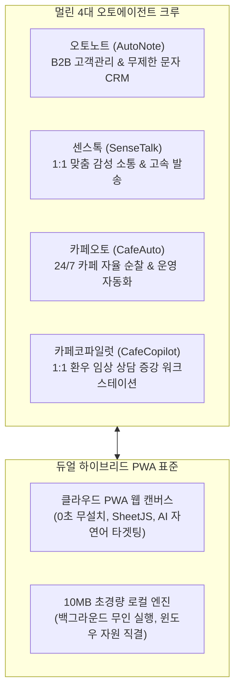

# 🚀 멀린 패밀리 앱 출시 라인업 및 2026년 9월 로드맵

> **"하나의 서비스 앱에는 반드시 하나의 전용 오토마케팅 앱이 페어링되어 함께 출격한다."**

본 문서는 멀린 패밀리 OS 생태계의 전체 앱 출시 순서, 앱별 특성, 2026년 9월 상세 스케줄, 재화 체계 및 런칭 전략을 정의한 공식 마스터 문서입니다.

---

## 🎯 1. 비즈니스 철칙: [1App + 1Auto-Marketer Pairing]

- **페어링 원칙**: 모든 서비스 앱은 단독으로 런칭되지 않으며, 각 앱에 특화된 전용 **오토마케팅 앱(쇼츠 자동화, 맘카페/커뮤니티 봇 등)**이 페어링되어 출시된다.
- **역할 경계 원칙**: 
  - 오토마케팅 봇과 도구는 개별 앱마다 고유성과 타겟이 매우 강하므로, **멀린님과 개별앱 AI가 개별 프로젝트 내에서 완전히 구축**한다.
  - 허브는 오토마케팅을 공통 프레임워크로 다루지 않으며, 개별앱과 마케터 구축이 끝난 후 런칭 직전 **[SDK 6대 모듈 + 보안/세션 + 검색엔진 SEO 검수]**의 마무리 총점검을 전담한다.

---

## 📅 2. 2026년 9월 릴리즈 타임라인 (핵심 스케줄)

```
┌────────────────────────────────────────────────────────────────────────┐
│ [8월 29일 ~ 9월 초]                                                    │
│ ☀️ 1호 썬드리머 (SunDreamer) MVP 릴리즈                                │
│  - 오프라인 환우 5천 DB 및 2개 전문 카페 대상 순차 가입 & 5,000P 지급  │
│  - 램프 수명 계산기(LampCheck), 치유일기, 30개 카페 후기 연동          │
├────────────────────────────────────────────────────────────────────────┤
│ [9월 1주 ~ 2주차]                                                      │
│ 🎬 2호 리얼픽 (RealPick) 무회원 초경량 출격                             │
│  - 애드센스 승인 즉시 런칭                                             │
│  - 쇼츠 자동화 + 맘카페 반자동 마케터 가동 (대중 트래픽/광고수익 극대화) │
├────────────────────────────────────────────────────────────────────────┤
│ [9월 중순]                                                             │
│ 🛡️ 썬드리머 & 리얼픽 2개 앱 집중 안정화 기간                           │
│  - 독립적 타겟층에서 각 앱의 기능/트래픽/광고 안정화에 집중            │
├────────────────────────────────────────────────────────────────────────┤
│ [9월 말]                                                               │
│ 🍽️ 3호 뭐먹지? (WhatEat) 출격 & 패밀리 허브 대통합 페스티벌 🎉         │
│  - 전국민 식사 추천/공유 앱 '뭐먹지?' 정식 오픈                         │
│  - 헤더 [ Ⓕ ] 스위처 및 [썬드리머 × 리얼픽 × 뭐먹지] 크로스 이벤트 공지 │
└────────────────────────────────────────────────────────────────────────┘
```

---

## 📱 3. 앱별 상세 스펙 및 런칭 전략

### 🥇 1호 앱: 썬드리머 (SunDreamer)
- **출시 일정**: 8월 말 순차 오픈 ➡️ 9월 초 공식 발표 및 5,000P 이벤트
- **배경 & 타겟**: 
  - 11년간 네이버에서만 직접 운영 중인 **2개 전문 질환 카페(2.5만 명 회원, '비타민D자외선요법' & '화폐상습진' 카페)**
  - **썬드림주식회사**의 자외선조사기('썬드림' 여러 모델) 구매 고객 관리 프로그램 **'루미노트'의 5천여 실구매자 11년 DB** 기반.
- **물리적 디렉토리 구조 (🚨 절대 혼동 금지)**:
  - **루트 (`D:\LumiNote\`)**: 멀린님/스탭 전용 5천 고객 관리 본진 CRM 프로그램 (`docs/기능명세서.md`)
  - **하위 (`D:\LumiNote\sundream\`)**: 일반 구매자 회원들이 접속하는 1호 회원용 PWA 웹앱 (`sundream/docs/기능명세.md`)
- **핵심 기능**:
  - 허브 이메일 OTP 본인인증으로 치료/구매 현황 확인
  - 1,600시간 램프 수명/조사시간 계산기 (`LampCheck`)
  - 자외선 조사기 치유 기록 타임라인 및 30개 카페 치유 후기 바로가기 배너
  - **프리미엄 독립 스토어 & 포인트 즉시 할인 주문 (완료)**: 스마트스토어 8대 실물 제품 라인업, 포인트 결제 시뮬레이터 및 CJ대한통운 안심 출고
- **쇼핑몰 세팅 이후 3대 핵심 플랜**:
  1. **썬드리머 SEO 전면 고도화**: 네이버/구글 서치콘솔 등록, 30개 질환별 메타태그 및 Schema.org 구조화 데이터 장착.
  2. **기존 `sun-dream.co.kr` 회사 공식 홈페이지 역할 완전 흡수**: 11년 썬드림 역사, 식약처 의료기기 인증/특허, 비타민D 자외선요법 원리 등 공식 브랜드 홈으로 통합.
  3. **카페24 호스팅/도메인 총정리 & 301 자동 포워딩**: 카페24 유료 호스팅 해지(비용 ZERO화), `sun-dream.co.kr` 잔여 수명 동안 `sundreamer.app`으로 301 포워딩 유지 후 자연 소멸.
- **재화 체계**:
  - 코인 없음 (`family_apps.is_paid = FALSE`)
  - 오프라인 실구매 회원을 위한 자체 **'포인트 제도 (5,000P)'** 별도 운영 (가입/추천 시 포인트 적립)
- **오토마케팅**: 카페 홍보용 쇼츠 자동화 시스템 가동 중 (개별앱 자체 구축).

---

### 🥈 2호 앱: 리얼픽 (RealPick)
- **출시 일정**: 구글 애드센스 승인 완료 즉시 정식 출시 (9월 초 예상)
- **성격 & 타겟**: 연애 리얼리티 방송('나는 솔로', '하트시그널' 등) 시청비서 서비스 (애드센스 광고 수익화 중심).
- **연동 플로우**:
  - **초기 MVP**: 허브 로그인 없이 **독립/무회원(Guest) 형태**로 선출시하여 진입장벽을 제로로 만들고 트래픽 및 광고 수익 극대화.
  - **차후 고도화 (9월 말 이후)**: 서비스 안정화 단계에서 허브 이메일 OTP 로그인 및 비회원 데이터 마이그레이션(투표/시청 기록 이관) 순차 적용.
- **오토마케팅**: 쇼츠 자동화 봇 + 맘카페 반자동 댓글달기 마케터 완성 단계 (개별앱 자체 구축).

---

### 🥉 3호 앱: 뭐먹지? (WhatEat)
- **출시 일정**: 9월 말 정식 출시
- **성격**: 메뉴 추천 및 가족 식탁 공유 라이프스타일 앱 (`is_paid = FALSE`, 무료 생활밀착형).
- **연동 현황**: 허브 SDK 1부 및 기초 연동 완료 상태.
- **출시 플로우**: 
  - 마지막 기능 구축 완료 후, **허브 전담 AI가 인프라, UI/UX, 세션 연동 및 SEO를 최종 총점검**한 뒤 9월 말 런칭.
  - 이 시점에 **멀린 패밀리 1~3호 앱 크로스 통합 프로모션** 전격 가동.

---

### 🎖️ 4호 이후 순차 출격 대기 라인업
1. **Bes2**: AI 사진 비서 서비스 (실측 AI 원가 기반 기간제 패스)
2. **볼트 (Vaulter / 금고지기)**:
   - 보안 데이터 및 디지털 자산 보관소
   - 유료 코인형 (`is_paid = TRUE`), Netlify Blobs 기반 버퍼링 누적 정산 세션
3. **어그로필터 (AggroFilter)**:
   - 유튜브 영상 어그로 및 팩트 신뢰도 AI 정밀 분석
   - 유료 코인형 (`is_paid = TRUE`), **일괄 50C 단일가 (결제 유저는 당일 전체 광고 제거) + 채널 소유자 재분석 1,000C 고정**
4. **오토노트 (AutoNote / 마케팅몬스터)**:
   - 엑셀 업로드 기반 B2B AI 스마트 CRM + 스마트폰 무제한 문자발송 하이브리드 솔루션
   - **트로이 목마형 CRM 이관 전략**: 자연어 고객 검색 + 1클릭 LumiSender 발송 대행으로 유입 ➔ 클라우드 DB 안전 축적 ➔ 구식 타사 CRM(월 3~5만원) 완전 대체
   - 유료 코인형 (`is_paid = TRUE`), 무료 체험(고객 300명) + 프로 부스터(월 코인 정기 구독)
   - **하이브리드 아키텍처**: 클라우드 PWA(웹 캔버스 & SheetJS 엑셀 파서) + 10MB 초경량 로컬 러너(윈도우 '휴대폰과 연결' 자동 발송 대행)
5. **노스트라 예언법정 (NostraCourt)**:
   - AI 기반 미래 예측, 예언 및 법정 판결 분석 플랫폼 (글로벌 확장형 괴물 앱)
   - 유료 고액 코인형 (`is_paid = TRUE`), 1,000C / 2,000C / 3,000C 티어별 정액 차감
6. 기타 후속 패밀리 앱 순차 출격 대기 중

---

## 🤖 4. 멀린 4대 오토에이전트 (AutoAgent) 크루 라인업 & 하이브리드 아키텍처

> **"클라우드 PWA 웹 캔버스(두뇌/관제탑) + 10MB 초경량 로컬 엔진(손발/실행체)"**  
> 일반 서비스 앱과 달리, 사용자 PC의 윈도우 OS 자원(휴대폰과 연결, 브라우저 자동화 등)과 결합하여 운영·마케팅·소통·상담을 초고속 자동화하는 특수 목적형 4대 하이브리드 에이전트 라인업입니다.



### 1. 📊 오토노트 (AutoNote) - [B2B 고객관리 & 무제한 문자 오토에이전트]
- **물리적 위치**: `D:\AutoNote` (웹: `LumiNote/autonote`, Netlify: `autonote.sundreamer.app`)
- **간단 정의**: **"엑셀 연동 AI 자연어 타겟팅 CRM + 스마트폰 무제한 무료 문자발송 하이브리드 에이전트"**
- **핵심 역할**: 기존 엑셀/CSV 데이터를 드래그앤드롭하면, AI가 다중 시트를 자동 분석하여 자연어 질의(예: "서울 사는 30대 중 6개월간 재구매 없는 고객")로 타겟을 정밀 추출하고, 10MB 로컬 러너로 스마트폰 무제한 문자를 무료 발송하는 독립 B2B SaaS 솔루션 (타사 월 3~5만원 CRM 완전 대체).

### 2. 💬 센스톡 (SenseTalk) - [1:1 맞춤 감성 소통 & 고속 발송 오토에이전트]
- **물리적 위치**: `D:\SensTalk` (Netlify: `sensetalk.netlify.app`)
- **간단 정의**: **"무설치 1:1 맞춤 감성 메시지 자동화 & 블록 조립 발송 하이브리드 에이전트"**
- **핵심 역할**: 기계적인 단체 공지를 파괴하고, 수신자별 이름·직책·동적 변수를 조합하여 카카오톡·텔레그램·SMS로 초고속 1:1 맞춤 메시지를 전송. 엑셀 수신자 관리 + 카톡 실시간 미리보기 + 키보드(ASDF) 초압축 단축키 및 로컬 발송 엔진이 결합된 소통 가속 도구 (썬드리머 5천 회원 전담 및 일반 영업/커뮤니티 확장).

### 3. 🛡️ 카페오토 (CafeAuto) - [네이버 카페 24/7 자율 순찰 & 운영 자동화 오토에이전트]
- **물리적 위치**: `D:\CafeAuto`
- **간단 정의**: **"대한민국 네이버 카페 매니저를 위한 24시간 자율 순찰 및 운영 자동화 인프라"**
- **핵심 역할**: 24시간 365일 실시간 순찰 & 자연어 정책 필터링(운영진 비방, 회원 저격, 은밀한 우회 홍보 감지 및 텔레그램 1초 원클릭 삭제), 등업 자동 심사 대기열, 가입인사 맞춤 환영 댓글러, 이벤트 자동 집계기 등 **카페 매니저의 단순 운영 노가다를 100% 무인화**.

### 4. 🩺 카페코파일럿 (CafeCopilot) - [1:1 환우 임상 상담 증강 워크스테이션 오토에이전트]
- **물리적 위치**: `D:\CafeCopilot` (포트: `8944`)
- **간단 정의**: **"네이버 카페 매니저/전문가를 위한 1:1 환우 임상 상담 증강 워크스테이션"**
- **핵심 역할**: 14대 난치성 피부질환 메타치유가이드 브레인 + 오늘 일기 3줄 핀포인트 사전 차트 브리핑 + 비서 지니(Genie) 0.01초 팩트 문답을 탑재하여, 전문가 매니저가 환우의 지난 치유 히스토리와 핵심 인과관계를 0.5초 만에 파악하고 완벽한 맞춤 치유 솔루션을 상담·코칭할 수 있도록 지능을 증강하는 워크스테이션.

---

## 🏛️ 5. 허브 총괄 관리자(AI)의 3대 런칭 전수 검수 의무
1. **SDK 6대 인프라 검증**: Auth, Session, Wallet, Referral, Notification, Ads/UI 표준 규격 충족 여부.
2. **보안 & 세션 안정성**: SSOT UUID 매핑, 30일 롤링 세션, Keep-Alive 핑 등록.
3. **네이버/구글 SEO 무결성**: `sitemap.xml`, `robots.txt`, 소유권 메타태그, 패스트트랙 색인 대기열 등록.
4. **365일 무인 자동 백업**: GitHub Actions 기반 일일 전수 백업(`.github/workflows/daily-db-backup.yml`) 파이프라인 탑재 여부.
