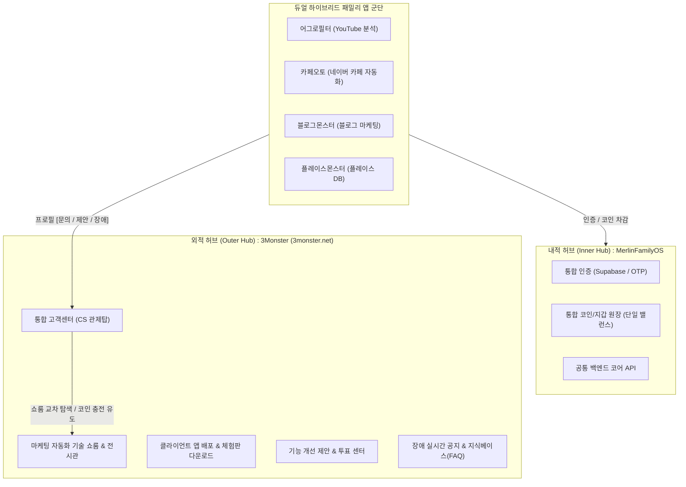

# 🏛️ 3Monster 외적 허브(Outer Hub) 통합 CS & 피드백 아키텍처 명세서

- **문서 번호**: 3M-ARCH-002
- **버전**: v1.0
- **작성 일자**: 2026-10-14
- **관리 주체**: 3Monster 총괄 아키텍트 & Hub AI (Google DeepMind Antigravity)

---

## 1. 아키텍처 개요 및 듀얼 허브 분조 체계 (Dual Hub System)

멀린패밀리 생태계는 시스템의 안정성과 운영 효율을 극대화하기 위해 **내적 허브(Inner Hub)**와 **외적 허브(Outer Hub)**로 역할을 명확히 분리하여 운영한다.



| 구분 | 주관 시스템 | 핵심 역할 | 도메인 |
| :--- | :--- | :--- | :--- |
| **내적 허브 (Inner Hub)** | **MerlinFamilyOS** | 회원 인증, 통합 코인 지갑, 백엔드 API, PG 결제 트랜잭션 | `api.sundreamer.app` 등 백엔드 |
| **외적 허브 (Outer Hub)** | **3Monster** | **기술 쇼룸, 제품 전시/배포, 통합 CS 및 장애 신고, 기능 제안** | `https://3monster.net` |

---

## 2. 듀얼 하이브리드(Dual-Hybrid) 앱 구조와 외적 허브의 필연성

### 2.1. 듀얼 하이브리드 아키텍처의 기술적 특수성
* 모든 몬스터 패밀리 앱은 **웹(클라우드 제어) + 로컬 PC(크롤링/자동화 고성능 엔진)**이 결합된 '듀얼 하이브리드' 아키텍처로 구동된다.
* 포털 사이트(네이버, 유튜브 등)의 DOM UI 변경, 봇 탐지 정책 변경, IP 차단, Chrome 드라이버 버전 충돌, Windows 권한 문제 등 **외부 환경 변화에 의한 기술적 장애 이슈가 필연적으로 발생**한다.

### 2.2. 외적 허브 집결의 4대 핵심 가치
1. **1인/소수 정예 운영 효율 극대화 (CS 분산 원천 차단)**:
   * 개별 앱마다 고객센터 게시판/카톡/이메일이 분산되면 유지보수 과부하로 개발이 마비된다.
   * 모든 채널을 **3Monster 단 1곳으로 깔때기(Funnel)처럼 집결**시켜 중앙에서 일괄 처리한다.
2. **동일 장애 중복 문의 방어 (Hotfix 공지 & 집단 지성)**:
   * 특정 유저가 겪는 네이버 패치 장애는 곧 모든 유저에게 발생하는 '공통 이슈'이다.
   * 3Monster 고객센터의 [실시간 장애 공지]와 [FAQ]를 통해 핫픽스 패치 일정을 공지함으로써, **수십 통의 중복 문의 인입을 사전에 95% 이상 방어**한다.
3. **문의 방문자의 교차 판매(Cross-Selling) 전환**:
   * 어그로필터나 카페오토 문의차 3Monster에 접속한 유저가 기술 쇼룸의 다른 앱(마케팅/플레이스 몬스터)을 자연스럽게 발견한다.
   * "이미 보유한 패밀리 코인으로 즉시 사용 가능"함을 인지하여 **타 서비스 추가 이용으로 직결되는 락인(Lock-in) 선순환**을 창출한다.
4. **제품 개발 로드맵 데이터 자산화**:
   * '개선 제안' 게시판을 통해 실제 유저들이 갈증을 느끼는 핵심 기능을 수집하고, 추천(좋아요) 수를 바탕으로 다음 버전 업데이트의 절대적 기준을 수립한다.

---

## 3. 전 패밀리 앱 공통 프로필 메뉴 연동 규격

모든 패밀리 앱(웹 및 클라이언트 UI)은 상단 헤더의 **유저 프로필 드롭다운**에 통일된 외적 허브 진입점을 탑재한다.

### 3.1. 프로필 드롭다운 표준 레이아웃
```text
┌──────────────────────────────────────┐
│  👤 홍길동 (test@naver.com)         │
│  🪙 보유 코인: 15,200 C [충전소]     │
├──────────────────────────────────────┤
│  ⚙️ 내 계정 설정 / 라이선스         │
│  🚨 장애 신고 & 1:1 문의             │ ──▶ 3Monster 통합 고객센터 직결
│  💡 기능 개선 제안                   │ ──▶ 3Monster 제안 센터 직결
│  📚 이용 가이드 & FAQ                │ ──▶ 3Monster FAQ 직결
├──────────────────────────────────────┤
│  🚪 로그아웃                         │
└──────────────────────────────────────┘
```

---

## 4. 스마트 컨텍스트 연동 프로토콜 (Smart Context Protocol)

유저가 앱에서 [문의하기] 또는 [장애 신고]를 클릭했을 때, 유저가 앱 이름이나 버전을 수동으로 적는 번거로움을 제거하기 위해 **URL 파라미터 자동 바인딩 규격**을 준수한다.

### 4.1. 호출 URL 표준 파라미터
```text
https://3monster.net/support?app_id={APP_ID}&app_ver={VERSION}&category={CATEGORY}&user_id={USER_ID}&platform={OS}
```

* `app_id`: 앱 고유 식별자 (`aggrofilter`, `cafe_monster`, `blog_monster`, `place_monster` 등)
* `app_ver`: 현재 클라이언트 버전 (예: `1.0.2`)
* `category`: 문의 분류 (`bug`: 장애신고, `feature`: 개선제안, `inquiry`: 일반문의)
* `user_id`: 사용자 고유 식별자 (선택)
* `platform`: OS 정보 (`win11_x64`, `web` 등)

### 4.2. 3Monster 고객센터 폼 자동 바인딩
* 3Monster 접수 화면은 파라미터를 읽어 **[대상 프로그램: 카페 몬스터 v1.0.2 / Windows 11]** 배지를 폼 최상단에 자동으로 마운트한다.
* 관리자(멀린님)는 유저에게 환경을 재차 묻지 않고도 즉시 원인 파악 및 디버깅에 착수할 수 있다.

---

## 5. 3Monster 통합 CS 3대 트랙 운용

1. **트랙 A: 🚨 장애 / 버그 신고 (Urgent Bug Report)**
   * 에러 발생 시각, 로컬 로그 파일(`app_debug.log`) 첨부, 화면 캡처 업로드 지원.
   * 동일 증상 접수 시 "동일 장애 조사 중 (예상 해결 시간 안내)" 배너 자동 노출.
2. **트랙 B: 💡 기능 개선 제안 (Feature Request & Upvote)**
   * "이런 기능이 있으면 좋겠어요" 아이디어 피드백 수렴.
   * 타 유저 추천(Upvote) 시스템을 두어 가장 반응이 뜨거운 제안을 우선 개발 로드맵에 배정.
3. **트랙 C: ❓ 이용 문의 & 인터랙티브 FAQ**
   * 라이선스 인증 실패, 프록시 설정, 네이버 로그인 2차 인증 등 빈출 질문을 검색형 아코디언 UI로 즉시 해결.

---

## 6. 개발 및 반영 체크리스트

- [x] 외적 허브(3Monster) 통합 CS 아키텍처 수립 및 문서화 (`3M-ARCH-002`)
- [ ] `MerlinFamilyOS` SDK 공용 Header / Profile 드롭다운 컴포넌트에 3Monster 고객지원 링크 탑재
- [ ] 3Monster 대시보드 내 `support` 라우트의 스마트 파라미터(`app_id`, `app_ver`) 자동 파싱 처리
- [ ] 개별 앱(어그로필터, 카페오토 등) 빌드 시 최신 Hub SDK 적용
