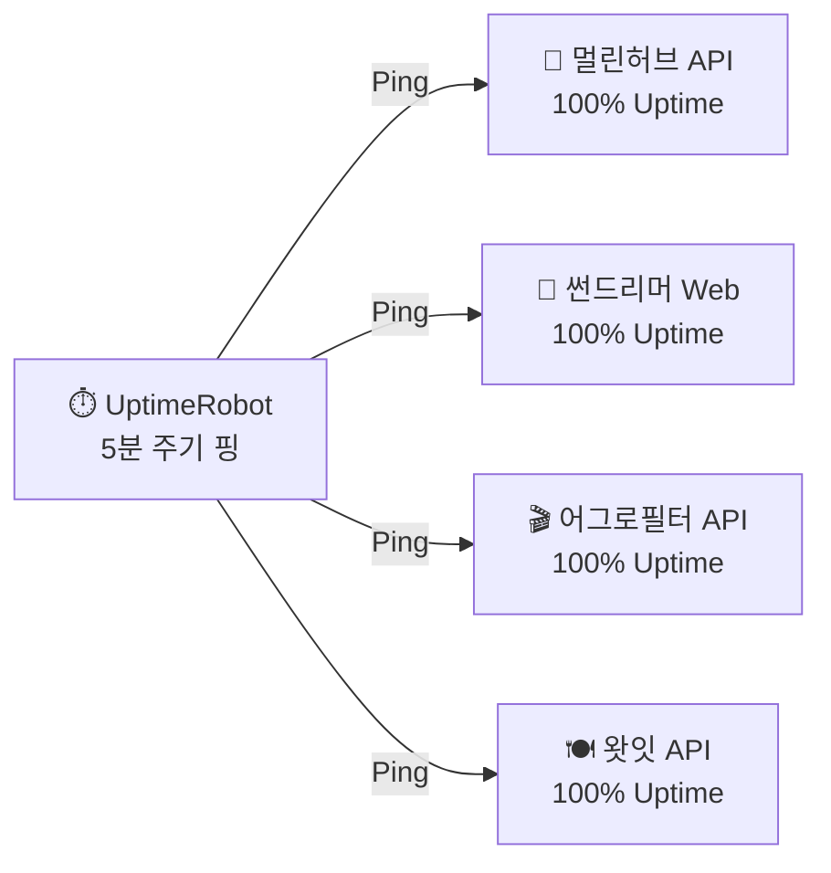

# 🏛️ 멀린 패밀리 인프라 구독 및 모니터링 현황 (Infrastructure & Monitoring Ledger)

본 문서는 멀린 패밀리 생태계의 모든 프론트엔드 호스팅, 백엔드 서버, 데이터베이스(Supabase) 구독 플랜 및 24시간 무중단 가동을 위한 **UptimeRobot 5분 핑(Keep-Alive) 모니터링 현황**을 통제하는 공식 장부입니다.

---

## 💳 1. 플랫폼별 구독 플랜 및 리소스 현황

| 플랫폼 (Platform) | 역할 및 대상 (Role) | 현재 구독 플랜 | 월 비용 | 현재 리소스 사용량 및 사양 | 인프라 평가 및 안전성 |
| :--- | :--- | :---: | :---: | :--- | :--- |
| **🌐 Netlify** | 프론트엔드 호스팅 (썬드리머, 어그로필터 등) | **Pro** | **$19 /월** | • 대역폭: 월 1TB 제공 • 동시 빌드: 3개 지원 • 글로벌 CDN 배포 | **무적 (100% 안전)** 월 400만~500만 페이지뷰 트래픽도 끄떡없이 완벽 방어 |
| **🚀 Render** | 허브 백엔드 서버 (`MerlinFamilyOS`, 룰렛) | **Hobby** | **$0 /월** | • 무료 시간: 267h / 750h (35%) • 대역폭: 1GB / 5GB • UptimeRobot 핑 연동 | **안정적 가동 중** 5분 핑으로 절전(Sleep) 및 콜드스타트 완벽 방어 |
| **🗄️ Supabase (해드림)** | 루미노트/썬드리머 DB (`ngoxwvvyuogpqsbfzleh`) | **Free** | **$0 /월** | • DB 용량: **38 MB / 500 MB (8%)** • Egress: 3 MB / 5 GB (<1%) • 실 서비스 테이블: 10 MB | **초특급 다이어트 완료 (🟢)** `cafe_posts` 삭제로 906MB(181%) ➔ 38MB(8%) 정상화 |
| **🗄️ Supabase (sundream)**| 허브 SSOT 공용 DB (`wwopcuitvjldixkyzpzi`) | **Free** | **$0 /월** | • DB 용량: **29 MB / 500 MB (5.8%)** • Egress: 39 MB / 5 GB (<1%) • 리전: `ap-northeast-1` (도쿄) | **초특급 건강 상태 (🟢)** 패밀리 공통 회원(family_users) 및 인증/재화 전담 |
| **🖋️ MS Artifact Signing** | Windows 공인 코드 서명 (루미노트, 오토노트 등) | **Basic** | **$9.99 /월** | • 월 5,000건 공인 서명 • SmartScreen 경고 제거 • 리전: `Korea Central` | **구축 완료 (🟢)** 썬드림주식회사 법인/여권 AU10TIX 검증 완료 |
| **⏱️ UptimeRobot** | 24시간 슬립 방지 핑 및 가동률(Uptime) 감시 | **Free** | **$0 /월** | • 등록 모니터: 4개 / 50개 • 가동률: **100% Uptime** • 주기: 5분 간격 HTTP 핑 | **4대 핵심 인프라 상시 가동 보장** |

> **💵 현재 월 총 인프라 비용**: **$28.99 USD /월** (약 39,000원, Netlify $19 + MS Signing $9.99)

---

## 📡 2. UptimeRobot 5분 핑 (Keep-Alive) 등록 현황

렌더(Render) 무료 플랜의 **15분 미접속 시 절전(Sleep) 및 콜드 스타트 지연(15~30초)을 원천 차단**하고, 24시간 상시 깨어있는 1초 즉각 응답 상태를 유지하기 위한 4대 모니터링 목록입니다.

### [실시간 4대 모니터 상세]
1. **👑 멀린허브 API**:
   - **대상**: `MerlinFamilyOS` 렌더 백엔드 API
   - **주기 & 가동률**: 5분 주기 핑 / **8일 23시간 연속 100% Uptime (무중단)**
2. **📱 썬드리머 Web**:
   - **대상**: `https://sundreamer.app` 넷리파이 웹앱
   - **주기 & 가동률**: 5분 주기 핑 / **6일 12시간 연속 100% Uptime**
3. **🎬 어그로필터 API**:
   - **대상**: `AggroFilter` 렌더 백엔드 API
   - **주기 & 가동률**: 5분 주기 핑 / **8일 15시간 연속 100% Uptime**
4. **🍽️ 왓잇 API**:
   - **대상**: `WhatEat` 렌더 백엔드 API
   - **주기 & 가동률**: 5분 주기 핑 / **8일 22시간 연속 100% Uptime**

---

## 🚀 3. 인프라 스케일업 및 운영 가이드

### 1) 현재 MVP 런칭 단계 (완벽)
- 월 $19 비용으로 모든 앱의 프론트엔드, 백엔드, DB가 최고 수준의 안정성으로 가동됩니다.
- 수파베이스 용량 다이어트(38MB) 및 5분 핑 체계로 장애 요인이 완벽히 제거되었습니다.

### 2) 9월 초 정식 발표 & 트래픽 대량 유입 시
- 동시 접속자 수천 명이 한꺼번에 유입될 경우 다음 순서로 원클릭 스케일업을 고려합니다:
  1. **Render (`MerlinFamilyOS`)**: **Starter ($7/월)** 전환 ➔ 0.5 vCPU + 512MB RAM 전용 자원 할당.
  2. **Supabase (해드림)**: **Pro ($25/월)** 전환 ➔ 기본 용량 8GB 제공 및 DB 커넥션 풀 확장.
  3. **Netlify**: 현재의 **Pro ($19/월)** 그대로 유지 (1TB 대역폭으로 트래픽 충분).
