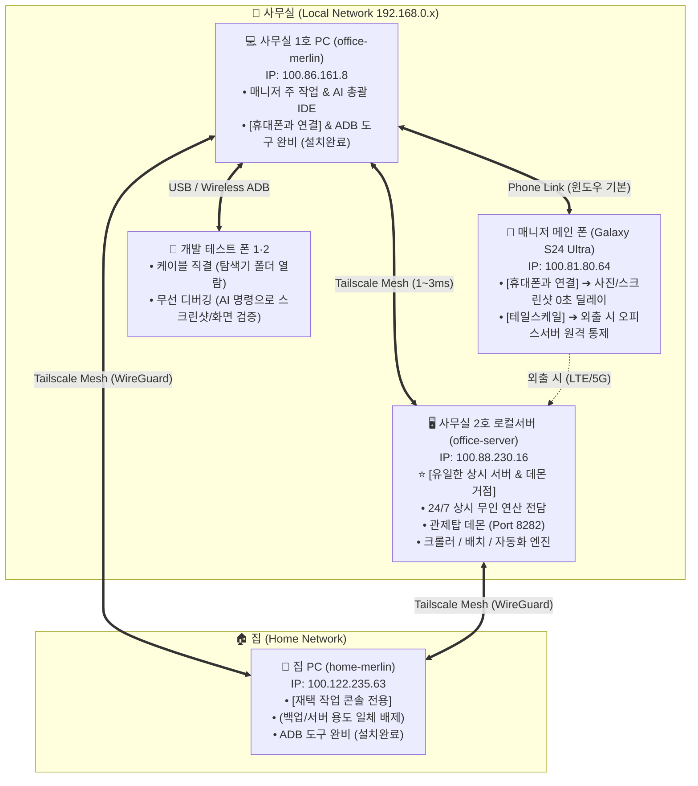

# 🌐 [멀린 유니버스] 테일스케일 & 원격 인프라 통제 표준 가이드북
> **"단 하나의 안전한 가상 사설망(Tailscale)으로 사무실 1·2호 PC, 집 서버, 모바일을 하나로 묶어 무인 24시간 자율 생태계를 실현한다."**

---

## 🏛️ 1. 생태계 인프라 토폴로지 (Ecosystem Topology)

멀린 유니버스는 4대 거점 노드가 단일 테일넷(`chiuking369@gmail.com`) 위에서 종단간 암호화(WireGuard)로 1~3ms 초고속 직결되어 있습니다.



---

## 📌 2. 노드별 역할 및 통제 표준 (SSOT)

> 🚨 **[서버 단일 고정 대원칙]**:  
> **멀린 유니버스의 상시 로컬서버 및 24시간 데몬 가동 거점은 오직 '사무실 2호 로컬서버(`office-server`)' 단 1대뿐입니다.**  
> 집 PC(`100.122.235.63`)는 야간 DR 백업이나 서버 용도로 일체 사용하지 않으며, 순수 재택 작업 콘솔로만 운영합니다.

| 노드 명칭 | Tailscale IP | 핵심 통제 및 사용 수칙 | ADB 도구 설치 상태 |
| :--- | :---: | :--- | :---: |
| **사무실 1호 PC**<br>(`office-merlin`) | `100.86.161.8` | **[Tier 1 마스터 콘솔]**<br>- 매니저 주 작업 및 Antigravity IDE 총괄 실행.<br>- 무선 디버깅 도구(ADB) 완비로 모바일 기기 일괄 통제. | ✅ **설치 완료**<br>(v37.0.1) |
| **사무실 2호 서버**<br>(`office-server`) | `100.88.230.16` | **[Tier 2 유일한 로컬서버 & 데몬 거점]**<br>- **생태계 내 유일한 24시간 연산 서버로 영구 고정.**<br>- MerlinSecretary (멀린비서) 관제탑 데몬 (Port `8282`) 365일 무중단 상주.<br>- CafeBreaker 쇼츠 영상 자동 렌더링/업로더 데몬 상시 구동.<br>- RealPick 텔레그램 수집 & 파이프라인 데몬 상시 구동. | - |
| **집 PC**<br>(`home-merlin`) | `100.122.235.63` | **[Tier 3 재택 작업 콘솔]**<br>- **서버 및 야간 DR 백업 거점으로 절대 사용 안 함 (서버는 오피스서버 단일 고정).**<br>- 퇴근 후 집에서의 재택 작업 및 원격 마스터 작업 콘솔 전용.<br>- 무선 디버깅 도구(ADB) 완비로 모바일 기기 일괄 통제. | ✅ **설치 완료**<br>(v37.0.1) |
| **매니저 메인 폰**<br>(`s24-ultra`) | `100.81.80.64` | **[Edge 모바일]**<br>1. **평소 사진/스크린샷**: 윈도우 기본 탑재 **[휴대폰과 연결]** 앱 활용 (마이박스 클라우드 대기시간 제로, 마우스 드래그 앤 드롭).<br>2. **테일스케일 용도**: 평소엔 꺼두고, **외출(LTE/5G) 시 외부에서 사무실 2호 서버(`100.88.230.16:8282`) 관제탑을 통제할 때만 ON**. | - |
| **개발 테스트 폰 1·2**<br>(`dev-phones`) | 동적 IP | **[Dev 실기기 테스트베드]**<br>1. **탐색기로 폴더 넓게 볼 때**: USB 케이블 직결 (꽂자마자 탐색기 드라이브 열람).<br>2. **선 없이 원격 제어할 때**: **무선 디버깅(ADB)** 상태 유지 ➔ AI 에이전트에게 "개발폰 스크린샷 가져와", "개발폰에 PWA 화면 띄워" 명령으로 0초 추출 및 화면 검증. | - |

---

## ⚡ 3. 실전 운용 3대 헌법

### 헌법 1: 서버는 오피스서버 단일 고정 & 24시간 연산 전담 위임
* **집 PC는 서버나 백업 거점으로 두지 않으며, 모든 로컬서버와 24시간 데몬(CafeBreaker, RealPick, MerlinSecretary)을 가동하는 곳은 오직 사무실 2호 로컬서버(`100.88.230.16`)로 단일 고정한다.**
* 1호 PC나 집 PC에서 AI IDE를 3~4개씩 띄워도 시스템이 뻗지 않도록, 무거운 24시간 백그라운드 연산은 2호 로컬서버에서만 격리 구동한다.
* 모든 PC와 스마트폰은 브라우저로 `http://office-server:8282/dashboard` (멀린비서 관제탑) 등에 접속하여 원격 관제한다.

### 헌법 2: 메인 폰 사진은 [휴대폰과 연결]로 단일화
* 네이버 마이박스나 원드라이브의 느린 클라우드 업로드/다운로드 딜레이를 겪지 않고, 윈도우 공식 **[휴대폰과 연결]** 앱으로 마우스 드래그 앤 드롭 0초 복사를 기본 표준으로 채택한다.
* 폰의 테일스케일 앱은 **외출 시 오피스 서버 통제용**으로만 목적을 제한한다.

### 헌법 3: 개발폰은 선 연결 또는 AI 무선 명령 대행
* 네이티브 앱(APK) 개발을 지양하고 100% PWA(웹앱) 생태계로 전환했으므로, 복잡한 앱 설치 없이:
  - 파일 열람은 USB 직결,
  - 화면 검증 및 스크린샷 수집은 AI의 무선 디버깅 1줄 명령(`adb shell / pull`)으로 대행 처리한다.

---

## 🛠️ 4. 집 PC (home-pc) ADB 세팅 가이드

집 PC에서 폰이나 개발폰을 무선으로 다루려면, 집 PC 터미널(PowerShell)에서 아래 한 줄을 실행하여 무선 디버깅 도구를 설치해야 합니다:

```cmd
winget install --id Google.PlatformTools -e --source winget --accept-source-agreements --accept-package-agreements
```
*(설치 소요 시간: 약 5초. 설치 후 집 PC에서도 사무실과 동일하게 무선 디버깅 기능 활성화 완료)*

---

## 🛠️ 5. 데몬 프로젝트별(CafeBreaker, RealPick 등) 오피스서버 운용 가이드

1. **카페브레이크 (CafeBreaker) - 24/7 쇼츠 자동 렌더링 & 업로더**:
   - **백그라운드 데몬**: 치유후기 1회원 1영상 원스톱 렌더링 + 유튜브 쇼츠 무인 자동 업로더 상시 구동
   - **운용 원칙**: 고부하 FFmpeg 영상 인코딩과 업로드 루프를 2호 서버에 전담시켜 작업용 PC의 리소스 점유와 발열을 원천 차단.

2. **리얼픽 (RealPick) - 텔레그램 수집 & 쇼츠 자동화 파이프라인**:
   - **백그라운드 데몬**: 실시간 텔레그램 채널 수집 및 쇼츠 파이프라인 자동화 데몬 상시 구동
   - **운용 원칙**: 24시간 끊김 없는 텔레그램 리스너와 쇼츠 제작 파이프라인을 2호 서버에 상주시켜 무인 자동화 실현.

3. **멀린비서 / 카페오토 (MerlinSecretary / CafeAuto) - 카페 관제탑 & 스마트에디터 ONE**:
   - **관제탑 데몬**: `cafe_daemon.py` (Port `8282`) ➔ 원격 접속: `http://office-server:8282/dashboard`
   - **운용 원칙**: 다중 PC 동시성 제어 큐(AutomationQueueManager) 보호 하에 11대 미션 및 스마트에디터 ONE 자동 임시등록 24시간 대기.

4. **PWA 모바일 반응형 검증**:
   - CafeMonster 등 모바일 PWA 개발 시 개발폰 2대에 무선으로 화면을 띄워 해상도별 UI 깨짐 여부를 동시 검증.

5. **⚡ [24/7 정전·재부팅 무인 자동복구 철칙: 전 프로젝트 데몬 시작프로그램 의무 등록]**:
   - 🚨 **배경**: 2호 서버가 정전이나 윈도우 자동 업데이트 등으로 재부팅되었을 때, 사람이 직접 로그인하거나 수동으로 창을 띄울 필요 없이 **모든 데몬이 100% 무인 자동 복구**되어야 합니다.
   - 📌 **모든 상시 연산 프로젝트의 필수 의무 규격**:
     1) **시작프로그램(Startup) 바로가기 등록**:  
        `%APPDATA%\Microsoft\Windows\Start Menu\Programs\Startup\` 폴더에 각 프로젝트의 데몬 실행 배치파일(`.bat`) 바로가기 등록 필수.  
        - 멀린비서: `[멀린비서] 데몬서버_부팅자동실행.lnk` (등록완료)  
        - 카페브레이크: `[카페브레이크] 데몬_부팅자동실행.lnk` (의무 등록)  
        - 리얼픽: `[리얼픽] 데몬_부팅자동실행.lnk` (의무 등록)  
     2) **윈도우 작업 스케줄러 (`schtasks`) 등록**:  
        사용자 로그온(`ONLOGON`) 또는 부팅 시(`ONSTART`) 백그라운드 자동 기동 및 비정상 종료 시 1분 내 자동 재시작(Auto-Restart) 트리거 설정 의무화.

---

## 🔑 6. 오피스 서버(2호기) SSH 무인증 원격 통제 표준 규격 (SSOT)

> 🚨 **[중요: Tailscale SSH vs Windows OpenSSH 팩트체크]**:  
> 테일스케일 공식 기술상 **윈도우 OS는 Tailscale 내장 SSH 서버 기능을 지원하지 않습니다** (`The Tailscale SSH server is not supported on windows`).  
> 따라서 2호 서버 본체에서 `tailscale up --ssh`를 실행할 필요가 전혀 없으며, 실행 시 오류가 발생합니다.  
> 대신 윈도우 순정 **OpenSSH Server + AI 무인 마스터키(`id_ai_master`)** 체계로 완벽하게 개통되어 있습니다.

### 1) 무인 마스터키 인프라 현황 & 노드별 실제 계정명 (SSOT)

> 🚨 **[노드별 윈도우 사용자 계정명 필수 숙지 (경로 착각 절대 방지)]**:  
> 각 PC마다 윈도우 로그인 계정명이 다르므로, 경로 안내 시 반드시 아래 표를 기준으로 해야 합니다.  
> 사무실 1호기 경로를 `C:\Users\WD` 등으로 잘못 안내하는 일이 없도록 주의합니다.

| 노드 명칭 | Tailscale IP | 윈도우 사용자 계정 | SSH 키 / 홈 디렉토리 경로 | 역할 |
| :--- | :---: | :---: | :--- | :---: |
| **사무실 1호기** (`office-merlin`) | `100.86.161.8` | **`chichi`** | `C:\Users\chichi\.ssh\id_ai_master` | 마스터키 발급 원본 |
| **사무실 2호기** (`office-server`) | `100.88.230.16` | **`sun-multi`** | `C:\Users\sun-multi\.ssh\authorized_keys` | 상시 서버 (포트 22 수신) |
| **사무실 3호기** (`office-design`) | `100.102.43.42` | **`chiuk`** | `C:\Users\chiuk\.ssh\authorized_keys` | 디자이너 PC (포트 22 수신) |
| **집 PC** (`home-merlin`) | `100.122.235.63` | **`WD`** | `C:\Users\WD\.ssh\id_ai_master` | 재택 마스터 콘솔 |

---

### 2) 타 프로젝트 및 재택(집 PC) 원격 명령 표준
어떤 프로젝트(사무실 1호기 또는 집 PC)에서든 2호 서버나 3호기를 원격 조작할 때는 아래 표준 커맨드를 사용합니다:

```bash
# 1. 2호 서버 원격 쉘 명령 실행 (비밀번호 없음, 0초 접속)
ssh -i ~/.ssh/id_ai_master sun-multi@office-server "<실행할 명령어>"

# 예: 2호 서버 프로세스 확인
ssh -i ~/.ssh/id_ai_master sun-multi@office-server "tasklist | findstr /i python"

# 예: 2호 서버 데몬 재시작 (작업 스케줄러)
ssh -i ~/.ssh/id_ai_master sun-multi@office-server "schtasks /run /tn CafeWriterDaemon"

# 2. 3호 디자이너 PC 원격 점검 (비밀번호 없음, 0초 접속)
ssh -i ~/.ssh/id_ai_master chiuk@office-design "hostname"

# 3. 파일 전송 (SCP)
scp -i ~/.ssh/id_ai_master <로컬파일> sun-multi@office-server:D:/Cafe_writer/<원격경로>
```

### 3) 집 PC(`home-merlin`)에 마스터키(`id_ai_master`) 배포하는 표준 (Taildrop)
Git에는 보안상 프라이빗 키가 절대 커밋되지 않으므로, 새 마스터 노드(집 PC 등)에 키를 안전하게 배포할 때는 테일스케일 종단간 암호화 전송(Taildrop)을 사용합니다:

- **[0초 테일스케일 Taildrop] (원격 자동 전송)**:
  1. 사무실 1호기 터미널에서 집 PC로 직접 파일 전송:
     ```bash
     tailscale file cp "C:\Users\chichi\.ssh\id_ai_master" home-merlin:
     ```
  2. 집 PC에서 수신된 파일을 `.ssh` 디렉토리로 이동:
     ```powershell
     tailscale file get --conflict=overwrite "$env:USERPROFILE\.ssh"
     ```

---

## 🛡️ 7. 윈도우 인프라 세팅 시 '관리자 권한(Run as Administrator)' 철칙

> 🚨 **[자주 발생하는 오류 팩트체크]**:  
> 일반 사용자로 실행된 PowerShell 창에서 `Add-WindowsCapability`, `Start-Service`, `Set-Service`, `sc delete`, `tailscale up` 등을 실행하면  
> 붉은 글씨로 **`"요청한 작업을 수행하려면 권한 상승이 필요합니다"`** 또는 **`"서비스를 찾을 수 없습니다"`** 에러가 100% 발생합니다.  
> 시스템 서비스, 방화벽, 포트, 원격 기능을 건드리는 모든 인프라 명령어는 반드시 **[관리자: Windows PowerShell]**에서 실행해야 합니다.

### ⚡ 1초 만에 관리자 권한 여는 2대 공식 단축키
1. **[마우스 1초] 윈도우 시작 버튼 우클릭**:  
   화면 좌측 하단 시작 로고 우클릭 ➔ **`[Windows PowerShell(관리자)]`** 또는 **`[터미널(관리자)]`** 클릭! (키보드: `Win + X` 누른 후 `A`).
2. **[키보드 1초] 단축키 실행**:  
   `Win 키` ➔ `powershell` 타이핑 ➔ **`Ctrl + Shift + Enter`** (또는 우측 '관리자 권한으로 실행' 클릭).
   * 파란 창 맨 위 타이틀바에 **`관리자: Windows PowerShell`**이라고 떠 있어야 정상입니다.

---

## 🎨 8. 오피스 디자이너 PC (3호기, office-design) 인프라 규격

- **노드 명칭**: `office-design`
- **Tailscale IP**: `100.102.43.42`
- **계정**: `chiuk` (`C:\Users\chiuk`)
- **OS 에디션**: Windows 10 Home (윈도우 순정 RDP 미지원)
- **원격 접속 표준**:
  1. **GUI 화면 원격 (사람용)**: **Chrome 원격 데스크톱** (`remotedesktop.google.com/access`, 구글 계정 연동)
  2. **AI 및 백그라운드 원격 (기계용)**: **OpenSSH Server** (포트 22) + Tailscale Mesh
- **OpenSSH 설치/기동 1줄 명령어 (반드시 관리자 권한 PowerShell)**:
  ```powershell
  Add-WindowsCapability -Online -Name OpenSSH.Server~~~~0.0.1.0; Start-Service sshd; Set-Service -Name sshd -StartupType 'Automatic'
  ```

---

### 📜 보존 및 문서 위치
- **멀린허브 공식 SSOT**: `D:\MerlinFamilyOS\허브_라이브러리\테일스케일_원격_인프라_통제_표준.md`
- **MerlinSecretary 참조본**: `D:\MerlinSecretary\docs\TAILSCALE_REMOTE_INFRASTRUCTURE_GUIDE.md`
- **최종 개정일**: 2026-10-14 (v1.4.0, 관리자 권한 필수 가이드 및 3호기 디자이너 PC 인프라 표준 신설)

